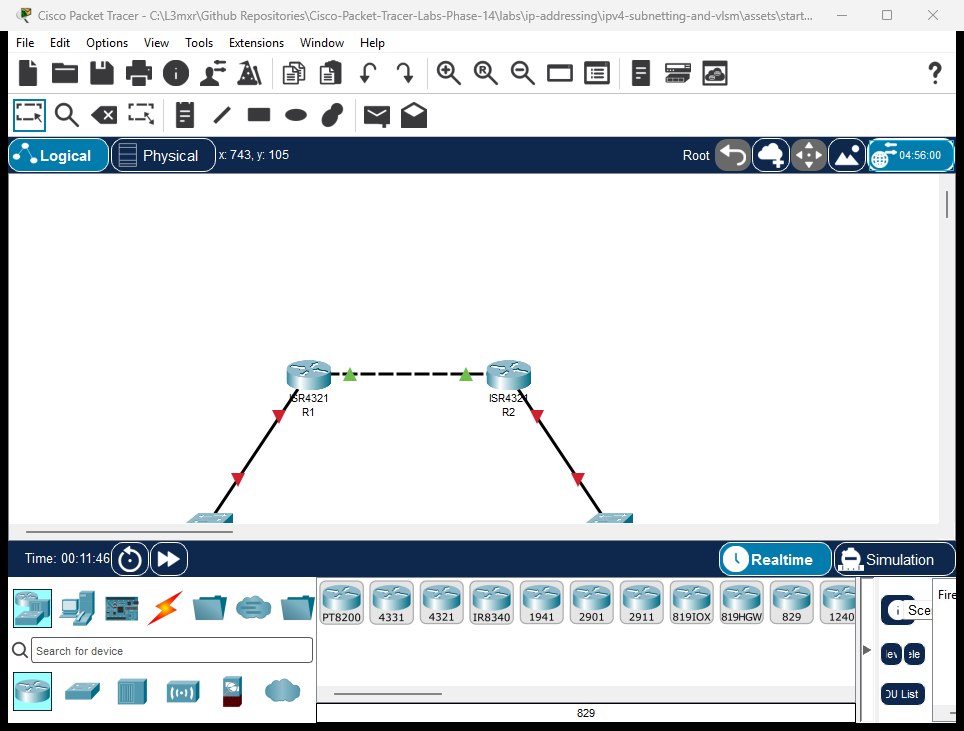

# PTL-0015: IPv4 Subnetting and VLSM Network Design


In traditional classful or fixed-length subnet masking (FLSM), every subnet in an organization is forced to use the same subnet mask regardless of the actual number of connected hosts. This rigid design causes severe IPv4 address waste—for example, dedicating a `/24` (254 hosts) or `/26` (62 hosts) subnet to a point-to-point router WAN link that only requires two IP addresses.

**Variable Length Subnet Masking (VLSM)** eliminates this inefficiency by allowing network engineers to recursively divide a network block into subnets of varying prefix lengths (`/26`, `/27`, `/28`, `/30`).

In this lab, you will design, calculate, configure, and verify an end-to-end multi-site network derived from a single classful `192.168.1.0/24` network block using VLSM principles.

---

## Learning Objectives

- Understand the business necessity and technical mechanics of Variable Length Subnet Masking (VLSM).
- Partition a base `/24` network block to satisfy specific host requirements using `/26`, `/27`, `/28`, and `/30` prefix lengths.
- Calculate network addresses, valid host address ranges, broadcast addresses, and decimal subnet masks.
- Configure Cisco router interfaces and end-host operating systems with custom VLSM masks.
- Verify end-to-end ICMP reachability across variably subnetted broadcast domains and point-to-point transit links.
- Analyze Cisco IOS validation mechanisms for overlapping subnets and reserved host addresses.

---

## Prerequisites

- Completion of [PTL-0002: Configuring Cisco Router Interfaces](../router-interface-configuration/README.md) and [PTL-0008: Cisco IOS Navigation and Initial Device Configuration](../../network-fundamentals/ios-navigation-and-initial-config/README.md).
- Mastery of binary-to-decimal conversion and powers of 2.
- Understanding of the difference between network, usable host, and broadcast IP addresses.

---

## Topology



The enterprise network consists of two sites interconnected across a point-to-point WAN transit link:
- **Headquarters Site (Router R1):** Connects the large Staff LAN via access switch `S1` (`192.168.1.2`) and workstation `PC-Staff` (`192.168.1.10`).
- **Branch Office Site (Router R2):** Connects the small Branch LAN via access switch `S2` (`192.168.1.114`) and workstation `PC-Branch` (`192.168.1.120`).
- **WAN Transit Link:** A dedicated point-to-point interconnection connecting router interface `R1 Gi0/0/1` (`192.168.1.97`) to `R2 Gi0/0/1` (`192.168.1.98`).

---

## Addressing Table

### VLSM Subnet Allocation Scheme (Base Network: `192.168.1.0/24`)

| Subnet Name | Host Requirement | Prefix | Subnet Mask | Network Address | Usable Host Range | Broadcast Address |
|---|---|---|---|---|---|---|
| **Staff LAN** | 50 Hosts | `/26` | `255.255.255.192` | `192.168.1.0` | `192.168.1.1` - `192.168.1.62` | `192.168.1.63` |
| **Reserved LAN** | 25 Hosts | `/27` | `255.255.255.224` | `192.168.1.64` | `192.168.1.65` - `192.168.1.94` | `192.168.1.95` |
| **WAN Transit** | 2 Hosts | `/30` | `255.255.255.252` | `192.168.1.96` | `192.168.1.97` - `192.168.1.98` | `192.168.1.99` |
| **Branch LAN** | 10 Hosts | `/28` | `255.255.255.240` | `192.168.1.112` | `192.168.1.113` - `192.168.1.126` | `192.168.1.127` |

### Device Interface Assignment Table

| Device | Interface | IP Address | Subnet Mask | Default Gateway | Purpose |
|---|---|---|---|---|---|
| **R1** | `Gi0/0/0` | `192.168.1.1` | `255.255.255.192` | N/A | Staff LAN Gateway (`/26`) |
| **R1** | `Gi0/0/1` | `192.168.1.97` | `255.255.255.252` | N/A | WAN Point-to-Point Link (`/30`) |
| **R2** | `Gi0/0/1` | `192.168.1.98` | `255.255.255.252` | N/A | WAN Point-to-Point Link (`/30`) |
| **R2** | `Gi0/0/0` | `192.168.1.113` | `255.255.255.240` | N/A | Branch LAN Gateway (`/28`) |
| **S1** | `Vlan1` | `192.168.1.2` | `255.255.255.192` | `192.168.1.1` | Staff Switch Management SVI |
| **S2** | `Vlan1` | `192.168.1.114` | `255.255.255.240` | `192.168.1.113` | Branch Switch Management SVI |
| **PC-Staff** | `FastEthernet0` | `192.168.1.10` | `255.255.255.192` | `192.168.1.1` | HQ Staff Workstation |
| **PC-Branch** | `FastEthernet0` | `192.168.1.120` | `255.255.255.240` | `192.168.1.113` | Branch Workstation |

---

## Lab Tasks

1. **Calculate VLSM Subnets:** Using the base `192.168.1.0/24` block, determine the prefix lengths and ranges from largest host requirement to smallest.
2. **Examine Starter State:** Open `assets/starter.pkt` and verify that the WAN point-to-point link (`192.168.1.96/30`) and static inter-router routes are pre-configured.
3. **Configure HQ Staff Gateway:** Assign `192.168.1.1 255.255.255.192` to `R1 GigabitEthernet0/0/0` and activate the interface.
4. **Configure Branch Gateway:** Assign `192.168.1.113 255.255.255.240` to `R2 GigabitEthernet0/0/0` and activate the interface.
5. **Configure Switch SVIs:** Assign management IP addresses and default gateways to `S1` and `S2`.
6. **Configure Host Workstations:** Assign IP parameters to `PC-Staff` (`192.168.1.10/26`) and `PC-Branch` (`192.168.1.120/28`).
7. **Perform End-to-End Testing:** Ping across the routed WAN boundary from `PC-Staff` to `PC-Branch`.
8. **Investigate Subnet Constraints:** Observe Cisco IOS error messages when attempting to assign a broadcast address or overlapping subnet.

---

## Configuration Walkthrough

### 1. Router R1 Configuration

Configure the Staff LAN gateway interface (`/26`) on router `R1`:

```text
R1> enable
R1# configure terminal
R1(config)# interface GigabitEthernet0/0/0
R1(config-if)# description Staff LAN Gateway (/26)
R1(config-if)# ip address 192.168.1.1 255.255.255.192
R1(config-if)# no shutdown
R1(config-if)# exit
R1(config)# end
R1# write memory
```

### 2. Router R2 Configuration

Configure the Branch LAN gateway interface (`/28`) on router `R2`:

```text
R2> enable
R2# configure terminal
R2(config)# interface GigabitEthernet0/0/0
R2(config-if)# description Branch LAN Gateway (/28)
R2(config-if)# ip address 192.168.1.113 255.255.255.240
R2(config-if)# no shutdown
R2(config-if)# exit
R2(config)# end
R2# write memory
```

### 3. Switch S1 and S2 Management Setup

Configure `S1`:
```text
S1> enable
S1# configure terminal
S1(config)# interface Vlan1
S1(config-if)# ip address 192.168.1.2 255.255.255.192
S1(config-if)# no shutdown
S1(config-if)# exit
S1(config)# ip default-gateway 192.168.1.1
S1(config)# end
S1# write memory
```

Configure `S2`:
```text
S2> enable
S2# configure terminal
S2(config)# interface Vlan1
S2(config-if)# ip address 192.168.1.114 255.255.255.240
S2(config-if)# no shutdown
S2(config-if)# exit
S2(config)# ip default-gateway 192.168.1.113
S2(config)# end
S2# write memory
```

### 4. Workstation Configuration

In the Packet Tracer Desktop tab:
- **PC-Staff:** IP `192.168.1.10`, Subnet Mask `255.255.255.192`, Default Gateway `192.168.1.1`.
- **PC-Branch:** IP `192.168.1.120`, Subnet Mask `255.255.255.240`, Default Gateway `192.168.1.113`.

---

## Verification

### Positive Test 1: PC-Staff IP Configuration (/26)
```text
C:\>ipconfig

FastEthernet0 Connection:
   IPv4 Address....................: 192.168.1.10
   Subnet Mask.....................: 255.255.255.192
   Default Gateway.................: 192.168.1.1
```

### Positive Test 2: PC-Branch IP Configuration (/28)
```text
C:\>ipconfig

FastEthernet0 Connection:
   IPv4 Address....................: 192.168.1.120
   Subnet Mask.....................: 255.255.255.240
   Default Gateway.................: 192.168.1.113
```

### Positive Test 3: Local Gateway Reachability
From `PC-Staff`, ping `R1`:
```text
C:\>ping 192.168.1.1
Reply from 192.168.1.1: bytes=32 time<1ms TTL=255
```

### Positive Test 4: WAN Transit Point-to-Point Ping
From `R1`, ping `R2`:
```text
R1# ping 192.168.1.98
Type escape sequence to abort.
Sending 5, 100-byte ICMP Echos to 192.168.1.98, timeout is 2 seconds:
!!!!!
Success rate is 100 percent (5/5), round-trip min/avg/max = 0/0/0 ms
```

### Positive Test 5: End-to-End Inter-Subnet Host Ping
From `PC-Staff`, ping `PC-Branch`:
```text
C:\>ping 192.168.1.120

Pinging 192.168.1.120 with 32 bytes of data:

Reply from 192.168.1.120: bytes=32 time<1ms TTL=126
Reply from 192.168.1.120: bytes=32 time<1ms TTL=126
Reply from 192.168.1.120: bytes=32 time<1ms TTL=126
Reply from 192.168.1.120: bytes=32 time<1ms TTL=126

Ping statistics for 192.168.1.120:
    Packets: Sent = 4, Received = 4, Lost = 0 (0% loss)
```
*Note: TTL=126 confirms that the packet successfully traversed two router hops (`R1` and `R2`).*

### Positive Test 6: Inspect VLSM Routing Table Output
```text
R1# show ip route
Gateway of last resort is not set

     192.168.1.0/24 is variably subnetted, 5 subnets, 4 masks
C       192.168.1.0/26 is directly connected, GigabitEthernet0/0/0
L       192.168.1.1/32 is directly connected, GigabitEthernet0/0/0
C       192.168.1.96/30 is directly connected, GigabitEthernet0/0/1
L       192.168.1.97/32 is directly connected, GigabitEthernet0/0/1
S       192.168.1.112/28 [1/0] via 192.168.1.98
```
*Notice: The routing table explicitly states `variably subnetted, 5 subnets, 4 masks`. This is the signature hallmark of a live VLSM network!*

---

## Troubleshooting

| Symptom | Diagnostic Finding | Root Cause | Remediation |
|---|---|---|---|
| Router rejects interface IP configuration | `Bad mask /26 for address 192.168.1.63` | An attempt was made to assign the subnet broadcast address or network ID as a host IP. | Calculate the usable host range (`192.168.1.1` - `192.168.1.62`) and choose an address within that range. |
| Router rejects secondary subnet configuration | `% 192.168.1.0 overlaps with GigabitEthernet0/0/0` | Overlapping subnet address space caused by incorrect VLSM boundary calculation. | Ensure subnets are allocated sequentially from largest to smallest without overlapping address ranges. |
| Host cannot communicate with remote subnet | `PC-Staff` configured with mask `255.255.255.0` instead of `255.255.255.192` | Subnet mask mismatch. With `/24`, host treats remote VLSM addresses as local and fails to forward frames to the gateway. | Correct host subnet mask to `255.255.255.192`. |

---

## Key Takeaways

- **Subnet From Largest to Smallest:** When designing a VLSM address plan, always allocate subnets to the largest host requirements first, descending to the smallest point-to-point links.
- **Save Address Space with /30:** Using `/30` (`255.255.255.252`) for point-to-point router links uses only 4 total addresses (2 usable), preventing the waste of dozens of IP addresses.
- **Custom Masks:** Unlike classful networks (`/8`, `/16`, `/24`), VLSM subnet masks split octets at non-zero values (`.128`, `.192`, `.224`, `.240`, `.248`, `.252`).
- **Overlapping Subnet Detection:** Cisco IOS actively protects against misconfiguration by preventing overlapping subnet assignments on active routed interfaces.

---

## References

- [RFC 1878: Variable Length Subnet Table For IPv4](https://datatracker.ietf.org/doc/html/rfc1878)
- [Cisco IP Addressing and Subnetting for New Users](https://www.cisco.com/c/en/us/support/docs/ip/routing-information-protocol-rip/13788-3.html)
- [Repository Troubleshooting Guide](../../../docs/troubleshooting.md)

---

## Files and Validation Status

| Deliverable | Location | Description |
|---|---|---|
| **Starter Activity** | [assets/starter.pkt](assets/starter.pkt) | Pre-configured WAN transit with unconfigured LAN interfaces |
| **Completed Reference** | [assets/completed.pkt](assets/completed.pkt) | Fully operational VLSM network with end-to-end reachability |
| **Topology Screenshot** | [assets/topology.png](assets/topology.png) | High-resolution canvas capture from running simulator |
| **Router 1 Configuration** | [configs/R1.txt](configs/R1.txt) | Cisco IOS commands for router R1 |
| **Router 2 Configuration** | [configs/R2.txt](configs/R2.txt) | Cisco IOS commands for router R2 |
| **Switch 1 Configuration** | [configs/S1.txt](configs/S1.txt) | Catalyst management setup for S1 |
| **Switch 2 Configuration** | [configs/S2.txt](configs/S2.txt) | Catalyst management setup for S2 |
| **Verification Guide** | [verification.md](verification.md) | Step-by-step diagnostic verification instructions |
| **Simulator Evidence** | [PTL-0015 Simulator Results](../../../AI_AGENT_GUIDE/state/PTL-0015-SIMULATOR-RESULTS.md) | Authentic live simulator console traces |
