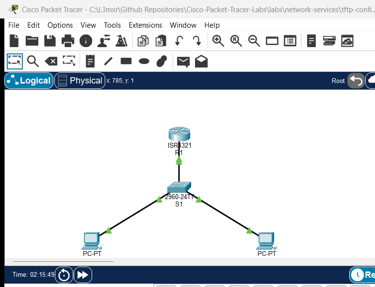

# PTL-0026: IPv6 SLAAC and Neighbor Discovery

> **Category:** ip-addressing · **Difficulty:** intermediate · **Lab ID:** PTL-0026 · **Document:** reviewed · **Simulator:** tested pass

One of the defining innovations of IPv6 over legacy IPv4 is the ability for end devices to obtain global network connectivity without requiring manual configuration or a stateful DHCP server. In IPv4 networks, hosts rely heavily on Dynamic Host Configuration Protocol (DHCP) daemons and Address Resolution Protocol (ARP) broadcast frames. IPv6 eliminates broadcast frames entirely and introduces **Stateless Address Autoconfiguration (SLAAC)**, defined in IETF RFC 4862.

SLAAC relies fundamentally on the **IPv6 Neighbor Discovery Protocol (NDP)** (RFC 4861), which operates via Internet Control Message Protocol version 6 (ICMPv6) messages. When IPv6 routing is enabled on an upstream Cisco IOS gateway router (`ipv6 unicast-routing`), the router periodically transmits ICMPv6 **Router Advertisement (RA)** packets (Type 134) to the all-nodes multicast address (`ff02::1`). Alternatively, newly connected client hosts can immediately solicit an RA by sending an ICMPv6 **Router Solicitation (RS)** packet (Type 133) to the all-routers multicast address (`ff02::2`).

The Router Advertisement carries crucial configuration parameters:
- The network prefix (e.g., `2001:db8:acad:1::/64`).
- Prefix lifetime and valid duration timers.
- Flags indicating how addressing is handled (such as the Autonomous address-configuration flag, **A=1**).
- The router's link-local address (`fe80::1`), which the client immediately adopts as its default gateway.

Upon receiving the RA, the host independently generates a 64-bit Interface Identifier (IID)—using either the modified IEEE EUI-64 format derived from its MAC address or a modern randomized token—and prepends the advertised 64-bit network prefix. The host then performs Duplicate Address Detection (DAD) and activates its Global Unicast Address (GUA). Furthermore, IPv6 nodes maintain an **IPv6 Neighbor Discovery cache** (replacing the IPv4 ARP table) to map IPv6 addresses to Layer 2 MAC addresses via Neighbor Solicitation (NS, Type 135) and Neighbor Advertisement (NA, Type 136) messages.

In this laboratory, you will configure an enterprise Cisco ISR 4321 router (`R1`) as an IPv6 SLAAC gateway, connect client workstations through a Catalyst access switch (`S1`), observe automatic host configuration, verify bidirectional IPv6 reachability, and audit the Cisco IOS Neighbor Discovery cache.

---

## Learning Objectives

- Explain the mechanics, message formats, and operational role of IPv6 Stateless Address Autoconfiguration (SLAAC) per RFC 4862.
- Analyze the functions of ICMPv6 Router Solicitation (RS) and Router Advertisement (RA) messages in host network bootstrapping.
- Enable IPv6 global routing on Cisco IOS using `ipv6 unicast-routing` to initiate RA transmissions.
- Configure static IPv6 Global Unicast and standardized Link-Local addresses on router and switch interfaces.
- Configure client workstations to dynamically acquire IPv6 addresses and default gateways using SLAAC.
- Verify intra-subnet and host-to-gateway IPv6 connectivity using ICMPv6 echo requests (`ping`).
- Inspect and interpret the Cisco IOS IPv6 Neighbor Discovery table using `show ipv6 neighbors` across reachability states (`REACH`, `STALE`, `INCMP`).
- Troubleshoot common IPv6 autoconfiguration faults, including disabled global routing and mismatched prefix lengths.

---

## Prerequisites

- Understanding of IPv6 hexadecimal representation, 128-bit address structure, and prefix notation.
- Familiarity with the role of link-local addresses (`fe80::/10`) and multicast scopes (`ff02::1`, `ff02::2`).
- Completion of **PTL-0002: Configuring Cisco Router Interfaces** or equivalent foundational routing experience.
- Cisco Packet Tracer 8.2 or newer (Packet Tracer 9.0+ verified).

---

## Topology



The topology models an enterprise IPv6 edge access network where an access switch (`S1`) connects the default gateway router (`R1`) to client workstations (`PC-A` and `PC-B`):

```text
               [R1 Core Gateway] (ISR 4321)
               Gi0/0/0 (2001:db8:acad:1::1/64, fe80::1)
               Loopback0 (2001:db8:acad:99::1/64)
                        │
                        │ Gi0/1
                 [Switch S1] (Catalyst 2960)
                 Fa0/1 │      │ Fa0/2
           ┌───────────┘      └───────────┐
           │                              │
        [PC-A]                          [PC-B]
    (SLAAC Auto)                    (SLAAC Auto)
```

| Device Name | Model | Interface | Connected Device | Neighbor Interface | Network Role |
|---|---|---|---|---|---|
| **R1** | Cisco ISR 4321 | GigabitEthernet0/0/0 | Switch S1 | GigabitEthernet0/1 | Core Gateway & RA Advertiser (`2001:db8:acad:1::1/64`) |
| **R1** | Cisco ISR 4321 | Loopback0 | N/A | N/A | Diagnostic Management Target (`2001:db8:acad:99::1/64`) |
| **Switch S1** | Catalyst 2960-24TT | GigabitEthernet0/1 | R1 | GigabitEthernet0/0/0 | Uplink to Gateway Router |
| **Switch S1** | Catalyst 2960-24TT | FastEthernet0/1 | PC-A | FastEthernet0 | Access Port for Workstation A |
| **Switch S1** | Catalyst 2960-24TT | FastEthernet0/2 | PC-B | FastEthernet0 | Access Port for Workstation B |
| **PC-A** | PC-PT | FastEthernet0 | Switch S1 | FastEthernet0/1 | Client Host Workstation A |
| **PC-B** | PC-PT | FastEthernet0 | Switch S1 | FastEthernet0/2 | Client Host Workstation B |

---

## Addressing Table

| Device | Interface | IPv6 Global Unicast | Prefix Length | IPv6 Link-Local | Role / Notes |
|---|---|---|---|---|---|
| **R1** | `Gi0/0/0` | `2001:db8:acad:1::1` | `/64` | `fe80::1` | Production Gateway Interface |
| **R1** | `Loopback0` | `2001:db8:acad:99::1` | `/64` | N/A | Management Diagnostic Target |
| **Switch S1** | `Vlan1` | `2001:db8:acad:1::2` | `/64` | `fe80::2` | Management SVI |
| **PC-A** | `FastEthernet0` | SLAAC Autoconfigured | `/64` | EUI-64 / Auto | Client Host A |
| **PC-B** | `FastEthernet0` | SLAAC Autoconfigured | `/64` | EUI-64 / Auto | Client Host B |

---

## Lab Tasks

1. **Verify Baseline IPv6 Interface Addressing:**
   - Inspect router `R1` and access switch `S1` interface configurations.
   - Confirm that IPv6 addressing is assigned to `Gi0/0/0` on `R1` and `Vlan1` on `S1`.

2. **Enable Global IPv6 Routing on R1:**
   - Enter global configuration mode on `R1`.
   - Execute the `ipv6 unicast-routing` command to enable IPv6 forwarding and initiate ICMPv6 Router Advertisements on enabled interfaces.
   - Verify that `show ipv6 interface GigabitEthernet0/0/0` confirms active RA transmissions every 200 seconds with the autonomous address configuration flag.

3. **Configure Client Hosts for SLAAC:**
   - On `PC-A` and `PC-B`, configure the FastEthernet0 IPv6 configuration mode to **Auto Config** (SLAAC).
   - In the command prompt, issue `ipv6config` to observe the dynamically assigned Global Unicast Address and default gateway.

4. **Verify IPv6 Network Reachability:**
   - From `PC-A`, test ICMPv6 reachability to the default gateway router `R1` (`2001:db8:acad:1::1`).
   - From `PC-A`, ping the autoconfigured IPv6 address of `PC-B` to confirm local subnet routing.
   - From `PC-B`, ping the remote diagnostic loopback interface on `R1` (`2001:db8:acad:99::1`).

5. **Audit the Cisco IOS IPv6 Neighbor Discovery Cache:**
   - On `R1`, issue `show ipv6 neighbors` to inspect the neighbor cache.
   - Analyze the correlation between IPv6 addresses, MAC (link-layer) addresses, and reachability states (`REACH`, `STALE`).

6. **Investigate IPv6 Failure Modes:**
   - Temporarily disable `ipv6 unicast-routing` on `R1` to observe the immediate cessation of Router Advertisements.
   - Attempt an ICMPv6 echo request to an unassigned IP address (`2001:db8:acad:1::999`) to observe unresolved Neighbor Solicitations and packet loss.

---

## Configuration Walkthrough

### Task 1: Verify Baseline Addressing

On `R1`, examine the interface status:

```cisco
R1#show ipv6 interface brief
GigabitEthernet0/0/0   [up/up]
    FE80::1
    2001:DB8:ACAD:1::1
GigabitEthernet0/0/1   [administratively down/down]
    unassigned
GigabitEthernet0/0/2   [administratively down/down]
    unassigned
Loopback0              [up/up]
    2001:DB8:ACAD:99::1
```

### Task 2: Enable Global IPv6 Routing

By default, Cisco IOS routers operate as IPv6 hosts rather than routers. To participate in dynamic routing protocols and transmit periodic ICMPv6 Router Advertisements, global unicast routing must be activated:

```cisco
R1#configure terminal
R1(config)#ipv6 unicast-routing
R1(config)#end
R1#copy running-config startup-config
Destination filename [startup-config]? 
Building configuration...
[OK]
```

Verify that `R1` has joined the all-routers multicast group (`FF02::2`) and is transmitting RAs:

```cisco
R1#show ipv6 interface GigabitEthernet0/0/0
GigabitEthernet0/0/0 is up, line protocol is up
  IPv6 is enabled, link-local address is FE80::1
  Global unicast address(es):
    2001:DB8:ACAD:1::1, subnet is 2001:DB8:ACAD:1::/64
  Joined group address(es):
    FF02::1
    FF02::2
    FF02::1:FF00:1
  ND router advertisements are sent every 200 seconds
  ND router advertisements live for 1800 seconds
  Hosts use stateless autoconfig for addresses.
```

> **Key Observation:** Notice that `FF02::2` is now present in the joined group addresses, and the router confirms `Hosts use stateless autoconfig for addresses.`

### Task 3: Configure SLAAC on Client Workstations

1. Click on **PC-A**, select the **Desktop** tab, and open **IP Configuration**.
2. Under the **IPv6 Configuration** section, select the **Auto Config** radio button.
3. Repeat the procedure on **PC-B**.

Open the Command Prompt on `PC-A` and inspect the autoconfigured settings:

```text
C:\>ipv6config

FastEthernet0 Connection:(default port)

   Connection-specific DNS Suffix..: 
   Link-local IPv6 Address.........: FE80::200:CFF:FE6A:EA59
   IPv6 Address....................: 2001:DB8:ACAD:1:200:CFF:FE6A:EA59
   Default Gateway.................: FE80::1
```

> **Protocol Mechanics:** `PC-A` transmitted a Router Solicitation (RS) to `FF02::2`. `R1` responded with a Router Advertisement (RA) announcing prefix `2001:DB8:ACAD:1::/64`. `PC-A` took its 48-bit MAC address (`0000.0C6A.EA59`), inserted `FFFE` in the middle, inverted the seventh bit (U/L bit) to form `0200:0CFF:FE6A:EA59`, and appended it to the prefix. It also installed `FE80::1` (R1's link-local address) as its default gateway.

### Task 4: Verify Network Reachability

From `PC-A`, test connectivity to the gateway router:

```text
C:\>ping 2001:db8:acad:1::1

Pinging 2001:db8:acad:1::1 with 32 bytes of data:

Reply from 2001:DB8:ACAD:1::1: bytes=32 time<1ms TTL=255
Reply from 2001:DB8:ACAD:1::1: bytes=32 time<1ms TTL=255
Reply from 2001:DB8:ACAD:1::1: bytes=32 time<1ms TTL=255
Reply from 2001:DB8:ACAD:1::1: bytes=32 time<1ms TTL=255

Ping statistics for 2001:db8:acad:1::1:
    Packets: Sent = 4, Received = 4, Lost = 0 (0% loss)
```

From `PC-A`, test connectivity across the access switch to `PC-B`:

```text
C:\>ping 2001:DB8:ACAD:1:250:FFF:FE10:97D2

Pinging 2001:DB8:ACAD:1:250:FFF:FE10:97D2 with 32 bytes of data:

Reply from 2001:DB8:ACAD:1:250:FFF:FE10:97D2: bytes=32 time<1ms TTL=128
Reply from 2001:DB8:ACAD:1:250:FFF:FE10:97D2: bytes=32 time<1ms TTL=128
Reply from 2001:DB8:ACAD:1:250:FFF:FE10:97D2: bytes=32 time<1ms TTL=128
Reply from 2001:DB8:ACAD:1:250:FFF:FE10:97D2: bytes=32 time<1ms TTL=128

Ping statistics for 2001:DB8:ACAD:1:250:FFF:FE10:97D2:
    Packets: Sent = 4, Received = 4, Lost = 0 (0% loss)
```

### Task 5: Audit IPv6 Neighbor Discovery Cache

On `R1`, examine the resolved neighbor table:

```cisco
R1#show ipv6 neighbors
IPv6 Address                              Age Link-layer Addr State Interface
2001:DB8:ACAD:1:200:CFF:FE6A:EA59           0 0000.0C6A.EA59  REACH Gig0/0/0
2001:DB8:ACAD:1:250:FFF:FE10:97D2           0 0050.0F10.97D2  REACH Gig0/0/0
```

---

## Verification

### 1. Verify Router Multicast Group Membership
Confirm that `R1` belongs to `FF02::2` (all-routers) on `Gi0/0/0`:

```cisco
R1#show ipv6 interface GigabitEthernet0/0/0 | include Joined group
  Joined group address(es):
    FF02::1
    FF02::2
    FF02::1:FF00:1
```

### 2. Verify Autoconfiguration Timers
Check the RA transmission interval on `R1`:

```cisco
R1#show ipv6 interface GigabitEthernet0/0/0 | include router advertisements
  ND router advertisements are sent every 200 seconds
  ND router advertisements live for 1800 seconds
```

### 3. Verify Switch IPv6 Management SVI
Confirm `S1` is reachable over IPv6 management:

```cisco
R1#ping 2001:db8:acad:1::2
Type escape sequence to abort.
Sending 5, 100-byte ICMP Echos to 2001:db8:acad:1::2, timeout is 2 seconds:
!!!!!
Success rate is 100 percent (5/5), round-trip min/avg/max = 0/0/0 ms
```

---

## Troubleshooting

### Issue 1: Host Shows IPv6 Address "::" and Default Gateway "::"
- **Symptom:** Executing `ipv6config` on the PC returns empty address fields (`::`).
- **Cause 1:** `ipv6 unicast-routing` was not enabled on `R1`. Without this command, the router never sends Router Advertisements.
- **Cause 2:** The router interface is in the `administratively down` state.
- **Remediation:** Verify that `ipv6 unicast-routing` is present in `R1` running-config. Confirm `GigabitEthernet0/0/0` is `up/up`. On the PC, click **Fast Forward Time** (Alt+D) or toggle the IPv6 configuration from Static to Auto Config to trigger a fresh Router Solicitation.

### Issue 2: Host Autoconfigures Link-Local but No Global Unicast Address
- **Symptom:** Host displays an address beginning with `FE80::` but the `2001:db8:acad:1::` GUA is missing.
- **Cause:** The prefix configured on the router does not have a `/64` prefix length. SLAAC strictly requires a `/64` subnet mask. If `/60`, `/68`, or `/120` is configured, SLAAC autoconfiguration is disabled by specification.
- **Remediation:** On `R1`, verify that the interface address specifies `/64`: `ipv6 address 2001:db8:acad:1::1/64`.

### Issue 3: Neighbor Table State Shows "INCMP" (Incomplete)
- **Symptom:** `show ipv6 neighbors` shows `INCMP` under the State column.
- **Cause:** The router sent Neighbor Solicitations (NS) requesting the Layer 2 MAC address of the target, but no node responded.
- **Remediation:** Check physical cabling and confirm that the target device is powered on with matching VLAN and IPv6 settings.

---

## Key Takeaways

1. **SLAAC Simplicity:** SLAAC provides zero-touch network addressing for IPv6 hosts by combining an advertised `/64` network prefix with a dynamically generated 64-bit host identifier.
2. **The Role of ipv6 unicast-routing:** Cisco IOS routers will NOT transmit ICMPv6 Router Advertisements or participate in SLAAC until `ipv6 unicast-routing` is explicitly enabled.
3. **Link-Local Default Gateways:** In IPv6, the default gateway advertised to hosts is almost always the router's link-local address (`fe80::...`), ensuring routing persistency regardless of global prefix renumbering.
4. **Neighbor Discovery vs. ARP:** IPv6 completely eliminates ARP broadcasts, utilizing ICMPv6 Neighbor Solicitations and solicited-node multicast addresses (`FF02::1:FFxx:xxxx`) for Layer 2 resolution.

---

## References

- [IETF RFC 4861 — Neighbor Discovery for IP version 6 (IPv6)](https://datatracker.ietf.org/doc/html/rfc4861)
- [IETF RFC 4862 — IPv6 Stateless Address Autoconfiguration](https://datatracker.ietf.org/doc/html/rfc4862)
- [IETF RFC 4291 — IP Version 6 Addressing Architecture](https://datatracker.ietf.org/doc/html/rfc4291)
- [Cisco IOS IPv6 Configuration Guide: Implementing IPv6 Addressing and Basic Connectivity](https://www.cisco.com/c/en/us/td/docs/ios-xml/ios/ipv6_basic/configuration/15-mt/ip6-basics-15-mt-book.html)

---

## Files and Validation Status

- `assets/starter.pkt`: Baseline network topology with physical cabling and interface addressing; `ipv6 unicast-routing` is unconfigured and client hosts have not acquired SLAAC addresses.
- `assets/completed.pkt`: Validated operational topology with active IPv6 routing, autoconfigured client hosts, verified neighbor cache, and saved startup configurations.
- `assets/topology.png`: Visual layout of the laboratory topology.
- `configs/R1.txt`: Running configuration for router `R1`.
- `configs/S1.txt`: Running configuration for switch `S1`.
- `verification.md`: Complete positive and negative testing matrix with live Packet Tracer simulation evidence.
