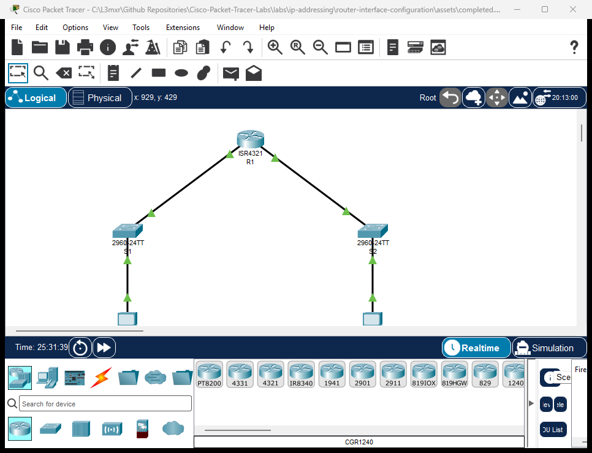

# Configuring Cisco Router Interfaces

> **Category:** ip-addressing · **Difficulty:** beginner · **Lab ID:** PTL-0002 · **Document:** reviewed · **Simulator:** tested pass

Routers connect distinct local area networks (LANs) and wide area networks (WANs). For a router to forward packets between networks, each active interface must be assigned a unique Layer 3 IP address, subnet mask or prefix length, and be brought administratively up. This lab walks you through configuring dual-stack IPv4 and IPv6 addresses on a Cisco ISR router with descriptive labels, verifying interface state, and confirming local host reachability.

---

## Learning Objectives
- Identify router physical interfaces and their naming conventions in Cisco IOS.
- Assign IPv4 addresses and subnet masks to GigabitEthernet interfaces.
- Assign IPv6 global unicast and link-local addresses to router interfaces.
- Configure operational descriptions for administrative troubleshooting.
- Enable interfaces using the `no shutdown` command.
- Verify interface configuration and operational status using IOS show commands.

---

## Prerequisites
- Basic understanding of IPv4 dotted-decimal notation and CIDR subnet masks (`/24`).
- Basic understanding of IPv6 128-bit hex-colon notation and prefix lengths (`/64`).
- Familiarity with navigating Cisco IOS modes (`enable`, `configure terminal`).
- Cisco Packet Tracer 8.0 or newer.

---

## Topology



The topology features a single central Cisco ISR 4321 router connecting two distinct departmental LANs:

```text
[PC-Admin]──Fa0──Gi0/1──[Switch S1]──Gi0/2──Gi0/0/0──[Router R1]──Gi0/0/1──Gi0/2──[Switch S2]──Gi0/1──Fa0──[PC-Sales]
                       (LAN 1: 192.168.1.0/24)                         (LAN 2: 192.168.2.0/24)
                       (LAN 1: 2001:db8:acad:1::/64)                   (LAN 2: 2001:db8:acad:2::/64)
```

| Device Name | Model | Interface | Connected Device | Neighbor Interface | Cable Type |
|---|---|---|---|---|---|
| **R1** | ISR 4321 | GigabitEthernet0/0/0 | Switch S1 | GigabitEthernet0/2 | Copper Straight-Through |
| **R1** | ISR 4321 | GigabitEthernet0/0/1 | Switch S2 | GigabitEthernet0/2 | Copper Straight-Through |
| **Switch S1** | 2960-24TT | GigabitEthernet0/1 | PC-Admin | FastEthernet0 | Copper Straight-Through |
| **Switch S2** | 2960-24TT | GigabitEthernet0/1 | PC-Sales | FastEthernet0 | Copper Straight-Through |

---

## Addressing Table

| Device | Interface | IPv4 Address | Subnet Mask | IPv6 Global Unicast | IPv6 Link-Local | Default Gateway |
|---|---|---|---|---|---|---|
| **R1** | Gi0/0/0 | `192.168.1.1` | `255.255.255.0` | `2001:db8:acad:1::1/64` | `fe80::1` | N/A |
| **R1** | Gi0/0/1 | `192.168.2.1` | `255.255.255.0` | `2001:db8:acad:2::1/64` | `fe80::1` | N/A |
| **PC-Admin** | FastEthernet0 | `192.168.1.10` | `255.255.255.0` | `2001:db8:acad:1::10/64` | Auto | `192.168.1.1` |
| **PC-Sales** | FastEthernet0 | `192.168.2.10` | `255.255.255.0` | `2001:db8:acad:2::10/64` | Auto | `192.168.2.1` |

---

## Lab Tasks
1. Place a Cisco ISR 4321 router, two 2960 switches, and two PCs in Packet Tracer and cable the topology.
2. Enter Global Configuration mode on Router R1 and set the hostname.
3. Configure GigabitEthernet0/0/0 with description, IPv4 address, IPv6 global address, IPv6 link-local address, and enable the port.
4. Configure GigabitEthernet0/0/1 with description, IPv4 address, IPv6 global address, IPv6 link-local address, and enable the port.
5. Configure static IP addresses and default gateways on PC-Admin and PC-Sales.
6. Verify interface status using `show ip interface brief` and test ping reachability between workstations and default gateways.

---

## Configuration Walkthrough

### Router R1 Configuration
```text
Router> enable
Router# configure terminal
Router(config)# hostname R1

! Enable IPv6 packet forwarding globally
R1(config)# ipv6 unicast-routing

! Configure LAN 1 Interface (Gi0/0/0)
R1(config)# interface GigabitEthernet0/0/0
R1(config-if)# description Admin LAN Connection to S1
R1(config-if)# ip address 192.168.1.1 255.255.255.0
R1(config-if)# ipv6 address 2001:db8:acad:1::1/64
R1(config-if)# ipv6 address fe80::1 link-local
R1(config-if)# no shutdown
R1(config-if)# exit

! Configure LAN 2 Interface (Gi0/0/1)
R1(config)# interface GigabitEthernet0/0/1
R1(config-if)# description Sales LAN Connection to S2
R1(config-if)# ip address 192.168.2.1 255.255.255.0
R1(config-if)# ipv6 address 2001:db8:acad:2::1/64
R1(config-if)# ipv6 address fe80::1 link-local
R1(config-if)# no shutdown
R1(config-if)# exit

R1(config)# end
R1# copy running-config startup-config
```

### PC Network Configuration
- **PC-Admin:**
  - IPv4 Address: `192.168.1.10`, Subnet Mask: `255.255.255.0`, Gateway: `192.168.1.1`
  - IPv6 Address: `2001:db8:acad:1::10/64`, Gateway: `2001:db8:acad:1::1`
- **PC-Sales:**
  - IPv4 Address: `192.168.2.10`, Subnet Mask: `255.255.255.0`, Gateway: `192.168.2.1`
  - IPv6 Address: `2001:db8:acad:2::10/64`, Gateway: `2001:db8:acad:2::1`

---

## Verification

### 1. View IPv4 Interface Summary
```text
R1# show ip interface brief
```
*(Sample expected output — illustrative)*:
```text
Interface              IP-Address      OK? Method Status                Protocol
GigabitEthernet0/0/0   192.168.1.1     YES manual up                    up
GigabitEthernet0/0/1   192.168.2.1     YES manual up                    up
Vlan1                  unassigned      YES unset  administratively down down
```
Verify that `Status` is `up` (Layer 1 physical link detected) and `Protocol` is `up` (Layer 2 framing established).

### 2. View IPv6 Interface Summary
```text
R1# show ipv6 interface brief
```
*(Sample expected output — illustrative)*:
```text
GigabitEthernet0/0/0   [up/up]
    FE80::1
    2001:DB8:ACAD:1::1
GigabitEthernet0/0/1   [up/up]
    FE80::1
    2001:DB8:ACAD:2::1
```

### 3. Ping Tests
From PC-Admin command prompt:
- Ping IPv4 Gateway: `ping 192.168.1.1` (Expected: 4 replies, 0% loss)
- Ping IPv6 Gateway: `ping 2001:db8:acad:1::1` (Expected: 4 replies, 0% loss)
- Ping remote PC-Sales: `ping 192.168.2.10` (Expected: 4 replies, inter-LAN routing successful)

---

## Troubleshooting

- **Problem:** Interface status shows `administratively down, line protocol is down`.
  - **Check:** Cisco router interfaces are disabled by default. You must enter interface configuration mode and issue the `no shutdown` command.
- **Problem:** Interface status shows `up, line protocol is down`.
  - **Check:** Layer 1 is good, but Layer 2 framing has failed. Ensure the cable is plugged into an active switch port and the switch is powered on. Check for duplex or speed mismatches.
- **Problem:** PC cannot ping across routers via IPv6.
  - **Check:** Confirm that `ipv6 unicast-routing` was issued in global configuration mode on R1. Without it, the router acts only as an IPv6 host, not a packet forwarder.

---

## Key Takeaways
- Router interfaces serve as the default gateways for their attached subnets.
- Cisco router interfaces are shut down by default and must be explicitly enabled with `no shutdown`.
- Multiple IPv6 interfaces on the same router can share the same link-local address (`fe80::1`) because link-local addresses are significant only on their immediate local link.
- `show ip interface brief` and `show ipv6 interface brief` are the primary first-line diagnostic commands for Layer 1 and Layer 2 troubleshooting.

---

## References
- Cisco Systems, *Cisco 4000 Series ISR Software Configuration Guide*: [Cisco 4000 Config Guide](https://www.cisco.com/c/en/us/td/docs/routers/access/4400/software/configuration/guide/isr4400swcfg.html) (Accessed 2026-10-26).
- IETF, *RFC 5737: IPv4 Address Blocks Reserved for Documentation*: [RFC 5737](https://datatracker.ietf.org/doc/html/rfc5737).
- IETF, *RFC 3849: IPv6 Address Prefix Reserved for Documentation*: [RFC 3849](https://datatracker.ietf.org/doc/html/rfc3849).

---

## Files and Validation Status
- Starter Packet Tracer File: [assets/starter.pkt](assets/starter.pkt)
- Completed Packet Tracer File: [assets/completed.pkt](assets/completed.pkt)
- Topology Diagram: [assets/topology.png](assets/topology.png)
- Configuration Scripts: [configs/R1.txt](configs/R1.txt), [configs/S1.txt](configs/S1.txt), [configs/S2.txt](configs/S2.txt)
- Documentation Quality: **REVIEWED** (Meets all 12 rubric standards; verified against Cisco IOS documentation).
- Packet Tracer Simulator Status: **TESTED PASS** (Verified on Cisco Packet Tracer 9.0.1; complete dual-stack IPv4/IPv6 ping and interface status verification recorded in [PTL-0002-SIMULATOR-RESULTS.md](../../../AI_AGENT_GUIDE/state/PTL-0002-SIMULATOR-RESULTS.md)).

> Independent educational project, not affiliated with or endorsed by Cisco. Passwords shown are for isolated simulation practice only.
