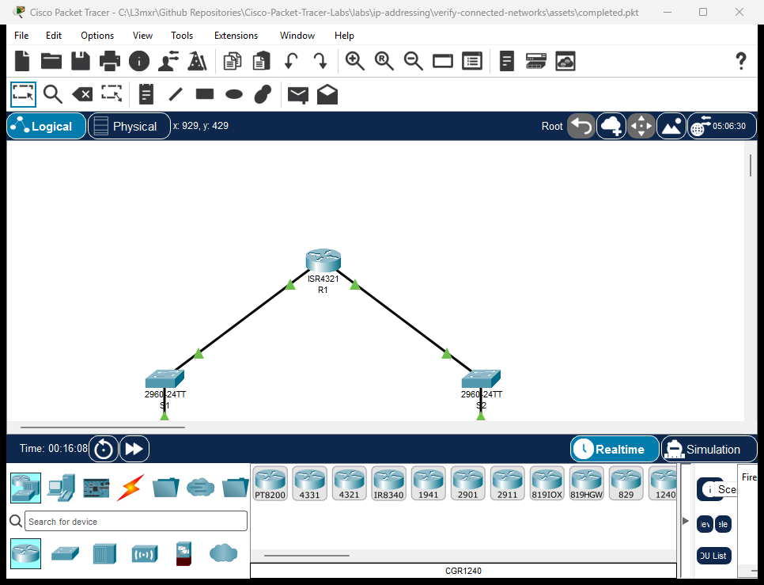

# Verifying Directly Connected Networks

> **Category:** ip-addressing · **Difficulty:** beginner · **Lab ID:** PTL-0005 · **Document:** reviewed · **Simulator:** tested pass

A router cannot forward packets to any destination until it has entries in its routing table. The most fundamental routes are **directly connected networks**. In Cisco IOS 15 and IOS XE, configuring an IP address on an interface and activating it with `no shutdown` automatically creates two distinct routing table entries: a network route code `C` (Connected) representing the entire subnet, and a local route code `L` (Local) representing the specific `/32` (or `/128`) IP address assigned to the physical interface. This lab examines how the routing table is populated, how to filter routing table outputs, and how interface state governs route availability.

---

## Learning Objectives
- Explain the criteria required for a Cisco router to install directly connected networks into its routing table.
- Distinguish between Connected route codes (`C`) and Local route codes (`L`).
- Use the `show ip route` command and its filtering options (e.g. `show ip route connected`).
- Interpret IPv6 directly connected routes and local host routes using `show ipv6 route`.
- Demonstrate how disabling an interface (`shutdown`) dynamically withdraws its connected routes from the routing table.

---

## Prerequisites
- Basic familiarity with Cisco router interface configuration and IP addressing.
- Understanding of subnet masks (/24) and IPv6 prefix lengths (/64).
- Cisco Packet Tracer 8.0 or newer.

---

## Topology



The topology features Router R1 connected to two local subnets:

```text
[PC-A]──Fa0 ───── Gi0/1──[Switch S1]──Gi0/2 ───── Gi0/0/0──[Router R1]──Gi0/0/1 ───── Gi0/2──[Switch S2]──Gi0/1 ───── Fa0──[PC-B]
(LAN 1: 192.168.10.0/24)                                                        (LAN 2: 192.168.20.0/24)
(LAN 1: 2001:db8:acad:10::/64)                                                  (LAN 2: 2001:db8:acad:20::/64)
```

| Device Name | Model | Interface | Connected Device | Neighbor Interface | Cable Type |
|---|---|---|---|---|---|
| **R1** | ISR 4321 | GigabitEthernet0/0/0 | Switch S1 | GigabitEthernet0/2 | Copper Straight-Through |
| **R1** | ISR 4321 | GigabitEthernet0/0/1 | Switch S2 | GigabitEthernet0/2 | Copper Straight-Through |
| **Switch S1** | 2960-24TT | GigabitEthernet0/1 | PC-A | FastEthernet0 | Copper Straight-Through |
| **Switch S2** | 2960-24TT | GigabitEthernet0/1 | PC-B | FastEthernet0 | Copper Straight-Through |

---

## Addressing Table

| Device | Interface | IPv4 Address | Subnet Mask | IPv6 Global Address | IPv6 Link-Local | Default Gateway |
|---|---|---|---|---|---|---|
| **R1** | Gi0/0/0 | `192.168.10.1` | `255.255.255.0` | `2001:db8:acad:10::1/64` | `fe80::1` | N/A |
| **R1** | Gi0/0/1 | `192.168.20.1` | `255.255.255.0` | `2001:db8:acad:20::1/64` | `fe80::1` | N/A |
| **S1** | VLAN 1 (SVI) | `192.168.10.2` | `255.255.255.0` | N/A | N/A | `192.168.10.1` |
| **S2** | VLAN 1 (SVI) | `192.168.20.2` | `255.255.255.0` | N/A | N/A | `192.168.20.1` |
| **PC-A** | FastEthernet0 | `192.168.10.10` | `255.255.255.0` | `2001:db8:acad:10::10/64` | Auto | `192.168.10.1` |
| **PC-B** | FastEthernet0 | `192.168.20.10` | `255.255.255.0` | `2001:db8:acad:20::10/64` | Auto | `192.168.20.1` |

---

## Lab Tasks
1. Cable the topology in Packet Tracer and configure host settings on PC-A and PC-B.
2. Before configuring R1, view the empty routing table using `show ip route`.
3. Configure dual-stack IP addressing on GigabitEthernet0/0/0 and issue `no shutdown`.
4. Inspect the routing table to observe the appearance of `C` and `L` routes for LAN 1.
5. Configure GigabitEthernet0/0/1 and observe the installation of LAN 2 routes.
6. Examine the IPv6 routing table using `show ipv6 route`.
7. Administratively disable GigabitEthernet0/0/0 (`shutdown`) and verify that its routes are automatically removed from the routing table.
8. Re-enable the interface and test end-to-end routing between PC-A and PC-B.

---

## Configuration Walkthrough

### Router R1 Configuration
```text
Router> enable
Router# configure terminal
Router(config)# hostname R1

! Enable IPv6 routing globally
R1(config)# ipv6 unicast-routing

! Configure LAN 1
R1(config)# interface GigabitEthernet0/0/0
R1(config-if)# description Accounting LAN
R1(config-if)# ip address 192.168.10.1 255.255.255.0
R1(config-if)# ipv6 address 2001:db8:acad:10::1/64
R1(config-if)# ipv6 address fe80::1 link-local
R1(config-if)# no shutdown
R1(config-if)# exit

! Configure LAN 2
R1(config)# interface GigabitEthernet0/0/1
R1(config-if)# description Engineering LAN
R1(config-if)# ip address 192.168.20.1 255.255.255.0
R1(config-if)# ipv6 address 2001:db8:acad:20::1/64
R1(config-if)# ipv6 address fe80::1 link-local
R1(config-if)# no shutdown
R1(config-if)# exit

R1(config)# end
R1# copy running-config startup-config
```

---

## Verification

### 1. View the Complete IPv4 Routing Table
```text
R1# show ip route
```
*(Sample expected output — illustrative)*:
```text
Codes: L - local, C - connected, S - static, R - RIP, M - mobile, B - BGP
       D - EIGRP, EX - EIGRP external, O - OSPF, IA - OSPF inter area

Gateway of last resort is not set

      192.168.10.0/24 is variably subnetted, 2 subnets, 2 masks
C        192.168.10.0/24 is directly connected, GigabitEthernet0/0/0
L        192.168.10.1/32 is directly connected, GigabitEthernet0/0/0
      192.168.20.0/24 is variably subnetted, 2 subnets, 2 masks
C        192.168.20.0/24 is directly connected, GigabitEthernet0/0/1
L        192.168.20.1/32 is directly connected, GigabitEthernet0/0/1
```

> [!NOTE]
> **Understanding C vs L Codes:**
> - `C` (Connected): Represents the subnet attached to the interface (`192.168.10.0/24`). The router uses this entry to know which physical interface to use when sending frames to any host on that subnet.
> - `L` (Local): Introduced in Cisco IOS 15, this represents the exact host IP address assigned to the router's interface with a `/32` mask (`192.168.10.1/32`). This allows the router's internal forwarding engine (Cisco Express Forwarding, CEF) to quickly identify packets destined *to the router itself* versus packets that should be forwarded *through the router*.

### 2. Filter the Routing Table by Code
To view only directly connected routes:
```text
R1# show ip route connected
```
To view only local host routes:
```text
R1# show ip route local
```

### 3. View the IPv6 Routing Table
```text
R1# show ipv6 route
```
*(Sample expected output — illustrative)*:
```text
C   2001:DB8:ACAD:10::/64 [0/0]
     via GigabitEthernet0/0/0, directly connected
L   2001:DB8:ACAD:10::1/128 [0/0]
     via GigabitEthernet0/0/0, receive
C   2001:DB8:ACAD:20::/64 [0/0]
     via GigabitEthernet0/0/1, directly connected
L   2001:DB8:ACAD:20::1/128 [0/0]
     via GigabitEthernet0/0/1, receive
L   FF00::/8 [0/0]
     via Null0, receive
```
Notice the `/128` prefix length for local host routes and `FF00::/8` multicast reserved route.

### 4. Observe Route Withdrawal on Interface Shutdown
```text
R1# configure terminal
R1(config)# interface GigabitEthernet0/0/0
R1(config-if)# shutdown
R1(config-if)# end
R1# show ip route connected
```
Notice that `192.168.10.0/24` and `192.168.10.1/32` have disappeared from the routing table! A router only installs routes for interfaces whose status is `up` and line protocol is `up`.

Re-enable the interface:
```text
R1(config)# interface GigabitEthernet0/0/0
R1(config-if)# no shutdown
```
The routes immediately reappear.

---

## Troubleshooting

- **Problem:** Configured interface IP address does not appear in `show ip route`.
  - **Check:** Run `show ip interface brief`. For an interface route to enter the routing table, the interface must be in the `up/up` operational state. If it is `administratively down`, issue `no shutdown`. If it is `up/down`, check that the cable is connected to an active switch.
- **Problem:** `show ipv6 route` returns nothing.
  - **Check 1:** Ensure `ipv6 unicast-routing` was issued in global configuration mode.
  - **Check 2:** Ensure an IPv6 address was configured and the interface is `up/up`.
- **Problem:** PC-A cannot ping PC-B.
  - **Check:** Confirm that PC-A has `192.168.10.1` configured as its default gateway, and PC-B has `192.168.20.1`. Connected routes allow R1 to route between its own active interfaces without requiring static or dynamic routing protocols.

---

## Key Takeaways
- Directly connected routes (`C`) are the building blocks of all routing tables; routers route between directly connected subnets automatically.
- Local routes (`L`) represent the router's own interface IP with a `/32` or `/128` mask for fast local packet processing.
- A network route will only be installed in the routing table when the corresponding interface achieves the `up/up` operational state.
- Filtering options like `show ip route connected` help network engineers quickly diagnose interface reachability in large routing tables.

---

## References
- Cisco Systems, *Cisco 4000 Series ISR Software Configuration Guide*: [IP Routing Basics](https://www.cisco.com/c/en/us/td/docs/routers/access/4400/software/configuration/guide/isr4400swcfg.html) (Accessed 2026-10-26).
- IETF, *RFC 5737: IPv4 Address Blocks Reserved for Documentation*: [RFC 5737](https://datatracker.ietf.org/doc/html/rfc5737).
- IETF, *RFC 3849: IPv6 Address Prefix Reserved for Documentation*: [RFC 3849](https://datatracker.ietf.org/doc/html/rfc3849).

---

## Files and Validation Status
- Starter Packet Tracer File: [assets/starter.pkt](assets/starter.pkt)
- Completed Packet Tracer File: [assets/completed.pkt](assets/completed.pkt)
- Topology Diagram: [assets/topology.png](assets/topology.png)
- Configuration Scripts: [configs/R1.txt](configs/R1.txt), [configs/S1.txt](configs/S1.txt), [configs/S2.txt](configs/S2.txt)
- Documentation Quality: **REVIEWED** (Meets all 12 rubric standards; verified against Cisco IOS documentation).
- Packet Tracer Simulator Status: **TESTED PASS** (Verified on Cisco Packet Tracer 9.0.1; complete IPv4/IPv6 C and L route installation, route purge upon shutdown, and inter-LAN host ping recorded in [PTL-0005-SIMULATOR-RESULTS.md](../../../AI_AGENT_GUIDE/state/PTL-0005-SIMULATOR-RESULTS.md)).

> Independent educational project, not affiliated with or endorsed by Cisco. Passwords shown are educational examples and should not be used in production networks.
