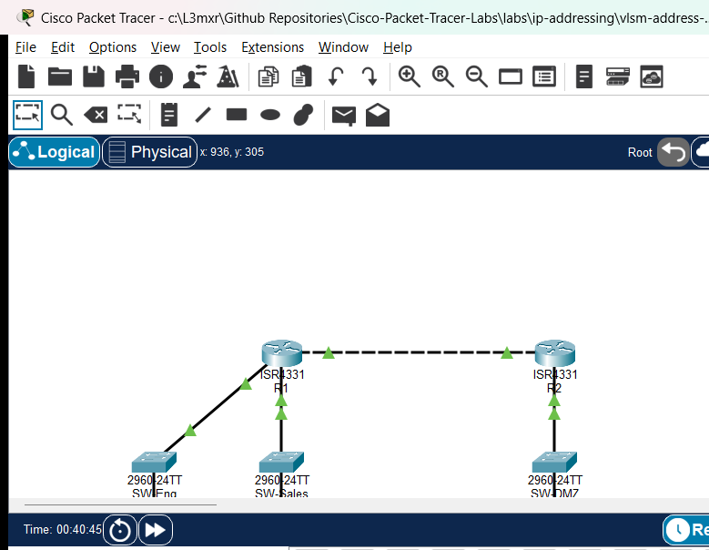

# PTL-0047: VLSM Address Plan Fault Investigation

## Learning Objectives
- Audit an enterprise Variable Length Subnet Masking (VLSM) address allocation plan against actual router interface and host workstation configurations.
- Identify invalid IPv4 host assignments, specifically detecting when directed broadcast or network identifier addresses are incorrectly assigned to endpoints.
- Diagnose and remediate default gateway and inter-router point-to-point transit subnet mask discrepancies using Cisco IOS diagnostic commands (`show ip interface brief`, `show interfaces`).
- Calculate exact prefix lengths, subnet masks, and usable host address ranges to satisfy host capacity requirements while preventing subnet overlap and conserving IPv4 address space.
- Verify bidirectional intra-subnet, inter-subnet, and cross-WAN transit data plane reachability across all provisioned organizational zones.

## Prerequisites
- Completion of [PTL-0015: IPv4 Subnetting and VLSM Design](../../ip-addressing/ipv4-subnetting-and-vlsm/README.md).
- Understanding of binary and dotted-decimal subnet masks (`/24`, `/26`, `/27`, `/28`, `/30`).
- Familiarity with Cisco IOS router interface configuration and static route syntax.

## Topology



The topology models an enterprise branch network connected to corporate headquarters across an inter-router point-to-point transit link. Branch router `R1` services two local departments (Engineering LAN on `Gi0/0/0` and Sales LAN on `Gi0/0/1`) through dedicated access switches (`SW-Eng` and `SW-Sales`). Router `R1` connects to HQ router `R2` across a point-to-point WAN link on `Gi0/0/2`, while `R2` provides access to the corporate Server DMZ on `Gi0/0/0` through `SW-DMZ`.

```text
+-----------------------------------------------------------------------------------+
|                                  ENTERPRISE TOPOLOGY                              |
|                                                                                   |
|  [Engineering LAN: /26]          [Sales LAN: /27]             [Server DMZ: /28]   |
|   PC-Eng1: .10                    PC-Sales1: .70               Srv-Web: .98       |
|        |                               |                            |             |
|     SW-Eng                          SW-Sales                      SW-DMZ          |
|        |                               |                            |             |
|      Gi0/0/0                         Gi0/0/1                      Gi0/0/0         |
|   +----------+                   +----------+                 +----------+        |
|   |    R1    |=== Gi0/0/2 ======>|    R2    |=================|  Servers |        |
|   | (Branch) |   [WAN: .112/30]  |   (HQ)   |                 +----------+        |
|   +----------+                   +----------+                                     |
+-----------------------------------------------------------------------------------+
```

## Addressing Table

### Base Allocation: `192.168.100.0/24`
| Subnet Name | Host Requirement | Prefix Length | Subnet Mask | Network Address | Usable Host Range | Broadcast Address |
|---|---|---|---|---|---|---|
| **Engineering LAN** | 50 hosts | `/26` | `255.255.255.192` | `192.168.100.0` | `192.168.100.1` - `192.168.100.62` | `192.168.100.63` |
| **Sales LAN** | 25 hosts | `/27` | `255.255.255.224` | `192.168.100.64` | `192.168.100.65` - `192.168.100.94` | `192.168.100.95` |
| **Server DMZ** | 10 hosts | `/28` | `255.255.255.240` | `192.168.100.96` | `192.168.100.97` - `192.168.100.110` | `192.168.100.111` |
| **WAN Transit** | 2 hosts | `/30` | `255.255.255.252` | `192.168.100.112` | `192.168.100.113` - `192.168.100.114` | `192.168.100.115` |

### Device Interface Configuration Table
| Device | Interface | IP Address | Subnet Mask | Default Gateway | Connected Subnet / Notes |
|---|---|---|---|---|---|
| **R1** | Gi0/0/0 | 192.168.100.1 | 255.255.255.192 | N/A | Engineering LAN Gateway (`/26`) |
| **R1** | Gi0/0/1 | 192.168.100.65 | 255.255.255.224 | N/A | Sales LAN Gateway (`/27`) — Configured with `/28` in starter |
| **R1** | Gi0/0/2 | 192.168.100.113 | 255.255.255.252 | N/A | WAN Transit to R2 (`/30`) — Configured with `/29` in starter |
| **R2** | Gi0/0/0 | 192.168.100.97 | 255.255.255.240 | N/A | Server DMZ Gateway (`/28`) |
| **R2** | Gi0/0/2 | 192.168.100.114 | 255.255.255.252 | N/A | WAN Transit to R1 (`/30`) |
| **PC-Eng1** | FastEthernet0 | 192.168.100.10 | 255.255.255.192 | 192.168.100.1 | Engineering Workstation — Configured with broadcast IP `.63` in starter |
| **PC-Sales1** | FastEthernet0 | 192.168.100.70 | 255.255.255.224 | 192.168.100.65 | Sales Workstation — Assigned `.85` in starter (outside `/28`) |
| **Srv-Web** | FastEthernet0 | 192.168.100.98 | 255.255.255.240 | 192.168.100.97 | Corporate Web Server |

## Lab Tasks
1. **Audit the VLSM Address Allocation Plan**: Review the enterprise base network `192.168.100.0/24` and verify that each departmental subnet block provides sufficient host capacity without overlapping adjacent subnets.
2. **Investigate Endpoint IP Configuration Faults**: Inspect `PC-Eng1` network settings using `ipconfig` and identify why attempts to reach the local default gateway fail. Determine if the assigned address violates host addressing rules (network ID or broadcast address).
3. **Audit Router Interface Subnet Masks**: Run `show ip interface brief` and `show interfaces` on branch router `R1`. Compare the configured subnet masks on `Gi0/0/1` and `Gi0/0/2` against the formal VLSM address plan.
4. **Remediate Addressing Discrepancies**:
   - Reconfigure `PC-Eng1` with a valid usable host IP (`192.168.100.10/26`).
   - Correct the subnet mask on `R1 Gi0/0/1` to `/27` (`255.255.255.224`).
   - Correct the subnet mask on `R1 Gi0/0/2` to `/30` (`255.255.255.252`).
5. **Verify Intra-Subnet and Inter-Router Connectivity**: Verify ping reachability from PC endpoints to their respective default gateways and across the point-to-point WAN transit link between `R1` and `R2`.
6. **Validate End-to-End Multi-Subnet Data Plane Delivery**: Perform end-to-end ping tests from `PC-Eng1` and `PC-Sales1` to corporate server `Srv-Web` (`192.168.100.98`) to confirm full routing convergence.

## Configuration Walkthrough

### 1. Diagnosing Fault 1: Directed Broadcast Host Assignment
In the starter topology, test gateway connectivity from `PC-Eng1`:

```text
PC> ping 192.168.100.1
Pinging 192.168.100.1 with 32 bytes of data:
Request timed out.
Request timed out.
Request timed out.
Request timed out.

Ping statistics for 192.168.100.1:
    Packets: Sent = 4, Received = 0, Lost = 4 (100% loss)
```

Now inspect the IP configuration on `PC-Eng1`:

```text
PC> ipconfig
FastEthernet0 Connection:(default port)
   Link-local IPv6 Address.........: FE80::201:97FF:FEAA:1101
   IP Address......................: 192.168.100.63
   Subnet Mask.....................: 255.255.255.192
   Default Gateway.................: 192.168.100.1
```

Analyze the subnet boundary for `192.168.100.0/26`:
- A `/26` prefix uses 26 network bits and 6 host bits ($2^6 = 64$ addresses per block).
- Block range: `192.168.100.0` to `192.168.100.63`.
- Network address: `192.168.100.0`.
- Usable host range: `192.168.100.1` through `192.168.100.62`.
- Directed broadcast address: `192.168.100.63`.

Because `PC-Eng1` was assigned `.63`, it was configured with the **directed broadcast address** of the subnet. IP stacks reject unicast communication originating from or addressed to a broadcast address.

**Remediation**: Reconfigure `PC-Eng1` with usable IP `192.168.100.10`, mask `255.255.255.192`, and gateway `192.168.100.1`.

### 2. Diagnosing Fault 2: Subnet Capacity Deficit and Mask Truncation on Gateway
Inspect router `R1` interface settings:

```text
R1# show interfaces GigabitEthernet0/0/1
GigabitEthernet0/0/1 is up, line protocol is up
  Hardware is ISR4331-3x1GE, address is 0002.166d.c402 (bia 0002.166d.c402)
  Description: Sales LAN
  Internet address is 192.168.100.65/28
```

Notice that `R1 Gi0/0/1` is configured with `192.168.100.65/28` (`255.255.255.240`).
However:
- The Sales LAN requires 25 host addresses. A `/28` prefix provides only $2^4 - 2 = 14$ usable host addresses (`192.168.100.65` through `192.168.100.78`), with `.79` acting as the directed broadcast address. This creates an immediate capacity deficit.
- In the starter topology, `PC-Sales1` was assigned `192.168.100.85/27`. Under the `/28` mask configured on `R1`, address `.85` is considered outside the local subnet. Consequently, `PC-Sales1` cannot communicate with gateway `192.168.100.65` (100% packet loss).
- Correcting `R1 Gi0/0/1` to `/27` (`255.255.255.224`) expands the subnet block to `192.168.100.64` - `192.168.100.95` (30 usable hosts), providing sufficient capacity and restoring gateway reachability.

**Remediation**:
```text
R1# configure terminal
R1(config)# interface GigabitEthernet0/0/1
R1(config-if)# ip address 192.168.100.65 255.255.255.224
R1(config-if)# exit
```
And reconfigure `PC-Sales1` to planned address `192.168.100.70`, mask `255.255.255.224`, default gateway `192.168.100.65`.

### 3. Diagnosing Fault 3: WAN Transit Prefix Inefficiency
Inspect the inter-router point-to-point link on `R1`:

```text
R1# show interfaces GigabitEthernet0/0/2
GigabitEthernet0/0/2 is up, line protocol is up
  Description: WAN Transit to R2
  Internet address is 192.168.100.113/29
```

`R1 Gi0/0/2` was configured with `/29` (`255.255.255.248`), whereas `R2 Gi0/0/2` was correctly configured with `/30` (`255.255.255.252`). A point-to-point transit link interconnecting only two routers requires exactly 2 usable host addresses ($2^2 - 2 = 2$), which is perfectly satisfied by a `/30` prefix. Using `/29` wastes 4 valuable host addresses.

**Remediation**:
```text
R1(config)# interface GigabitEthernet0/0/2
R1(config-if)# ip address 192.168.100.113 255.255.255.252
R1(config-if)# exit
R1(config)# end
R1# copy running-config startup-config
```

## Verification

### 1. Interface IP and Subnet Mask Verification
Verify the running interface table on `R1`:

```text
R1# show ip interface brief
Interface              IP-Address      OK? Method Status                Protocol
GigabitEthernet0/0/0   192.168.100.1   YES manual up                    up      
GigabitEthernet0/0/1   192.168.100.65  YES manual up                    up      
GigabitEthernet0/0/2   192.168.100.113 YES manual up                    up      
```

Confirm exact prefix lengths on `R1`:
- `Gi0/0/0`: `Internet address is 192.168.100.1/26`
- `Gi0/0/1`: `Internet address is 192.168.100.65/27`
- `Gi0/0/2`: `Internet address is 192.168.100.113/30`

Verify `R2`:
- `Gi0/0/0`: `Internet address is 192.168.100.97/28`
- `Gi0/0/2`: `Internet address is 192.168.100.114/30`

### 2. Intra-Subnet Gateway Ping Verification
Test gateway reachability from `PC-Eng1`:

```text
PC> ping 192.168.100.1
Pinging 192.168.100.1 with 32 bytes of data:
Reply from 192.168.100.1: bytes=32 time<1ms TTL=255
Reply from 192.168.100.1: bytes=32 time<1ms TTL=255
Reply from 192.168.100.1: bytes=32 time<1ms TTL=255
Reply from 192.168.100.1: bytes=32 time<1ms TTL=255

Ping statistics for 192.168.100.1:
    Packets: Sent = 4, Received = 4, Lost = 0 (0% loss)
```

Test gateway reachability from `PC-Sales1`:

```text
PC> ping 192.168.100.65
Pinging 192.168.100.65 with 32 bytes of data:
Reply from 192.168.100.65: bytes=32 time<1ms TTL=255
Reply from 192.168.100.65: bytes=32 time<1ms TTL=255
Reply from 192.168.100.65: bytes=32 time<1ms TTL=255
Reply from 192.168.100.65: bytes=32 time<1ms TTL=255

Ping statistics for 192.168.100.65:
    Packets: Sent = 4, Received = 4, Lost = 0 (0% loss)
```

### 3. Point-to-Point WAN Transit Verification
Test connectivity across the WAN link from `R1`:

```text
R1# ping 192.168.100.114
Type escape sequence to abort.
Sending 5, 100-byte ICMP Echos to 192.168.100.114, timeout is 2 seconds:
!!!!!
Success rate is 100 percent (5/5), round-trip min/avg/max = 1/1/2 ms
```

### 4. End-to-End Enterprise Multi-Subnet Routing
Verify multi-hop reachability from `PC-Eng1` to corporate server `Srv-Web`:

```text
PC> ping 192.168.100.98
Pinging 192.168.100.98 with 32 bytes of data:
Reply from 192.168.100.98: bytes=32 time=1ms TTL=126
Reply from 192.168.100.98: bytes=32 time=1ms TTL=126
Reply from 192.168.100.98: bytes=32 time=1ms TTL=126
Reply from 192.168.100.98: bytes=32 time=1ms TTL=126

Ping statistics for 192.168.100.98:
    Packets: Sent = 4, Received = 4, Lost = 0 (0% loss)
```

Verify multi-hop reachability from `PC-Sales1` to corporate server `Srv-Web`:

```text
PC> ping 192.168.100.98
Pinging 192.168.100.98 with 32 bytes of data:
Reply from 192.168.100.98: bytes=32 time=1ms TTL=126
Reply from 192.168.100.98: bytes=32 time=1ms TTL=126
Reply from 192.168.100.98: bytes=32 time=1ms TTL=126
Reply from 192.168.100.98: bytes=32 time=1ms TTL=126

Ping statistics for 192.168.100.98:
    Packets: Sent = 4, Received = 4, Lost = 0 (0% loss)
```

### Verification Criteria Checklist
| Test ID | Objective | Expected Output | Status |
|---|---|---|---|
| POS-01 | R1 Addressing & Mask Validation | Gi0/0/0 .1/26, Gi0/0/1 .65/27, Gi0/0/2 .113/30 up/up | PASS |
| POS-02 | R2 Addressing & Mask Validation | Gi0/0/0 .97/28, Gi0/0/2 .114/30 up/up | PASS |
| POS-03 | Engineering LAN Gateway Ping | 0% packet loss (PC-Eng1 -> R1 Gi0/0/0) | PASS |
| POS-04 | Sales LAN Gateway Ping | 0% packet loss (PC-Sales1 -> R1 Gi0/0/1) | PASS |
| POS-05 | WAN Transit Link Ping | 100% success rate (R1 -> R2 Gi0/0/2) | PASS |
| POS-06 | End-to-End Enterprise Ping | 0% packet loss (PC-Eng1 -> Srv-Web) | PASS |
| POS-07 | End-to-End Enterprise Ping | 0% packet loss (PC-Sales1 -> Srv-Web) | PASS |

## Troubleshooting
- **PC Cannot Ping Local Gateway (`Request timed out`)**:
  - Run `ipconfig` on the endpoint. Ensure the IP address is not the network address (first address in block) or directed broadcast address (last address in block).
  - Verify that the subnet mask entered on the PC matches the prefix length configured on the router gateway interface.
  - Verify physical cabling and port status on the intermediate switch.
- **Router Rejects Interface IP Configuration (`% Overlaps with...`)**:
  - Cisco IOS dynamically detects overlapping IP address blocks across active interfaces.
  - If a mask is too broad (e.g., using `/24` or `/26` when `/27` was intended), the calculated subnet range will overlap adjacent interface blocks.
  - Correct the subnet mask or network block allocation before re-applying the IP address.
- **Inter-Subnet Pings Fail Across WAN Transit Link**:
  - Verify that both routers have static or dynamic routes for remote departmental subnets.
  - Check the point-to-point transit link: verify that both router interfaces share the same `/30` subnet (`255.255.255.252`) and can ping each other directly.

## Key Takeaways
- **VLSM Efficiency**: VLSM maximizes IPv4 address efficiency by breaking away from classful and fixed-length boundaries, allocating subnets customized to specific departmental requirements ($2^h - 2 \ge \text{required hosts}$).
- **Address Boundary Rules**: In every IPv4 subnet, the first address ($h=0$) is reserved as the Network ID and the last address ($h=\text{all 1s}$) is reserved as the Directed Broadcast. Neither can ever be assigned to a host or router interface.
- **Subnet Mask Consistency**: Both the endpoint and the default gateway must share the identical subnet mask. A mask mismatch leads to split-horizon broadcast calculation errors and broken ARP resolution.
- **Point-to-Point Optimization**: Dedicated dual-node point-to-point links (such as router-to-router WAN circuits) should always use `/30` (or `/31` RFC 3021 where supported) to eliminate address waste.

## References
- [RFC 1878: Variable Length Subnet Table For IPv4](https://datatracker.ietf.org/doc/html/rfc1878)
- [Cisco Technical Support: IP Addressing and Subnetting for New Users](https://www.cisco.com/c/en/us/support/docs/ip/routing-information-protocol-rip/13788-3.html)
- [Cisco 4000 Series ISR Software Configuration Guide](https://www.cisco.com/c/en/us/td/docs/routers/access/4400/software/configuration/guide/isr4400swcfg.html)

## Files and Validation Status
- `assets/starter.pkt`: Initial topology containing addressing design faults (broadcast IP host assignment on Engineering PC, `/28` mask truncation on Sales gateway with isolated host, and `/29` mask on WAN link).
- `assets/completed.pkt`: Fully remediated topology adhering to the enterprise VLSM address plan.
- `assets/topology.png`: Visual network diagram illustrating branch and HQ router subnets.
- `assets/test_evidence.json`: Automated test execution results captured via Packet Tracer MCP bridge.
- `configs/R1.txt`: Baseline running configuration for Branch Router 1.
- `configs/R2.txt`: Baseline running configuration for HQ Router 2.
- `verification.md`: Comprehensive verification matrix detailing positive, negative, and reload tests.

