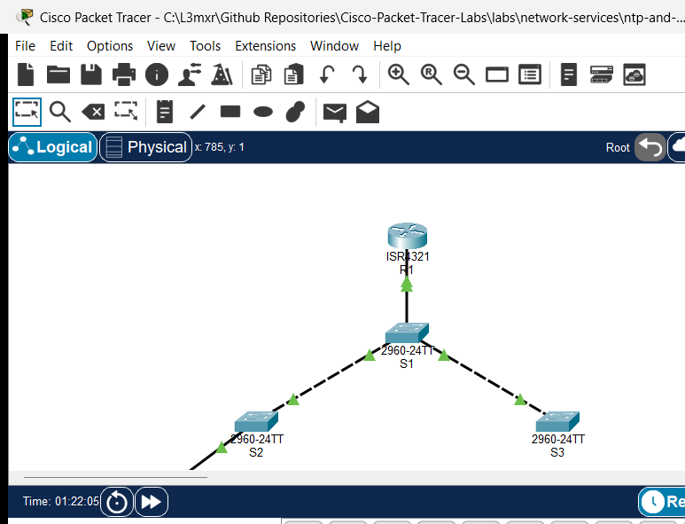

# PTL-0024: CDP Neighbor Discovery and Topology Audit

> **Category:** network-fundamentals · **Difficulty:** beginner · **Lab ID:** PTL-0024 · **Document:** reviewed · **Simulator:** tested pass

In enterprise network engineering, professionals frequently encounter complex physical infrastructures where documentation is outdated, incomplete, or entirely missing. Traceable cabling labels may be absent, and physical access to remote wiring closets or datacenter racks may be restricted. In such environments, discovery protocols provide the primary mechanism for discovering network topology and auditing device connections directly from the command line.

The **Cisco Discovery Protocol (CDP)** is an IEEE 802.3 Logical Link Control (LLC) Layer 2 proprietary protocol enabled by default on virtually all Cisco routers, switches, and communication servers. Because CDP operates strictly at the Data Link layer independent of network-layer protocol suites (such as IPv4 or IPv6), two directly connected Cisco devices can discover and communicate with each other even if their IP addresses are unconfigured, misconfigured, or on completely different subnets.

CDP periodically broadcasts unencrypted Type-Length-Value (TLV) frames containing crucial device telemetry: hostname identifiers, hardware platforms, software versions, native VLAN numbers, duplex settings, and local/remote interface connections. While invaluable for troubleshooting and inventory mapping, broadcasting this telemetry on access switchports facing end users introduces security risks by exposing reconnaissance data to unauthorized eavesdroppers. Enterprise hardening best practices mandate selectively disabling CDP on untrusted access ports.

In this laboratory, you will explore CDP from both an operational and security perspective. You will map a multi-switch campus distribution topology without consulting physical cabling diagrams, audit neighbor capabilities and IP addresses, inspect protocol timers, and execute security hardening on edge interfaces.

---

## Learning Objectives

- Explain the architecture, Layer 2 frame format, and Type-Length-Value (TLV) structure of the Cisco Discovery Protocol (CDP).
- Discover directly connected neighbors, device identifiers, and local/remote interface mappings using `show cdp neighbors`.
- Audit hardware platforms, Cisco IOS release versions, capabilities, and management IP addresses using `show cdp neighbors detail`.
- Query specific device telemetry using targeted commands such as `show cdp entry <device-id>`.
- Inspect global protocol parameters, packet timers, and interface operational states using `show cdp` and `show cdp interface`.
- Evaluate the security implications of CDP information disclosure on access-layer switchports.
- Harden access switchports facing end-user workstations by selectively disabling CDP using `no cdp enable`.
- Compare interface-level disabling (`no cdp enable`) with global protocol deactivation (`no cdp run`).

---

## Prerequisites

- Understanding of Layer 2 Ethernet framing and basic switch operation.
- Basic familiarity with Cisco IOS user EXEC, privileged EXEC, and global configuration modes.
- Completion of **PTL-0008: Router Configuration Baseline** or equivalent introductory networking experience.
- Cisco Packet Tracer 8.2 or newer (Packet Tracer 9.0+ verified).

---

## Topology



The topology models a hierarchical campus distribution and access network consisting of a core gateway router (`R1`), a central distribution switch (`S1`), two building access switches (`S2` and `S3`), and an administrator workstation (`PC-Admin`):

```text
               [R1 Router] (ISR 4321)
               Gi0/0/0 (192.168.1.1/24)
                    │
                    │ Gi0/1
              [Switch S1] (Distribution 2960)
         Fa0/1 │         │ Fa0/2
       ┌───────┘         └───────┐
       │ Fa0/1                   │ Fa0/1
  [Switch S2]               [Switch S3]
 (Access Bldg A)           (Access Bldg B)
       │ Fa0/10
       │
  [PC-Admin]
 (192.168.1.50)
```

| Device Name | Model | Interface | Connected Device | Neighbor Interface | Network Role |
|---|---|---|---|---|---|
| **R1** | Cisco ISR 4321 | GigabitEthernet0/0/0 | Switch S1 | GigabitEthernet0/1 | Core Gateway Router (`192.168.1.1/24`) |
| **Switch S1** | Catalyst 2960-24TT | GigabitEthernet0/1 | R1 | GigabitEthernet0/0/0 | Distribution Uplink to Router |
| **Switch S1** | Catalyst 2960-24TT | FastEthernet0/1 | Switch S2 | FastEthernet0/1 | Distribution Interconnect to Access Switch 2 |
| **Switch S1** | Catalyst 2960-24TT | FastEthernet0/2 | Switch S3 | FastEthernet0/1 | Distribution Interconnect to Access Switch 3 |
| **Switch S2** | Catalyst 2960-24TT | FastEthernet0/1 | Switch S1 | FastEthernet0/1 | Uplink to Distribution Switch |
| **Switch S2** | Catalyst 2960-24TT | FastEthernet0/10 | PC-Admin | FastEthernet0 | Access Switchport for Administrator Host |
| **Switch S3** | Catalyst 2960-24TT | FastEthernet0/1 | Switch S1 | FastEthernet0/2 | Uplink to Distribution Switch |
| **PC-Admin** | PC-PT | FastEthernet0 | Switch S2 | FastEthernet0/10 | Management Workstation (`192.168.1.50/24`) |

---

## Addressing Table

| Device | Interface | IPv4 Address | Subnet Mask | Default Gateway | CDP Role / State |
|---|---|---|---|---|---|
| **R1** | `Gi0/0/0` | `192.168.1.1` | `255.255.255.0` | N/A | Core Discovery Node (CDP Enabled) |
| **Switch S1** | `Vlan1` | `192.168.1.2` | `255.255.255.0` | `192.168.1.1` | Distribution Hub (CDP Enabled) |
| **Switch S2** | `Vlan1` | `192.168.1.3` | `255.255.255.0` | `192.168.1.1` | Access Switch (Hardened on Fa0/10) |
| **Switch S3** | `Vlan1` | `192.168.1.4` | `255.255.255.0` | `192.168.1.1` | Access Switch (CDP Enabled) |
| **PC-Admin** | `FastEthernet0` | `192.168.1.50` | `255.255.255.0` | `192.168.1.1` | Non-CDP End Device |

---

## Lab Tasks

1. **Perform Multi-Neighbor Discovery:** Use `show cdp neighbors` on `S1` to discover all directly attached infrastructure nodes and reconstruct the cabling diagram.
2. **Audit Device Telemetry & Management Addresses:** Use `show cdp neighbors detail` on `R1` to discover neighbor hardware models, Cisco IOS software versions, and IP management addresses.
3. **Targeted Device Telemetry Query:** Use `show cdp entry S1` on `S2` to query details for a specific neighbor without paginating through the full neighbor database.
4. **Audit Protocol Timers & Interface Transmission:** Inspect CDP update timers and holdtimes using `show cdp` and verify per-interface parameters using `show cdp interface`.
5. **Harden Edge Switchports:** Disable CDP frame transmissions on `S2 FastEthernet0/10` facing `PC-Admin` to prevent information disclosure.
6. **Evaluate Global Protocol Deactivation:** Test global CDP disabling (`no cdp run`) on `S3`, observe cache purging, and restore normal operation.

---

## Configuration Walkthrough

### Task 1: Discover Neighbors from Distribution Switch S1
Access the CLI of `S1` and enter privileged EXEC mode:

```cisco
enable
terminal length 0
show cdp neighbors
```

Examine the output columns:
- **Device ID:** The hostname of the neighbor (`R1`, `S2`, `S3`).
- **Local Intrfce:** The physical port on `S1` where the neighbor is plugged in (`Gig 0/1`, `Fas 0/1`, `Fas 0/2`).
- **Holdtme:** Remaining seconds before the neighbor entry expires if no new advertisement is received.
- **Capability:** Device type (`R` for Router, `S` for Switch).
- **Platform:** Hardware model family (`ISR4300`, `2960`).
- **Port ID:** The remote physical port on the neighboring device (`Gig 0/0/0`, `Fas 0/1`).

### Task 2: Audit Detailed TLVs from Core Router R1
Access the CLI of `R1` and inspect detailed neighbor records:

```cisco
enable
terminal length 0
show cdp neighbors detail
```

Notice the IP management address (`192.168.1.2`), native duplex mode, and complete Cisco IOS release string advertised by `S1`.

### Task 3: Query a Specific Device Entry from Switch S2
Access the CLI of `S2` and query only the distribution switch:

```cisco
enable
show cdp entry S1
```

### Task 4: Audit CDP Timers on R1
Verify global protocol timers on `R1`:

```cisco
show cdp
show cdp interface GigabitEthernet0/0/0
```

Notice the transmission timer is 60 seconds and the holdtime is 180 seconds.

### Task 5: Harden Edge Access Port on S2
Because `PC-Admin` is an end-user host that does not participate in network infrastructure management, broadcasting internal router and switch details onto `FastEthernet0/10` presents an unnecessary security exposure. Disable CDP on that interface:

```cisco
configure terminal
interface FastEthernet0/10
description Access Port to PC-Admin (Hardened)
no cdp enable
exit
end
copy running-config startup-config
```

### Task 6: Evaluate Global Disabling on S3
On `S3`, test completely stopping the CDP process:

```cisco
configure terminal
no cdp run
end
show cdp neighbors
```

Observe the response: `% CDP is not enabled`.

Re-enable CDP on `S3` to maintain enterprise management visibility:

```cisco
configure terminal
cdp run
end
copy running-config startup-config
```

---

## Verification

### 1. Verify Multi-Neighbor Discovery on S1
```cisco
S1#show cdp neighbors
Capability Codes: R - Router, T - Trans Bridge, B - Source Route Bridge
                  S - Switch, H - Host, I - IGMP, r - Repeater, P - Phone
Device ID    Local Intrfce   Holdtme    Capability   Platform    Port ID
R1           Gig 0/1          166            R       ISR4300     Gig 0/0/0
S2           Fas 0/1          145            S       2960        Fas 0/1
S3           Fas 0/2          165            S       2960        Fas 0/1
```
All three infrastructure neighbors appear with valid holdtimes and correct interface pairings.

### 2. Verify Edge Port Hardening on S2
```cisco
S2#show cdp interface FastEthernet0/10
```
The command produces no output, confirming that CDP frame generation is completely suppressed on `Fa0/10`, while trunk port `Fa0/1` continues to exchange CDP frames with `S1`.

### 3. Verify Global Protocol Restoration on S3
```cisco
S3#show cdp neighbors
Capability Codes: R - Router, T - Trans Bridge, B - Source Route Bridge
                  S - Switch, H - Host, I - IGMP, r - Repeater, P - Phone
Device ID    Local Intrfce   Holdtme    Capability   Platform    Port ID
S1           Fas 0/1          173            S       2960        Fas 0/2
```
Neighbor `S1` is successfully restored following global protocol re-enablement.

---

## Troubleshooting

### Issue 1: Neighbor Does Not Appear in Table
- **Symptom:** Directly connected device is missing from `show cdp neighbors`.
- **Cause 1:** Physical cable disconnected or interface administratively down.
- **Cause 2:** The neighbor has CDP disabled globally (`no cdp run`) or on the connected interface (`no cdp enable`).
- **Remediation:** Verify Layer 1/2 status with `show ip interface brief`. Verify that `cdp run` is active on both devices.

### Issue 2: CDP Advertisements Blocked by Non-Cisco Hardware
- **Symptom:** Two Cisco switches connected through a third-party unmanaged switch do not see each other.
- **Cause:** CDP uses a multicast destination MAC address (`01:00:0C:CC:CC:CC`). Some non-Cisco switches discard this frame rather than forwarding it.
- **Remediation:** Connect Cisco devices directly or configure the intermediate device to forward Cisco multicast frames.

---

## Key Takeaways

1. **Layer 2 Protocol Independence:** CDP operates at the Data Link layer and functions regardless of IP address configuration or routing state.
2. **Reconnaissance vs Observability:** While indispensable for rapid topology mapping, CDP broadcasts sensitive infrastructure details. Always disable CDP on ports connected to untrusted devices (`no cdp enable`).
3. **Global vs Interface Control:** The `no cdp run` global configuration command halts the entire protocol subsystem and clears the neighbor table. The `no cdp enable` interface command suppresses advertisements on a single link while preserving neighbor discovery elsewhere.

---

## References

- [Cisco Discovery Protocol Configuration Guide](https://www.cisco.com/c/en/us/td/docs/ios-xml/ios/cdp/configuration/15-mt/cdp-15-mt-book.html)
- [Cisco Discovery Protocol Technology Support Overview](https://www.cisco.com/c/en/us/support/docs/ip/routing-information-protocol-rip/13783-cdp.html)
- [IEEE Standard 802.3 for Ethernet](https://standards.ieee.org/ieee/802.3/7071/)

---

## Files and Validation Status

- `assets/starter.pkt`: Baseline campus distribution topology with CDP globally enabled across all interfaces.
- `assets/completed.pkt`: Validated laboratory topology with edge access port security hardening (`no cdp enable` on S2 Fa0/10).
- `assets/topology.png`: Visual layout of the laboratory topology.
- `configs/R1.txt`: Running configuration for router `R1`.
- `configs/S1.txt`: Running configuration for distribution switch `S1`.
- `configs/S2.txt`: Running configuration for access switch `S2`.
- `configs/S3.txt`: Running configuration for access switch `S3`.
- `verification.md`: Complete positive and negative testing matrix with live Packet Tracer simulation evidence.

