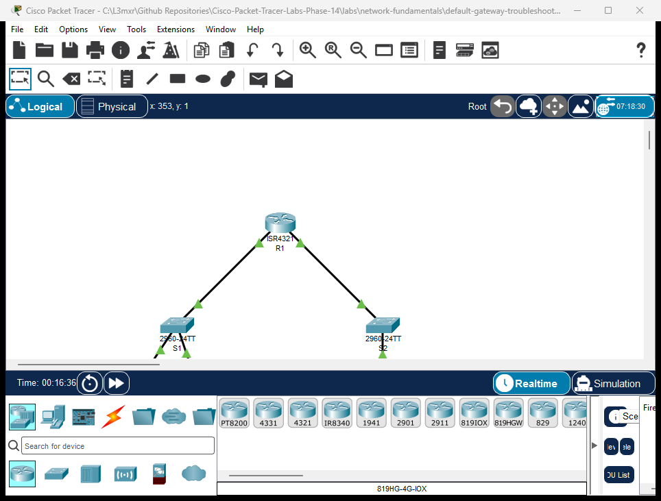

# PTL-0014: Default Gateway Operation and Troubleshooting


When two computers sit on the exact same local area network (LAN), they communicate directly through a switch using Layer 2 Ethernet MAC addresses resolved through the Address Resolution Protocol (ARP). However, when a computer attempts to transmit data to an IP address outside its local subnet, it cannot reach the remote computer directly at Layer 2. Instead, it must forward its IP packets to an intermediate Layer 3 device known as the **Default Gateway** (typically a local router interface).

In this lab, you will explore the operational boundary between local switching and routed forwarding. You will observe how hosts use ARP and the default gateway to deliver traffic, examine host routing decisions, and troubleshoot three common real-world default gateway failure scenarios: missing gateway, incorrect gateway IP, and gateway interface failure.

---

## Learning Objectives

- Explain the purpose and role of the default gateway in IPv4 networking.
- Contrast intra-subnet local frame delivery with inter-subnet routed delivery.
- Inspect and interpret host ARP tables (`arp -a`) and IP configuration (`ipconfig`).
- Diagnose the symptoms and root cause of a missing default gateway on a workstation.
- Troubleshoot the effects of an incorrect default gateway IP address.
- Verify connectivity restoration after resolving router gateway interface outages.

---

## Prerequisites

- Completion of [PTL-0008: Cisco IOS Navigation and Initial Device Configuration](../ios-navigation-and-initial-config/README.md) or equivalent basic command-line familiarity.
- Understanding of IPv4 dotted-decimal addressing, subnet masks (`255.255.255.0` / `/24`), and binary network boundaries.
- Familiarity with the layered diagnostic model outlined in the [Troubleshooting Guide](../../../docs/troubleshooting.md).

---

## Topology



The topology consists of two distinct local subnets connected through a central Cisco ISR 4321 router (`R1`):
- **Local LAN 1 (`192.168.10.0/24`):** Served by router interface `GigabitEthernet0/0/0` (`192.168.10.1`), connecting Catalyst switch `S1` (`192.168.10.2`), workstation `PC1` (`192.168.10.10`), and workstation `PC2` (`192.168.10.11`).
- **Remote LAN 2 (`192.168.20.0/24`):** Served by router interface `GigabitEthernet0/0/1` (`192.168.20.1`), connecting Catalyst switch `S2` (`192.168.20.2`) and remote workstation `PC-Remote` (`192.168.20.10`).

---

## Addressing Table

| Device | Interface | IP Address | Subnet Mask | Default Gateway | Role / Purpose |
|---|---|---|---|---|---|
| **R1** | `Gi0/0/0` | `192.168.10.1` | `255.255.255.0` | N/A | LAN 1 Gateway Interface |
| **R1** | `Gi0/0/1` | `192.168.20.1` | `255.255.255.0` | N/A | LAN 2 Gateway Interface |
| **S1** | `Vlan1` | `192.168.10.2` | `255.255.255.0` | `192.168.10.1` | LAN 1 Switch Management SVI |
| **S2** | `Vlan1` | `192.168.20.2` | `255.255.255.0` | `192.168.20.1` | LAN 2 Switch Management SVI |
| **PC1** | `FastEthernet0` | `192.168.10.10` | `255.255.255.0` | `192.168.10.1` *(Investigate)* | Local Workstation 1 |
| **PC2** | `FastEthernet0` | `192.168.10.11` | `255.255.255.0` | `192.168.10.1` | Local Workstation 2 |
| **PC-Remote** | `FastEthernet0` | `192.168.20.10` | `255.255.255.0` | `192.168.20.1` | Remote Destination Host |

---

## Lab Tasks

1. **Verify Baseline Local Connectivity:** Open `PC1` command prompt and verify reachability to local peer `PC2` (`192.168.10.11`).
2. **Diagnose Inter-Subnet Failure:** Attempt to ping `PC-Remote` (`192.168.20.10`) from `PC1` and observe the failure symptom.
3. **Inspect Host Configuration:** Run `ipconfig` on `PC1` to identify the missing default gateway parameter (`0.0.0.0`).
4. **Remediate Host Gateway:** Configure `192.168.10.1` as the default gateway on `PC1`.
5. **Verify End-to-End Routing:** Ping `R1` gateway (`192.168.10.1`) and `PC-Remote` (`192.168.20.10`) to verify routed connectivity.
6. **Analyze Host ARP Table:** Inspect `arp -a` on `PC1` and confirm that only local IP addresses (peer `192.168.10.11` and gateway `192.168.10.1`) have MAC entries.
7. **Perform Fault Injection Scenarios:** Test the diagnostic symptoms of an invalid gateway IP address and a downed router gateway interface.

---

## Configuration Walkthrough

### 1. Router R1 Interface Configuration

On Router `R1`, both LAN gateway interfaces are configured and brought up:

```text
Router> enable
Router# configure terminal
Router(config)# hostname R1
R1(config)# interface GigabitEthernet0/0/0
R1(config-if)# description Gateway for LAN 1
R1(config-if)# ip address 192.168.10.1 255.255.255.0
R1(config-if)# no shutdown
R1(config-if)# exit
R1(config)# interface GigabitEthernet0/0/1
R1(config-if)# description Gateway for LAN 2 (Remote)
R1(config-if)# ip address 192.168.20.1 255.255.255.0
R1(config-if)# no shutdown
R1(config-if)# exit
R1(config)# end
R1# write memory
```

### 2. Switch S1 and S2 Management Configuration

Switches require `ip default-gateway` for remote management reachability outside their local management VLAN:

```text
Switch> enable
Switch# configure terminal
Switch(config)# hostname S1
S1(config)# interface Vlan1
S1(config-if)# ip address 192.168.10.2 255.255.255.0
S1(config-if)# no shutdown
S1(config-if)# exit
S1(config)# ip default-gateway 192.168.10.1
S1(config)# end
S1# write memory
```

On `S2`:

```text
Switch> enable
Switch# configure terminal
Switch(config)# hostname S2
S2(config)# interface Vlan1
S2(config-if)# ip address 192.168.20.2 255.255.255.0
S2(config-if)# no shutdown
S2(config-if)# exit
S2(config)# ip default-gateway 192.168.20.1
S2(config)# end
S2# write memory
```

### 3. Workstation Remediation (PC1)

In the starter activity (`assets/starter.pkt`), `PC1` has an unconfigured default gateway. In the Packet Tracer GUI:
1. Click on **PC1** -> **Desktop** tab -> **IP Configuration**.
2. Change **Default Gateway** from `0.0.0.0` to `192.168.10.1`.
3. Close the window and return to the **Command Prompt**.

---

## Verification

### Positive Test 1: Verify Host IP Configuration
```text
C:\>ipconfig

FastEthernet0 Connection:
   Link-local IPv6 Address.........: FE80::20D:BDFF:FE64:885
   IPv4 Address....................: 192.168.10.10
   Subnet Mask.....................: 255.255.255.0
   Default Gateway.................: 192.168.10.1
```

### Positive Test 2: Local Intra-Subnet Ping (PC1 to PC2)
```text
C:\>ping 192.168.10.11

Pinging 192.168.10.11 with 32 bytes of data:

Reply from 192.168.10.11: bytes=32 time<1ms TTL=128
Reply from 192.168.10.11: bytes=32 time<1ms TTL=128
Reply from 192.168.10.11: bytes=32 time<1ms TTL=128
Reply from 192.168.10.11: bytes=32 time<1ms TTL=128

Ping statistics for 192.168.10.11:
    Packets: Sent = 4, Received = 4, Lost = 0 (0% loss)
```
*Note: Intra-subnet ping has TTL=128 and round-trip <1ms because packets travel purely through switch S1 without passing through a router.*

### Positive Test 3: Gateway Ping (PC1 to R1)
```text
C:\>ping 192.168.10.1

Pinging 192.168.10.1 with 32 bytes of data:

Reply from 192.168.10.1: bytes=32 time<1ms TTL=255
Reply from 192.168.10.1: bytes=32 time<1ms TTL=255
Reply from 192.168.10.1: bytes=32 time<1ms TTL=255
Reply from 192.168.10.1: bytes=32 time<1ms TTL=255

Ping statistics for 192.168.10.1:
    Packets: Sent = 4, Received = 4, Lost = 0 (0% loss)
```

### Positive Test 4: Remote Inter-Subnet Ping (PC1 to PC-Remote)
```text
C:\>ping 192.168.20.10

Pinging 192.168.20.10 with 32 bytes of data:

Reply from 192.168.20.10: bytes=32 time<1ms TTL=127
Reply from 192.168.20.10: bytes=32 time<1ms TTL=127
Reply from 192.168.20.10: bytes=32 time<1ms TTL=127
Reply from 192.168.20.10: bytes=32 time<1ms TTL=127

Ping statistics for 192.168.20.10:
    Packets: Sent = 4, Received = 4, Lost = 0 (0% loss)
```
*Note: Notice that the TTL decremented to 127. PC1 transmitted the packet with TTL=128, and router R1 decremented the TTL field by 1 upon forwarding the packet to LAN 2.*

### Positive Test 5: Inspect Host ARP Table
```text
C:\>arp -a
  Internet Address      Physical Address      Type
  192.168.10.1          0001.c748.1701        dynamic
  192.168.10.11         00e0.b0c2.31cb        dynamic
```
*Notice: PC1 has resolved MAC addresses for local peer 192.168.10.11 and default gateway 192.168.10.1. Crucially, 192.168.20.10 is NOT in PC1's ARP table because hosts never ARP for IP addresses outside their local subnet!*

---

## Troubleshooting

| Symptom | Diagnostic Finding | Root Cause | Remediation |
|---|---|---|---|
| PC1 can ping local peer `192.168.10.11`, but pings to `192.168.20.10` return immediate timeout or destination unreachable | `ipconfig` on PC1 reports `Default Gateway: 0.0.0.0` | Missing default gateway. The host cannot find a path to non-local networks. | Configure default gateway to `192.168.10.1`. |
| PC1 can ping local peer `192.168.10.11`, but pings to both gateway `192.168.10.1` and remote host time out | `ipconfig` shows gateway set to `192.168.10.254` (non-existent IP) | Incorrect default gateway IP address. The host sends ARP requests to `.254` but receives no reply. | Correct the default gateway IP to match router interface `192.168.10.1`. |
| Both PC1 and PC2 can communicate with each other, but neither can ping R1 or any remote destination | On R1, `show ip interface brief` shows `GigabitEthernet0/0/0` is `administratively down` | The router gateway interface was shut down or never enabled. | On R1, execute `interface Gi0/0/0` followed by `no shutdown`. |

---

## Key Takeaways

- **Local vs. Remote Forwarding:** A host uses its own IPv4 address and subnet mask to evaluate whether a destination IP is local or remote (`Destination IP & Subnet Mask == Local IP & Subnet Mask`).
- **Direct Delivery:** If the destination is local, the host sends an ARP broadcast for the destination IP address and transmits the Ethernet frame directly to the destination MAC.
- **Indirect Delivery:** If the destination is remote, the host encapsulates the IP packet into an Ethernet frame addressed to the **Default Gateway MAC address**.
- **No Remote ARPs:** A host never sends ARP requests for IP addresses on remote subnets. It only ARPs for its configured default gateway.
- **Layer 2 Isolation from Gateway State:** Intra-subnet communication continues to function completely even if the default gateway is powered off, disconnected, or misconfigured.

---

## References

- [Cisco IP Routing Protocols and Default Gateway Fundamentals](https://www.cisco.com/c/en/us/support/docs/ip/routing-information-protocol-rip/13788-3.html)
- [Cisco IOS IP Addressing Configuration Guide](https://www.cisco.com/c/en/us/td/docs/ios-xml/ios/ipaddr_l2/configuration/15-mt/ip2-15-mt-book.html)
- [Repository Troubleshooting Guide](../../../docs/troubleshooting.md)

---

## Files and Validation Status

| Deliverable | Location | Description |
|---|---|---|
| **Starter Activity** | [assets/starter.pkt](assets/starter.pkt) | Pre-cabled topology with unconfigured host gateway |
| **Completed Reference** | [assets/completed.pkt](assets/completed.pkt) | Fully operational topology with working default gateway |
| **Topology Screenshot** | [assets/topology.png](assets/topology.png) | High-resolution canvas capture from running simulator |
| **Router Configuration** | [configs/R1.txt](configs/R1.txt) | Cisco IOS interface commands for router R1 |
| **Switch 1 Configuration** | [configs/S1.txt](configs/S1.txt) | Catalyst management and default-gateway setup for S1 |
| **Switch 2 Configuration** | [configs/S2.txt](configs/S2.txt) | Catalyst management and default-gateway setup for S2 |
| **Verification Guide** | [verification.md](verification.md) | Step-by-step diagnostic verification instructions |
| **Simulator Evidence** | [PTL-0014 Simulator Results](../../../AI_AGENT_GUIDE/state/PTL-0014-SIMULATOR-RESULTS.md) | Authentic live simulator console traces |
