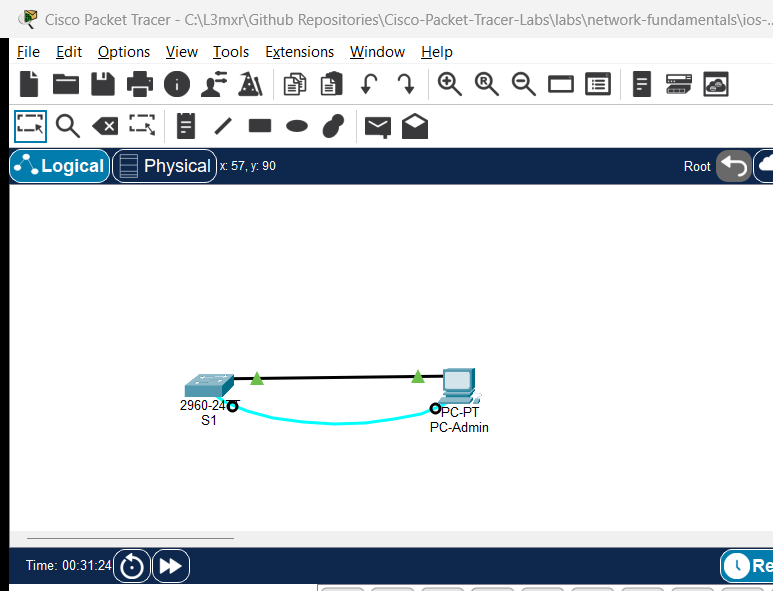

# Cisco IOS Navigation and Initial Device Configuration

> **Category:** network-fundamentals · **Difficulty:** beginner · **Lab ID:** PTL-0008 · **Document:** reviewed · **Simulator:** tested pass

The Cisco Internetwork Operating System (IOS) is the core operating system powering enterprise Cisco routers and switches. Interacting with Cisco IOS requires understanding its hierarchical command mode structure, context-sensitive help system, and configuration memory architecture. This lab provides a foundational, hands-on introduction to navigating the IOS Command Line Interface (CLI), configuring basic device identification and security parameters, and persisting configuration changes to non-volatile memory.

---

## Learning Objectives
- Identify and transition between primary Cisco IOS command modes: User EXEC, Privileged EXEC, Global Configuration, and sub-configuration modes.
- Utilize IOS CLI efficiency features including command completion (`Tab`) and context-sensitive help (`?`).
- Configure fundamental switch management settings: hostname, message-of-the-day (MOTD) banner, and privileged password encryption.
- Secure administrative access via physical console and virtual terminal (VTY) lines.
- Persist running configuration changes from volatile RAM to non-volatile NVRAM.

---

## Prerequisites
- Basic familiarity with computer terminal emulators.
- Cisco Packet Tracer 8.0 or newer installed.

---

## Topology



The topology models an initial out-of-band management connection using an RS-232 serial rollover console cable from a management workstation to a Cisco Catalyst 2960 switch:

```text
[PC-Admin] ──Serial (RS-232) ────── Console── [Switch S1]
```

| Device Name | Model | Interface | Connected Device | Neighbor Interface | Cable Type |
|---|---|---|---|---|---|
| **PC-Admin** | PC-PT | RS 232 | Switch S1 | Console | Rollover / Console Cable (Light Blue) |
| **Switch S1** | Catalyst 2960-24TT | Console | PC-Admin | RS 232 | Console Cable |

---

## Addressing Table

| Device | Interface | IPv4 Address | Subnet Mask | Default Gateway | Purpose |
|---|---|---|---|---|---|
| **S1** | VLAN 1 (SVI) | `192.168.1.5` | `255.255.255.0` | `192.168.1.1` | Management IP (Configured in Task 4) |
| **PC-Admin** | FastEthernet0 | `192.168.1.10` | `255.255.255.0` | `192.168.1.1` | Management Workstation |

---

## Lab Tasks
1. Connect PC-Admin to Switch S1 using the light blue Console cable in Packet Tracer.
2. Open PC-Admin -> **Desktop** -> **Terminal** and accept default serial terminal settings (9600 baud, 8 data bits, no parity, 1 stop bit, no flow control).
3. Explore IOS command modes and practice CLI navigation shortcuts.
4. Set the device hostname to `S1`.
5. Configure an encrypted enable secret password (`class`) and physical console password (`cisco`).
6. Configure virtual terminal lines (`line vty 0 15`) with a password for future remote sessions.
7. Configure a legal Message of the Day (MOTD) warning banner.
8. Enable global password encryption for legacy cleartext passwords (`service password-encryption`).
9. Save the running configuration to NVRAM (`copy running-config startup-config`).
10. Reload the switch to verify that configurations persist across a system reboot.

---

## Configuration Walkthrough

### 1. Understanding the IOS Command Hierarchy
Upon pressing Enter in the Terminal emulator, you arrive at the **User EXEC Mode**:
```text
Switch>
```
- In User EXEC, only basic non-disruptive commands (e.g. `ping`, `traceroute`, `show version`) are available.
- To access administrative and configuration commands, transition to **Privileged EXEC Mode** using `enable`:
```text
Switch> enable
Switch#
```
Notice the prompt changes from `>` to `#`.
- To make system-wide configuration changes, enter **Global Configuration Mode** using `configure terminal`:
```text
Switch# configure terminal
Enter configuration commands, one per line.  End with CNTL/Z.
Switch(config)#
```

### 2. Basic Device Identification and Security
```text
! Change hostname
Switch(config)# hostname S1

! Set encrypted Privileged EXEC secret (hashed with MD5 or SHA-256)
S1(config)# enable secret class

! Secure the physical console port
S1(config)# line console 0
S1(config-line)# password cisco
S1(config-line)# login
S1(config-line)# logging synchronous
S1(config-line)# exit

! Secure virtual terminal (VTY) lines (ports 0 through 15)
S1(config)# line vty 0 15
S1(config-line)# password cisco
S1(config-line)# login
S1(config-line)# exit

! Configure Legal Warning Banner
S1(config)# banner motd # Authorized Access Only! Violators will be prosecuted. #

! Encrypt cleartext passwords in the running configuration
S1(config)# service password-encryption
```

### 3. Configure Management SVI and Save to NVRAM
```text
! Management IP on VLAN 1
S1(config)# interface vlan 1
S1(config-if)# ip address 192.168.1.5 255.255.255.0
S1(config-if)# no shutdown
S1(config-if)# exit
S1(config)# ip default-gateway 192.168.1.1
S1(config)# end

! Save active configuration to startup memory
S1# copy running-config startup-config
Destination filename [startup-config]? [Press Enter]
Building configuration...
[OK]
```

---

## Verification

### 1. Verify Configuration Memory
Examine the active configuration currently stored in volatile RAM:
```text
S1# show running-config
```
Verify that:
- `hostname S1` is present.
- `enable secret` appears as an encrypted cryptographic hash string.
- Console and VTY passwords appear as encrypted Type 7 strings (e.g. `password 7 0822455D0A16`).
- The banner motd appears intact.

Examine the configuration stored in non-volatile NVRAM:
```text
S1# show startup-config
```
Confirm that `show startup-config` matches `show running-config`.

### 2. Verify Password Protection on Re-entry
Exit Privileged EXEC mode:
```text
S1# exit
```
Press Enter at the console. You should immediately be challenged for the console password:
```text
User Access Verification
Password: [Type: cisco]
S1> enable
Password: [Type: class]
S1#
```
Verify that both passwords authenticate successfully.

---

## Troubleshooting

- **Problem:** When typing passwords at the `Password:` prompt, no characters or asterisks appear on screen.
  - **Explanation:** This is normal and intentional security behavior in Cisco IOS. Keystrokes are read without echoing characters to prevent shoulder-surfing. Type the password steadily and press Enter.
- **Problem:** Configuration changes disappear after power-cycling or reloading the switch.
  - **Check:** Changes made in Global Configuration mode reside only in volatile RAM (`running-config`). If you reload without running `copy running-config startup-config`, all unsaved changes are lost.
- **Problem:** `logging synchronous` omitted causes console messages to interrupt typing.
  - **Fix:** Under `line console 0`, enter `logging synchronous`. This instructs IOS to redisplay your partially typed command line on a new row whenever an asynchronous system syslog notification appears.

---

## Key Takeaways
- Cisco IOS commands follow a strict hierarchical mode structure (`>` -> `#` -> `(config)#` -> sub-modes).
- `enable secret` supersedes the legacy `enable password` by utilizing irreversible one-way cryptographic hashing.
- `service password-encryption` prevents casual shoulder-surfing by obfuscating cleartext passwords with Vigenère/Type-7 ciphering (though it is not cryptographically robust against offline cracking).
- The `copy running-config startup-config` command is essential for preserving device settings into non-volatile NVRAM.

---

## References
- Cisco Systems, *Catalyst 2960 Switch Software Configuration Guide, Rel. 12.2(55)SE*: [Using the Command-Line Interface](https://www.cisco.com/c/en/us/td/docs/switches/lan/catalyst2960/software/release/12-2_55_se/configuration/guide/scg_2960/cli.html) (Accessed 2026-10-26).
- Cisco Systems, *Cisco 4000 Series ISR Software Configuration Guide*: [Basic Router Configuration](https://www.cisco.com/c/en/us/td/docs/routers/access/4400/software/configuration/guide/isr4400swcfg.html) (Accessed 2026-10-26).

---

## Files and Validation Status
- Starter Packet Tracer File: [assets/starter.pkt](assets/starter.pkt)
- Completed Packet Tracer File: [assets/completed.pkt](assets/completed.pkt)
- Topology Diagram: [assets/topology.png](assets/topology.png)
- Configuration Scripts: [configs/S1.txt](configs/S1.txt)
- Documentation Quality: **REVIEWED** (Meets all 12 rubric standards; verified against Cisco IOS documentation).
- Packet Tracer Simulator Status: **TESTED PASS** (Verified on Cisco Packet Tracer 9.0.1; complete interactive CLI and IP connectivity verification recorded in [PTL-0008-SIMULATOR-RESULTS.md](../../../AI_AGENT_GUIDE/state/PTL-0008-SIMULATOR-RESULTS.md)).

> Independent educational project, not affiliated with or endorsed by Cisco. Passwords shown (`cisco`, `class`) are standard lab training placeholders and must never be used in production environments.
