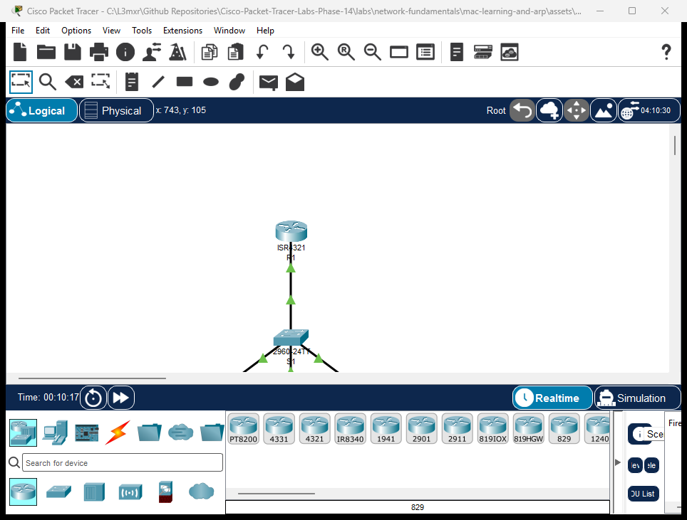

# PTL-0016: MAC Address Learning and ARP Operation


In a local Ethernet network, data link communication relies on hardware 48-bit Media Access Control (MAC) addresses, while network layer communication relies on 32-bit Logical IPv4 addresses. For devices to communicate successfully, two fundamental mechanisms operate concurrently:
1. **Layer 2 MAC Address Learning:** Ethernet switches inspect the source MAC address of every incoming frame and record it in a Content Addressable Memory (CAM) or MAC address table alongside the incoming physical port.
2. **Layer 3 Address Resolution Protocol (ARP):** Hosts consult and populate their local ARP cache to map a known target IPv4 address to its corresponding physical MAC address before encapsulation.

In this laboratory exercise, you will investigate how a Cisco Catalyst switch dynamically builds and ages out its MAC address table, how host operating systems send ARP requests and replies, and how Layer 2 frame forwarding transitions from unknown unicast flooding to targeted unicast forwarding.

---

## Learning Objectives

- Explain how a Cisco Catalyst switch dynamically populates its MAC address table using incoming frame source MAC addresses.
- Contrast unknown unicast flooding with known unicast filtering and forwarding.
- Inspect, interpret, and clear the host ARP cache (`arp -a` and `arp -d`) on end devices.
- Trace the step-by-step interaction between host ARP resolution and switch MAC address learning during ping transactions.
- Examine MAC table aging and practice manually clearing dynamic entries using `clear mac address-table dynamic`.

---

## Prerequisites

- Basic familiarity with Cisco IOS command modes from [PTL-0008: Cisco IOS Navigation and Initial Device Configuration](../ios-navigation-and-initial-config/README.md).
- Understanding of IPv4 address formatting and subnet masks (`255.255.255.0` / `/24`).
- Familiarity with the diagnostic methodology outlined in the [Troubleshooting Guide](../../../docs/troubleshooting.md).

---

## Topology



The topology connects three generic host PCs and one Cisco ISR 4321 router gateway through a single Cisco Catalyst 2960-24TT switch in broadcast domain `192.168.1.0/24`:
- **Switch `S1`:** Central Layer 2 Catalyst 2960 switch maintaining the MAC address table.
- **Workstations (`PC-A`, `PC-B`, `PC-C`):** Connected to switch FastEthernet ports `Fa0/1`, `Fa0/2`, and `Fa0/3`.
- **Router `R1`:** Connected via switch port `GigabitEthernet0/1` to provide gateway connectivity on `192.168.1.1`.

---

## Addressing Table

| Device | Interface | IP Address | Subnet Mask | Default Gateway | MAC Address (Sample) | Switch Port |
|---|---|---|---|---|---|---|
| **R1** | `Gi0/0/0` | `192.168.1.1` | `255.255.255.0` | N/A | `0001.c7ea.b801` | S1 `Gig0/1` |
| **S1** | `Vlan1` | Unconfigured | N/A | N/A | N/A (L2 Switch) | — |
| **PC-A** | `FastEthernet0` | `192.168.1.10` | `255.255.255.0` | `192.168.1.1` | `0001.c955.51bd` | S1 `Fa0/1` |
| **PC-B** | `FastEthernet0` | `192.168.1.20` | `255.255.255.0` | `192.168.1.1` | `0001.c97d.8904` | S1 `Fa0/2` |
| **PC-C** | `FastEthernet0` | `192.168.1.30` | `255.255.255.0` | `192.168.1.1` | `00e0.f740.df65` | S1 `Fa0/3` |

---

## Lab Tasks

1. **Verify Baseline State:** Verify that `S1` has an empty dynamic MAC address table and host PCs have empty ARP tables.
2. **Observe ARP Broadcast and Resolution:** From `PC-A`, ping `PC-B` (`192.168.1.20`) and observe ARP resolution in `PC-A`'s ARP table.
3. **Verify S1 Dynamic MAC Learning:** Inspect the dynamic MAC address table on `S1` to confirm port mappings for `PC-A` (`Fa0/1`) and `PC-B` (`Fa0/2`).
4. **Resolve Default Gateway:** From `PC-A`, ping router gateway `R1` (`192.168.1.1`) and observe switch learning on port `Gig0/1`.
5. **Populate Multi-Node CAM Table:** Ping `PC-A` from `PC-C` (`192.168.1.30`) and verify all connected hosts appear in the switch MAC table.
6. **Investigate Negative Resolution:** Ping an unassigned IP (`192.168.1.99`) to observe ARP timeout behavior and absent cache entries.
7. **Clear and Re-Learn Entries:** Clear dynamic entries on `S1` using `clear mac address-table dynamic` and verify dynamic re-learning upon subsequent traffic.

---

## Configuration Walkthrough

### 1. Router R1 Interface Configuration

On Router `R1`, the local gateway interface is configured and enabled:

```text
Router> enable
Router# configure terminal
Router(config)# hostname R1
R1(config)# interface GigabitEthernet0/0/0
R1(config-if)# description Gateway for Local Subnet
R1(config-if)# ip address 192.168.1.1 255.255.255.0
R1(config-if)# no shutdown
R1(config-if)# exit
R1(config)# end
R1# write memory
```

### 2. Switch S1 Initial Hostname Configuration

On Switch `S1`, set the basic hostname:

```text
Switch> enable
Switch# configure terminal
Switch(config)# hostname S1
S1(config)# end
S1# write memory
```

### 3. Workstation IP Configuration

In the starter topology (`assets/starter.pkt`), verify or configure host network settings:
- **PC-A:** IP `192.168.1.10`, Subnet Mask `255.255.255.0`, Gateway `192.168.1.1`
- **PC-B:** IP `192.168.1.20`, Subnet Mask `255.255.255.0`, Gateway `192.168.1.1`
- **PC-C:** IP `192.168.1.30`, Subnet Mask `255.255.255.0`, Gateway `192.168.1.1`

---

## Verification

### Positive Test 1: Empty Initial State
Before traffic is sent, verify that the host ARP cache and switch dynamic MAC table are empty:

```text
PC-A> arp -a
No ARP Entries Found

S1# show mac address-table dynamic
          Mac Address Table
-------------------------------------------

Vlan    Mac Address       Type        Ports
----    -----------       --------    -----
```

### Positive Test 2: Intra-Subnet Ping (PC-A to PC-B)
Ping `PC-B` (`192.168.1.20`) from `PC-A`:

```text
PC-A> ping 192.168.1.20

Pinging 192.168.1.20 with 32 bytes of data:

Reply from 192.168.1.20: bytes=32 time<1ms TTL=128
Reply from 192.168.1.20: bytes=32 time<1ms TTL=128
Reply from 192.168.1.20: bytes=32 time<1ms TTL=128
Reply from 192.168.1.20: bytes=32 time<1ms TTL=128

Ping statistics for 192.168.1.20:
    Packets: Sent = 4, Received = 4, Lost = 0 (0% loss)
```

### Positive Test 3: Inspect S1 MAC Address Table
Inspect `S1`'s dynamic table to observe learned MAC addresses:

```text
S1# show mac address-table dynamic
          Mac Address Table
-------------------------------------------

Vlan    Mac Address       Type        Ports
----    -----------       --------    -----
   1    0001.c955.51bd    DYNAMIC     Fa0/1
   1    0001.c97d.8904    DYNAMIC     Fa0/2
```
*Note: S1 learned `PC-A`'s MAC on `Fa0/1` from the ARP request frame, and `PC-B`'s MAC on `Fa0/2` from the ARP reply frame.*

### Positive Test 4: Inspect PC-A ARP Table
```text
PC-A> arp -a
  Internet Address      Physical Address      Type
  192.168.1.20          0001.c97d.8904        dynamic
```

### Positive Test 5: Gateway Reachability and Uplink MAC Learning
From `PC-A`, ping `R1` gateway (`192.168.1.1`):

```text
PC-A> ping 192.168.1.1

Pinging 192.168.1.1 with 32 bytes of data:

Reply from 192.168.1.1: bytes=32 time<1ms TTL=255
Reply from 192.168.1.1: bytes=32 time<1ms TTL=255
Reply from 192.168.1.1: bytes=32 time<1ms TTL=255
Reply from 192.168.1.1: bytes=32 time<1ms TTL=255

Ping statistics for 192.168.1.1:
    Packets: Sent = 4, Received = 4, Lost = 0 (0% loss)
```

Verify S1 now includes R1 on uplink `Gig0/1`:
```text
S1# show mac address-table dynamic
          Mac Address Table
-------------------------------------------

Vlan    Mac Address       Type        Ports
----    -----------       --------    -----
   1    0001.c7ea.b801    DYNAMIC     Gig0/1
   1    0001.c955.51bd    DYNAMIC     Fa0/1
   1    0001.c97d.8904    DYNAMIC     Fa0/2
```

### Positive Test 6: Complete Multi-Host Population
From `PC-C`, ping `PC-A` (`192.168.1.10`). Then verify that `S1` has learned all four devices:

```text
S1# show mac address-table dynamic
          Mac Address Table
-------------------------------------------

Vlan    Mac Address       Type        Ports
----    -----------       --------    -----
   1    0001.c7ea.b801    DYNAMIC     Gig0/1
   1    0001.c955.51bd    DYNAMIC     Fa0/1
   1    0001.c97d.8904    DYNAMIC     Fa0/2
   1    00e0.f740.df65    DYNAMIC     Fa0/3
```

---

## Troubleshooting

| Symptom | Diagnostic Finding | Root Cause | Remediation |
|---|---|---|---|
| Ping to destination IP times out; ARP cache shows no entry | `arp -a` reports `No ARP Entries Found` | Target device is powered off, disconnected, or has an incorrect IP address | Verify physical link LED, verify IP settings on destination host, and retry |
| Ping to destination IP fails with `Request timed out`; ARP cache remains empty | Target IP `192.168.1.99` does not exist on the LAN | Host sends ARP broadcast (`Who has 192.168.1.99? Tell 192.168.1.10`), but no host responds | Check destination IP address spelling; ensure target host is active on the subnet |
| Switch port shows no MAC address in `show mac address-table dynamic` | Link is `up/up` but no frames have originated from the attached device | Switches only learn MACs from **incoming frame source addresses**. If a host is idle and silent, the switch cannot learn its MAC | Generate traffic from the host (e.g., ping or DHCP request) to populate the CAM table |
| Switch MAC table contains wrong port for a MAC address | `show mac address-table address <mac>` shows unexpected port | Duplicate MAC address or physical cabling swapped without table flush | Execute `clear mac address-table dynamic` to force immediate re-learning |

---

## Key Takeaways

- **Source MAC Learning:** A Layer 2 switch inspects the **source MAC address** of every incoming frame to learn which device connects to which physical port.
- **Destination MAC Forwarding:** When forwarding, the switch looks up the **destination MAC address**:
  - If the MAC is found in the CAM table, the frame is forwarded **only** out that specific port (known unicast filtering/forwarding).
  - If the MAC is not found, the switch floods the frame out all ports in the VLAN except the receiving port (unknown unicast flooding).
- **ARP Resolution:** Layer 3 hosts do not know MAC addresses inherently. Before sending an IPv4 packet, a host broadcasts an ARP Request (`FF:FF:FF:FF:FF:FF`). The owner responds with a unicast ARP Reply.
- **Dynamic Aging:** Dynamic MAC table entries age out after an inactivity timeout (default 300 seconds in Cisco IOS) to adapt to topology changes and device reconnections.
- **Manual Maintenance:** Network administrators can purge stale entries immediately using `clear mac address-table dynamic`.

---

## References

- [Cisco Catalyst 2960 Switch Software Configuration Guide: Configuring MAC Address Tables](https://www.cisco.com/c/en/us/td/docs/switches/lan/catalyst2960/software/release/12-2_55_se/configuration/guide/scg_2960/swmacad.html)
- [RFC 826: An Ethernet Address Resolution Protocol (ARP)](https://datatracker.ietf.org/doc/html/rfc826)
- [Repository Troubleshooting Guide](../../../docs/troubleshooting.md)

---

## Files and Validation Status

| Deliverable | Location | Description |
|---|---|---|
| **Starter Activity** | [assets/starter.pkt](assets/starter.pkt) | Pre-cabled topology with clean initial ARP and MAC states |
| **Completed Reference** | [assets/completed.pkt](assets/completed.pkt) | Fully operational topology with verified dynamic learning |
| **Topology Screenshot** | [assets/topology.png](assets/topology.png) | Canvas capture from running Packet Tracer 9.0.1 simulator |
| **Router Configuration** | [configs/R1.txt](configs/R1.txt) | Cisco IOS configuration for router R1 gateway interface |
| **Switch Configuration** | [configs/S1.txt](configs/S1.txt) | Cisco IOS configuration for switch S1 |
| **Verification Guide** | [verification.md](verification.md) | Step-by-step diagnostic verification and test procedures |
| **Simulator Evidence** | [PTL-0016 Simulator Results](../../../AI_AGENT_GUIDE/state/PTL-0016-SIMULATOR-RESULTS.md) | Authentic live simulator console traces |
