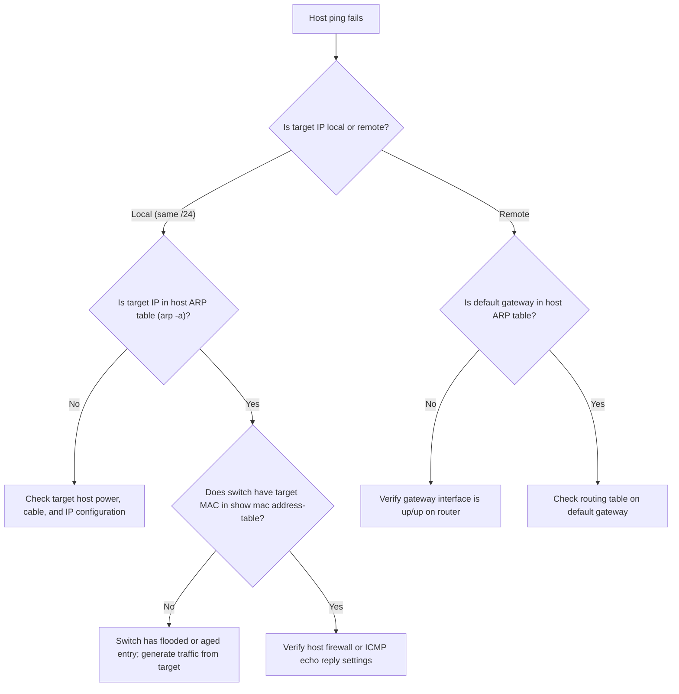

# Verification and Diagnostic Guide: PTL-0016

**Lab ID:** `PTL-0016`  
**Lab Title:** MAC Address Learning and ARP Operation  
**Category:** `network-fundamentals`  
**Simulator Verification:** `tested_pass`  

This document details the test procedures, expected outputs, and diagnostic steps required to verify Layer 2 MAC address learning and Address Resolution Protocol (ARP) operation in Cisco Packet Tracer.

---

## 1. Physical and Logical Topology Verification

Confirm that all interfaces are active (green link indicators) and correctly assigned:

| Device | Interface | Expected IP | Expected State | Cable Type | Connected To |
|---|---|---|---|---|---|
| **R1** | `GigabitEthernet0/0/0` | `192.168.1.1/24` | Up / Up | Straight-Through | S1 `Gig0/1` |
| **S1** | `GigabitEthernet0/1` | Unnumbered (L2) | Up / Up | Straight-Through | R1 `Gi0/0/0` |
| **S1** | `FastEthernet0/1` | Unnumbered (L2) | Up / Up | Straight-Through | PC-A `Fa0` |
| **S1** | `FastEthernet0/2` | Unnumbered (L2) | Up / Up | Straight-Through | PC-B `Fa0` |
| **S1** | `FastEthernet0/3` | Unnumbered (L2) | Up / Up | Straight-Through | PC-C `Fa0` |
| **PC-A** | `FastEthernet0` | `192.168.1.10/24` | Connected | Straight-Through | S1 `Fa0/1` |
| **PC-B** | `FastEthernet0` | `192.168.1.20/24` | Connected | Straight-Through | S1 `Fa0/2` |
| **PC-C** | `FastEthernet0` | `192.168.1.30/24` | Connected | Straight-Through | S1 `Fa0/3` |

---

## 2. Command-by-Command Verification Matrix

### Test 1: Empty Initial Cache and Table
Execute on `PC-A`:
```text
C:\>arp -a
No ARP Entries Found
```

Execute on `S1`:
```text
S1# show mac address-table dynamic
          Mac Address Table
-------------------------------------------

Vlan    Mac Address       Type        Ports
----    -----------       --------    -----
```
*Expected Result:* No dynamic entries exist prior to frame transmission.

### Test 2: Local Ping and ARP Resolution (PC-A to PC-B)
Execute on `PC-A`:
```text
C:\>ping 192.168.1.20
Pinging 192.168.1.20 with 32 bytes of data:
Reply from 192.168.1.20: bytes=32 time<1ms TTL=128
Reply from 192.168.1.20: bytes=32 time<1ms TTL=128
Reply from 192.168.1.20: bytes=32 time<1ms TTL=128
Reply from 192.168.1.20: bytes=32 time<1ms TTL=128

Ping statistics for 192.168.1.20:
    Packets: Sent = 4, Received = 4, Lost = 0 (0% loss)
```

Inspect ARP cache on `PC-A`:
```text
C:\>arp -a
  Internet Address      Physical Address      Type
  192.168.1.20          0001.c97d.8904        dynamic
```
*Expected Result:* `192.168.1.20` is resolved to `PC-B`'s MAC address with type `dynamic`.

### Test 3: Switch S1 Dynamic CAM Table Population
Execute on `S1`:
```text
S1# show mac address-table dynamic
          Mac Address Table
-------------------------------------------

Vlan    Mac Address       Type        Ports
----    -----------       --------    -----
   1    0001.c955.51bd    DYNAMIC     Fa0/1
   1    0001.c97d.8904    DYNAMIC     Fa0/2
```
*Expected Result:* Switch dynamically maps `PC-A`'s MAC to port `Fa0/1` and `PC-B`'s MAC to port `Fa0/2`.

### Test 4: Default Gateway Ping (PC-A to R1)
Execute on `PC-A`:
```text
C:\>ping 192.168.1.1
Pinging 192.168.1.1 with 32 bytes of data:
Reply from 192.168.1.1: bytes=32 time<1ms TTL=255
Reply from 192.168.1.1: bytes=32 time<1ms TTL=255
Reply from 192.168.1.1: bytes=32 time<1ms TTL=255
Reply from 192.168.1.1: bytes=32 time<1ms TTL=255

Ping statistics for 192.168.1.1:
    Packets: Sent = 4, Received = 4, Lost = 0 (0% loss)
```

Execute on `S1`:
```text
S1# show mac address-table dynamic
          Mac Address Table
-------------------------------------------

Vlan    Mac Address       Type        Ports
----    -----------       --------    -----
   1    0001.c7ea.b801    DYNAMIC     Gig0/1
   1    0001.c955.51bd    DYNAMIC     Fa0/1
   1    0001.c97d.8904    DYNAMIC     Fa0/2
```
*Expected Result:* Uplink port `Gig0/1` now displays router `R1`'s MAC address (`0001.c7ea.b801`).

### Test 5: Negative Test — Ping to Non-Existent Host
Execute on `PC-A`:
```text
C:\>ping 192.168.1.99
Pinging 192.168.1.99 with 32 bytes of data:
Request timed out.
Request timed out.
Request timed out.
Request timed out.

Ping statistics for 192.168.1.99:
    Packets: Sent = 4, Received = 0, Lost = 4 (100% loss)
```

Verify ARP cache on `PC-A`:
```text
C:\>arp -a
  Internet Address      Physical Address      Type
  192.168.1.1           0001.c7ea.b801        dynamic
  192.168.1.20          0001.c97d.8904        dynamic
```
*Expected Result:* Unanswered ARP broadcasts do not populate an entry in the host ARP table.

### Test 6: Dynamic MAC Table Flush and Re-Learning
Execute on `S1`:
```text
S1# clear mac address-table dynamic
S1# show mac address-table dynamic
          Mac Address Table
-------------------------------------------

Vlan    Mac Address       Type        Ports
----    -----------       --------    -----
```

Execute on `PC-C`:
```text
C:\>ping 192.168.1.10
```

Execute on `S1`:
```text
S1# show mac address-table dynamic
          Mac Address Table
-------------------------------------------

Vlan    Mac Address       Type        Ports
----    -----------       --------    -----
   1    0001.c955.51bd    DYNAMIC     Fa0/1
   1    00e0.f740.df65    DYNAMIC     Fa0/3
```
*Expected Result:* Table is immediately emptied by the clear command, and dynamic learning reoccurs upon incoming frame reception.

---

## 3. Diagnostic Decision Tree



---

## 4. Automated Verification Script Reference

The automated test script `scratch/test_ptl_0016.py` verifies:
- Positive tests: POS-01 (host IP check), POS-02 (flushed table baseline), POS-03 (intra-subnet ping), POS-04 (S1 dynamic MAC table inspection), POS-05 (host ARP resolution), POS-06 (gateway ping and uplink learning), POS-07 (multi-host MAC population).
- Negative tests: NEG-01 (ARP request timeout for unassigned IP), NEG-02 (manual table clear and re-learning).
