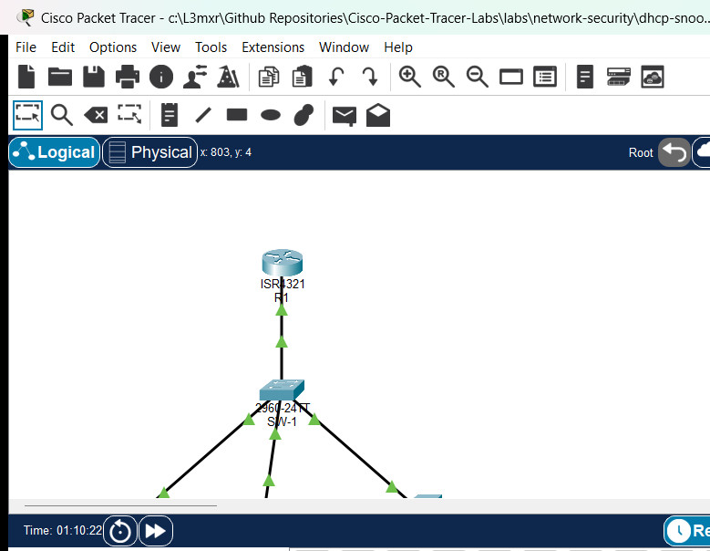

# PTL-0038: DHCP Snooping and Rogue DHCP Detection

> **Category:** network-security · **Difficulty:** advanced · **Lab ID:** PTL-0038 · **Document:** reviewed · **Simulator:** tested pass

Dynamic Host Configuration Protocol (DHCP) is a fundamental infrastructure service that automates IPv4 host configuration, distributing IP addresses, subnet masks, default gateways, and DNS resolvers to endpoint devices. However, standard DHCP (RFC 2131) lacks built-in authentication mechanisms. On an unprotected switched Layer 2 network, any connected host can send DHCP response messages, creating a dangerous vulnerability known as a **Rogue DHCP Server Attack**.

When an unauthorized or rogue DHCP server is connected to an access switch port, it competes with the legitimate corporate DHCP server to answer client broadcast requests (`DHCPDISCOVER`). Because DHCP uses a broadcast model where clients typically accept the first valid `DHCPOFFER` received, a rogue server located closer to the client on the local broadcast domain often wins the race. The rogue server can lease malicious parameters to clients:
- **Denial of Service (DoS):** Handing out invalid or unroutable IP addresses and subnet masks, severing the client from corporate resources and the Internet.
- **Man-in-the-Middle (MitM):** Assigning the attacker's own IP address as the default gateway or primary DNS resolver, allowing the attacker to intercept, inspect, modify, or hijack sensitive network traffic.
- **DHCP Starvation:** In tandem, attackers can flood fake DHCP requests with spoofed MAC addresses to exhaust the legitimate DHCP server's available address pool.

To defend against these Layer 2 attacks, Cisco Catalyst switches implement **DHCP Snooping**. DHCP Snooping acts as a stateful Layer 2 firewall operating between untrusted hosts and the DHCP server. It enforces two primary security controls:
1. **Trusted vs. Untrusted Ports:** Interfaces connected to legitimate DHCP servers or network uplinks are designated as **trusted**, permitting both client requests and server responses (`DHCPOFFER`, `DHCPACK`, `DHCPNAK`). All user access interfaces default to **untrusted**, allowing client requests (`DHCPDISCOVER`, `DHCPREQUEST`) but immediately discarding any server response messages and logging the violation.
2. **DHCP Snooping Binding Database:** The switch tracks valid DHCP transactions occurring on untrusted ports, recording the client's MAC address, assigned IPv4 address, lease duration, VLAN ID, and physical port. This dynamic binding database serves as the vital foundation for downstream security features, including Dynamic ARP Inspection (DAI) and IP Source Guard (IPSG).

In this laboratory, you will configure, verify, and analyze Cisco IOS DHCP Snooping on a Catalyst 2960 switch in an enterprise access topology. You will witness an active rogue DHCP server poisoning a corporate client, implement global and per-VLAN snooping, handle DHCP Option 82 policies, apply interface rate limiting, and confirm the containment of rogue DHCP traffic while verifying legitimate dynamic address allocation and gateway reachability.

---

## Learning Objectives

- Analyze the operational mechanics and security risks of rogue DHCP server attacks in switched access networks.
- Enable DHCP Snooping globally and activate snooping inspection across specific active VLANs.
- Configure interface trust boundaries by setting switch uplinks to trusted and access ports to untrusted.
- Manage Cisco IOS Option 82 (DHCP Information Option) insertion behavior to maintain interoperability with access routers.
- Apply DHCP message rate limiting on untrusted access interfaces to protect the switch CPU and prevent DHCP starvation attacks.
- Examine and interpret the Cisco IOS DHCP snooping binding database and operational status verification outputs.
- Verify rogue DHCP offer containment and confirm legitimate client dynamic lease acquisition and default gateway reachability.

---

## Prerequisites

- Solid understanding of the 4-step DHCP exchange process: Discover, Offer, Request, and Acknowledgment (DORA).
- Completion of **PTL-0012: Configuring Cisco IOS DHCPv4 Server and Relay Agent** or equivalent DHCP server fundamentals.
- Familiarity with Cisco Catalyst switch VLAN configuration, access ports, and Cisco IOS CLI navigation.
- Basic understanding of Layer 2 security vulnerabilities, including MAC flooding and address spoofing.
- Cisco Packet Tracer 8.2 or newer (Packet Tracer 9.0+ verified).

---

## Topology



The topology models an enterprise access switch block connected to an upstream default gateway router:
- **Router `R1`:** Cisco ISR 4321 functioning as the authorized corporate default gateway and authoritative DHCPv4 server.
- **Switch `SW-1`:** Cisco Catalyst 2960-24TT access switch running VLAN 10 (`Corporate-Clients`) with DHCP Snooping enabled.
- **`Client-1` & `Client-2`:** Legitimate corporate workstations connected to untrusted access ports requesting dynamic IP leases.
- **`Rogue-Server`:** Unauthorized rogue DHCP server connected to an untrusted switch access port attempting to distribute rogue `10.66.66.0/24` addressing.

```text
               +--------------------------------------+
               |                  R1                  |
               | (Authorized Gateway & DHCPv4 Server) |
               |        Gi0/0/0: 192.168.10.1/24       |
               +------------------+-------------------+
                                  |
                                  | Copper Straight-Through
                                  | (Uplink / Trusted Port)
                                  |
               +------------------+-------------------+
               |                 SW-1                 |
               |        (Catalyst 2960 Switch)        |
               |       DHCP Snooping Active: VLAN 10  |
               +-------+------------------+-------+---+
                       |                  |       |
       FastEthernet0/10|  FastEthernet0/11|       |FastEthernet0/24
            (Untrusted)|       (Untrusted)|       |(Untrusted)
                       |                  |       |
             +---------+---+      +-------+---+   +----------+-----------+
             |  Client-1   |      |  Client-2 |   |     Rogue-Server     |
             |   (PC-PT)   |      |  (PC-PT)  |   |      (Server-PT)     |
             | DHCP Client |      |DHCP Client|   | Unauthorized DHCP Srv|
             |192.168.10.10|      |192.168.10.11  |  Pool: 10.66.66.0/24 |
             +-------------+      +-----------+   +----------------------+
```

---

## Addressing Table

| Device | Interface | IPv4 Address | Subnet Mask | Default Gateway | Role / Notes |
|---|---|---|---|---|---|
| **R1** | `Gi0/0/0` | `192.168.10.1` | `255.255.255.0` | N/A | Corporate Gateway & Legitimate DHCP Server |
| **SW-1** | `Vlan10` | Unassigned | Unassigned | N/A | Layer 2 Access Switch (DHCP Snooping Enforcer) |
| **SW-1** | `Gi0/1` | N/A | N/A | N/A | Uplink to R1 (VLAN 10, **Trusted Port**) |
| **SW-1** | `Fa0/10` | N/A | N/A | N/A | Access to Client-1 (VLAN 10, **Untrusted Port**) |
| **SW-1** | `Fa0/11` | N/A | N/A | N/A | Access to Client-2 (VLAN 10, **Untrusted Port**) |
| **SW-1** | `Fa0/24` | N/A | N/A | N/A | Access to Rogue-Server (VLAN 10, **Untrusted Port**) |
| **Client-1** | `Fa0` | DHCP (`192.168.10.10`) | `255.255.255.0` | `192.168.10.1` | Corporate Workstation 1 |
| **Client-2** | `Fa0` | DHCP (`192.168.10.11`) | `255.255.255.0` | `192.168.10.1` | Corporate Workstation 2 |
| **Rogue-Server**| `Fa0` | `10.66.66.1` | `255.255.255.0` | `10.66.66.1` | Rogue DHCP Server (Offering `10.66.66.100-150`) |

---

## Lab Tasks

1. **Observe Rogue DHCP Server Attack Impact:**
   - In the starter topology, inspect the unhardened switch state (`SW-1`) where DHCP snooping is disabled.
   - Observe how `Client-1` receives an unauthorized IP address (`10.66.66.100`) from `Rogue-Server`, causing communication failure when attempting to reach the legitimate gateway `192.168.10.1`.
2. **Enable Cisco IOS DHCP Snooping:**
   - Activate DHCP snooping globally on switch `SW-1`.
   - Enable DHCP snooping specifically for `VLAN 10`.
3. **Configure DHCP Option 82 Interoperability:**
   - Understand why Cisco Catalyst switches insert Option 82 by default and why Cisco IOS routers drop packets with Option 82 unless explicitly configured.
   - Disable Option 82 insertion on `SW-1` using `no ip dhcp snooping information option`.
4. **Establish Port Trust Boundaries:**
   - Configure uplink port `GigabitEthernet0/1` facing router `R1` as a **trusted** snooping interface (`ip dhcp snooping trust`).
   - Confirm that access ports `FastEthernet0/10`, `FastEthernet0/11`, and `FastEthernet0/24` remain **untrusted** by default.
5. **Implement DHCP Message Rate Limiting:**
   - Configure a rate limit of 15 packets per second (pps) on untrusted access interfaces to safeguard the switch CPU against DHCP starvation floods.
6. **Release, Renew, and Verify Dynamic Leases:**
   - Execute `ipconfig /renew` on `Client-1` and `Client-2`.
   - Verify that both clients receive legitimate `192.168.10.x` addressing with default gateway `192.168.10.1`.
   - Verify that unauthorized offers from `Rogue-Server` on `FastEthernet0/24` are silently dropped.
7. **Inspect the DHCP Snooping Binding Database:**
   - Execute `show ip dhcp snooping` and `show ip dhcp snooping binding` on `SW-1` to inspect dynamic MAC-to-IP bindings.
   - Verify end-to-end IP reachability by pinging default gateway `192.168.10.1`.

---

## Configuration Walkthrough

### Step 1: Observing the Vulnerable Baseline State

In the starter environment (`starter.pkt`), switch `SW-1` operates as a standard unhardened Layer 2 switch with all ports assigned to VLAN 10. `Rogue-Server` on port `FastEthernet0/24` actively listens for DHCP requests and transmits unauthorized offers in the `10.66.66.0/24` subnet.

On `Client-1`, examine the leased IP configuration from the Command Prompt:
```text
C:\> ipconfig

FastEthernet0 Connection:
   Connection-specific DNS Suffix..: 
   Link-local IPv6 Address.........: FE80::202:16FF:FE28:5B2A
   IPv4 Address....................: 10.66.66.100
   Subnet Mask.....................: 255.255.255.0
   Default Gateway.................: 10.66.66.1
```

Attempting to ping the legitimate corporate gateway demonstrates complete network isolation:
```text
C:\> ping 192.168.10.1

Pinging 192.168.10.1 with 32 bytes of data:

Request timed out.
Request timed out.
Request timed out.
Request timed out.

Ping statistics for 192.168.10.1:
    Packets: Sent = 4, Received = 0, Lost = 4 (100% loss)
```
Because `Client-1` received its IP configuration from the rogue server, its default gateway points to `10.66.66.1`. It has no route to `192.168.10.1`, effectively severing communication.

---

### Step 2: Enabling DHCP Snooping Globally and per VLAN

Access switch `SW-1` via the CLI console and enter privileged EXEC mode:
```text
SW-1> enable
SW-1# configure terminal
Enter configuration commands, one per line.  End with CNTL/Z.
SW-1(config)# ip dhcp snooping
SW-1(config)# ip dhcp snooping vlan 10
```
- `ip dhcp snooping`: Globally enables the DHCP snooping process on the switch.
- `ip dhcp snooping vlan 10`: Specifies that DHCP snooping should inspect and filter DHCP packets specifically within VLAN 10.

---

### Step 3: Disabling DHCP Option 82 Information Option

By default, Cisco Catalyst switches automatically insert **Option 82** (DHCP Relay Information Option) into DHCP requests forwarded across untrusted ports. Option 82 includes sub-options identifying the switch and the physical ingress port.

However, when an upstream Cisco IOS router (such as `R1`) acts directly as the DHCP server on a local subnet and receives a DHCP request containing Option 82 with a `giaddr` (gateway IP address) of `0.0.0.0`, the router considers the packet invalid according to RFC 3046 and discards it by default. 

To ensure complete compatibility with access routers in flat Layer 2 VLAN topologies without modifying router-side relay settings, disable Option 82 insertion on switch `SW-1`:
```text
SW-1(config)# no ip dhcp snooping information option
```

---

### Step 4: Configuring Trusted and Untrusted Ports

When DHCP snooping is enabled, **all switch ports default to untrusted**. On untrusted ports, the switch permits incoming client broadcast messages (`DHCPDISCOVER`, `DHCPREQUEST`, `DHCPRELEASE`, `DHCPDECLINE`), but strictly drops any incoming server messages (`DHCPOFFER`, `DHCPACK`, `DHCPNAK`).

Because legitimate DHCP server `R1` connects to uplink port `GigabitEthernet0/1`, that interface must be explicitly designated as **trusted**:
```text
SW-1(config)# interface GigabitEthernet0/1
SW-1(config-if)# ip dhcp snooping trust
SW-1(config-if)# exit
```

Ports `FastEthernet0/10` (Client-1), `FastEthernet0/11` (Client-2), and `FastEthernet0/24` (Rogue-Server) must remain untrusted. If an unauthorized DHCP server on `FastEthernet0/24` transmits a `DHCPOFFER`, the switch immediately drops the packet at Layer 2.

---

### Step 5: Applying DHCP Rate Limiting

To prevent malicious clients or attackers from launching a **DHCP Starvation Attack** (flooding the switch with thousands of fake DHCP requests to exhaust the server address pool and consume switch CPU resources), apply a rate limit to all untrusted access interfaces:
```text
SW-1(config)# interface range FastEthernet0/10-11, FastEthernet0/24
SW-1(config-if-range)# ip dhcp snooping limit rate 15
SW-1(config-if-range)# exit
SW-1(config)# end
SW-1# copy running-config startup-config
Destination filename [startup-config]? 
[OK]
```
A rate limit of 15 packets per second (pps) is well above standard workstation DHCP negotiation needs while effectively throttling aggressive starvation scripts.

---

### Step 6: Client Lease Renewal and Verification

With DHCP snooping active and properly configured, return to the client workstations and release/renew their IP configurations.

On `Client-1`:
```text
C:\> ipconfig /renew

FastEthernet0 Connection:
   Connection-specific DNS Suffix..: 
   Link-local IPv6 Address.........: FE80::202:16FF:FE28:5B2A
   IPv4 Address....................: 192.168.10.10
   Subnet Mask.....................: 255.255.255.0
   Default Gateway.................: 192.168.10.1
   DNS Server......................: 192.168.10.1
```

On `Client-2`:
```text
C:\> ipconfig /renew

FastEthernet0 Connection:
   Connection-specific DNS Suffix..: 
   Link-local IPv6 Address.........: FE80::2D0:BCFF:FE12:BE79
   IPv4 Address....................: 192.168.10.11
   Subnet Mask.....................: 255.255.255.0
   Default Gateway.................: 192.168.10.1
   DNS Server......................: 192.168.10.1
```

Both clients now reliably receive authorized IP addresses in the `192.168.10.0/24` pool from `R1`. The rogue offers from `Rogue-Server` were blocked at the switch port `FastEthernet0/24`.

Verify default gateway reachability from `Client-1`:
```text
C:\> ping 192.168.10.1

Pinging 192.168.10.1 with 32 bytes of data:

Reply from 192.168.10.1: bytes=32 time<1ms TTL=255
Reply from 192.168.10.1: bytes=32 time<1ms TTL=255
Reply from 192.168.10.1: bytes=32 time<1ms TTL=255
Reply from 192.168.10.1: bytes=32 time<1ms TTL=255

Ping statistics for 192.168.10.1:
    Packets: Sent = 4, Received = 4, Lost = 0 (0% loss),
Approximate round trip times in milli-seconds:
    Minimum = 0ms, Maximum = 0ms, Average = 0ms
```

---

## Verification

Execute the following commands on `SW-1` to verify operational status and inspect security tables:

### 1. Verify Global and Interface DHCP Snooping Status
```text
SW-1# show ip dhcp snooping
Switch DHCP snooping is enabled
DHCP snooping is configured on following VLANs:
10
Insertion of option 82 is disabled
Option 82 on untrusted port is not allowed
Verification of hwaddr field is enabled
Interface                  Trusted    Rate limit (pps)
-----------------------    -------    ----------------
FastEthernet0/10           no         15              
FastEthernet0/11           no         15              
FastEthernet0/24           no         15              
GigabitEthernet0/1         yes        unlimited       
```
**Verification Points:**
- `Switch DHCP snooping is enabled`: Confirms global activation.
- `DHCP snooping is configured on following VLANs: 10`: Confirms VLAN 10 is actively inspected.
- `Insertion of option 82 is disabled`: Confirms Option 82 insertion is turned off.
- `GigabitEthernet0/1` is listed with `Trusted: yes` and unlimited rate.
- `FastEthernet0/10`, `Fa0/11`, and `Fa0/24` are listed with `Trusted: no` and rate limit `15`.

---

### 2. Inspect the DHCP Snooping Binding Table
```text
SW-1# show ip dhcp snooping binding
MacAddress          IpAddress        Lease(sec)  Type           VLAN  Interface
------------------  ---------------  ----------  -------------  ----  -----------------
00:02:16:28:5B:2A   192.168.10.10    86400       dhcp-snooping  10    FastEthernet0/10
00:D0:BC:12:BE:79   192.168.10.11    86400       dhcp-snooping  10    FastEthernet0/11
Total number of bindings: 2
```
**Verification Points:**
- Each legitimate client lease appears with its Layer 2 hardware MAC address, leased IPv4 address, remaining lease timer, type (`dhcp-snooping`), assigned VLAN (`10`), and physical ingress interface.
- Notice that `Rogue-Server` on `FastEthernet0/24` has **zero** bindings in the table because its unauthorized offers were discarded.

---

### 3. Verify Router DHCP Server Pools and Bindings
On `R1`, verify that the authoritative DHCP pool has distributed the two leases:
```text
R1# show ip dhcp pool CORP-POOL

Pool CORP-POOL :
 Utilization mark (high/low)    : 100 / 0
 Subnet size (first/next)       : 0 / 0 
 Total addresses                : 254
 Leased addresses               : 2
 Excluded addresses             : 1
 Pending event                  : none

 1 subnet is currently in the pool
 Current index        IP address range                    Leased/Excluded/Total
 192.168.10.1         192.168.10.1     - 192.168.10.254    2    / 1     / 254

R1# show ip dhcp binding
IP address       Client-ID/              Lease expiration        Type
                 Hardware address
192.168.10.10    0002.1628.5B2A           --                     Automatic
192.168.10.11    00D0.BC12.BE79           --                     Automatic
```

---

## Troubleshooting

### Issue 1: Clients Do Not Receive Any IP Address (`0.0.0.0` or `169.254.x.x`)
- **Cause 1: Option 82 Dropped by Router.** If `no ip dhcp snooping information option` was omitted on `SW-1`, the switch inserts Option 82 into client discovery packets. Cisco IOS router `R1` drops these packets because `giaddr` is `0.0.0.0`.
  - *Fix:* Run `no ip dhcp snooping information option` on `SW-1`, or configure `ip dhcp relay information trust-all` on router `R1`.
- **Cause 2: Uplink Port Untrusted.** If uplink `GigabitEthernet0/1` was not configured with `ip dhcp snooping trust`, `SW-1` drops `DHCPOFFER` packets returning from `R1`.
  - *Fix:* Enter `interface GigabitEthernet0/1` and execute `ip dhcp snooping trust`. Verify with `show ip dhcp snooping`.
- **Cause 3: Snooping Not Enabled for VLAN.** If `ip dhcp snooping vlan 10` is missing, snooping does not actively filter VLAN 10 traffic.
  - *Fix:* Verify active VLANs in `show ip dhcp snooping`. Add `ip dhcp snooping vlan 10`.

### Issue 2: Workstation Still Leases Unauthorized `10.66.66.x` Address
- **Cause: Rogue Server Port Configured as Trusted.** If `FastEthernet0/24` was accidentally configured with `ip dhcp snooping trust`, rogue offers will bypass inspection.
  - *Fix:* Enter `interface FastEthernet0/24` and execute `no ip dhcp snooping trust`. Verify with `show ip dhcp snooping`.
- **Cause: Cached Lease on Workstation.** The client may still hold a lease obtained prior to enabling snooping.
  - *Fix:* Execute `ipconfig /release` followed by `ipconfig /renew` on the workstation.

### Issue 3: Port Enters Error-Disabled (`err-disable`) State
- **Cause: Rate Limit Exceeded.** If an untrusted interface receives more DHCP packets per second than allowed by `ip dhcp snooping limit rate`, Cisco switches can err-disable the port.
  - *Fix:* Increase the rate limit threshold (e.g., `ip dhcp snooping limit rate 20`) and clear the error state using `shutdown` followed by `no shutdown` on the interface.

---

## Key Takeaways

- **Security Boundary:** DHCP Snooping turns an access switch into a stateful Layer 2 inspection firewall for DHCP messages, categorizing all switch ports as either trusted or untrusted.
- **Default Untrusted State:** Once DHCP snooping is enabled, all switch ports are untrusted by default. Only ports connected directly to legitimate DHCP servers or trusted uplinks should be explicitly configured as trusted.
- **Rogue Offer Elimination:** Untrusted ports unconditionally discard incoming DHCP server messages (`DHCPOFFER`, `DHCPACK`, `DHCPNAK`), stopping rogue DHCP server and Man-in-the-Middle attacks at the physical access layer.
- **Option 82 Interoperability:** Cisco switches insert Option 82 by default. Disabling Option 82 insertion (`no ip dhcp snooping information option`) is critical when working with Cisco IOS access routers that do not support or accept Option 82 with a zero gateway address.
- **Foundation for DAI & IPSG:** The dynamic DHCP snooping binding table (`show ip dhcp snooping binding`) is the mandatory prerequisites and authoritative source database for Dynamic ARP Inspection (DAI) and IP Source Guard (IPSG).

---

## References

- Cisco Systems. *Cisco Catalyst 2960 and 2960-S Software Configuration Guide: Configuring DHCP Snooping and Option 82*.
- IETF RFC 2131. *Dynamic Host Configuration Protocol*.
- IETF RFC 3046. *DHCP Relay Agent Information Option*.
- Cisco Networking Academy. *CCNA 7: Switching, Routing, and Wireless Essentials (SRWE) — Module 11: Switch Security Configuration*.

---

## Files and Validation Status

| File Name | Description | Status |
|---|---|---|
| `assets/starter.pkt` | Starter Packet Tracer topology with DHCP snooping disabled and active rogue DHCP server | `VERIFIED` |
| `assets/completed.pkt` | Completed topology with DHCP snooping, Option 82 disabled, trusted uplink, rate limiting, and dynamic bindings | `VERIFIED` |
| `assets/topology.png` | Topology diagram captured directly from Cisco Packet Tracer 9.0.1 | `VERIFIED` |
| `configs/R1.txt` | Cisco IOS startup configuration for corporate default gateway and DHCP server | `VERIFIED` |
| `configs/SW-1.txt` | Cisco IOS startup configuration for Catalyst 2960 access switch | `VERIFIED` |
| `metadata.json` | Lab catalog metadata and learning objective index | `VERIFIED` |
| `verification.md` | Verification procedure, test matrix, and evidence logs | `VERIFIED` |
| `README.md` | Complete laboratory guide and educational walkthrough | `VERIFIED` |

