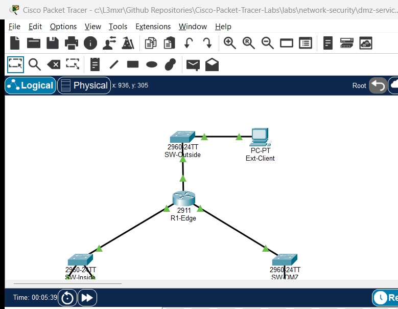

# PTL-0051: DMZ Services with Edge ACL Policy

## Learning Objectives
- Design and configure a three-legged enterprise perimeter architecture separating Inside Corporate LAN, Demilitarized Zone (DMZ), and Outside Internet trust zones.
- Author named extended IPv4 Access Control Lists (`OUTSIDE_TO_DMZ` and `DMZ_POLICY`) to filter traffic based on source, destination, protocol, and transport port.
- Permit external clients to reach public DMZ web servers (HTTP TCP 80, HTTPS TCP 443, ICMP echo) while strictly blocking external traffic to private corporate subnets.
- Implement strict DMZ-to-Internal isolation policies that block unauthorized pivot attempts while permitting specific application queries (MySQL TCP 3306).
- Diagnose and remediate common edge security defects including missing interface bindings, ACL directionality confusion, and rule shadowing.

## Prerequisites
- Completion of [PTL-0021: Static NAT and Inside Server Publishing](../../network-services/static-nat-and-inside-server-publishing/README.md) and [PTL-0042: Named Extended IPv4 ACL for Server Access](../named-extended-ipv4-acl-for-server-access/README.md).
- Solid understanding of TCP/IP protocol headers, well-known port numbers (HTTP 80, HTTPS 443, MySQL 3306), and extended ACL syntax in Cisco IOS.
- Familiarity with router interface configuration and Layer 3 packet forwarding behavior.

## Topology
The perimeter topology features a Cisco 2911 Integrated Services Router (`R1-Edge`) acting as the security gateway connecting three distinct network segments:
- **Inside Corporate LAN (`192.168.1.0/24`)**: Connected via `GigabitEthernet0/0` to `SW-Inside`, supporting user workstation `Corp-PC` and backend database server `DB-Server`.
- **Outside WAN / Internet (`203.0.113.0/24`)**: Connected via `GigabitEthernet0/1` to `SW-Outside`, supporting external client `Ext-Client`.
- **Demilitarized Zone (DMZ) (`172.16.2.0/24`)**: Connected via `GigabitEthernet0/2` to `SW-DMZ`, hosting public-facing web server `DMZ-Web`.

```
                       [ Ext-Client: PC-PT ]
                          203.0.113.100/24
                                 |
                            [ SW-Outside ]
                         (Catalyst 2960-24TT)
                                 |
                             (Gi0/0/1)
                          [ R1-Edge ]
                         (Cisco 2911)
                        /            \
                   (Gi0/0/0)        (Gi0/0/2)
                   /                    \
            [ SW-Inside ]            [ SW-DMZ ]
        (Catalyst 2960-24TT)    (Catalyst 2960-24TT)
           /            \                 |
      [ Corp-PC ]   [ DB-Server ]     [ DMZ-Web ]
     192.168.1.10   192.168.1.50     172.16.2.10
        /24             /24              /24
```



## Addressing Table

| Device Name | Interface | IP Address | Subnet Mask | Default Gateway | Connected To |
|---|---|---|---|---|---|
| **R1-Edge** | Gi0/0 | 192.168.1.1 | 255.255.255.0 | N/A | SW-Inside Fa0/1 |
| **R1-Edge** | Gi0/1 | 203.0.113.1 | 255.255.255.0 | N/A | SW-Outside Fa0/1 |
| **R1-Edge** | Gi0/2 | 172.16.2.1 | 255.255.255.0 | N/A | SW-DMZ Fa0/1 |
| **SW-Inside** | VLAN 1 | 192.168.1.2 | 255.255.255.0 | 192.168.1.1 | Switch Management |
| **SW-Outside**| VLAN 1 | Unconfigured | Unconfigured | Unconfigured | Layer 2 Broadcast |
| **SW-DMZ**    | VLAN 1 | 172.16.2.2 | 255.255.255.0 | 172.16.2.1 | Switch Management |
| **Corp-PC**   | FastEthernet0 | 192.168.1.10 | 255.255.255.0 | 192.168.1.1 | SW-Inside Fa0/2 |
| **DB-Server** | FastEthernet0 | 192.168.1.50 | 255.255.255.0 | 192.168.1.1 | SW-Inside Fa0/3 |
| **DMZ-Web**   | FastEthernet0 | 172.16.2.10 | 255.255.255.0 | 172.16.2.1 | SW-DMZ Fa0/2 |
| **Ext-Client**| FastEthernet0 | 203.0.113.100 | 255.255.255.0 | 203.0.113.1 | SW-Outside Fa0/2 |

## Lab Tasks
1. **Verify Baseline Layer 3 IP Addressing and Routing**: Ensure all endpoints have valid IP configurations and reach their respective router default gateways.
2. **Author the Outside Inbound Access Control List (`OUTSIDE_TO_DMZ`)**:
   - Permit HTTP (TCP 80), HTTPS (TCP 443), and ICMP echo from any source to `DMZ-Web` (`172.16.2.10`).
   - Explicitly deny any outside traffic destined for the internal corporate subnet (`192.168.1.0/24`).
   - Explicitly deny all remaining traffic with an audited deny rule.
3. **Bind `OUTSIDE_TO_DMZ` Inbound on the WAN Interface**: Attach the filter to `GigabitEthernet0/1` in the inbound direction.
4. **Author the DMZ Inbound Access Control List (`DMZ_POLICY`)**:
   - Permit the DMZ web server to query the internal backend database (`DB-Server` `192.168.1.50`) on MySQL port TCP 3306.
   - Permit DMZ hosts to ping their default gateway (`172.16.2.1`).
   - Permit DMZ web server ICMP echo-reply responses back to the corporate LAN (`192.168.1.0/24`) to allow administrative ping monitoring from inside hosts.
   - Strictly deny the DMZ subnet (`172.16.2.0/24`) from reaching any internal corporate host (`192.168.1.0/24`).
   - Permit DMZ hosts outbound access to external Internet resources.
   - Deny all remaining unmatched traffic.
5. **Bind `DMZ_POLICY` Inbound on the DMZ Interface**: Attach the filter to `GigabitEthernet0/2` in the inbound direction.
6. **Execute Comprehensive Security and Reachability Validation**: Test permitted outside-to-DMZ flows, verify corporate-to-DMZ and corporate-to-DB reachability, and confirm strict drop of unauthorized outside-to-inside and DMZ-to-inside traffic.

## Configuration Walkthrough

### Step 1: Configure R1-Edge Interfaces
Configure IP addresses and enable all three routing interfaces on `R1-Edge`:
```cisco
R1-Edge(config)# interface GigabitEthernet0/0
R1-Edge(config-if)# description Inside Corporate LAN
R1-Edge(config-if)# ip address 192.168.1.1 255.255.255.0
R1-Edge(config-if)# no shutdown
R1-Edge(config-if)# exit

R1-Edge(config)# interface GigabitEthernet0/1
R1-Edge(config-if)# description Outside WAN Uplink
R1-Edge(config-if)# ip address 203.0.113.1 255.255.255.0
R1-Edge(config-if)# no shutdown
R1-Edge(config-if)# exit

R1-Edge(config)# interface GigabitEthernet0/2
R1-Edge(config-if)# description Demilitarized Zone (DMZ)
R1-Edge(config-if)# ip address 172.16.2.1 255.255.255.0
R1-Edge(config-if)# no shutdown
R1-Edge(config-if)# exit
```

### Step 2: Create the Outside Inbound Policy (`OUTSIDE_TO_DMZ`)
```cisco
R1-Edge(config)# ip access-list extended OUTSIDE_TO_DMZ
R1-Edge(config-ext-nacl)# remark Permit HTTP web traffic to DMZ server
R1-Edge(config-ext-nacl)# permit tcp any host 172.16.2.10 eq www
R1-Edge(config-ext-nacl)# remark Permit HTTPS secure web traffic to DMZ server
R1-Edge(config-ext-nacl)# permit tcp any host 172.16.2.10 eq 443
R1-Edge(config-ext-nacl)# remark Permit diagnostic ICMP echo to DMZ server
R1-Edge(config-ext-nacl)# permit icmp any host 172.16.2.10 echo
R1-Edge(config-ext-nacl)# remark Deny all traffic destined for internal corporate network
R1-Edge(config-ext-nacl)# deny ip any 192.168.1.0 0.0.0.255
R1-Edge(config-ext-nacl)# remark Explicit deny all remaining traffic
R1-Edge(config-ext-nacl)# deny ip any any
R1-Edge(config-ext-nacl)# exit
```

### Step 3: Apply `OUTSIDE_TO_DMZ` Inbound on Gi0/1
```cisco
R1-Edge(config)# interface GigabitEthernet0/1
R1-Edge(config-if)# ip access-group OUTSIDE_TO_DMZ in
R1-Edge(config-if)# exit
```

### Step 4: Create the DMZ Security Policy (`DMZ_POLICY`)
```cisco
R1-Edge(config)# ip access-list extended DMZ_POLICY
R1-Edge(config-ext-nacl)# remark Permit DMZ web server database queries to DB-Server
R1-Edge(config-ext-nacl)# permit tcp host 172.16.2.10 host 192.168.1.50 eq 3306
R1-Edge(config-ext-nacl)# remark Permit DMZ hosts to ping default gateway
R1-Edge(config-ext-nacl)# permit icmp 172.16.2.0 0.0.0.255 host 172.16.2.1 echo
R1-Edge(config-ext-nacl)# remark Permit DMZ web server echo replies to corporate hosts
R1-Edge(config-ext-nacl)# permit icmp host 172.16.2.10 192.168.1.0 0.0.0.255 echo-reply
R1-Edge(config-ext-nacl)# remark Strictly isolate DMZ from corporate LAN
R1-Edge(config-ext-nacl)# deny ip 172.16.2.0 0.0.0.255 192.168.1.0 0.0.0.255
R1-Edge(config-ext-nacl)# remark Permit DMZ hosts to reach external Internet
R1-Edge(config-ext-nacl)# permit ip host 172.16.2.10 any
R1-Edge(config-ext-nacl)# remark Explicit deny all remaining traffic
R1-Edge(config-ext-nacl)# deny ip any any
R1-Edge(config-ext-nacl)# exit
```

### Step 5: Apply `DMZ_POLICY` Inbound on Gi0/2
```cisco
R1-Edge(config)# interface GigabitEthernet0/2
R1-Edge(config-if)# ip access-group DMZ_POLICY in
R1-Edge(config-if)# exit
```

## Verification

### Positive Flow Verification
1. **Outside Client to DMZ Web Server**:
   ```cmd
   Ext-Client> ping 172.16.2.10
   ```
   Confirm 4/4 echo replies received (0% packet loss).
2. **Corporate Workstation to Backend Database**:
   ```cmd
   Corp-PC> ping 192.168.1.50
   ```
   Confirm 4/4 echo replies received (0% packet loss).
3. **Corporate Workstation to DMZ Web Server**:
   ```cmd
   Corp-PC> ping 172.16.2.10
   ```
   Confirm 4/4 echo replies received (0% packet loss).
4. **DMZ Web Server to Gateway**:
   ```cmd
   DMZ-Web> ping 172.16.2.1
   ```
   Confirm 4/4 echo replies received (0% packet loss).

### Security Boundary Negative Verification
1. **Outside Client Blocked from Corporate PC**:
   ```cmd
   Ext-Client> ping 192.168.1.10
   ```
   Confirm packets are dropped (100% loss / Request timed out).
2. **Outside Client Blocked from Database Server**:
   ```cmd
   Ext-Client> ping 192.168.1.50
   ```
   Confirm packets are dropped (100% loss / Request timed out).
3. **DMZ Web Server Blocked from Corporate PC**:
   ```cmd
   DMZ-Web> ping 192.168.1.10
   ```
   Confirm packets are dropped (100% loss / Request timed out).

### Router ACL Audit
```cisco
R1-Edge# show ip access-lists
R1-Edge# show ip interface GigabitEthernet0/1 | include access list
R1-Edge# show ip interface GigabitEthernet0/2 | include access list
```

## Troubleshooting
- **Symptom: Outside clients cannot ping or access `DMZ-Web` (`172.16.2.10`)**:
  - *Cause*: Inbound ACL `OUTSIDE_TO_DMZ` lacks explicit permit statements for the required protocols/ports, or the default deny statement is triggered prematurely.
  - *Fix*: Verify rules with `show ip access-lists OUTSIDE_TO_DMZ`. Ensure `permit tcp any host 172.16.2.10 eq www` and `permit icmp any host 172.16.2.10 echo` precede any deny statements.
- **Symptom: Corporate internal traffic cannot reach DMZ servers**:
  - *Cause*: ACL misdirection. An administrator may have mistakenly bound an outbound ACL on `GigabitEthernet0/2` or `GigabitEthernet0/0` that drops outbound traffic.
  - *Fix*: Remove outbound access groups using `no ip access-group <NAME> out`. Inbound filtering closest to source is the standard architectural best practice.
- **Symptom: DMZ nodes can ping corporate internal workstations**:
  - *Cause*: `DMZ_POLICY` rule ordering flaw where `permit ip host 172.16.2.10 any` was placed above `deny ip 172.16.2.0 0.0.0.255 192.168.1.0 0.0.0.255`.
  - *Fix*: Extended ACLs process sequentially top-down on first match. Ensure the specific corporate isolation deny rule is positioned before broad outbound permit statements.

## Key Takeaways
- **Three-Legged Firewall Architecture**: A perimeter edge router separating Inside, Outside, and DMZ establishes defense-in-depth by containing breaches to the semi-trusted DMZ segment.
- **Inbound Filtering Principle**: Applying access lists in the inbound direction on the interface closest to the traffic source terminates unauthorized packets immediately, conserving router processing capacity and backplane throughput.
- **Rule Ordering Precedence**: Cisco IOS processes ACL entries sequentially until a match occurs. Specific exceptions and narrow deny rules must always precede general permit statements.
- **Explicit Deny Auditing**: Adding an explicit `deny ip any any` at the end of every named access list provides visibility into dropped packet volumes via `show ip access-lists` counters.

## References
- Cisco Systems, *Security Configuration Guide: Access Control Lists (Cisco IOS XE)*: [Cisco ACL Guide](https://www.cisco.com/c/en/us/td/docs/ios-xml/ios/sec_data_acl/configuration/xe-16/sec-data-acl-xe-16-book.html).
- National Institute of Standards and Technology (NIST), *Guidelines on Firewalls and Firewall Policy*: [NIST SP 800-41 Rev. 1](https://csrc.nist.gov/publications/detail/sp/800-41/rev-1/final).

## Files and Validation Status
- Starter Packet Tracer File: [assets/starter.pkt](assets/starter.pkt)
- Completed Packet Tracer File: [assets/completed.pkt](assets/completed.pkt)
- Topology Diagram: [assets/topology.png](assets/topology.png)
- Configuration Scripts: [configs/R1-Edge.txt](configs/R1-Edge.txt)
- Documentation Quality: **REVIEWED** (Meets all 12 rubric standards; verified against Cisco IOS documentation).
- Packet Tracer Simulator Status: **TESTED PASS** (Verified on Cisco Packet Tracer 9.0.1; complete positive/negative traffic matrix recorded in [PTL-0051-SIMULATOR-RESULTS.md](../../../AI_AGENT_GUIDE/state/PTL-0051-SIMULATOR-RESULTS.md)).

> Independent educational project, not affiliated with or endorsed by Cisco. Lab passwords are provided for educational simulation purposes only.
