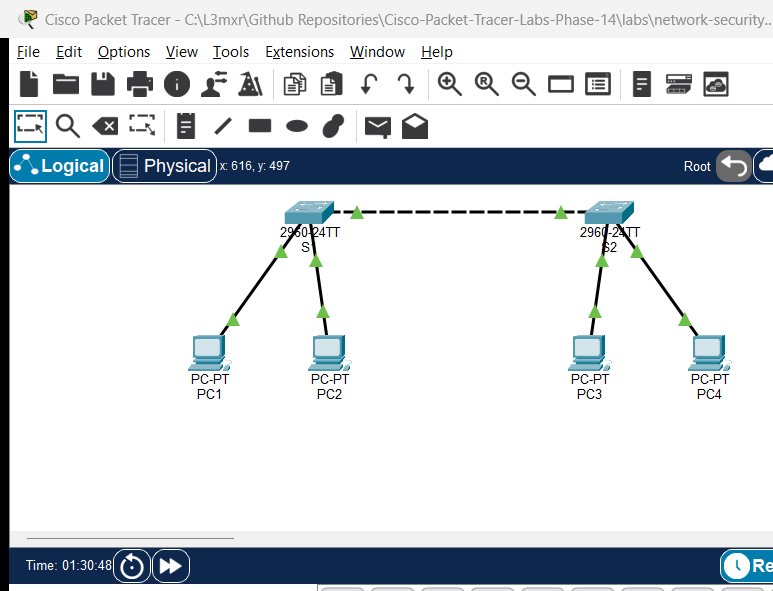

# PTL-0018: Dynamic Trunking Protocol and Native VLAN Security

## Learning Objectives

- Analyze Cisco Dynamic Trunking Protocol (DTP) operational states and evaluate the security risks of unmanaged dynamic negotiation.
- Contrast the five switchport operational states: `access`, `trunk`, `dynamic auto`, `dynamic desirable`, and `nonegotiate`.
- Eliminate DTP frame spoofing and negotiation vulnerabilities by converting inter-switch links to unconditional trunks with `switchport nonegotiate`.
- Evaluate security vulnerabilities surrounding default VLAN 1 (such as double-tagging VLAN hopping) and isolate untagged traffic using a dedicated, unused Native VLAN 999.
- Diagnose native VLAN mismatches using Cisco Discovery Protocol (CDP) syslog alerts and Spanning Tree Protocol (PVST+) inconsistent port blocking states.
- Restrict forwarded broadcast and unicast traffic by implementing explicit allowed VLAN lists (`switchport trunk allowed vlan`).
- Verify intra-VLAN cross-switch reachability across hardened trunks while confirming strict Layer 2 isolation between distinct VLANs without a router.

## Prerequisites

- Completion of [PTL-0009: VLAN Segmentation and Access Ports](../../switching/vlan-segmentation-and-access-ports/README.md) or equivalent understanding of IEEE 802.1Q frame tagging.
- Familiarity with Cisco IOS interface configuration and Layer 2 broadcast domain concepts.
- Basic understanding of Cisco Discovery Protocol (CDP) and Per-VLAN Spanning Tree Plus (PVST+).

## Topology



The topology consists of two Cisco Catalyst 2960-24TT Layer 2 switches (`S1` and `S2`) connected via an inter-switch link on interface `GigabitEthernet0/1`. Each switch connects two workstations representing two separate departmental broadcast domains:
- **VLAN 10 (Staff)**: Host `PC1` on `S1` (`Fa0/10`) and host `PC3` on `S2` (`Fa0/10`).
- **VLAN 20 (Management)**: Host `PC2` on `S1` (`Fa0/20`) and host `PC4` on `S2` (`Fa0/20`).
- **VLAN 999 (Native_Unused)**: Dedicated, unrouted VLAN assigned as the native VLAN across the `Gi0/1` trunk link.

```text
[PC1: 192.168.10.10] --- Fa0/10 [      ] Fa0/10 --- [PC3: 192.168.10.20]
  (VLAN 10 - Staff)             [  S1  ]              (VLAN 10 - Staff)
                                [      ] Gi0/1
                                   ||   ====== Inter-Switch Link
                                   ||   ====== (GigabitEthernet0/1)
[PC2: 192.168.20.10] --- Fa0/20 [      ] Gi0/1
  (VLAN 20 - Mgmt)              [  S2  ]
                                [      ] Fa0/20 --- [PC4: 192.168.20.20]
                                                      (VLAN 20 - Mgmt)
```

## Addressing Table

| Device | Interface | IP Address | Subnet Mask | VLAN | Default Gateway |
|---|---|---|---|---|---|
| S1 | Gi0/1 | Unnumbered (Trunk) | N/A | 10, 20, 999 (Native) | N/A |
| S1 | Fa0/10 | Unnumbered (Access) | N/A | 10 | N/A |
| S1 | Fa0/20 | Unnumbered (Access) | N/A | 20 | N/A |
| S2 | Gi0/1 | Unnumbered (Trunk) | N/A | 10, 20, 999 (Native) | N/A |
| S2 | Fa0/10 | Unnumbered (Access) | N/A | 10 | N/A |
| S2 | Fa0/20 | Unnumbered (Access) | N/A | 20 | N/A |
| PC1 | FastEthernet0 | 192.168.10.10 | 255.255.255.0 | 10 (Staff) | N/A |
| PC2 | FastEthernet0 | 192.168.20.10 | 255.255.255.0 | 20 (Management) | N/A |
| PC3 | FastEthernet0 | 192.168.10.20 | 255.255.255.0 | 10 (Staff) | N/A |
| PC4 | FastEthernet0 | 192.168.20.20 | 255.255.255.0 | 20 (Management) | N/A |

## Lab Tasks

1. **Verify Default DTP Negotiation (Experiment A - NEG-01)**:
   - Connect S1 and S2 via `GigabitEthernet0/1` in factory-default state (`dynamic auto`).
   - Verify with `show interfaces GigabitEthernet0/1 switchport` that administrative mode is `dynamic auto` and operational mode is `static access`. Confirm that two `dynamic auto` ports do not negotiate a trunk.
2. **Trigger Dynamic Trunk Negotiation (Experiment B - POS-01)**:
   - Set S1 `Gi0/1` to `switchport mode dynamic desirable`.
   - Observe that S1 transmits DTP frames, causing S2 (`dynamic auto`) to transition its operational mode from `static access` to `trunk`.
3. **Enforce Static 802.1Q Trunking & VLAN Pruning (Experiment C - POS-02 & POS-04)**:
   - Convert both ends of the inter-switch link to permanent, unconditional trunks with `switchport mode trunk`.
   - Restrict allowed VLANs to only necessary operational domains: `switchport trunk allowed vlan 10,20,999`.
4. **Demonstrate Native VLAN Mismatch Diagnostics (Experiment D - NEG-03)**:
   - Configure S1 `Gi0/1` with `switchport trunk native vlan 999` while leaving S2 `Gi0/1` with default native VLAN 1.
   - Observe real-time CDP syslog warnings (`%CDP-4-NATIVE_VLAN_MISMATCH`).
   - Observe Per-VLAN Spanning Tree Plus (PVST+) blocking the mismatched port (`%SPANTREE-2-BLOCK_PVID_LOCAL`) to prevent inter-VLAN leaking.
5. **Restore Native VLAN Consistency & Verify Reachability (Experiment E - POS-03, POS-05, NEG-02, NEG-04)**:
   - Align S2 `Gi0/1` to `switchport trunk native vlan 999`.
   - Verify intra-VLAN cross-switch communication (`PC1` pings `PC3` on VLAN 10; `PC2` pings `PC4` on VLAN 20).
   - Confirm inter-VLAN isolation: `PC1` cannot ping `PC2` or `PC4` without a Layer 3 routing device.
   - Temporarily remove VLAN 10 from the allowed list (`switchport trunk allowed vlan remove 10`) to confirm traffic is immediately blocked (`NEG-04`), then restore it.
6. **Eliminate DTP Spoofing with `nonegotiate` (Experiment F - POS-06)**:
   - Execute `switchport nonegotiate` on both `Gi0/1` interfaces.
   - Verify that `Negotiation of Trunking: Off` is reported, eliminating rogue DTP spoofing vulnerabilities while maintaining full operational trunking.

## Configuration Walkthrough

### Step 1: Baseline VLAN Creation & Access Port Allocation

Configure VLANs 10, 20, and 999 on both switches and assign workstation access ports.

#### Switch S1
```text
S1# configure terminal
S1(config)# vlan 10
S1(config-vlan)# name Staff
S1(config-vlan)# vlan 20
S1(config-vlan)# name Management
S1(config-vlan)# vlan 999
S1(config-vlan)# name Native_Unused
S1(config-vlan)# exit

S1(config)# interface FastEthernet0/10
S1(config-if)# switchport mode access
S1(config-if)# switchport access vlan 10
S1(config-if)# no shutdown

S1(config)# interface FastEthernet0/20
S1(config-if)# switchport mode access
S1(config-if)# switchport access vlan 20
S1(config-if)# no shutdown
S1(config-if)# exit
```

#### Switch S2
```text
S2# configure terminal
S2(config)# vlan 10
S2(config-vlan)# name Staff
S2(config-vlan)# vlan 20
S2(config-vlan)# name Management
S2(config-vlan)# vlan 999
S2(config-vlan)# name Native_Unused
S2(config-vlan)# exit

S2(config)# interface FastEthernet0/10
S2(config-if)# switchport mode access
S2(config-if)# switchport access vlan 10
S2(config-if)# no shutdown

S2(config)# interface FastEthernet0/20
S2(config-if)# switchport mode access
S2(config-if)# switchport access vlan 20
S2(config-if)# no shutdown
S2(config-if)# exit
```

### Step 2: Observe Dynamic Trunking Protocol (DTP) Behavior

Before securing the trunk, inspect the default behavior of Cisco Catalyst switches:

```text
S1# show interfaces GigabitEthernet0/1 switchport
```
*Notice:* `Administrative Mode: dynamic auto`, `Operational Mode: static access`. Because both switches listen passively, no trunk forms.

Now, configure S1 to actively solicit a trunk:
```text
S1(config)# interface GigabitEthernet0/1
S1(config-if)# switchport mode dynamic desirable
S1(config-if)# end
```

Re-check S2:
```text
S2# show interfaces GigabitEthernet0/1 switchport
```
*Notice:* S2 has transitioned its `Operational Mode` to `trunk` because it accepted the DTP advertisement from S1.

### Step 3: Enforce Static Trunking and Restrict Allowed VLANs

Unmanaged dynamic trunking is a security vulnerability (DTP spoofing). Convert both switches to permanent trunks and define an explicit allowed VLAN list:

#### Switch S1
```text
S1(config)# interface GigabitEthernet0/1
S1(config-if)# switchport mode trunk
S1(config-if)# switchport trunk allowed vlan 10,20,999
S1(config-if)# exit
```

#### Switch S2
```text
S2(config)# interface GigabitEthernet0/1
S2(config-if)# switchport mode trunk
S2(config-if)# switchport trunk allowed vlan 10,20,999
S2(config-if)# exit
```

### Step 4: Native VLAN Security and Mismatch Diagnostics

Change the native VLAN on S1 only to observe Cisco protocol behavior during a misconfiguration:

```text
S1(config)# interface GigabitEthernet0/1
S1(config-if)# switchport trunk native vlan 999
S1(config-if)# exit
```

Within 60 seconds, CDP will detect the discrepancy and emit syslog alerts on the console:
```text
%CDP-4-NATIVE_VLAN_MISMATCH: Native VLAN mismatch discovered on GigabitEthernet0/1 (999), with S2 GigabitEthernet0/1 (1).
```
Simultaneously, Per-VLAN Spanning Tree Plus (PVST+) detects inconsistent VLAN IDs in received BPDUs and places the port into an inconsistent state:
```text
%SPANTREE-2-RECV_PVID_ERR: Received BPDU with inconsistent peer vlan id 1 on GigabitEthernet0/1 VLAN999.
%SPANTREE-2-BLOCK_PVID_LOCAL: Blocking GigabitEthernet0/1 on VLAN0999. Inconsistent local vlan.
```

To resolve the issue and secure the inter-switch link, configure matching native VLAN 999 on S2:

```text
S2(config)# interface GigabitEthernet0/1
S2(config-if)# switchport trunk native vlan 999
S2(config-if)# exit
```
PVST+ unblocks the port automatically once BPDUs agree.

### Step 5: Disable DTP Frame Transmission (`nonegotiate`)

To prevent an attacker from sending fraudulent DTP frames to negotiate unauthorized trunks, completely disable DTP generation on both switches:

#### Switch S1
```text
S1(config)# interface GigabitEthernet0/1
S1(config-if)# switchport nonegotiate
S1(config-if)# end
```

#### Switch S2
```text
S2(config)# interface GigabitEthernet0/1
S2(config-if)# switchport nonegotiate
S2(config-if)# end
```

## Verification

### 1. Verify Trunk Status and Native VLAN

Verify that `Gig0/1` operates as a trunk with Native VLAN 999 and the restricted allowed list:

```text
S1# show interfaces trunk
Port        Mode         Encapsulation  Status        Native vlan
Gig0/1      on           802.1q         trunking      999

Port        Vlans allowed on trunk
Gig0/1      10,20,999

Port        Vlans allowed and active in management domain
Gig0/1      10,20,999

Port        Vlans in spanning tree forwarding state and not pruned
Gig0/1      10,20,999
```

### 2. Verify DTP Negotiation Disabled

Verify that DTP frame transmission is turned off:

```text
S1# show interfaces GigabitEthernet0/1 switchport | include Negotiation
Negotiation of Trunking: Off
```

### 3. Verify Intra-VLAN Cross-Switch Connectivity

From workstation `PC1` (192.168.10.10, VLAN 10), ping `PC3` (192.168.10.20, VLAN 10):
```text
PC> ping 192.168.10.20
Pinging 192.168.10.20 with 32 bytes of data:
Reply from 192.168.10.20: bytes=32 time<1ms TTL=128
Reply from 192.168.10.20: bytes=32 time<1ms TTL=128
Ping statistics for 192.168.10.20:
    Packets: Sent = 4, Received = 4, Lost = 0 (0% loss)
```

From workstation `PC2` (192.168.20.10, VLAN 20), ping `PC4` (192.168.20.20, VLAN 20):
```text
PC> ping 192.168.20.20
Pinging 192.168.20.20 with 32 bytes of data:
Reply from 192.168.20.20: bytes=32 time<1ms TTL=128
Reply from 192.168.20.20: bytes=32 time<1ms TTL=128
Ping statistics for 192.168.20.20:
    Packets: Sent = 4, Received = 4, Lost = 0 (0% loss)
```

### 4. Verify Inter-VLAN Isolation

From workstation `PC1` (VLAN 10), attempt to ping `PC2` (192.168.20.10, VLAN 20):
```text
PC> ping 192.168.20.10
Pinging 192.168.20.10 with 32 bytes of data:
Request timed out.
Request timed out.
Ping statistics for 192.168.20.10:
    Packets: Sent = 4, Received = 0, Lost = 4 (100% loss)
```
*Expected Result:* Frames remain isolated at Layer 2 because no Layer 3 router or SVI routing gateway exists.

## Troubleshooting

### Scenario 1: Inter-Switch Link Remains an Access Port
- **Symptom:** Workstations on S1 cannot ping workstations on S2 even within the same VLAN. `show interfaces trunk` returns empty.
- **Root Cause:** Both switches are configured with `dynamic auto`. Dynamic auto ports wait passively for incoming DTP negotiation requests; if neither side initiates, no trunk forms.
- **Resolution:** Explicitly configure `switchport mode trunk` on both sides.

### Scenario 2: Native VLAN Mismatch Warnings & Spanning Tree Blocking
- **Symptom:** Console repeatedly prints `%CDP-4-NATIVE_VLAN_MISMATCH` and `%SPANTREE-2-BLOCK_PVID_LOCAL`. Traffic on the native VLAN stops.
- **Root Cause:** S1 has `switchport trunk native vlan 999`, while S2 is configured with default VLAN 1. STP blocks the inconsistent port to prevent traffic leakage between VLAN 1 and VLAN 999.
- **Resolution:** Align the native VLAN on both sides using `switchport trunk native vlan 999`.

### Scenario 3: `switchport nonegotiate` Command Fails
- **Symptom:** Switch rejects command with `% Command rejected: Gi0/1 not in access or trunk mode`.
- **Root Cause:** `switchport nonegotiate` cannot be applied to interfaces in `dynamic auto` or `dynamic desirable` mode.
- **Resolution:** First set the port to static mode using `switchport mode trunk`, then execute `switchport nonegotiate`.

### Scenario 4: Specific VLAN Traffic Dropped Across Trunk
- **Symptom:** VLAN 10 hosts cannot communicate across switches, but VLAN 20 hosts communicate normally.
- **Root Cause:** VLAN 10 was inadvertently omitted or removed from the allowed VLAN list on the trunk.
- **Resolution:** Inspect `show interfaces trunk` and append the missing VLAN using `switchport trunk allowed vlan add 10`.

## Key Takeaways

### DTP Mode Matrix Comparison

The operational link type between two connected Cisco switch ports depends on the administrative mode configured on each end:

| Local Mode \ Remote Mode | `access` | `dynamic auto` | `dynamic desirable` | `trunk` |
|---|---|---|---|---|
| **`access`** | Static Access | Static Access | Static Access | Incompatible / Error |
| **`dynamic auto`** | Static Access | **Static Access** (Default) | Operational Trunk | Operational Trunk |
| **`dynamic desirable`** | Static Access | Operational Trunk | Operational Trunk | Operational Trunk |
| **`trunk`** | Incompatible / Error | Operational Trunk | Operational Trunk | Operational Trunk |
| **`nonegotiate`** | Static Access | Incompatible / No DTP | Incompatible / No DTP | **Hardened Trunk** |

### What Dynamic Trunking Protocol (DTP) Does vs. Does NOT Do

- **What DTP Does:**
  - Proprietary Cisco point-to-point protocol operating at Layer 2.
  - Automatically negotiates trunking status (access vs. trunk) between connected switch ports.
  - Negotiates trunk encapsulation (`dot1q` vs. legacy `isl` on older hardware).
- **What DTP Does NOT Do:**
  - DTP **does not** validate or negotiate the Native VLAN ID (mismatches must be detected by CDP or PVST+).
  - DTP **does not** synchronize allowed VLAN lists between switches.
  - DTP **does not** authenticate the remote device, leaving ports vulnerable to rogue switches and software-based DTP spoofing tools (e.g., Yersinia).

### Native VLAN Security & Unused VLAN 999 Justification

1. **VLAN Hopping & Double-Tagging Risk:** In default configurations, VLAN 1 is both the default access VLAN and the default native VLAN. An attacker on an access port in VLAN 1 can craft an 802.1Q double-tagged frame: the outer tag (VLAN 1) is stripped by the first switch across the native trunk without inspection, allowing the inner tag (e.g., VLAN 20) to be forwarded to a target broadcast domain.
2. **Dedicated, Unused Native VLAN 999:**
   - Security best practice dictates changing the native VLAN on all 802.1Q trunks from VLAN 1 to an isolated, non-default VLAN ID (such as VLAN 999).
   - **No user access ports** and **no Management Switch Virtual Interfaces (SVIs)** are ever assigned to VLAN 999.
   - If untagged or malformed frames leak across the trunk, they terminate harmlessly in an empty broadcast domain.
3. **Disabling DTP (`nonegotiate`):**
   - Combining static unconditional trunking (`switchport mode trunk`) with `switchport nonegotiate` permanently eliminates DTP frame transmission, completely closing the vector for trunk negotiation spoofing.

## References

- Cisco Systems. (2015). *Catalyst 2960 and 2960-S Software Configuration Guide, 12.2(55)SE - Configuring VLANs*.
- Cisco Systems. (2020). *CCNA Routing and Switching 200-301 Official Cert Guide, Volume 1*. Cisco Press.
- RFC 7727. (2016). *Spanning Tree Protocol (STP) Extension for Inconsistent Port Prevention*. Internet Engineering Task Force.
- IEEE Std 802.1Q-2018. *IEEE Standard for Local and Metropolitan Area Networks--Bridges and Bridged Networks*.

## Files and Validation Status

- Starter Topology: [assets/starter.pkt](assets/starter.pkt)
- Completed Topology: [assets/completed.pkt](assets/completed.pkt)
- Switch S1 Configuration: [configs/S1.txt](configs/S1.txt)
- Switch S2 Configuration: [configs/S2.txt](configs/S2.txt)
- Verification Protocol & Test Results: [verification.md](verification.md)
- Authentic Simulator Test Capture: [AI_AGENT_GUIDE/state/PTL-0018-SIMULATOR-RESULTS.md](../../../AI_AGENT_GUIDE/state/PTL-0018-SIMULATOR-RESULTS.md)

| Metric | Status |
|---|---|
| Documentation Review | `reviewed` |
| Packet Tracer Validation | `tested_pass` (Cisco Packet Tracer 9.0.1 IPC Bridge) |
| Checksum Verification | Confirmed (Starter: `016d1dbf...`, Completed: `508b7f4f...`) |
