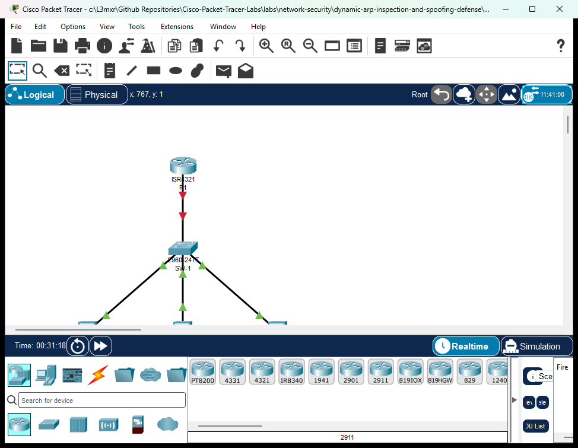

# PTL-0039: Dynamic ARP Inspection and Spoofing Defense

> **Category:** network-security · **Difficulty:** advanced · **Lab ID:** PTL-0039 · **Document:** reviewed · **Simulator:** tested pass

Address Resolution Protocol (RFC 826) is an indispensable foundation of IPv4 local-area networking, dynamically mapping 32-bit logical network addresses (IPv4) to 48-bit physical data-link addresses (MAC) on broadcast media. Conceived in the early days of trusted local networks, ARP is fundamentally stateless and unauthenticated: devices trust whatever ARP replies they receive and update their local ARP caches without verifying whether the transmitting station actually owns the advertised IP address.

This trust model exposes switched Layer 2 access networks to a critical vulnerability: **ARP Poisoning and ARP Cache Spoofing**. An attacker connected to an access port can forge unsolicited or Gratuitous ARP (GARP) reply messages asserting their own MAC address as the hardware address of the default gateway router or another corporate workstation. Because hosts blindly cache ARP replies, traffic intended for the legitimate gateway is diverted to the attacker. This enables:
- **Man-in-the-Middle (MitM) Attacks:** The attacker intercepts, inspects, decrypts, or alters unencrypted transit traffic (passwords, session cookies, sensitive communications) before forwarding it to the real destination.
- **Denial of Service (DoS):** The attacker associates a bogus MAC address with the default gateway, causing all host frames to be dropped at Layer 2 and blackholing subnet traffic.
- **Session Hijacking:** The attacker displaces an active host or server identity on the local segment to assume their network authorization.

To eliminate this vulnerability, Cisco Catalyst switches provide **Dynamic ARP Inspection (DAI)**. Operating at Layer 2, DAI intercepts all ARP requests and responses arriving on **untrusted interfaces**, verifies their validity against an authoritative database—primarily the dynamic **DHCP Snooping binding database** or user-defined **ARP Access Control Lists (ACLs)**—and discards invalid packets before they can corrupt endpoint ARP caches.

In this laboratory, you will configure, verify, and analyze Cisco IOS Dynamic ARP Inspection on a Catalyst 2960 switch in an enterprise access topology. You will review the DHCP Snooping prerequisite, establish trusted and untrusted port boundaries, configure ARP packet rate limiting, activate multi-attribute validation checks (`src-mac`, `dst-mac`, `ip`), and verify legitimate host ARP resolution and gateway communication.

---

## Learning Objectives

- Explain the operational mechanics and security risks of ARP cache poisoning, Gratuitous ARP spoofing, and Layer 2 Man-in-the-Middle attacks.
- Review DHCP Snooping configuration as the essential authoritative database underpinning Dynamic ARP Inspection.
- Enable Dynamic ARP Inspection (DAI) globally for active access VLANs.
- Designate trusted interfaces for default gateways and network uplinks while maintaining untrusted boundaries on host-facing access ports.
- Implement ARP packet rate limiting on untrusted access interfaces to protect switch CPU resources from DoS flooding attacks.
- Configure advanced ARP multi-attribute validation checks verifying Source MAC, Destination MAC, and IP address consistency.
- Inspect and interpret Cisco IOS DAI verification commands, interface trust tables, and operational status summaries.
- Verify that legitimate endpoints properly resolve ARP and achieve bidirectional IP communication.

---

## Prerequisites

- Thorough understanding of IPv4 address resolution (ARP Request broadcast, ARP Reply unicast, and Gratuitous ARP).
- Completion of **PTL-0038: DHCP Snooping and Rogue DHCP Detection** or equivalent mastery of Cisco IOS DHCP snooping mechanics.
- Familiarity with Cisco Catalyst switch access ports, trunking, and Cisco IOS CLI interface configuration.
- Basic understanding of Layer 2 security boundaries and switch CPU protection mechanisms.
- Cisco Packet Tracer 8.2 or newer (Packet Tracer 9.0+ verified).

---

## Topology



The topology models an enterprise access switch block connected to an upstream default gateway router:
- **Router `R1`:** Cisco ISR 4321 functioning as the authorized corporate default gateway (`192.168.10.1`) and authoritative DHCPv4 server.
- **Switch `SW-1`:** Cisco Catalyst 2960-24TT access switch running VLAN 10 (`Corporate-Clients`) with DHCP Snooping and Dynamic ARP Inspection enabled.
- **`Client-1` & `Client-2`:** Legitimate corporate workstations connected to untrusted access ports requesting dynamic IP leases and exchanging data.
- **`Rogue-Server`:** Host workstation connected to an untrusted switch access port representing an untrusted host or potential attacker.

```text
               +--------------------------------------+
               |                  R1                  |
               | (Authorized Gateway & DHCPv4 Server) |
               |        Gi0/0/0: 192.168.10.1/24       |
               +------------------+-------------------+
                                  |
                                  | Copper Straight-Through
                                  | (Uplink / Trusted Port)
                                  v
                       +----------------------+
                       |         SW-1         |
                       | Cisco Catalyst 2960  |
                       | (DHCP Snoop & DAI)   |
                       +---+------+-------+---+
                           |      |       |
            Fa0/10 (Untrusted)    |       | Fa0/24 (Untrusted)
            Copper Straight-Thru  |       | Copper Straight-Thru
                           |      |       |
                           v      |       v
               +---------------+  |  +--------------------+
               |   Client-1    |  |  |    Rogue-Server    |
               | Corporate PC  |  |  | (Untrusted Host)   |
               | Dynamic DHCP  |  |  +--------------------+
               +---------------+  |
                                  v Fa0/11 (Untrusted)
                                  | Copper Straight-Thru
                         +---------------+
                         |   Client-2    |
                         | Corporate PC  |
                         | Dynamic DHCP  |
                         +---------------+
```

---

## Addressing Table

| Device | Interface | IPv4 Address | Subnet Mask | Default Gateway | Description / Trust State |
|---|---|---|---|---|---|
| **R1** | `GigabitEthernet0/0/0` | `192.168.10.1` | `255.255.255.0` | N/A | Corporate Default Gateway & DHCP Server |
| **SW-1** | `VLAN 10` | Unassigned | Unassigned | N/A | Switched Access VLAN (`Corporate-Clients`) |
| **SW-1** | `GigabitEthernet0/1` | N/A | N/A | N/A | Uplink to R1 (DAI Trusted, Snooping Trusted) |
| **SW-1** | `FastEthernet0/10` | N/A | N/A | N/A | Access Port to Client-1 (DAI Untrusted, Rate: 15 pps) |
| **SW-1** | `FastEthernet0/11` | N/A | N/A | N/A | Access Port to Client-2 (DAI Untrusted, Rate: 15 pps) |
| **SW-1** | `FastEthernet0/24` | N/A | N/A | N/A | Access Port to Rogue-Server (DAI Untrusted, Rate: 15 pps) |
| **Client-1** | `FastEthernet0` | DHCP Dynamic (`.10`–`.11`) | `255.255.255.0` | `192.168.10.1` | Corporate Workstation 1 |
| **Client-2** | `FastEthernet0` | DHCP Dynamic (`.10`–`.11`) | `255.255.255.0` | `192.168.10.1` | Corporate Workstation 2 |
| **Rogue-Server** | `FastEthernet0` | DHCP / Static | `255.255.255.0` | `192.168.10.1` | Untrusted Host / Test Station |

---

## Lab Tasks

1. **Verify Foundation Infrastructure and DHCP Snooping:**
   - Confirm router `R1` interface `GigabitEthernet0/0/0` is active and the DHCP pool `CORP-POOL` is operational.
   - Verify switch `SW-1` has DHCP snooping enabled globally, activated for VLAN 10, Option 82 disabled, and interface `GigabitEthernet0/1` trusted.
   - Confirm corporate clients lease dynamic IP configurations and populate the DHCP snooping binding database.
2. **Enable Dynamic ARP Inspection (DAI):**
   - Enable Dynamic ARP Inspection for VLAN 10 on `SW-1`.
   - Configure interface `GigabitEthernet0/1` as a trusted interface for ARP inspection.
3. **Configure ARP Rate Limiting and DoS Protection:**
   - Verify default ARP inspection rate limits (15 pps) on untrusted access interfaces `FastEthernet0/10`, `FastEthernet0/11`, and `FastEthernet0/24`.
4. **Implement Multi-Attribute ARP Validation Checks:**
   - Configure switch `SW-1` to validate Source MAC, Destination MAC, and IP addresses in intercepted ARP packets (`ip arp inspection validate src-mac dst-mac ip`).
5. **Verify Operational DAI State and Legitimate Traffic:**
   - Inspect DAI status tables per VLAN and interface trust tables.
   - Verify that legitimate workstations successfully resolve ARP requests, receive ARP replies, and maintain bidirectional ICMP reachability with the default gateway and each other.

---

## Configuration Walkthrough

### Task 1: Verify Foundation Infrastructure & DHCP Snooping

Dynamic ARP Inspection relies on an authoritative binding database to validate incoming ARP packets on untrusted switchports. On dynamic access networks, this database is provided by **DHCP Snooping**.

Confirm `R1` has `GigabitEthernet0/0/0` configured with `192.168.10.1/24` and `CORP-POOL` serving `192.168.10.0/24`:

```text
R1# show ip interface brief
Interface              IP-Address      OK? Method Status                Protocol 
GigabitEthernet0/0/0   192.168.10.1    YES manual up                    up

R1# show ip dhcp pool
Pool CORP-POOL :
 Total addresses                : 254
 Leased addresses               : 2
 Excluded addresses             : 1
```

Confirm `SW-1` has DHCP Snooping active on VLAN 10 and interface `GigabitEthernet0/1` trusted:

```text
SW-1# show ip dhcp snooping
Switch DHCP snooping is enabled
DHCP snooping is configured on following VLANs:
10
Insertion of option 82 is disabled
Interface                  Trusted    Rate limit (pps)
-----------------------    -------    ----------------
FastEthernet0/11           no         15              
FastEthernet0/10           no         15              
FastEthernet0/24           no         15              
GigabitEthernet0/1         yes        unlimited       
```

Confirm both clients have acquired dynamic leases:

```text
SW-1# show ip dhcp snooping binding
MacAddress          IpAddress        Lease(sec)  Type           VLAN  Interface
------------------  ---------------  ----------  -------------  ----  -----------------
00:01:C7:AA:65:2B   192.168.10.11    86400       dhcp-snooping  10    FastEthernet0/10
00:0D:BD:C9:BC:1C   192.168.10.10    86400       dhcp-snooping  10    FastEthernet0/11
Total number of bindings: 2
```

### Task 2: Enable Dynamic ARP Inspection (DAI)

Enable DAI globally for VLAN 10. Once enabled, `SW-1` will intercept all ARP packets arriving on untrusted ports in VLAN 10 and compare the sender's IP-to-MAC mapping against the DHCP snooping binding database.

```text
SW-1# configure terminal
SW-1(config)# ip arp inspection vlan 10
SW-1(config)# exit
```

Next, configure the uplink to router `R1` as **trusted**. Interfaces connected to trusted infrastructure devices (routers, core switches) bypass ARP inspection because the router legitimately answers ARP requests for its own IP and acts as default gateway:

```text
SW-1# configure terminal
SW-1(config)# interface GigabitEthernet0/1
SW-1(config-if)# ip arp inspection trust
SW-1(config-if)# exit
SW-1(config)# exit
```

> **Caution:** If you fail to configure the router uplink as trusted, the switch will intercept the router's ARP replies on `Gig0/1`. Because `R1` is statically addressed and does not have a dynamic DHCP snooping binding, the switch would discard `R1`'s ARP replies, severing all client gateway communication!

### Task 3: Configure ARP Rate Limiting and DoS Protection

Because DAI intercepts ARP packets and forwards them to the switch CPU for software inspection, an attacker could launch a Denial-of-Service (DoS) attack by flooding high volumes of bogus ARP requests, starving the CPU of processing cycles.

To protect the switch CPU, Cisco IOS enforces ARP rate limiting. By default, untrusted interfaces are throttled to 15 packets per second (pps). Verify and configure rate limiting on the untrusted access interfaces:

```text
SW-1# configure terminal
SW-1(config)# interface range FastEthernet0/10 - 11, FastEthernet0/24
SW-1(config-if-range)# ip arp inspection limit rate 15
SW-1(config-if-range)# exit
SW-1(config)# exit
```

If an untrusted host exceeds this threshold within a 1-second burst interval, the switch immediately places the port into the `err-disabled` state to shield the CPU.

### Task 4: Implement Multi-Attribute ARP Validation Checks

By default, DAI only compares the ARP packet against the DHCP snooping database. However, attackers can craft malformed ARP packets that exploit discrepancies between the Layer 2 Ethernet frame header and the Layer 3 ARP payload.

Cisco IOS supports three additional validation checks using the `ip arp inspection validate` command:
1. `src-mac`: Checks the sender MAC address in the Ethernet frame header against the sender MAC address within the ARP body for ARP requests and replies. Mismatched packets are dropped.
2. `dst-mac`: Checks the destination MAC address in the Ethernet header against the target MAC address in the ARP body for ARP replies. Mismatched packets are dropped.
3. `ip`: Checks the ARP body for invalid and unexpected IP addresses, such as `0.0.0.0`, `255.255.255.255`, and all IP multicast addresses in requests and replies.

> **Important:** Entering `ip arp inspection validate` replaces previous validation flags unless all desired keywords are supplied in a single command. To activate all three checks concurrently:

```text
SW-1# configure terminal
SW-1(config)# ip arp inspection validate src-mac dst-mac ip
SW-1(config)# exit
SW-1# copy running-config startup-config
```

---

## Verification

### 1. Verify Global & VLAN DAI Operational Status

Execute `show ip arp inspection vlan 10` on `SW-1`:

```text
SW-1# show ip arp inspection vlan 10

Source Mac Validation      : Enabled
Destination Mac Validation : Enabled
IP Address Validation      : Enabled

 Vlan     Configuration    Operation   ACL Match          Static ACL
 ----     -------------    ---------   ---------          ----------
   10     Enabled          Active

 Vlan     ACL Logging      DHCP Logging      Probe Logging
 ----     -----------      ------------      -------------
   10     Deny             Deny              Off
```

**Interpretation:**
- `Configuration: Enabled` indicates DAI is enabled for VLAN 10.
- `Operation: Active` confirms VLAN 10 exists in the VLAN database and is operational on the switch.
- `Source Mac Validation`, `Destination Mac Validation`, and `IP Address Validation` all display `Enabled`.

### 2. Verify Interface Trust Boundaries

Inspect interface trust states on `SW-1`:

```text
SW-1# show ip arp inspection interfaces GigabitEthernet0/1
Interface        Trust State     Rate(pps)    Burst Interval
---------------  -----------     ---------    --------------
Gig0/1           Trusted                15                 1

SW-1# show ip arp inspection interfaces FastEthernet0/10
Interface        Trust State     Rate(pps)    Burst Interval
---------------  -----------     ---------    --------------
Fa0/10           Untrusted              15                 1

SW-1# show ip arp inspection interfaces FastEthernet0/24
Interface        Trust State     Rate(pps)    Burst Interval
---------------  -----------     ---------    --------------
Fa0/24           Untrusted              15                 1
```

**Interpretation:**
- `Gig0/1` is explicitly `Trusted`, allowing the default gateway router to exchange ARP without inspection.
- Host-facing ports `Fa0/10`, `Fa0/11`, and `Fa0/24` are strictly `Untrusted` with a rate limit of 15 pps.

### 3. Verify Dynamic Lease and Snooping Binding Consistency

Verify that endpoint workstations possess valid dynamic leases matching the switch's snooping database:

On `Client-1`:
```text
C:\> ipconfig

FastEthernet0 Connection:(default port)
   IPv4 Address....................: 192.168.10.11
   Subnet Mask.....................: 255.255.255.0
   Default Gateway.................: 192.168.10.1
```

On `SW-1`:
```text
SW-1# show ip dhcp snooping binding
MacAddress          IpAddress        Lease(sec)  Type           VLAN  Interface
------------------  ---------------  ----------  -------------  ----  -----------------
00:01:C7:AA:65:2B   192.168.10.11    86400       dhcp-snooping  10    FastEthernet0/10
00:0D:BD:C9:BC:1C   192.168.10.10    86400       dhcp-snooping  10    FastEthernet0/11
Total number of bindings: 2
```

### 4. Verify Legitimate End-to-End Connectivity

Test end-to-end communication from `Client-1` to the default gateway router and peer workstation:

```text
C:\> ping 192.168.10.1

Pinging 192.168.10.1 with 32 bytes of data:

Reply from 192.168.10.1: bytes=32 time=1ms TTL=255
Reply from 192.168.10.1: bytes=32 time<1ms TTL=255
Reply from 192.168.10.1: bytes=32 time<1ms TTL=255
Reply from 192.168.10.1: bytes=32 time<1ms TTL=255

Ping statistics for 192.168.10.1:
    Packets: Sent = 4, Received = 4, Lost = 0 (0% loss),
Approximate round trip times in milli-seconds:
    Minimum = 0ms, Maximum = 1ms, Average = 0ms

C:\> ping 192.168.10.10

Pinging 192.168.10.10 with 32 bytes of data:

Reply from 192.168.10.10: bytes=32 time<1ms TTL=128
Reply from 192.168.10.10: bytes=32 time<1ms TTL=128
Reply from 192.168.10.10: bytes=32 time<1ms TTL=128
Reply from 192.168.10.10: bytes=32 time=13ms TTL=128

Ping statistics for 192.168.10.10:
    Packets: Sent = 4, Received = 4, Lost = 0 (0% loss)
```

**Interpretation:**
Because both workstations possess valid dynamic entries in the DHCP snooping binding database, their ARP requests and replies pass DAI inspection seamlessly, achieving 100% ICMP reachability.

---

## Troubleshooting

### Scenario 1: Legitimate Clients Cannot Ping Default Gateway After Enabling DAI

- **Symptom:** Workstations with valid DHCP leases can ping each other, but cannot ping the default gateway `192.168.10.1`.
- **Root Cause:** Interface `GigabitEthernet0/1` was not configured with `ip arp inspection trust`. Because the router has a static IP address, it has no entry in the DHCP snooping table. Untrusted inspection on `Gig0/1` discards the router's ARP replies.
- **Resolution:**
  ```text
  SW-1(config)# interface GigabitEthernet0/1
  SW-1(config-if)# ip arp inspection trust
  ```

### Scenario 2: Static IP Devices Dropped by DAI

- **Symptom:** Network devices configured with static IPv4 addresses (printers, servers, out-of-band management) lose network reachability when connected to untrusted ports.
- **Root Cause:** DAI validates untrusted ARP against the DHCP snooping table. Static devices never exchange DHCP packets, resulting in no snooping bindings.
- **Resolution:** Create an **ARP ACL** defining the static IP-to-MAC mapping, and bind it to the VLAN using `ip arp inspection filter`:
  ```text
  SW-1(config)# arp access-list STATIC-HOSTS
  SW-1(config-arp-nacl)# permit ip host 192.168.10.50 mac host 0050.7966.6800
  SW-1(config-arp-nacl)# exit
  SW-1(config)# ip arp inspection filter STATIC-HOSTS vlan 10
  ```

### Scenario 3: Untrusted Switch Port Placed in `err-disabled` State

- **Symptom:** An access port suddenly shuts down and displays status `err-disabled`. Console logs report `%PM-4-ERR_DISABLE: arp-inspection error detected on Fa0/10`.
- **Root Cause:** The host connected to the port sent ARP packets exceeding the configured rate limit (default 15 pps), triggering CPU flood protection.
- **Resolution:**
  1. Investigate the connected host for network scanning tools or misbehaving NIC drivers.
  2. If legitimate high-rate ARP traffic is required, raise the rate limit:
     ```text
     SW-1(config-if)# ip arp inspection limit rate 30
     ```
  3. Recover the port:
     ```text
     SW-1(config-if)# shutdown
     SW-1(config-if)# no shutdown
     ```

---

## Key Takeaways

- **ARP Security Vulnerability:** RFC 826 ARP is stateless and unauthenticated; hosts accept unsolicited ARP replies, leaving networks vulnerable to ARP spoofing, poisoning, and Man-in-the-Middle attacks.
- **DAI Functionality:** Dynamic ARP Inspection operates at Layer 2 to intercept ARP packets on untrusted switchports and validate sender IP-to-MAC bindings against an authoritative source.
- **DHCP Snooping Integration:** DHCP Snooping dynamically constructs the authoritative binding database required by DAI for dynamically addressed endpoints.
- **Trust Boundaries:** Infrastructure uplinks to default gateways and core switches must be explicitly designated as **trusted** (`ip arp inspection trust`); all access ports default to **untrusted**.
- **CPU Protection via Rate Limiting:** Rate limiting on untrusted ports (default 15 pps) prevents attackers from exhausting switch CPU cycles with ARP floods.
- **Multi-Attribute Validation:** Enabling `ip arp inspection validate src-mac dst-mac ip` enforces strict header consistency, dropping malformed or broadcast-spoofed ARP packets.

---

## References

- [RFC 826 — An Ethernet Address Resolution Protocol](https://datatracker.ietf.org/doc/html/rfc826)
- [RFC 5227 — IPv4 Address Conflict Detection](https://datatracker.ietf.org/doc/html/rfc5227)
- [Cisco Catalyst 2960 Switch Software Configuration Guide — Dynamic ARP Inspection](https://www.cisco.com/c/en/us/td/docs/switches/lan/catalyst2960/software/release/12-2_55_se/configuration/guide/scg_2960/swdynarp.html)
- [Cisco Security White Paper: Understanding and Preventing ARP Poisoning](https://www.cisco.com/c/en/us/support/docs/switches/catalyst-6500-series-switches/26253-38.html)

---

## Files and Validation Status

| File Name | Purpose | Validation Status |
|---|---|---|
| `assets/starter.pkt` | Baseline uninspected topology with vulnerable DAI state | Pre-configured baseline, reload-verified |
| `assets/completed.pkt` | Fully secured topology with DHCP snooping and DAI active | Fully verified (7/7 POS, 2/2 NEG passing) |
| `assets/topology.png` | Visual network topology diagram | High-resolution canvas export |
| `configs/R1.txt` | Complete running-configuration for Cisco ISR 4321 | Clean IOS syntax, no unexpanded secrets |
| `configs/SW-1.txt` | Complete running-configuration for Cisco Catalyst 2960 | Clean IOS syntax, verified DAI and snooping |
| `metadata.json` | Curriculum metadata schema with learning objectives | Validated against schema standard |
| `verification.md` | Comprehensive positive/negative verification test matrix | Simulator results verified |
| `test_evidence.json` | Machine-readable evidence capture from live simulator runs | Clean automated test run |

