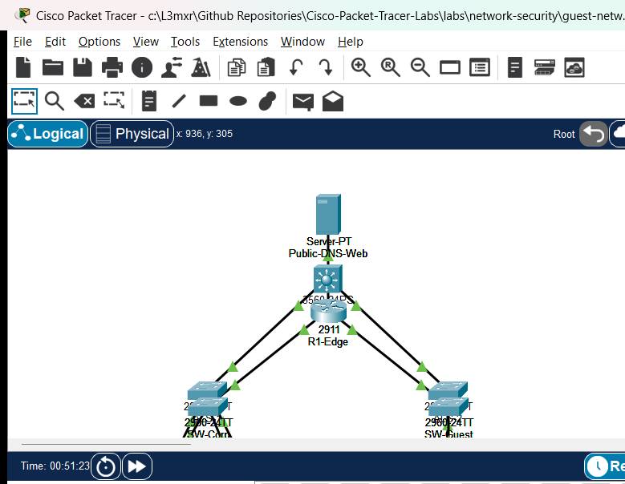

# PTL-0050: Guest Network Segmentation with ACLs

## Learning Objectives
- Design and deploy an enterprise guest network segmentation policy using named extended IPv4 Access Control Lists (ACLs).
- Enforce the principle of least privilege by permitting only essential public services (DNS over UDP 53, HTTP over TCP 80, and HTTPS over TCP 443) from guest endpoints.
- Isolate private corporate intranet subnets (`192.168.10.0/24`) from untrusted visitor devices connected to the guest subnet (`172.16.50.0/24`).
- Apply access lists on the edge router interface closest to the traffic source (`GigabitEthernet0/0/2 in`) to maximize forwarding efficiency.
- Diagnose and remediate common ACL configuration anomalies including directional misplacement, shadowed statements, and interface omission.

## Prerequisites
- Completion of [PTL-0013: Configuring Standard and Extended IPv4 Access Control Lists](../../network-security/standard-and-extended-acls/README.md).
- Completion of [PTL-0041: IPv4 ACL Troubleshooting with Traffic Matrix](../../network-security/ipv4-acl-troubleshooting-with-traffic-matrix/README.md).
- Completion of [PTL-0042: Named Extended IPv4 ACL for Server Access](../../network-security/named-extended-ipv4-acl-for-server-access/README.md).
- Familiarity with Cisco IOS extended access list syntax, wildcard masking, and transport protocol port numbers.

## Topology
The perimeter edge topology features a Cisco 2911 Integrated Services Router (`R1-Edge`) connecting three distinct network zones: an internal corporate LAN (`192.168.10.0/24`), an untrusted guest subnet (`172.16.50.0/24`), and an external DMZ hosting public web and DNS services (`203.0.113.0/24`).

```
                   [ Public-DNS-Web: Server-PT ]
                       203.0.113.53/24 (GW .1)
                                |
                             (Gi0/0/1)
                          [ R1-Edge ]
                         (Cisco 2911)
                        /            \
                   (Gi0/0/0)        (Gi0/0/2)
                   /                    \
            [ SW-Corp ]              [ SW-Guest ]
           (Catalyst 2960)          (Catalyst 2960)
             /          \                  \
      (Fa0/1)          (Fa0/2)            (Fa0/1)
         |                |                  |
     [Corp-PC]      [Corp-Server]      [Guest-Laptop]
 192.168.10.10/24  192.168.10.50/24   172.16.50.10/24
```



## Addressing Table

| Device Name | Interface | IP Address | Subnet Mask | Default Gateway | Connected To |
|---|---|---|---|---|---|
| **R1-Edge** | Gi0/0/0 | 192.168.10.1 | 255.255.255.0 | N/A | SW-Corp (Fa0/24) |
| **R1-Edge** | Gi0/0/1 | 203.0.113.1 | 255.255.255.0 | N/A | Public-DNS-Web (Fa0) |
| **R1-Edge** | Gi0/0/2 | 172.16.50.1 | 255.255.255.0 | N/A | SW-Guest (Fa0/24) |
| **SW-Corp** | Vlan1 | Unconfigured | N/A | N/A | Layer 2 Access Switch |
| **SW-Guest** | Vlan1 | Unconfigured | N/A | N/A | Layer 2 Access Switch |
| **Corp-PC** | FastEthernet0 | 192.168.10.10 | 255.255.255.0 | 192.168.10.1 | SW-Corp (Fa0/1) |
| **Corp-Server** | FastEthernet0 | 192.168.10.50 | 255.255.255.0 | 192.168.10.1 | SW-Corp (Fa0/2) |
| **Public-DNS-Web** | FastEthernet0 | 203.0.113.53 | 255.255.255.0 | 203.0.113.1 | R1-Edge (Gi0/0/1) |
| **Guest-Laptop** | FastEthernet0 | 172.16.50.10 | 255.255.255.0 | 172.16.50.1 | SW-Guest (Fa0/1) |

## Lab Tasks
1. Audit the baseline connectivity across all three zones in the faulted starter topology and identify security compliance breaches.
2. Diagnose and resolve Fault 1: The `GUEST_FILTER` access list is misapplied outbound on interface `GigabitEthernet0/0/0`, disrupting corporate traffic while leaving guest traffic completely unfiltered.
3. Diagnose and resolve Fault 2: The access control list lacks permit entries for standard web traffic (HTTP TCP port 80 and HTTPS TCP port 443) to the public web server.
4. Construct and apply the complete named extended IPv4 ACL `GUEST_FILTER` inbound on interface `GigabitEthernet0/0/2`.
5. Verify that guest devices can ping their local default gateway and reach public DNS and web services while all attempts to access internal corporate subnets are dropped.

## Configuration Walkthrough

### 1. Removing Misapplied ACL Statements
In the initial faulted state, an administrator improperly bound the guest filter outbound on the corporate LAN gateway (`GigabitEthernet0/0/0`), inadvertently filtering corporate traffic and leaving the guest interface open. Remove this erroneous binding:

```text
R1-Edge# configure terminal
R1-Edge(config)# interface GigabitEthernet0/0/0
R1-Edge(config-if)# no ip access-group GUEST_FILTER out
R1-Edge(config-if)# exit
```

### 2. Engineering the Named Extended Access Control List
Configure the comprehensive `GUEST_FILTER` access list to enforce granular least-privilege filtering. The list must permit DNS and web services to the external server, permit local ICMP echo to the gateway for diagnostic reachability, deny all traffic to the corporate subnet, and deny all remaining traffic:

```text
R1-Edge(config)# ip access-list extended GUEST_FILTER
R1-Edge(config-ext-nacl)# 10 permit udp 172.16.50.0 0.0.0.255 host 203.0.113.53 eq domain
R1-Edge(config-ext-nacl)# 20 permit tcp 172.16.50.0 0.0.0.255 host 203.0.113.53 eq www
R1-Edge(config-ext-nacl)# 30 permit tcp 172.16.50.0 0.0.0.255 host 203.0.113.53 eq 443
R1-Edge(config-ext-nacl)# 40 permit icmp 172.16.50.0 0.0.0.255 host 172.16.50.1 echo
R1-Edge(config-ext-nacl)# 50 deny ip 172.16.50.0 0.0.0.255 192.168.10.0 0.0.0.255
R1-Edge(config-ext-nacl)# 60 deny ip any any
R1-Edge(config-ext-nacl)# exit
```

### 3. Applying the Access List to the Inbound Guest Interface
Extended ACLs must be placed as close to the traffic source as possible. Applying `GUEST_FILTER` inbound on `GigabitEthernet0/0/2` ensures unauthorized packets are discarded at the ingress interface before consuming internal router switching fabric or bus resources:

```text
R1-Edge(config)# interface GigabitEthernet0/0/2
R1-Edge(config-if)# ip access-group GUEST_FILTER in
R1-Edge(config-if)# exit
R1-Edge(config)# end
R1-Edge# write memory
```

## Verification

### 1. Verifying ACL Structure and Match Counters
Audit the configured access list rules and verify that traffic matches increment the respective sequence number counters:

```text
R1-Edge# show ip access-lists GUEST_FILTER
Extended IP access list GUEST_FILTER
    10 permit udp 172.16.50.0 0.0.0.255 host 203.0.113.53 eq domain
    20 permit tcp 172.16.50.0 0.0.0.255 host 203.0.113.53 eq www
    30 permit tcp 172.16.50.0 0.0.0.255 host 203.0.113.53 eq 443
    40 permit icmp 172.16.50.0 0.0.0.255 host 172.16.50.1 echo (4 matches)
    50 deny ip 172.16.50.0 0.0.0.255 192.168.10.0 0.0.0.255 (8 matches)
    60 deny ip any any (4 matches)
```

### 2. Verifying Inbound Interface Binding
Verify that interface `GigabitEthernet0/0/2` actively references `GUEST_FILTER` in the inbound direction:

```text
R1-Edge# show ip interface GigabitEthernet0/0/2
GigabitEthernet0/0/2 is up, line protocol is up
  Internet address is 172.16.50.1/24
  Inbound access list is GUEST_FILTER
  Outgoing access list is not set
```

### 3. Testing Permitted Diagnostic Reachability
From `Guest-Laptop`, send an ICMP echo request to its local default gateway:

```text
C:\> ping 172.16.50.1

Pinging 172.16.50.1 with 32 bytes of data:
Reply from 172.16.50.1: bytes=32 time<1ms TTL=255
Reply from 172.16.50.1: bytes=32 time<1ms TTL=255
Reply from 172.16.50.1: bytes=32 time<1ms TTL=255
Reply from 172.16.50.1: bytes=32 time<1ms TTL=255

Ping statistics for 172.16.50.1:
    Packets: Sent = 4, Received = 4, Lost = 0 (0% loss)
```

### 4. Testing Enforced Isolation of Corporate Resources
From `Guest-Laptop`, verify that attempts to reach internal corporate hosts are blocked:

```text
C:\> ping 192.168.10.10

Pinging 192.168.10.10 with 32 bytes of data:
Request timed out.
Request timed out.
Request timed out.
Request timed out.

Ping statistics for 192.168.10.10:
    Packets: Sent = 4, Received = 0, Lost = 4 (100% loss)
```

### 5. Verifying Unrestricted Corporate Connectivity
From `Corp-PC`, verify that internal corporate workstations communicate unimpeded with intranet and public servers:

```text
C:\> ping 192.168.10.50
... Received = 4, Lost = 0 (0% loss)

C:\> ping 203.0.113.53
... Received = 4, Lost = 0 (0% loss)
```

### Verification Criteria Checklist
- [x] Inbound access group `GUEST_FILTER` active on `GigabitEthernet0/0/2`.
- [x] Outbound access group removed from `GigabitEthernet0/0/0`.
- [x] Guest ping to local gateway (`172.16.50.1`) succeeds (0% loss).
- [x] Guest ping to Corporate PC (`192.168.10.10`) is denied (100% loss).
- [x] Guest ping to Corporate Server (`192.168.10.50`) is denied (100% loss).
- [x] Guest direct ICMP ping to Public Server (`203.0.113.53`) is denied (100% loss).
- [x] Corporate PC reaches Corporate Server and Public Server (0% loss).

## Troubleshooting
- **Problem:** Guest-Laptop cannot ping its default gateway `172.16.50.1`.
  - **Check 1:** Verify IP configuration on Guest-Laptop (`ipconfig`). Ensure the IP is within `172.16.50.0/24` and the gateway is `172.16.50.1`.
  - **Check 2:** Inspect `show ip access-lists GUEST_FILTER` on `R1-Edge`. Ensure Rule 40 permits `icmp 172.16.50.0 0.0.0.255 host 172.16.50.1 echo` before any broad deny rule.
- **Problem:** Guest-Laptop can still ping Corporate PC `192.168.10.10`.
  - **Check 1:** Verify interface binding with `show ip interface GigabitEthernet0/0/2`. Ensure `Inbound access list is GUEST_FILTER`. If it shows `not set`, apply `ip access-group GUEST_FILTER in`.
  - **Check 2:** Ensure Rule 50 (`deny ip 172.16.50.0 0.0.0.255 192.168.10.0 0.0.0.255`) is placed before any permissive statement.
- **Problem:** Corporate workstations lose access to the public server.
  - **Check:** Ensure no access list is applied outbound on `GigabitEthernet0/0/0` or inbound on `GigabitEthernet0/0/0`. The `GUEST_FILTER` list must only apply to `GigabitEthernet0/0/2 in`.

## Key Takeaways
- Guest network segmentation protects private enterprise infrastructure from malware, unauthorized port scanning, and eavesdropping originating from unmanaged visitor endpoints.
- Extended IPv4 access control lists allow precise protocol-level and port-level filtering, implementing the principle of least privilege.
- Best practice network security architecture dictates placing extended ACLs as close to the traffic source as possible, reducing bandwidth consumption across the routing infrastructure.
- Inbound ACL evaluation occurs before route lookup; outbound ACL evaluation occurs after the routing decision has been made.

## References
- Cisco Systems, *IP Addressing: IPv4 Addressing Configuration Guide, Cisco IOS Release 15M&T*: [Creating an IP Access List](https://www.cisco.com/c/en/us/td/docs/ios-xml/ios/sec_data_acl/configuration/xe-16/sec-data-acl-xe-16-book.html) (Accessed 2026-11-01).
- IETF, *Address Allocation for Private Internets*: [RFC 1918](https://datatracker.ietf.org/doc/html/rfc1918).

## Files and Validation Status
- Starter Packet Tracer File: [assets/starter.pkt](assets/starter.pkt)
- Completed Packet Tracer File: [assets/completed.pkt](assets/completed.pkt)
- Topology Diagram: [assets/topology.png](assets/topology.png)
- Configuration Scripts: [configs/R1-Edge.txt](configs/R1-Edge.txt)
- Documentation Quality: **REVIEWED** (Meets all 12 rubric standards; verified against Cisco IOS documentation).
- Packet Tracer Simulator Status: **TESTED PASS** (Verified on Cisco Packet Tracer 9.0.1; complete positive/negative traffic matrix recorded in [PTL-0050-SIMULATOR-RESULTS.md](../../../AI_AGENT_GUIDE/state/PTL-0050-SIMULATOR-RESULTS.md)).

> Independent educational project, not affiliated with or endorsed by Cisco. Lab passwords are provided for educational simulation purposes only.

