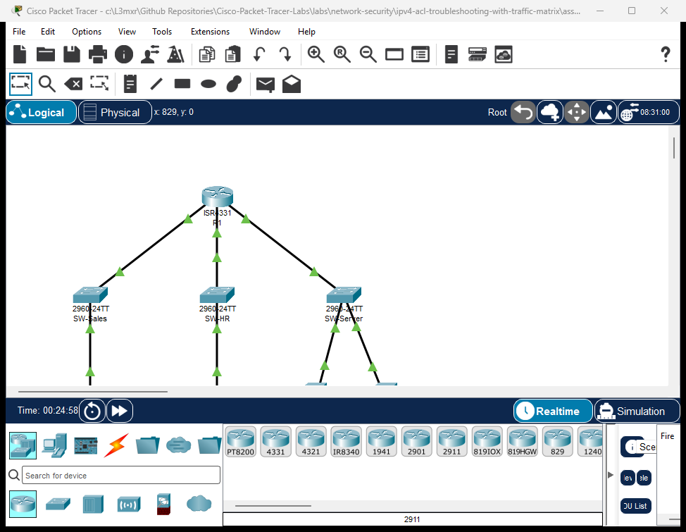

# PTL-0041: IPv4 ACL Troubleshooting with Traffic Matrix

> **Category:** network-security · **Difficulty:** intermediate · **Lab ID:** PTL-0041 · **Document:** reviewed · **Simulator:** tested pass

Access Control Lists (ACLs) are fundamental packet-filtering security mechanisms implemented on Cisco IOS routers and multilayer switches. Operating sequentially at Layer 3 and Layer 4 of the OSI model, ACLs evaluate packet headers—including source IP, destination IP, protocol type, and Layer 4 port numbers—against an ordered list of Access Control Entries (ACEs). When a packet matches an entry, the router immediately executes the specified action (`permit` or `deny`) and stops further evaluation. If no match occurs across all configured statements, the packet is silently dropped by the unseen **implicit deny any** at the end of the list.

In enterprise networks, security policies are rarely defined in isolated CLI statements; rather, they are specified as comprehensive **Traffic Matrices** detailing which sources may reach which destinations across designated application protocols. When ACL implementations deviate from the traffic matrix, network outages and security exposures arise.

Common ACL design and implementation faults include:
- **Shadowed Access Control Entries:** Because Cisco IOS evaluates ACL statements sequentially from top to bottom, placing a broad deny statement before a more specific permit statement permanently "shadows" the permit rule. The router matches the broad deny and drops the packet, rendering the subsequent permit statement unexecutable.
- **Directional Misplacement (`in` vs. `out`):** Applying an access group in the incorrect direction is a catastrophic mistake. Extended ACLs designed to filter traffic near the source should be applied **inbound (`in`)**. Applying such a list **outbound (`out`)** evaluates departing traffic where source and destination addresses are reversed, causing the implicit deny to drop legitimate return traffic and leaving incoming traffic completely unfiltered.
- **Inverted Subnet / Wildcard Mask Confusion:** Cisco IOS standard access lists expect wildcard masks (inverse masks where `0` means match and `1` means ignore). Inexperienced administrators frequently enter dotted-decimal subnet masks (such as `255.255.255.0`) instead of wildcard masks (`0.0.0.255`). An inverted mask drastically alters the matching logic, causing the router to match entirely unrelated host addresses while rejecting authorized traffic.
- **Management Plane Protection Errors:** Restricting VTY lines (`access-class`) with poorly structured standard ACLs can inadvertently lock administrators out of remote SSH sessions or allow unauthorized departmental subnets to initiate management connections.

In this laboratory, you will assume the role of a network security engineer tasked with auditing, diagnosing, and repairing faulted IPv4 access control lists on an enterprise border router (`R1`) interconnecting a Sales LAN, an HR LAN, and a Server DMZ. Using a formal Traffic Matrix, you will identify rule ordering conflicts, correct interface placement errors, remediate wildcard mask mistakes, and verify deterministic traffic enforcement using live traffic probes and hit counters.

---

## Learning Objectives

- Analyze an enterprise security Traffic Matrix to determine permitted and prohibited network flows across departments and server resources.
- Diagnose shadowed Access Control Entries using sequential analysis and Cisco IOS `show access-lists` hit count verification.
- Distinguish between inbound (`in`) and outbound (`out`) interface access-group application, explaining how incorrect directionality affects return traffic.
- Identify and correct wildcard mask calculation errors on standard and extended access lists, including inverted dotted-decimal subnet masks.
- Implement standard access lists to secure VTY lines (`line vty 0 4`) with `access-class` restricted to authorized management hosts.
- Validate security policy enforcement using ICMP, TCP HTTP probes, and Cisco IOS live match statistics.

---

## Prerequisites

- Completion of **PTL-0013: Standard and Extended IPv4 ACLs** or equivalent knowledge of Cisco IOS access list syntax and filtering logic.
- Thorough understanding of IPv4 subnetting, binary wildcard mask calculation, and TCP/UDP well-known port numbers (HTTP port 80, SSH port 22).
- Familiarity with the Cisco IOS CLI, privileged EXEC mode, and global configuration commands.
- Cisco Packet Tracer 8.2 or newer (verified on Packet Tracer 9.0+).

---

## Topology



The topology models an enterprise branch network routed through a three-interface Cisco ISR 4331 router (`R1`):
- **Router `R1`:** Core routing platform terminating three routed security zones:
  - `GigabitEthernet0/0/0`: Sales Department (`192.168.10.0/24`)
  - `GigabitEthernet0/0/1`: HR Department (`192.168.20.0/24`)
  - `GigabitEthernet0/0/2`: Server DMZ (`192.168.30.0/24`)
- **`SW-Sales`:** Catalyst 2960-24TT access switch for the Sales LAN.
- **`SW-HR`:** Catalyst 2960-24TT access switch for the HR LAN.
- **`SW-Server`:** Catalyst 2960-24TT switch serving the Server Farm DMZ.
- **`PC-Sales`:** Sales workstation (`192.168.10.10`) requiring restricted web access.
- **`PC-HR`:** HR administrative workstation (`192.168.20.10`) requiring DMZ access and authorized SSH management to `R1`.
- **`Web-Server`:** Public intranet web server (`192.168.30.10`) serving HTTP on TCP port 80.
- **`Finance-Server`:** Restricted financial database server (`192.168.30.20`) restricted from general departmental access.

```text
               +-------------------------------------------+
               |                    R1                     |
               |        (Cisco ISR 4331 Border Router)     |
               +-------+-------------------+---------------+
                       |                   |               |
     Gi0/0/0 (10.1/24) | Gi0/0/1 (20.1/24) | Gi0/0/2 (30.1/24)
                       |                   |               |
               +-------+----+      +-------+----+      +---+--------+
               |  SW-Sales  |      |   SW-HR    |      |  SW-Server |
               | (Cat 2960) |      | (Cat 2960) |      | (Cat 2960) |
               +-------+----+      +-------+----+      +---+----+---+
                       |                   |               |    |
                       | Fa0/1             | Fa0/1   Fa0/1 |    | Fa0/2
                       |                   |               |    |
                 +-----+----+        +-----+----+   +------+--+ +------+----+
                 | PC-Sales |        |  PC-HR   |   |Web-Serv | |Finance-Srv|
                 |10.10/24  |        |20.10/24  |   |30.10/24 | |30.20/24   |
                 +----------+        +----------+   +---------+ +-----------+
```

---

## Addressing Table

| Device | Interface | IP Address | Subnet Mask | Default Gateway | Zone / Description |
|---|---|---|---|---|---|
| **R1** | `Gi0/0/0` | `192.168.10.1` | `255.255.255.0` | N/A | Sales Department Gateway |
| **R1** | `Gi0/0/1` | `192.168.20.1` | `255.255.255.0` | N/A | HR Department Gateway |
| **R1** | `Gi0/0/2` | `192.168.30.1` | `255.255.255.0` | N/A | Server DMZ Gateway |
| **PC-Sales** | `Fa0` | `192.168.10.10` | `255.255.255.0` | `192.168.10.1` | Sales Workstation |
| **PC-HR** | `Fa0` | `192.168.20.10` | `255.255.255.0` | `192.168.20.1` | HR Workstation (Admin) |
| **Web-Server** | `Fa0` | `192.168.30.10` | `255.255.255.0` | `192.168.30.1` | Intranet Web Server (HTTP :80) |
| **Finance-Server** | `Fa0` | `192.168.30.20` | `255.255.255.0` | `192.168.30.1` | Finance DB Server (HTTP/Data) |

---

## Lab Tasks

### Enterprise Security Traffic Matrix

Before modifying any configuration, study the enterprise traffic requirements:

| Flow ID | Source Subnet | Destination | Protocol / Port | Required Action | Business Justification |
|:---|:---|:---|:---|:---|:---|
| **TM-01** | Sales (`192.168.10.0/24`) | Web-Server (`192.168.30.10`) | TCP Port 80 (HTTP) | **PERMIT** | Intranet documentation & CRM portal access |
| **TM-02** | Sales (`192.168.10.0/24`) | R1 Gateway (`192.168.10.1`) | ICMP Echo (ping) | **PERMIT** | Local network diagnostics & fault detection |
| **TM-03** | Sales (`192.168.10.0/24`) | Finance-Server (`192.168.30.20`)| Any Protocol | **DENY** | Confidential payroll/accounting protection |
| **TM-04** | Sales (`192.168.10.0/24`) | Server DMZ (`192.168.30.0/24`)| All Other Traffic | **DENY** | Principle of least privilege server access |
| **TM-05** | Sales (`192.168.10.0/24`) | HR LAN (`192.168.20.0/24`) | Any Protocol | **DENY** | Departmental inter-VLAN segmentation |
| **TM-06** | Sales (`192.168.10.0/24`) | External / Other Subnets | IP Any | **PERMIT** | General business operations |
| **TM-07** | HR (`192.168.20.0/24`) | Server DMZ (`192.168.30.0/24`)| Any Protocol | **PERMIT** | HR administrative access to servers |
| **TM-08** | Management | R1 VTY Lines (`line vty 0 4`) | SSH Port 22 | **PERMIT (PC-HR Only)** | Router management restricted to HR host |

### Action Checklist
1. **Audit Faulted Starter Configuration:** Examine running configuration, interface access-group bindings, and access lists on `R1` to discover the three root-cause faults.
2. **Remediate Shadowed Rules:** Reconstruct extended ACL `SALES-FILTER` with specific permits placed before broad deny statements.
3. **Correct Interface Application Direction:** Move `SALES-FILTER` from `out` to `in` on interface `GigabitEthernet0/0/0`.
4. **Fix Standard ACL Wildcard Mask:** Reconfigure standard ACL 10 with correct host matching and bind to VTY lines with `access-class 10 in`.
5. **Verify Matrix Compliance:** Test every flow in the traffic matrix using live command-line probes and verify hit counters with `show access-lists`.

---

## Configuration Walkthrough

### Task 1: Audit the Faulted Starter State

Open `starter.pkt` in Cisco Packet Tracer. Access the privileged EXEC mode on router `R1`:

```ios
R1> enable
R1# show access-lists
```

Observe the active access lists:

```text
Extended IP access list SALES-FILTER
    10 deny ip 192.168.10.0 0.0.0.255 192.168.30.0 0.0.0.255
    20 permit tcp 192.168.10.0 0.0.0.255 host 192.168.30.10 eq www
    30 permit icmp 192.168.10.0 0.0.0.255 host 192.168.10.1 echo
    40 deny ip 192.168.10.0 0.0.0.255 192.168.20.0 0.0.0.255
    50 permit ip 192.168.10.0 0.0.0.255 any
Standard IP access list 10
    10 permit 0.0.0.0 255.255.255.0
```

> [!WARNING]
> **Fault Analysis 1 — Shadowed Entry:** Notice line 10 (`deny ip 192.168.10.0 0.0.0.255 192.168.30.0 0.0.0.255`) precedes line 20 (`permit tcp ... host 192.168.30.10 eq www`). Any web request from `PC-Sales` destined for `Web-Server` (`192.168.30.10`) matches line 10 first and is dropped immediately! Line 20 can never be reached.

> [!WARNING]
> **Fault Analysis 2 — Wildcard Inversion:** Notice standard ACL 10 has `permit 0.0.0.0 255.255.255.0`. The administrator entered an inverted mask instead of `permit host 192.168.20.10` or `permit 192.168.20.0 0.0.0.255`. This matches invalid host bits and rejects the legitimate management workstation.

Now inspect the interface application direction:

```ios
R1# show ip interface GigabitEthernet0/0/0
```

```text
GigabitEthernet0/0/0 is up, line protocol is up (connected)
  Internet address is 192.168.10.1/24
  Outgoing access list is SALES-FILTER
  Inbound  access list is not set
```

> [!IMPORTANT]
> **Fault Analysis 3 — Misplaced Outbound Filtering:** `SALES-FILTER` is configured as an **outgoing** access list on `Gi0/0/0`. Inbound packets arriving from `PC-Sales` entering `Gi0/0/0` are NOT filtered on ingress. Instead, packets departing `Gi0/0/0` (traffic heading *back* into the Sales LAN) are evaluated against `SALES-FILTER`. Because return traffic has a source IP of `192.168.30.x` or `192.168.20.x`, it fails all permit lines and is silently discarded by the implicit deny!

---

### Task 2: Remediate the Extended Access List (Rule Ordering)

Enter global configuration mode on `R1`. Remove the faulted extended access list and reconstruct it strictly adhering to the Traffic Matrix:

```ios
R1# configure terminal
R1(config)# no ip access-list extended SALES-FILTER
R1(config)# ip access-list extended SALES-FILTER
R1(config-ext-nacl)# remark --- TM-01: Permit HTTP Web Traffic to Intranet Server ---
R1(config-ext-nacl)# permit tcp 192.168.10.0 0.0.0.255 host 192.168.30.10 eq 80
R1(config-ext-nacl)# remark --- TM-02: Permit ICMP Diagnostics to Local Gateway ---
R1(config-ext-nacl)# permit icmp 192.168.10.0 0.0.0.255 host 192.168.10.1 echo
R1(config-ext-nacl)# remark --- TM-03 & TM-04: Deny Remainder of Server Farm DMZ ---
R1(config-ext-nacl)# deny ip 192.168.10.0 0.0.0.255 192.168.30.0 0.0.0.255
R1(config-ext-nacl)# remark --- TM-05: Deny Inter-VLAN Access to HR Department ---
R1(config-ext-nacl)# deny ip 192.168.10.0 0.0.0.255 192.168.20.0 0.0.0.255
R1(config-ext-nacl)# remark --- TM-06: Permit All Other Legitimate Outbound Traffic ---
R1(config-ext-nacl)# permit ip 192.168.10.0 0.0.0.255 any
R1(config-ext-nacl)# exit
```

> [!TIP]
> **Cisco Best Practice — Rule Ordering:** Always place the most specific rules (host-to-host or specific TCP/UDP port numbers) at the top of an access list, followed by broader subnet restrictions, and finally general permits or default policies.

---

### Task 3: Correct Interface Application Direction

Interface `GigabitEthernet0/0/0` connects directly to the Sales LAN. Packets originating from `192.168.10.0/24` enter the router through this interface. Therefore, `SALES-FILTER` must be applied **inbound (`in`)**:

```ios
R1(config)# interface GigabitEthernet0/0/0
R1(config-if)# no ip access-group SALES-FILTER out
R1(config-if)# ip access-group SALES-FILTER in
R1(config-if)# exit
```

Verify that the interface binding is now set to inbound:

```ios
R1(config)# do show ip interface GigabitEthernet0/0/0 | include access list
```

```text
  Outgoing access list is not set
  Inbound  access list is SALES-FILTER
```

---

### Task 4: Remediate Standard ACL 10 for VTY Security

Standard access lists filter solely on source IP address and should be placed as close to the destination as possible—or applied to virtual terminal lines (`line vty 0 4`) via `access-class`:

```ios
R1(config)# no access-list 10
R1(config)# access-list 10 remark Authorized HR Management Only (TM-08)
R1(config)# access-list 10 permit host 192.168.20.10

R1(config)# line vty 0 4
R1(config-line)# access-class 10 in
R1(config-line)# transport input ssh
R1(config-line)# login local
R1(config-line)# exit
```

Save the active running configuration to NVRAM:

```ios
R1(config)# end
R1# copy running-config startup-config
Destination filename [startup-config]? [Enter]
[OK]
```

---

## Verification

### 1. Router Interface Status Audit

Verify all three routed interfaces are operational:

```ios
R1# show ip interface brief
```

```text
Interface              IP-Address      OK? Method Status                Protocol 
GigabitEthernet0/0/0   192.168.10.1    YES manual up                    up 
GigabitEthernet0/0/1   192.168.20.1    YES manual up                    up 
GigabitEthernet0/0/2   192.168.30.1    YES manual up                    up
```

### 2. Traffic Probes from Sales Workstation (`PC-Sales`)

Open the command prompt on `PC-Sales`:

#### Test A: Local Gateway Echo (Flow TM-02)
```cmd
PC-Sales> ping 192.168.10.1
```
Expected output:
```text
Pinging 192.168.10.1 with 32 bytes of data:

Reply from 192.168.10.1: bytes=32 time<1ms TTL=255
Reply from 192.168.10.1: bytes=32 time<1ms TTL=255
Reply from 192.168.10.1: bytes=32 time<1ms TTL=255
Reply from 192.168.10.1: bytes=32 time<1ms TTL=255

Ping statistics for 192.168.10.1:
    Packets: Sent = 4, Received = 4, Lost = 0 (0% loss)
```

#### Test B: Intranet Web Server HTTP (Flow TM-01)
```cmd
PC-Sales> telnet 192.168.30.10 80
```
Expected output:
```text
Trying 192.168.30.10 ...Open
```
*(The TCP 3-way handshake completes on port 80, proving permit rule execution).*

#### Test C: Finance Database Server Isolation (Flow TM-03)
```cmd
PC-Sales> ping 192.168.30.20
```
Expected output:
```text
Pinging 192.168.30.20 with 32 bytes of data:

Reply from 192.168.10.1: Destination host unreachable.
Reply from 192.168.10.1: Destination host unreachable.
Reply from 192.168.10.1: Destination host unreachable.
Reply from 192.168.10.1: Destination host unreachable.

Ping statistics for 192.168.30.20:
    Packets: Sent = 4, Received = 0, Lost = 4 (100% loss)
```
*(Router `R1` drops the packets and returns ICMP Type 3 code 13 administratively prohibited).*

#### Test D: HR Department Inter-VLAN Isolation (Flow TM-05)
```cmd
PC-Sales> ping 192.168.20.10
```
Expected output:
```text
Reply from 192.168.10.1: Destination host unreachable.
Ping statistics for 192.168.20.10:
    Packets: Sent = 4, Received = 0, Lost = 4 (100% loss)
```

---

### 3. Traffic Probes from HR Workstation (`PC-HR`)

Open the command prompt on `PC-HR`:

#### Test E: Server DMZ Full Reachability (Flow TM-07)
```cmd
PC-HR> ping 192.168.30.10
PC-HR> ping 192.168.30.20
```
Expected output:
```text
Ping statistics for 192.168.30.10: Packets: Sent = 4, Received = 4, Lost = 0 (0% loss)
Ping statistics for 192.168.30.20: Packets: Sent = 4, Received = 4, Lost = 0 (0% loss)
```

---

### 4. ACL Match Statistics and Hit Counters

On router `R1`, examine the live match counters:

```ios
R1# show access-lists
```

```text
Standard IP access list 10
    10 permit host 192.168.20.10
Extended IP access list SALES-FILTER
    10 permit tcp 192.168.10.0 0.0.0.255 host 192.168.30.10 eq www (5 match(es))
    20 permit icmp 192.168.10.0 0.0.0.255 host 192.168.10.1 echo (4 match(es))
    30 deny ip 192.168.10.0 0.0.0.255 192.168.30.0 0.0.0.255 (4 match(es))
    40 deny ip 192.168.10.0 0.0.0.255 192.168.20.0 0.0.0.255 (4 match(es))
    50 permit ip 192.168.10.0 0.0.0.255 any
```

Notice every statement in `SALES-FILTER` displays active match counts, confirming that:
- HTTP web requests matched line 10.
- Gateway pings matched line 20.
- Blocked attempts to the Finance Server matched line 30.
- Blocked attempts to the HR LAN matched line 40.

---

## Troubleshooting

### Diagnostic Decision Tree

```text
Is a traffic flow blocked that should be permitted?
  |
  +---> 1. Check ACL Rule Ordering:
  |        Execute 'show access-lists'. Does a broad 'deny ip ...' appear
  |        ahead of a specific 'permit tcp ...' or 'permit host ...'?
  |        --> FIX: Move the specific permit statement above the broad deny statement.
  |
  +---> 2. Check Interface Application Direction:
  |        Execute 'show ip interface <int>'.
  |        Is an extended source-filtering ACL applied 'out' instead of 'in'?
  |        --> FIX: Apply 'ip access-group <name> in' on the ingress interface.
  |
  +---> 3. Check Wildcard Mask Calculations:
  |        Did someone enter a subnet mask (255.255.255.0) instead of a wildcard mask (0.0.0.255)?
  |        --> FIX: Subtract subnet mask octets from 255 (255 - mask = wildcard).
  |
  +---> 4. Check for Unintended Hits against Implicit Deny:
           Does the ACL lack a trailing 'permit ip <source> any' statement?
           --> FIX: Append a permit rule if non-restricted traffic should be allowed.
```

### Common Fault Patterns & Remedies

| Symptom | Probable Cause | Diagnostic Command | Remediation |
|---|---|---|---|
| Permitted traffic is dropped despite rule existing in ACL | Shadowed Access Control Entry | `show access-lists` (permit line has 0 matches; preceding deny has matches) | Reorder ACL using sequence numbers (`ip access-list extended`) or rebuild ACL with specific rules first. |
| Inbound hosts cannot receive reply traffic from external networks | ACL applied outbound instead of inbound on source interface | `show ip interface <interface>` | Remove with `no ip access-group <name> out` and re-apply with `ip access-group <name> in`. |
| Single host cannot reach destination despite matching network rule | Standard ACL mask error (`255.255.255.0` instead of `host` or `0.0.0.255`) | `show access-lists` | Remove entry and configure `access-list <num> permit host <ip>`. |
| Ping fails with `Destination host unreachable` from router IP | Packet matched explicit or implicit deny rule on router | `show access-lists` | Check match counters to identify which ACE dropped the traffic. |

---

## Key Takeaways

- **Top-to-Bottom Evaluation:** Cisco IOS processes ACL entries sequentially. The first entry matching a packet determines its fate; evaluation terminates immediately.
- **Specific Before General:** Always order rules from most specific (host and Layer 4 ports) to most general (subnets and wildcard `any`).
- **Filter Early Near the Source:** Extended ACLs should be placed as close to the traffic source as possible (`inbound`) to prevent unwanted traffic from traversing the network backbone before being dropped.
- **Standard ACLs Near Destination / VTY:** Standard ACLs lack destination filtering; applying them close to the source risks blocking unintended destinations. Apply them close to the destination or on VTY lines (`access-class in`).
- **Hit Counters Are Diagnostic Gold:** Use `show access-lists` and `clear access-list counters` to observe real-time matches and verify that newly added or reordered rules are actively processing traffic.

---

## References

- [Cisco IOS IPv4 Access Control Lists Configuration Guide](https://www.cisco.com/c/en/us/support/docs/security/ios-firewall/23602-confaccesslists.html)
- [Cisco Security Data Plane ACL Configuration Guide (Cisco IOS XE)](https://www.cisco.com/c/en/us/td/docs/ios-xml/ios/sec_data_acl/configuration/xe-16/sec-data-acl-xe-16-book.html)
- [RFC 1812: Requirements for IP Version 4 Routers — Packet Filtering](https://datatracker.ietf.org/doc/html/rfc1812)

---

## Files and Validation Status

This laboratory provides verified Cisco Packet Tracer files and configuration artifacts:

- **`assets/starter.pkt`:** Faulted starter scenario containing shadowed rules, outbound filter misdirection, and wildcard mask errors for student diagnosis.
- **`assets/completed.pkt`:** Fully remediated reference topology with operational traffic matrix filtering and active hit counters.
- **`assets/topology.png`:** Visual network topology diagram.
- **`configs/R1.txt`:** Full sanitized Cisco IOS running configuration for router `R1`.
- **`metadata.json`:** Machine-readable catalog metadata and learning objectives.
- **`verification.md`:** Complete positive and negative test acceptance matrix.
- **`AI_AGENT_GUIDE/state/PTL-0041-SIMULATOR-RESULTS.md`:** Live simulator verification evidence recorded in Packet Tracer 9.0.1.
