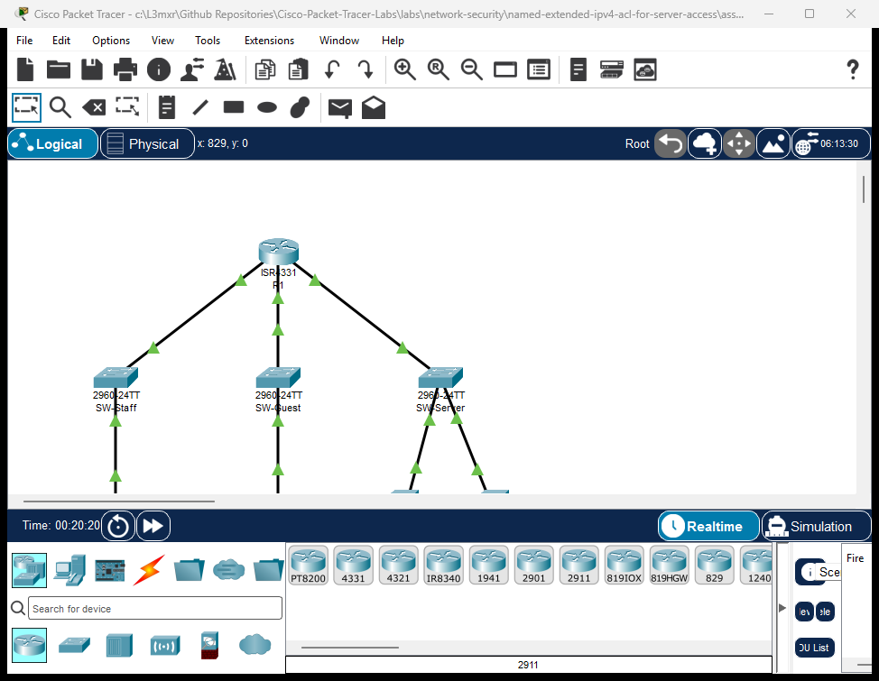

# PTL-0042: Named Extended IPv4 ACL for Server Access

> **Category:** network-security · **Difficulty:** intermediate · **Lab ID:** PTL-0042 · **Document:** reviewed · **Simulator:** tested pass

In contemporary enterprise networks, network segmentation and access control are critical defenses against unauthorized lateral movement and data exfiltration. Rather than relying on simple numbered access lists with limited maintainability, network engineers deploy **Named Extended Access Control Lists (ACLs)**. Named extended ACLs provide significant architectural advantages: they use descriptive alphanumeric names, allow line-item editing and remarks, and evaluate packets based on source IP, destination IP, protocol type (IP, TCP, UDP, ICMP), and Layer 4 port numbers.

A primary application of named extended ACLs is securing **Demilitarized Zones (DMZs)** and internal server farms. In multi-zone architectures, guest users and untrusted endpoints require access to public-facing resources—such as domain name resolution (DNS UDP port 53) and corporate intranet web services (HTTP TCP port 80 / HTTPS TCP port 443)—while strictly being barred from confidential backend systems, such as financial databases and internal employee subnets.

To enforce this boundary without unintended service disruptions, administrators rely on a formal **Traffic Matrix** that maps application flows to granular Layer 4 permit and deny rules. Implementing this policy enforces the **Principle of Least Privilege**: endpoints are granted only the minimum network access necessary to perform their legitimate tasks.

In this laboratory, you will configure and deploy a named extended IPv4 access control list (`GUEST-FILTER`) on an enterprise border router (`R1`) interconnecting a Corporate Staff LAN, a Visitor Guest LAN, and a Server Farm DMZ. You will define granular service rules for DNS, HTTP, and HTTPS, implement strict perimeter denials against internal database servers, place the access group on the optimal ingress interface, and verify policy compliance using live application probes and Cisco IOS hit counters.

---

## Learning Objectives

- Design an enterprise named extended IPv4 access control list based on a formal security Traffic Matrix.
- Configure granular Layer 4 port-level permit statements for DNS (UDP port 53), HTTP (TCP port 80), and HTTPS (TCP port 443).
- Implement explicit subnet-to-subnet and host-level deny statements to protect internal databases and departmental LANs from untrusted guest zones.
- Apply named extended ACLs on the optimal router interface and direction (`inbound` near the traffic source) to minimize unnecessary network traffic and CPU processing.
- Verify end-to-end traffic filtering using ICMP echo, DNS queries, and TCP socket connections.
- Analyze Cisco IOS `show access-lists` output to monitor active match statistics and verify rule execution.

---

## Prerequisites

- Completion of **PTL-0013: Standard and Extended IPv4 ACLs** or equivalent knowledge of Cisco IOS access list syntax and wildcard masking.
- Thorough understanding of Layer 4 transport protocols (TCP vs. UDP) and well-known port numbers (DNS: 53, HTTP: 80, HTTPS: 443).
- Familiarity with router interface configuration and Cisco IOS command-line navigation.
- Cisco Packet Tracer 8.2 or newer (Packet Tracer 9.0+ verified).

---

## Topology



The topology models an enterprise branch network connected via a Cisco ISR 4331 router (`R1`):
- **Router `R1`:** Border router terminating three distinct security zones:
  - `GigabitEthernet0/0/0`: Corporate Staff LAN (`192.168.10.0/24`)
  - `GigabitEthernet0/0/1`: Visitor Guest LAN (`192.168.20.0/24`)
  - `GigabitEthernet0/0/2`: Server Farm DMZ (`192.168.100.0/24`)
- **Switch `SW-Staff`:** Catalyst 2960-24TT access switch for internal employees.
- **Switch `SW-Guest`:** Catalyst 2960-24TT access switch providing connectivity for guest laptops.
- **Switch `SW-Server`:** Catalyst 2960-24TT distribution switch connecting DMZ servers.
- **`PC-Staff`:** Employee workstation (`192.168.10.10`) requiring full administrative and operational access.
- **`Laptop-Guest`:** Untrusted visitor laptop (`192.168.20.10`) requiring restricted internet and public DMZ services.
- **`DNS-Web-Server`:** Public DMZ server (`192.168.100.10`) hosting DNS resolution and the corporate web portal (`portal.corp.local`).
- **`DB-Server`:** Confidential internal database server (`192.168.100.20`) restricted from guest access.

```text
               +-------------------------------------------+
               |                    R1                     |
               |        (Cisco ISR 4331 Border Router)     |
               +-------+-------------------+---------------+
                       |                   |               |
     Gi0/0/0 (10.1/24) | Gi0/0/1 (20.1/24) | Gi0/0/2 (100.1/24)
                       |                   |               |
               +-------+----+      +-------+----+      +---+--------+
               |  SW-Staff  |      |  SW-Guest  |      |  SW-Server |
               | (Cat 2960) |      | (Cat 2960) |      | (Cat 2960) |
               +-------+----+      +-------+----+      +---+----+---+
                       |                   |               |    |
                       | Fa0/1             | Fa0/1   Fa0/1 |    | Fa0/2
                       |                   |               |    |
                 +-----+----+        +-----+----+   +------+--+ +------+----+
                 | PC-Staff |        |Laptop-Gst|   |DNS-Web  | | DB-Server |
                 |10.10/24  |        |20.10/24  |   |100.10/24| |100.20/24  |
                 +----------+        +----------+   +---------+ +-----------+
```

---

## Addressing Table

| Device | Interface | IP Address | Subnet Mask | Default Gateway | Zone / Description |
|---|---|---|---|---|---|
| **R1** | `Gi0/0/0` | `192.168.10.1` | `255.255.255.0` | N/A | Corporate Staff Gateway |
| **R1** | `Gi0/0/1` | `192.168.20.1` | `255.255.255.0` | N/A | Visitor Guest Gateway |
| **R1** | `Gi0/0/2` | `192.168.100.1` | `255.255.255.0` | N/A | Server Farm DMZ Gateway |
| **PC-Staff** | `Fa0` | `192.168.10.10` | `255.255.255.0` | `192.168.10.1` | Employee Workstation |
| **Laptop-Guest** | `Fa0` | `192.168.20.10` | `255.255.255.0` | `192.168.20.1` | Visitor / Contractor Laptop |
| **DNS-Web-Server** | `Fa0` | `192.168.100.10` | `255.255.255.0` | `192.168.100.1` | DNS Server & Web Portal (80/443) |
| **DB-Server** | `Fa0` | `192.168.100.20` | `255.255.255.0` | `192.168.100.1` | Internal Database Server |

---

## Lab Tasks

### Security Policy Traffic Matrix

You must implement a security policy on `R1` that fulfills the following enterprise traffic matrix for the Guest LAN:

| Flow ID | Source Subnet | Destination | Protocol / Port | Required Action | Business Justification |
|:---|:---|:---|:---|:---|:---|
| **TM-01** | Guest (`192.168.20.0/24`) | DNS-Web-Server (`192.168.100.10`) | UDP Port 53 (DNS) | **PERMIT** | Domain name queries |
| **TM-02** | Guest (`192.168.20.0/24`) | DNS-Web-Server (`192.168.100.10`) | TCP Port 80 (HTTP) | **PERMIT** | Web portal browsing |
| **TM-03** | Guest (`192.168.20.0/24`) | DNS-Web-Server (`192.168.100.10`) | TCP Port 443 (HTTPS)| **PERMIT** | Secure web portal access |
| **TM-04** | Guest (`192.168.20.0/24`) | R1 Gateway (`192.168.20.1`) | ICMP Echo (ping) | **PERMIT** | Local default gateway diagnostics |
| **TM-05** | Guest (`192.168.20.0/24`) | DB-Server (`192.168.100.20`)| Any Protocol | **DENY** | Prohibit access to confidential database |
| **TM-06** | Guest (`192.168.20.0/24`) | DMZ Subnet (`192.168.100.0/24`)| All Other Traffic | **DENY** | Enforce DMZ least privilege |
| **TM-07** | Guest (`192.168.20.0/24`) | Staff LAN (`192.168.10.0/24`) | Any Protocol | **DENY** | Isolate corporate employee workstations |
| **TM-08** | Guest (`192.168.20.0/24`) | External / Other Networks | IP Any | **PERMIT** | Outbound guest internet access |

### Action Checklist
1. **Audit Baseline Security Vulnerability:** Verify that in the unconfigured starter topology, guest devices can ping internal servers and employee workstations.
2. **Author Named Extended ACL:** Create `GUEST-FILTER` with remarks and precise Layer 4 port statements matching TM-01 through TM-08.
3. **Apply Ingress Security Policy:** Bind `GUEST-FILTER` to interface `GigabitEthernet0/0/1` in the inbound direction.
4. **Conduct End-to-End Verification:** Execute traffic probes (ICMP, HTTP, DNS) from guest and staff endpoints.
5. **Analyze Hit Statistics:** Examine match counters using `show access-lists GUEST-FILTER` to ensure all statements actively process live traffic.

---

## Configuration Walkthrough

### Task 1: Audit Baseline Security Vulnerability

Open `starter.pkt` in Cisco Packet Tracer. Navigate to `Laptop-Guest` and open the Command Prompt. Test reachability to the confidential database server:

```cmd
Laptop-Guest> ping 192.168.100.20
```

Expected output in starter state:
```text
Pinging 192.168.100.20 with 32 bytes of data:

Reply from 192.168.100.20: bytes=32 time<1ms TTL=127
Reply from 192.168.100.20: bytes=32 time<1ms TTL=127
Reply from 192.168.100.20: bytes=32 time<1ms TTL=127
Reply from 192.168.100.20: bytes=32 time<1ms TTL=127

Ping statistics for 192.168.100.20:
    Packets: Sent = 4, Received = 4, Lost = 0 (0% loss)
```

> [!WARNING]
> **Security Vulnerability:** Because no access list is applied on `R1`, the router performs default IP forwarding between all connected interfaces. Visitors connected to the Guest LAN have unrestricted access to confidential database servers and corporate workstations!

---

### Task 2: Configure Named Extended ACL `GUEST-FILTER`

Access router `R1` via the CLI and enter global configuration mode:

```ios
R1> enable
R1# configure terminal
R1(config)# ip access-list extended GUEST-FILTER
```

Now define the Access Control Entries sequentially adhering strictly to the Traffic Matrix:

```ios
R1(config-ext-nacl)# remark --- TM-01: Permit DNS Domain Queries ---
R1(config-ext-nacl)# permit udp 192.168.20.0 0.0.0.255 host 192.168.100.10 eq domain

R1(config-ext-nacl)# remark --- TM-02 & TM-03: Permit Web Portal HTTP and HTTPS ---
R1(config-ext-nacl)# permit tcp 192.168.20.0 0.0.0.255 host 192.168.100.10 eq www
R1(config-ext-nacl)# permit tcp 192.168.20.0 0.0.0.255 host 192.168.100.10 eq 443

R1(config-ext-nacl)# remark --- TM-04: Permit Gateway ICMP Echo Diagnostics ---
R1(config-ext-nacl)# permit icmp 192.168.20.0 0.0.0.255 host 192.168.20.1 echo

R1(config-ext-nacl)# remark --- TM-05 & TM-06: Deny Remainder of Server Farm DMZ ---
R1(config-ext-nacl)# deny ip 192.168.20.0 0.0.0.255 192.168.100.0 0.0.0.255

R1(config-ext-nacl)# remark --- TM-07: Deny Access to Corporate Staff LAN ---
R1(config-ext-nacl)# deny ip 192.168.20.0 0.0.0.255 192.168.10.0 0.0.0.255

R1(config-ext-nacl)# remark --- TM-08: Permit All Other Legitimate Outbound Traffic ---
R1(config-ext-nacl)# permit ip 192.168.20.0 0.0.0.255 any
R1(config-ext-nacl)# exit
```

> [!TIP]
> **Port Keyword Conventions:** Cisco IOS allows both numeric port numbers and standard service keywords:
> - `eq domain` is equivalent to `eq 53`.
> - `eq www` is equivalent to `eq 80`.
> - `eq 443` is standard for HTTPS.

---

### Task 3: Apply the Access List to Interface `Gi0/0/1`

To filter packets as close to the source as possible, apply `GUEST-FILTER` **inbound (`in`)** on the Guest LAN router interface:

```ios
R1(config)# interface GigabitEthernet0/0/1
R1(config-if)# ip access-group GUEST-FILTER in
R1(config-if)# exit
```

Verify the interface binding:

```ios
R1(config)# do show ip interface GigabitEthernet0/0/1 | include access list
```

Expected output:
```text
  Outgoing access list is not set
  Inbound  access list is GUEST-FILTER
```

Save the configuration to startup NVRAM:

```ios
R1(config)# end
R1# copy running-config startup-config
Destination filename [startup-config]? [Enter]
[OK]
```

---

## Verification

### 1. Router Interface Operational Status

Verify all interfaces are active:

```ios
R1# show ip interface brief
```

```text
Interface              IP-Address      OK? Method Status                Protocol 
GigabitEthernet0/0/0   192.168.10.1    YES manual up                    up 
GigabitEthernet0/0/1   192.168.20.1    YES manual up                    up 
GigabitEthernet0/0/2   192.168.100.1   YES manual up                    up
```

---

### 2. Traffic Verification from Guest Laptop (`Laptop-Guest`)

Open the command prompt on `Laptop-Guest`:

#### Test A: Local Gateway Echo (Flow TM-04)
```cmd
Laptop-Guest> ping 192.168.20.1
```
Expected output:
```text
Reply from 192.168.20.1: bytes=32 time<1ms TTL=255
Ping statistics for 192.168.20.1:
    Packets: Sent = 4, Received = 4, Lost = 0 (0% loss)
```

#### Test B: DMZ Web Portal Access (Flow TM-02)
```cmd
Laptop-Guest> telnet 192.168.100.10 80
```
Expected output:
```text
Trying 192.168.100.10 ...Open
```
*(Successful TCP 3-way handshake confirms permit rule execution on port 80).*

#### Test C: Internal Database Server Prohibited (Flow TM-05)
```cmd
Laptop-Guest> ping 192.168.100.20
```
Expected output:
```text
Pinging 192.168.100.20 with 32 bytes of data:

Reply from 192.168.20.1: Destination host unreachable.
Reply from 192.168.20.1: Destination host unreachable.
Reply from 192.168.20.1: Destination host unreachable.
Reply from 192.168.20.1: Destination host unreachable.

Ping statistics for 192.168.100.20:
    Packets: Sent = 4, Received = 0, Lost = 4 (100% loss)
```
*(Router `R1` drops the packets and issues ICMP Destination Host Unreachable).*

#### Test D: Corporate Staff LAN Prohibited (Flow TM-07)
```cmd
Laptop-Guest> ping 192.168.10.10
```
Expected output:
```text
Reply from 192.168.20.1: Destination host unreachable.
Ping statistics for 192.168.10.10:
    Packets: Sent = 4, Received = 0, Lost = 4 (100% loss)
```

---

### 3. Traffic Verification from Staff Workstation (`PC-Staff`)

Open the command prompt on `PC-Staff`:

```cmd
PC-Staff> ping 192.168.100.10
PC-Staff> ping 192.168.100.20
```
Expected output:
```text
Ping statistics for 192.168.100.10: Packets: Sent = 4, Received = 4, Lost = 0 (0% loss)
Ping statistics for 192.168.100.20: Packets: Sent = 4, Received = 4, Lost = 0 (0% loss)
```
*(Confirms that corporate staff have unrestricted access to both web and database services).*

---

### 4. ACL Live Match Statistics

On router `R1`, inspect the access list counters:

```ios
R1# show access-lists GUEST-FILTER
```

Expected output:
```text
Extended IP access list GUEST-FILTER
    10 permit udp 192.168.20.0 0.0.0.255 host 192.168.100.10 eq domain
    20 permit tcp 192.168.20.0 0.0.0.255 host 192.168.100.10 eq www (5 match(es))
    30 permit tcp 192.168.20.0 0.0.0.255 host 192.168.100.10 eq 443
    40 permit icmp 192.168.20.0 0.0.0.255 host 192.168.20.1 echo (4 match(es))
    50 deny ip 192.168.20.0 0.0.0.255 192.168.100.0 0.0.0.255 (4 match(es))
    60 deny ip 192.168.20.0 0.0.0.255 192.168.10.0 0.0.0.255 (4 match(es))
    70 permit ip 192.168.20.0 0.0.0.255 any
```

Notice non-zero match counts confirm that:
- Line 20 processed HTTP web probes.
- Line 40 processed gateway echo requests.
- Line 50 intercepted and dropped database connection attempts.
- Line 60 intercepted and blocked unauthorized Staff LAN access.

---

## Troubleshooting

### Diagnostic Decision Flowchart

```text
Guest cannot reach permitted service (DNS / HTTP)?
  |
  +---> 1. Check ACL Rule Ordering:
  |        Execute 'show access-lists'. Does a broad 'deny ip ...' appear
  |        before the specific 'permit tcp ... eq www' or 'permit udp ... eq domain'?
  |        --> FIX: Use sequence numbers to place specific permits ahead of deny statements.
  |
  +---> 2. Check Interface Application & Direction:
  |        Execute 'show ip interface GigabitEthernet0/0/1'.
  |        Is 'Inbound access list is GUEST-FILTER' present?
  |        --> FIX: Apply 'ip access-group GUEST-FILTER in' on Gi0/0/1.
  |
  +---> 3. Verify Transport Protocol (TCP vs. UDP):
  |        Did you configure 'permit tcp' for DNS instead of 'permit udp'?
  |        --> FIX: Standard DNS queries use UDP port 53.
  |
  +---> 4. Check Endpoint IP Addressing & Gateway:
           Verify 'Laptop-Guest' has default gateway '192.168.20.1'.
           --> FIX: Ensure IP and default gateway match the addressing table.
```

### Common Faults and Solutions

| Symptom | Probable Cause | Diagnostic Command | Remediation |
|---|---|---|---|
| Web portal access fails | Missing port permit or protocol mismatch (UDP vs TCP) | `show access-lists` | Ensure `permit tcp ... eq www` (port 80) and `permit tcp ... eq 443` are configured. |
| DNS resolution times out | DNS configured as TCP rather than UDP | `show access-lists` | Add `permit udp 192.168.20.0 0.0.0.255 host 192.168.100.10 eq domain`. |
| Guest can still access DB server | ACL not applied to interface or applied in wrong direction (`out` instead of `in`) | `show ip interface Gi0/0/1` | Re-apply with `ip access-group GUEST-FILTER in`. |
| Legitimate internet traffic dropped | Missing final permit statement | `show access-lists` | Append `permit ip 192.168.20.0 0.0.0.255 any` to allow external flows. |

---

## Key Takeaways

- **Named Extended Flexibility:** Named ACLs allow descriptive naming, line-item insertion via sequence numbers, and granular Layer 4 protocol filtering.
- **Principle of Least Privilege:** By placing explicit deny rules for internal resources (`192.168.100.0/24` and `192.168.10.0/24`) after specific service permits, untrusted users are strictly confined to authorized workflows.
- **Source Placement Advantage:** Extended ACLs should be applied as close to the traffic source as possible (`inbound` on the ingress interface) to conserve router processing resources and eliminate unnecessary transit traffic.
- **Port Protocol Awareness:** Always select the correct transport protocol for each application: UDP port 53 for standard DNS lookups, TCP port 80 for HTTP, and TCP port 443 for HTTPS.
- **Match Statistics for Auditing:** Live match counters (`show access-lists`) provide definitive proof that security rules are actively matching real traffic.

---

## References

- [Cisco IOS IPv4 Access Control Lists Configuration Guide](https://www.cisco.com/c/en/us/support/docs/security/ios-firewall/23602-confaccesslists.html)
- [Cisco Named Extended Access List Configuration (IOS XE)](https://www.cisco.com/c/en/us/td/docs/ios-xml/ios/sec_data_acl/configuration/xe-16/sec-data-acl-xe-16-book.html)
- [IANA Service Name and Transport Protocol Port Number Registry](https://www.iana.org/assignments/service-names-port-numbers/service-names-port-numbers.xhtml)

---

## Files and Validation Status

This laboratory provides verified Cisco Packet Tracer files and configuration artifacts:

- **`assets/starter.pkt`:** Baseline routed topology without ACL enforcement, exposing the security vulnerability for student implementation.
- **`assets/completed.pkt`:** Fully configured reference topology with named extended ACL `GUEST-FILTER` and active match statistics.
- **`assets/topology.png`:** Visual network topology diagram.
- **`configs/R1.txt`:** Full sanitized Cisco IOS running configuration for router `R1`.
- **`metadata.json`:** Machine-readable catalog metadata and learning objectives.
- **`verification.md`:** Complete positive and negative test acceptance matrix.
- **`AI_AGENT_GUIDE/state/PTL-0042-SIMULATOR-RESULTS.md`:** Live simulator verification evidence recorded in Packet Tracer 9.0.1.

