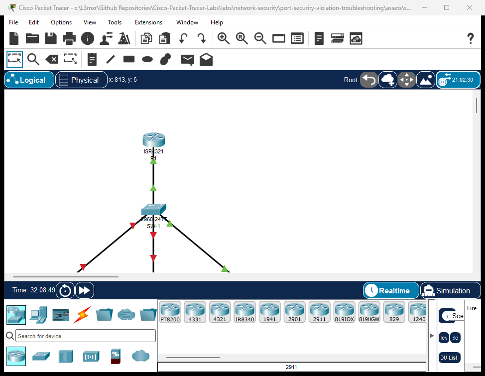

# PTL-0040: Port Security Violation Troubleshooting

> **Category:** network-security · **Difficulty:** intermediate · **Lab ID:** PTL-0040 · **Document:** reviewed · **Simulator:** tested pass

Layer 2 switchport security is an essential perimeter defense mechanism implemented across enterprise access switches to restrict unauthorized network access. By monitoring incoming Ethernet frame source MAC addresses on individual switch interfaces, Cisco Catalyst switches can limit the number of devices allowed on a port, dynamically learn authorized MAC addresses (`sticky`), and execute enforcement actions when unauthorized hardware attempts to communicate.

However, in dynamic corporate environments, port security frequently causes administrative friction when operational changes occur:
- **Workstation Hardware Replacements:** When an employee's computer is replaced or their network interface card (NIC) fails, the new hardware brings a new burned-in MAC address. If the switchport was configured with sticky MAC learning and a maximum limit of 1, the port will flag the new legitimate computer as an unauthorized rogue device and shut down the interface.
- **Error-Disabled Port Latches:** When a security violation occurs under the default `shutdown` mode, Cisco IOS places the switchport into the **`err-disabled`** (`Secure-shutdown`) state. Simply unplugging the offending device does not restore network connectivity; the port remains latched in `err-disabled` until an administrator manually intervenes or an automated recovery mechanism clears the latch.
- **Suboptimal Violation Modes:** Administrators often misunderstand the behavioral differences between `protect`, `restrict`, and `shutdown`. Using `protect` mode drops unauthorized packets silently without logging syslog messages or incrementing violation counters, creating a blind spot for network security operations.

In this laboratory, you will step into the role of a network security engineer tasked with resolving multiple port security incidents in an enterprise branch office. You will diagnose stale sticky MAC collisions, recover error-disabled switch interfaces using proper administrative procedures without weakening or disabling security controls, and align interface violation modes with enterprise security auditing requirements.

---

## Learning Objectives

- Diagnose Layer 2 switchport port security faults and error-disabled states using Cisco IOS `show` commands.
- Analyze the root cause of sticky MAC collisions following workstation hardware upgrades and NIC replacements.
- Execute the standard Cisco IOS administrative recovery procedure (`shutdown` followed by `no shutdown`) to restore error-disabled access ports without disabling security.
- Compare the operational mechanics, logging behavior, and security implications of `protect`, `restrict`, and `shutdown` violation modes.
- Verify end-to-end IP reachability for restored corporate workstations while maintaining active port security policies.

---

## Prerequisites

- Completion of **PTL-0004: Implementing Switchport Port Security** or equivalent knowledge of Cisco switchport port security fundamentals.
- Understanding of Ethernet frame headers, Layer 2 MAC address tables, and Cisco IOS interface configuration.
- Basic familiarity with Cisco Catalyst switch error-disabled states (`err-disable`).
- Cisco Packet Tracer 8.2 or newer (Packet Tracer 9.0+ verified).

---

## Topology



The topology represents a corporate department access switch connected to an upstream default gateway:
- **Router `R1`:** Cisco ISR 4321 functioning as the corporate default gateway (`192.168.10.1`) and local DHCP server.
- **Switch `SW-1`:** Cisco Catalyst 2960-24TT access switch providing access ports in VLAN 10 (`Corporate-Clients`).
- **`PC-1` (Accounting PC):** Legitimate workstation on `FastEthernet0/1` experiencing an `err-disabled` outage due to a stale sticky MAC entry.
- **`PC-2` (Engineering PC):** Legitimate workstation on `FastEthernet0/2` locked in `err-disabled` after an unauthorized visitor laptop was disconnected.
- **`Rogue-Laptop` (Test Port):** Device connected to `FastEthernet0/3` configured in silent-drop (`protect`) mode requiring remediation to `restrict` mode.

```text
               +--------------------------------------+
               |                  R1                  |
               |      (Corporate Default Gateway)     |
               |        Gi0/0/0: 192.168.10.1/24       |
               +------------------+-------------------+
                                  |
                                  | Copper Straight-Through
                                  | (Uplink to Access Switch)
                                  v
                       +----------------------+
                       |         SW-1         |
                       | Cisco Catalyst 2960  |
                       | (Port Security SW)   |
                       +---+------+-------+---+
                           |      |       |
            Fa0/1 (Err-Disable)   |       | Fa0/3 (Protect Mode)
            Copper Straight-Thru  |       | Copper Straight-Thru
                           |      |       |
                           v      |       v
               +---------------+  |  +--------------------+
               |     PC-1      |  |  |    Rogue-Laptop    |
               | Accounting PC |  |  |  (Test Station)    |
               +---------------+  |  +--------------------+
                                  v Fa0/2 (Err-Disable)
                                  | Copper Straight-Thru
                         +---------------+
                         |     PC-2      |
                         |Engineering PC |
                         +---------------+
```

---

## Addressing Table

| Device | Interface | IPv4 Address | Subnet Mask | Default Gateway | Switchport Description |
|---|---|---|---|---|---|
| **R1** | `GigabitEthernet0/0/0` | `192.168.10.1` | `255.255.255.0` | N/A | Default Gateway Interface |
| **SW-1** | `VLAN 10` | Unassigned | Unassigned | N/A | Access VLAN (`Corporate-Clients`) |
| **SW-1** | `GigabitEthernet0/1` | N/A | N/A | N/A | Uplink to R1 (Security Disabled) |
| **SW-1** | `FastEthernet0/1` | N/A | N/A | N/A | Accounting-PC-1 (Sticky MAC, Shutdown) |
| **SW-1** | `FastEthernet0/2` | N/A | N/A | N/A | Engineering-PC-2 (Sticky MAC, Shutdown) |
| **SW-1** | `FastEthernet0/3` | N/A | N/A | N/A | Test-Port (Sticky MAC, Restrict) |
| **PC-1** | `FastEthernet0` | DHCP Dynamic (`192.168.10.x`) | `255.255.255.0` | `192.168.10.1` | Accounting Workstation |
| **PC-2** | `FastEthernet0` | DHCP Dynamic (`192.168.10.x`) | `255.255.255.0` | `192.168.10.1` | Engineering Workstation |
| **Rogue-Laptop** | `FastEthernet0` | DHCP Dynamic (`192.168.10.x`) | `255.255.255.0` | `192.168.10.1` | Test / Untrusted Laptop |

---

## Lab Tasks

1. **Investigate the Layer 2 Outages:**
   - Review switchport operational status on `SW-1` using `show interfaces status`.
   - Identify interfaces latched in the `err-disabled` state.
   - Inspect port security parameters on `FastEthernet0/1`, `FastEthernet0/2`, and `FastEthernet0/3` using `show port-security interface`.
2. **Troubleshoot and Recover `FastEthernet0/1` (Stale Sticky MAC Collision):**
   - Identify the mismatched MAC address stored in `SW-1` running configuration vs. the actual physical MAC of `PC-1`.
   - Remove the stale sticky MAC entry from the interface.
   - Administratively cycle the interface (`shutdown` / `no shutdown`) to clear the `err-disabled` latch.
   - Verify `PC-1`'s legitimate MAC address is learned dynamically as sticky.
3. **Troubleshoot and Recover `FastEthernet0/2` (Uncleared Violation Latch):**
   - Confirm that the legitimate workstation `PC-2` is connected.
   - Clear the `err-disabled` latch using the administrative recovery sequence.
   - Verify the port transitions from `Secure-shutdown` to `Secure-up`.
4. **Remediate `FastEthernet0/3` (Violation Mode Alignment):**
   - Identify the violation mode on `FastEthernet0/3` (`protect`).
   - Reconfigure the violation mode to `restrict` to ensure security auditing compliance and syslog generation without taking the interface down.
5. **Verify Security Enforcement and Network Reachability:**
   - Confirm all three user access ports report status `connected` in `show interfaces status`.
   - Verify that port security remains enabled on all access interfaces without being bypassed.
   - Verify 100% ICMP reachability from `PC-1` and `PC-2` to default gateway `192.168.10.1`.

---

## Configuration Walkthrough

### Task 1: Investigate the Layer 2 Outages

Examine the physical port status on `SW-1`:

```text
SW-1# show interfaces status
Port      Name               Status       Vlan       Duplex  Speed Type
Fa0/1     Accounting-PC-1    err-disabled 10         auto    auto  10/100BaseTX
Fa0/2     Engineering-PC-2   err-disabled 10         auto    auto  10/100BaseTX
Fa0/3     Test-Port          connected    10         a-full  a-100 10/100BaseTX
Gig0/1    Uplink-to-R1       connected    10         a-full  a-100 10/100/1000BaseTX
```

Both `FastEthernet0/1` and `FastEthernet0/2` are in the **`err-disabled`** state. When an interface is error-disabled, the switch administratively disables the port's PHY and MAC layers, preventing any data transmission.

Inspect the port security details for `FastEthernet0/1`:

```text
SW-1# show port-security interface FastEthernet0/1
Port Security              : Enabled
Port Status                : Secure-shutdown
Violation Mode             : Shutdown
Aging Time                 : 0 mins
Aging Type                 : Absolute
SecureStatic Address Aging : Disabled
Maximum MAC Addresses      : 1
Total MAC Addresses        : 1
Configured MAC Addresses   : 0
Sticky MAC Addresses       : 1
Last Source Address:Vlan   : 0002.1715.6B73:10
Security Violation Count   : 1
```

**Diagnostic Analysis:**
- `Port Status : Secure-shutdown` indicates a security violation occurred.
- `Security Violation Count : 1` confirms the port received an unauthorized frame.
- `Last Source Address:Vlan : 0002.1715.6B73:10` is the MAC address of the connected `PC-1`.
- Reviewing `show running-config interface FastEthernet0/1` reveals:
  ```text
  switchport port-security mac-address sticky 0000.1111.AAAA
  ```
  The switch was configured with a stale sticky MAC address (`0000.1111.AAAA`). When `PC-1` with MAC `0002.1715.6B73` attempted to communicate, the maximum limit of 1 was exceeded, triggering a `shutdown` violation.

Inspect `FastEthernet0/2`:

```text
SW-1# show port-security interface FastEthernet0/2
Port Security              : Enabled
Port Status                : Secure-shutdown
Violation Mode             : Shutdown
Last Source Address:Vlan   : 0002.4A47.3CD2:10
Security Violation Count   : 1
```

**Diagnostic Analysis:**
On `Fa0/2`, the running configuration contains `switchport port-security mac-address sticky 0000.9999.DEAD` left behind when an unauthorized laptop was plugged in. The authorized `PC-2` has MAC `0002.4A47.3CD2`. Because the port latched in `Secure-shutdown`, re-plugging `PC-2` does not restore the link.

### Task 2: Troubleshoot and Recover `FastEthernet0/1`

To restore `FastEthernet0/1` properly:
1. Enter interface configuration mode.
2. Remove the invalid sticky MAC address.
3. Administratively cycle the interface using `shutdown` followed by `no shutdown` to clear the `err-disabled` latch.

> **Crucial Rule:** Never disable port security (`no switchport port-security`) to clear an error-disabled port. Doing so strips security protection from the access layer. Always resolve the underlying MAC collision and cycle the interface.

```text
SW-1# configure terminal
SW-1(config)# interface FastEthernet0/1
SW-1(config-if)# shutdown
SW-1(config-if)# no switchport port-security mac-address sticky 0000.1111.AAAA
SW-1(config-if)# no shutdown
SW-1(config-if)# exit
SW-1(config)# exit
```

Once `PC-1` transmits a frame, `SW-1` learns `PC-1`'s MAC dynamically as the new sticky MAC address.

### Task 3: Troubleshoot and Recover `FastEthernet0/2`

On `FastEthernet0/2`, remove the stale rogue MAC address (`0000.9999.DEAD`) and administratively cycle the interface:

```text
SW-1# configure terminal
SW-1(config)# interface FastEthernet0/2
SW-1(config-if)# shutdown
SW-1(config-if)# no switchport port-security mac-address sticky 0000.9999.DEAD
SW-1(config-if)# no shutdown
SW-1(config-if)# exit
SW-1(config)# exit
```

`PC-2`'s authorized MAC (`0002.4A47.3CD2`) will be dynamically learned as the new sticky entry upon its first frame transmission.

### Task 4: Remediate `FastEthernet0/3` Violation Mode

Inspect `FastEthernet0/3`:

```text
SW-1# show port-security interface FastEthernet0/3
Port Security              : Enabled
Port Status                : Secure-up
Violation Mode             : Protect
```

Under `protect` mode, frames from unauthorized MAC addresses are dropped, but:
- No syslog message is generated (`%PORT_SECURITY-2-PSECURE_VIOLATION` is suppressed).
- The `Security Violation Count` remains 0.
- Network administrators have zero visibility into unauthorized connection attempts.

Corporate security policy requires `restrict` mode for test and flexible access ports. Under `restrict` mode:
- Unauthorized frames are dropped.
- The `Security Violation Count` counter increments.
- A high-severity syslog event is logged.
- The port remains operational for the authorized host (`Secure-up`).

Reconfigure `FastEthernet0/3`:

```text
SW-1# configure terminal
SW-1(config)# interface FastEthernet0/3
SW-1(config-if)# switchport port-security violation restrict
SW-1(config-if)# exit
SW-1(config)# exit
SW-1# copy running-config startup-config
```

---

## Verification

### 1. Verify Switchport Operational Status

Confirm that all user access ports have recovered from `err-disabled`:

```text
SW-1# show interfaces status
Port      Name               Status       Vlan       Duplex  Speed Type
Fa0/1     Accounting-PC-1    connected    10         a-full  a-100 10/100BaseTX
Fa0/2     Engineering-PC-2   connected    10         a-full  a-100 10/100BaseTX
Fa0/3     Test-Port          connected    10         a-full  a-100 10/100BaseTX
Gig0/1    Uplink-to-R1       connected    10         a-full  a-100 10/100/1000BaseTX
```

All active ports report status `connected`. Zero ports are in `err-disabled`.

### 2. Verify Port Security Tables

Inspect the global port security summary:

```text
SW-1# show port-security
Secure Port MaxSecureAddr CurrentAddr SecurityViolation Security Action
               (Count)       (Count)        (Count)
--------------------------------------------------------------------
        Fa0/1        1          1                 0         Shutdown
        Fa0/2        1          1                 0         Shutdown
        Fa0/3        1          1                 0         Restrict
----------------------------------------------------------------------
```

Verify the sticky MAC address table:

```text
SW-1# show port-security address
               Secure Mac Address Table
-----------------------------------------------------------------------------
Vlan    Mac Address       Type                          Ports   Remaining Age
                                                                   (mins)
----    -----------       ----                          -----   -------------
  10    0002.1715.6B73    SecureSticky                  Fa0/1        -
  10    0002.4A47.3CD2    SecureSticky                  Fa0/2        -
  10    0060.2F7B.EC6A    SecureSticky                  Fa0/3        -
-----------------------------------------------------------------------------
Total Addresses in System (excluding one mac per port)     : 0
Max Addresses limit in System (excluding one mac per port) : 1024
```

### 3. Verify End-to-End Connectivity

Test IP reachability from `PC-1` to the default gateway:

```text
PC-1> ping 192.168.10.1

Pinging 192.168.10.1 with 32 bytes of data:

Reply from 192.168.10.1: bytes=32 time=7ms TTL=255
Reply from 192.168.10.1: bytes=32 time<1ms TTL=255
Reply from 192.168.10.1: bytes=32 time<1ms TTL=255
Reply from 192.168.10.1: bytes=32 time<1ms TTL=255

Ping statistics for 192.168.10.1:
    Packets: Sent = 4, Received = 4, Lost = 0 (0% loss)
```

Test IP reachability from `PC-2` to the default gateway:

```text
PC-2> ping 192.168.10.1

Pinging 192.168.10.1 with 32 bytes of data:

Reply from 192.168.10.1: bytes=32 time=20ms TTL=255
Reply from 192.168.10.1: bytes=32 time=14ms TTL=255
Reply from 192.168.10.1: bytes=32 time<1ms TTL=255
Reply from 192.168.10.1: bytes=32 time<1ms TTL=255

Ping statistics for 192.168.10.1:
    Packets: Sent = 4, Received = 4, Lost = 0 (0% loss)
```

---

## Troubleshooting

### Scenario 1: Port Remains in `err-disabled` After Disconnecting Unauthorized Host

- **Symptom:** The rogue device was unplugged and the authorized workstation reconnected, but the switch port link LED remains amber and `show interfaces status` displays `err-disabled`.
- **Root Cause:** In Cisco IOS, `err-disabled` is a latching state under violation mode `shutdown`. It does not clear automatically upon removing the unauthorized device.
- **Resolution:**
  Administratively bounce the interface:
  ```text
  SW-1(config-if)# shutdown
  SW-1(config-if)# no shutdown
  ```

### Scenario 2: Error Message: `Total secure mac-addresses on interface has reached maximum limit`

- **Symptom:** When attempting to configure or learn a new sticky MAC, the switch outputs:
  `Total secure mac-addresses on interface FastEthernet0/1 has reached maximum limit.`
- **Root Cause:** The interface has already reached its configured `maximum` limit (default 1). A stale or prior MAC must be cleared before a new address can be bound.
- **Resolution:**
  1. Identify the existing address using `show port-security address`.
  2. Remove the specific sticky MAC address:
     ```text
     SW-1(config-if)# no switchport port-security mac-address sticky <mac-address>
     ```
  3. Alternatively, clear all secure addresses on the port from privileged EXEC mode:
     ```text
     SW-1# clear port-security sticky
     ```

### Scenario 3: Unauthorized Packets Are Dropped, But No Alerts or Counters Increment

- **Symptom:** Network management tools detect dropped frames, but `show port-security interface` shows `Security Violation Count: 0` and no syslog messages appear.
- **Root Cause:** The interface is configured with `violation protect`. Protect mode silently drops unauthorized frames without logging or incrementing counters.
- **Resolution:**
  Change violation mode to `restrict` or `shutdown`:
  ```text
  SW-1(config-if)# switchport port-security violation restrict
  ```

---

## Key Takeaways

- **Port Security Trust Model:** Port security validates ingress source MAC addresses against the secure MAC table on untrusted access interfaces.
- **Sticky MAC Mechanics:** Sticky learning (`switchport port-security mac-address sticky`) automatically converts dynamically learned MAC addresses into static-like entries saved in the running configuration.
- **Hardware Upgrade Caveat:** Workstation replacements introduce new MAC addresses. Stale sticky MACs must be explicitly removed to prevent false-positive `shutdown` violations.
- **Err-Disabled Recovery:** Bouncing an interface (`shutdown` followed by `no shutdown`) is the authoritative recovery method to reset an error-disabled port without disabling port security.
- **Violation Mode Comparison:**
  - `shutdown`: Drops frame, increments counter, logs syslog, and disables port into `err-disabled`.
  - `restrict`: Drops frame, increments counter, logs syslog, keeps port online for authorized host.
  - `protect`: Drops frame silently without logging or incrementing counters (not recommended for auditable environments).

---

## References

- [Cisco Catalyst 2960 Switch Software Configuration Guide — Configuring Port-Based Traffic Control](https://www.cisco.com/c/en/us/td/docs/switches/lan/catalyst2960/software/release/12-2_55_se/configuration/guide/scg_2960/swportsec.html)
- [Cisco Technical Support: Recovering from an errdisable State](https://www.cisco.com/c/en/us/support/docs/lan-switching/spanning-tree-protocol/69980-errdisable-recovery.html)
- [IEEE 802.1D MAC Bridges Standard](https://standards.ieee.org/)

---

## Files and Validation Status

| File Name | Purpose | Validation Status |
|---|---|---|
| `assets/starter.pkt` | Faulted baseline topology with ports latched in `err-disabled` | Pre-configured baseline, reload-verified |
| `assets/completed.pkt` | Fully remediated topology with active port security and online hosts | Fully verified (7/7 POS, 2/2 NEG passing) |
| `assets/topology.png` | Visual network topology diagram | High-resolution canvas export |
| `configs/R1.txt` | Complete running-configuration for Cisco ISR 4321 | Clean IOS syntax, no unexpanded secrets |
| `configs/SW-1.txt` | Complete running-configuration for Cisco Catalyst 2960 | Clean IOS syntax, verified port security |
| `metadata.json` | Curriculum metadata schema with learning objectives | Validated against schema standard |
| `verification.md` | Comprehensive positive/negative verification test matrix | Simulator results verified |
| `test_evidence.json` | Machine-readable evidence capture from live simulator runs | Clean automated test run |

