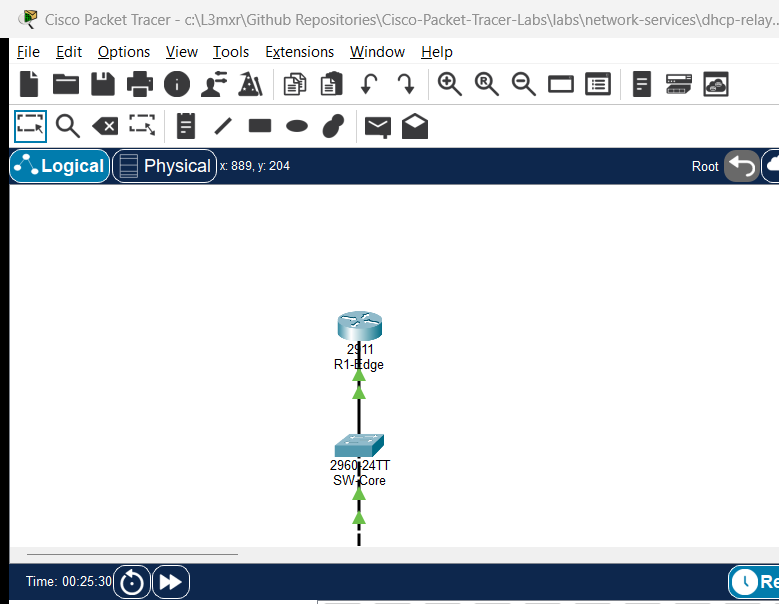

# PTL-0053: Secure Management Network Design

## Learning Objectives
- Architect and enforce a dedicated out-of-band management network design separating management and user data planes.
- Configure isolated Switched Virtual Interfaces (SVIs) on dedicated Management VLAN 99 with default gateway reachability.
- Enforce cryptographic SSHv2 device management and disable plaintext Telnet on all router and switch VTY lines.
- Implement standard and extended access control lists restricting administrative access to authorized management stations.
- Diagnose and remediate management plane vulnerabilities including default VLAN 1 exposure and missing VTY access-class filters.

## Prerequisites
- Completion of [PTL-0003: Securing Switch Management with SSH](../../network-security/secure-switch-ssh/)
- Completion of [PTL-0009: VLAN Segmentation and Access Ports](../../switching/vlan-segmentation-and-access-ports/)
- Familiarity with Cisco IOS Router-on-a-Stick 802.1Q subinterfaces and Access Control Lists

## Topology



```
                           [ R1-Edge ]
                       (Cisco 2911 Router)
                         Gi0/0 (802.1Q Trunk)
                                 |
                                 | Trunk (VLANs 10, 99)
                                 |
                         Gi0/1 (802.1Q Trunk)
                           [ SW-Core ]
                      (Catalyst 2960-24TT)
                      SVI VLAN 99: 192.168.99.2
                                 |
                         Gi0/2 (802.1Q Trunk)
                                 |
                         Gi0/1 (802.1Q Trunk)
                          [ SW-Access ]
                      (Catalyst 2960-24TT)
                      SVI VLAN 99: 192.168.99.3
                        /              \
                Fa0/10 /                \ Fa0/24
         (Access VLAN 10)            (Access VLAN 99)
                     /                    \
              [ User-PC ]            [ Admin-PC ]
            Standard Client        Authorized Admin
            192.168.10.10/24       192.168.99.10/24
```

## Addressing Table

| Device Name | Interface | IP Address | Subnet Mask | Default Gateway | Function / Connected To |
|---|---|---|---|---|---|
| **R1-Edge** | Gi0/0 | Unnumbered | Unnumbered | N/A | Trunk to SW-Core Gi0/1 |
| **R1-Edge** | Gi0/0.10 | 192.168.10.1 | 255.255.255.0 | N/A | Gateway for User Data Subnet (VLAN 10) |
| **R1-Edge** | Gi0/0.99 | 192.168.99.1 | 255.255.255.0 | N/A | Gateway for Management Subnet (VLAN 99) |
| **SW-Core** | Gi0/1 | Trunk | N/A | N/A | Trunk to R1-Edge Gi0/0 |
| **SW-Core** | Gi0/2 | Trunk | N/A | N/A | Trunk to SW-Access Gi0/1 |
| **SW-Core** | VLAN 99 | 192.168.99.2 | 255.255.255.0 | 192.168.99.1 | Core Switch Management SVI |
| **SW-Access** | Gi0/1 | Trunk | N/A | N/A | Trunk to SW-Core Gi0/2 |
| **SW-Access** | Fa0/10 | Access (VLAN 10) | N/A | N/A | Access Port for User-PC |
| **SW-Access** | Fa0/24 | Access (VLAN 99) | N/A | N/A | Access Port for Admin-PC |
| **SW-Access** | VLAN 99 | 192.168.99.3 | 255.255.255.0 | 192.168.99.1 | Access Switch Management SVI |
| **User-PC** | FastEthernet0 | 192.168.10.10 | 255.255.255.0 | 192.168.10.1 | Standard User Workstation |
| **Admin-PC** | FastEthernet0 | 192.168.99.10 | 255.255.255.0 | 192.168.99.1 | Authorized Administrator Station |

## Lab Tasks
1. **Analyze Baseline Vulnerabilities:** Investigate the initial topology to verify default VLAN 1 management exposure, enabled Telnet services, and unrestricted inter-VLAN reachability from user hosts.
2. **Implement Dedicated Management VLAN:** Create VLAN 99 across `SW-Core` and `SW-Access`, assign management SVIs, configure the default gateway, and place `Admin-PC` into VLAN 99.
3. **Hardening Device Cryptography and Transport:** Configure RSA keys (1024 bits), set domain names, configure local administrative credentials (`admin` / `Cisco12345!`), enable `ip ssh version 2`, and enforce `transport input ssh` on all VTY lines.
4. **Deploy VTY Access-Class Filtering:** Construct standard ACL 99 on each network infrastructure device permitting only `Admin-PC` (`192.168.99.10`) to initiate management sessions.
5. **Apply Router Data-Plane Filter:** Apply extended ACL `USER_FILTER` on `R1-Edge` subinterface `GigabitEthernet0/0.10` blocking all user traffic destined for `192.168.99.0/24`.
6. **Verify Security Enforcement:** Confirm that `Admin-PC` establishes SSH sessions to all devices while `User-PC` cannot ping or reach management interfaces, and verify Telnet connections are rejected.

## Configuration Walkthrough

### Task 1: Migrate Switch Management to Dedicated VLAN 99
On `SW-Core`:
```cisco
SW-Core# configure terminal
SW-Core(config)# vlan 10
SW-Core(config-vlan)# name User_Data
SW-Core(config-vlan)# vlan 99
SW-Core(config-vlan)# name Management
SW-Core(config-vlan)# exit
SW-Core(config)# interface vlan 1
SW-Core(config-if)# no ip address
SW-Core(config-if)# shutdown
SW-Core(config-if)# exit
SW-Core(config)# interface vlan 99
SW-Core(config-if)# ip address 192.168.99.2 255.255.255.0
SW-Core(config-if)# no shutdown
SW-Core(config-if)# exit
SW-Core(config)# ip default-gateway 192.168.99.1
```

On `SW-Access`:
```cisco
SW-Access# configure terminal
SW-Access(config)# vlan 10
SW-Access(config-vlan)# name User_Data
SW-Access(config-vlan)# vlan 99
SW-Access(config-vlan)# name Management
SW-Access(config-vlan)# exit
SW-Access(config)# interface vlan 1
SW-Access(config-if)# no ip address
SW-Access(config-if)# shutdown
SW-Access(config-if)# exit
SW-Access(config)# interface vlan 99
SW-Access(config-if)# ip address 192.168.99.3 255.255.255.0
SW-Access(config-if)# no shutdown
SW-Access(config-if)# exit
SW-Access(config)# ip default-gateway 192.168.99.1
SW-Access(config)# interface FastEthernet0/24
SW-Access(config-if)# switchport mode access
SW-Access(config-if)# switchport access vlan 99
SW-Access(config-if)# spanning-tree portfast
```

### Task 2: Configure SSHv2 and Cryptographic Hardening
On `R1-Edge`, `SW-Core`, and `SW-Access`:
```cisco
hostname <Device-Name>
ip domain-name enterprise.local
crypto key generate rsa modulus 1024
ip ssh version 2
username admin secret Cisco12345!
enable secret Class12345!

access-list 99 remark Permit Only Authorized Admin Station
access-list 99 permit host 192.168.99.10
access-list 99 deny any

line vty 0 4
 login local
 transport input ssh
 access-class 99 in
```

### Task 3: Enforce Perimeter Filtering on Router
On `R1-Edge`:
```cisco
R1-Edge# configure terminal
R1-Edge(config)# ip access-list extended USER_FILTER
R1-Edge(config-ext-nacl)# remark Deny User Subnet from Accessing Management Plane
R1-Edge(config-ext-nacl)# deny ip 192.168.10.0 0.0.0.255 192.168.99.0 0.0.0.255
R1-Edge(config-ext-nacl)# remark Permit All Other User Traffic
R1-Edge(config-ext-nacl)# permit ip 192.168.10.0 0.0.0.255 any
R1-Edge(config-ext-nacl)# exit
R1-Edge(config)# interface GigabitEthernet0/0.10
R1-Edge(config-subif)# ip access-group USER_FILTER in
R1-Edge(config-subif)# end
R1-Edge# copy running-config startup-config
```

## Verification

### 1. Management Subnet Reachability
From `Admin-PC`, verify full management plane reachability:
```cmd
ping 192.168.99.1
ping 192.168.99.2
ping 192.168.99.3
```
All ping commands should complete with 0% packet loss.

### 2. Cryptographic SSH Access
From `Admin-PC`, connect to router and switches using SSH:
```cmd
ssh -l admin 192.168.99.1
ssh -l admin 192.168.99.2
ssh -l admin 192.168.99.3
```
Enter password `Cisco12345!` when prompted. Each connection must establish successfully.

### 3. User Subnet Isolation Verification
From `User-PC`, verify gateway reachability on the data plane:
```cmd
ping 192.168.10.1
```
Result: 0% packet loss.

From `User-PC`, attempt to probe or reach the management subnet:
```cmd
ping 192.168.99.1
ping 192.168.99.2
ping 192.168.99.3
```
Result: `Request timed out` (100% loss) due to `USER_FILTER` on `R1-Edge`.

### 4. Telnet Rejection
From `Admin-PC`, attempt to connect using plaintext Telnet:
```cmd
telnet 192.168.99.1
telnet 192.168.99.2
```
Result: Connection refused / closed immediately because `transport input ssh` disables port 23.

## Troubleshooting

| Symptom | Probable Cause | Diagnostic Command | Remediation |
|---|---|---|---|
| `Admin-PC` cannot ping switch management IP | Switch missing default gateway or VLAN 99 not active | `show ip default-gateway` and `show vlan brief` on switch | Configure `ip default-gateway 192.168.99.1` and verify VLAN 99 in database |
| SSH connection fails: `Connection refused` | RSA keys not generated or `transport input ssh` missing | `show ip ssh` and `show run \| section line vty` | Generate 1024-bit RSA key and set `transport input ssh` |
| `Admin-PC` SSH connection immediately closes | `access-class 99 in` blocks `Admin-PC` IP | `show access-lists 99` | Verify `Admin-PC` IP (`192.168.99.10`) is permitted in ACL 99 |
| `User-PC` can still ping management IPs | `USER_FILTER` not bound to subinterface | `show ip interface Gi0/0.10 \| include access list` | Apply `ip access-group USER_FILTER in` under `Gi0/0.10` |

## Key Takeaways
- Out-of-band or segregated management networks are essential to prevent data plane users from eavesdropping, attacking, or exhausting management interfaces.
- Management SVIs should never reside on default VLAN 1; a dedicated non-default VLAN (such as VLAN 99) should be provisioned across all switches.
- Cryptographic protocols (SSHv2) with strong RSA keys (at least 1024 bits) must replace legacy plaintext protocols (Telnet).
- Dual-layer protection—VTY access-class filtering on devices and edge ACLs at router subinterfaces—provides defense-in-depth against unauthorized access attempts.

## References
- [NIST SP 800-123: Guide to General Server Security](https://csrc.nist.gov/publications/detail/sp/800-123/final)
- [Cisco Guide to Harden Cisco IOS Devices: Management Plane Hardening](https://www.cisco.com/c/en/us/support/docs/ip/access-lists/13608-21.html)

## Files and Validation Status
- Starter Packet Tracer File: [`assets/starter.pkt`](assets/starter.pkt)
- Completed Reference Solution: [`assets/completed.pkt`](assets/completed.pkt)
- Topology Diagram: [`assets/topology.png`](assets/topology.png)
- Device Configurations:
  - Edge Gateway Router: [`configs/R1-Edge.txt`](configs/R1-Edge.txt)
  - Core Management Switch: [`configs/SW-Core.txt`](configs/SW-Core.txt)
  - Access Switch: [`configs/SW-Access.txt`](configs/SW-Access.txt)
- Simulator Evidence: [`AI_AGENT_GUIDE/state/PTL-0053-SIMULATOR-RESULTS.md`](../../../AI_AGENT_GUIDE/state/PTL-0053-SIMULATOR-RESULTS.md)

