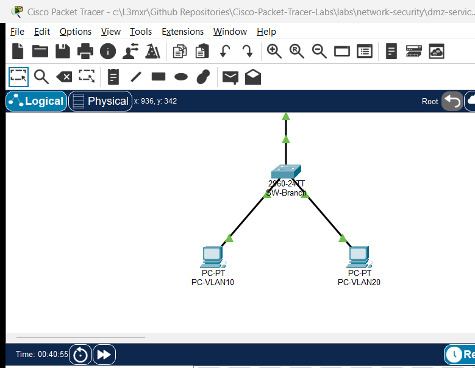

# PTL-0052: DHCP Helper-Address Multi-Subnet Troubleshooting

## Learning Objectives
- Diagnose and resolve DHCP relay failures across multiple 802.1Q VLANs using standard Cisco IOS verification commands.
- Understand how `ip helper-address` converts broadcast DHCP Discover messages into unicast packets routed to a centralized DHCP server.
- Identify and correct helper-address misconfigurations on subinterfaces, including invalid helper destinations and missing relay directives.
- Identify and resolve DHCP pool scope mismatches where the central server's network configuration does not match the incoming relay agent `giaddr` subnet.
- Validate dynamic IP lease acquisition, default gateway assignment, and end-to-end inter-VLAN routing across client endpoints.

## Prerequisites
- Completion of [PTL-0012: Configuring Cisco IOS DHCPv4 Server and Relay Agent](../../network-services/dhcp-server-and-relay/)
- Working knowledge of IEEE 802.1Q trunking and Router-on-a-Stick subinterface routing
- Familiarity with the 4-step DHCPv4 DORA process (Discover, Offer, Request, Acknowledge)

## Topology



```
                   [ R1-HQ: DHCP Server ]
                    (Cisco 2911 Router)
                         Gi0/0 (10.0.0.1/30)
                                 |
                                 | WAN Link: 10.0.0.0/30
                                 |
                         Gi0/0 (10.0.0.2/30)
                   [ R2-Branch: Relay Agent ]
                    (Cisco 2911 Router)
                         Gi0/1 (Trunk 802.1Q)
                                 |
                                 | 802.1Q Trunk (VLANs 10, 20)
                                 |
                         Gi0/1 (Trunk 802.1Q)
                   [ SW-Branch: Access Switch ]
                    (Catalyst 2960-24TT)
                        /              \
                Fa0/10 /                \ Fa0/20
           (Access VLAN 10)         (Access VLAN 20)
                     /                    \
              [ PC-VLAN10 ]          [ PC-VLAN20 ]
             DHCP Client 10         DHCP Client 20
            192.168.10.0/24         192.168.20.0/24
```

## Addressing Table

| Device Name | Interface | IP Address | Subnet Mask | Default Gateway | Function / Connected To |
|---|---|---|---|---|---|
| **R1-HQ** | Gi0/0 | 10.0.0.1 | 255.255.255.252 | N/A | Central DHCP Server / WAN Link to R2-Branch |
| **R2-Branch** | Gi0/0 | 10.0.0.2 | 255.255.255.252 | N/A | WAN Link to R1-HQ |
| **R2-Branch** | Gi0/1 | Unnumbered | Unnumbered | N/A | 802.1Q Physical Trunk to SW-Branch Gi0/1 |
| **R2-Branch** | Gi0/1.10 | 192.168.10.1 | 255.255.255.0 | N/A | VLAN 10 Gateway (Encapsulation dot1Q 10) |
| **R2-Branch** | Gi0/1.20 | 192.168.20.1 | 255.255.255.0 | N/A | VLAN 20 Gateway (Encapsulation dot1Q 20) |
| **SW-Branch** | Gi0/1 | Trunk | N/A | N/A | Trunk to R2-Branch Gi0/1 |
| **SW-Branch** | Fa0/10 | Access (VLAN 10) | N/A | N/A | Access Port for PC-VLAN10 |
| **SW-Branch** | Fa0/20 | Access (VLAN 20) | N/A | N/A | Access Port for PC-VLAN20 |
| **PC-VLAN10** | FastEthernet0 | DHCP Assigned | 255.255.255.0 | 192.168.10.1 | Client in VLAN 10 (Expected: 192.168.10.11+) |
| **PC-VLAN20** | FastEthernet0 | DHCP Assigned | 255.255.255.0 | 192.168.20.1 | Client in VLAN 20 (Expected: 192.168.20.11+) |

## Lab Tasks
1. **Analyze Initial Symptoms:** Inspect IP configuration on client endpoints `PC-VLAN10` and `PC-VLAN20` to verify lack of dynamic IP lease acquisition.
2. **Troubleshoot VLAN 10 Relay Agent:** Inspect `R2-Branch` subinterface `GigabitEthernet0/1.10`, identify the erroneous `ip helper-address 10.0.0.5`, and reconfigure it to point to central DHCP server `10.0.0.1`.
3. **Troubleshoot VLAN 20 Central DHCP Pool Scope:** Inspect `R1-HQ` DHCP pool configurations, identify the scope mismatch in `POOL_VLAN20` (configured with `192.168.200.0/24` instead of `192.168.20.0/24`), and correct the network and default gateway definitions.
4. **Trigger Client Lease Renewals:** Issue `ipconfig /renew` on both client machines and verify successful receipt of IP address, subnet mask, default gateway, and DNS server parameters.
5. **Verify End-to-End Connectivity:** Verify inter-VLAN routing between `PC-VLAN10` and `PC-VLAN20`, and test reachability to the central headquarters router (`10.0.0.1`).

## Configuration Walkthrough

### Task 1: Identify Fault Symptoms
On `PC-VLAN10` and `PC-VLAN20`, verify the current IP status:
```cmd
ipconfig
```
Both clients show `0.0.0.0` or APIPA `169.254.x.x` addresses because neither host receives a DHCP Offer.

### Task 2: Remediate VLAN 10 Relay Helper Address
On `R2-Branch`, examine the subinterface running configuration:
```cisco
R2-Branch# show running-config interface GigabitEthernet0/1.10
Building configuration...

Current configuration : 138 bytes
!
interface GigabitEthernet0/1.10
 encapsulation dot1Q 10
 ip address 192.168.10.1 255.255.255.0
 ip helper-address 10.0.0.5
end
```
Notice that the helper address points to `10.0.0.5`, which does not exist in the routing topology. Reconfigure `GigabitEthernet0/1.10` to point to `10.0.0.1`:
```cisco
R2-Branch# configure terminal
R2-Branch(config)# interface GigabitEthernet0/1.10
R2-Branch(config-subif)# no ip helper-address 10.0.0.5
R2-Branch(config-subif)# ip helper-address 10.0.0.1
R2-Branch(config-subif)# end
R2-Branch# copy running-config startup-config
```

### Task 3: Remediate VLAN 20 Central DHCP Pool Scope
On `R1-HQ`, examine the configured DHCP pools:
```cisco
R1-HQ# show run | section dhcp
ip dhcp excluded-address 10.0.0.1 10.0.0.10
ip dhcp excluded-address 192.168.10.1 192.168.10.10
ip dhcp excluded-address 192.168.20.1 192.168.20.10
ip dhcp pool POOL_VLAN10
 network 192.168.10.0 255.255.255.0
 default-router 192.168.10.1
 dns-server 10.0.0.1
 domain-name enterprise.local
ip dhcp pool POOL_VLAN20
 network 192.168.200.0 255.255.255.0
 default-router 192.168.200.1
 dns-server 10.0.0.1
 domain-name enterprise.local
```
When `R2-Branch` forwards a DHCP Discover for VLAN 20, it inserts `giaddr = 192.168.20.1`. `R1-HQ` searches for a pool covering `192.168.20.1`, finds no matching network, and discards the request.

Correct the pool definition on `R1-HQ`:
```cisco
R1-HQ# configure terminal
R1-HQ(config)# no ip dhcp pool POOL_VLAN20
R1-HQ(config)# ip dhcp pool POOL_VLAN20
R1-HQ(config-dhcp)# network 192.168.20.0 255.255.255.0
R1-HQ(config-dhcp)# default-router 192.168.20.1
R1-HQ(config-dhcp)# dns-server 10.0.0.1
R1-HQ(config-dhcp)# domain-name enterprise.local
R1-HQ(config-dhcp)# end
R1-HQ# copy running-config startup-config
```

### Task 4: Renew Client Leases
On `PC-VLAN10`:
```cmd
ipconfig /renew
```
On `PC-VLAN20`:
```cmd
ipconfig /renew
```

## Verification

### 1. Client IP Configuration
Check `PC-VLAN10`:
```cmd
C:\> ipconfig

FastEthernet0 Connection:(default port)

   Connection-specific DNS Suffix..: enterprise.local
   Link-local IPv6 Address.........: FE80::...
   IPv4 Address....................: 192.168.10.11
   Subnet Mask.....................: 255.255.255.0
   Default Gateway.................: 192.168.10.1
```

Check `PC-VLAN20`:
```cmd
C:\> ipconfig

FastEthernet0 Connection:(default port)

   Connection-specific DNS Suffix..: enterprise.local
   Link-local IPv6 Address.........: FE80::...
   IPv4 Address....................: 192.168.20.11
   Subnet Mask.....................: 255.255.255.0
   Default Gateway.................: 192.168.20.1
```

### 2. Central DHCP Server Bindings
On `R1-HQ`:
```cisco
R1-HQ# show ip dhcp binding
Bindings from all pools :
IP address      Client-ID/              Lease expiration        Type
                Hardware address/
                User name
192.168.10.11   0001.42A3.B810          --                      Automatic
192.168.20.11   00D0.FF41.562A          --                      Automatic
```

### 3. End-to-End ICMP Reachability
From `PC-VLAN10`, ping the local gateway, the remote VLAN host, and the headquarters router:
```cmd
ping 192.168.10.1
ping 192.168.20.11
ping 10.0.0.1
```
All ping operations should complete with a 0% packet loss rate.

## Troubleshooting

| Symptom | Probable Cause | Diagnostic Command | Remediation |
|---|---|---|---|
| Client receives no lease; gets `0.0.0.0` or APIPA `169.254.x.x` | Helper address points to wrong IP | `show running-config interface Gi0/1.x` on relay router | Configure `ip helper-address <DHCP-Server-IP>` under the subinterface |
| Relay router forwards request, but server issues no Offer | DHCP pool network statement does not match subinterface `giaddr` subnet | `show running-config \| section dhcp` and `show ip dhcp pool` on server | Ensure `network` in DHCP pool matches the subinterface IP subnet |
| Server shows pool exhausted | Excluded address range covers whole subnet or pool is depleted | `show ip dhcp pool <name>` | Verify `ip dhcp excluded-address` range only reserves gateways/servers |
| Client cannot ping default gateway after lease | 802.1Q encapsulation mismatch or missing VLAN on trunk | `show interface trunk` on switch, `show ip interface brief` on router | Ensure trunk allows the VLAN and subinterface encapsulation matches |

## Key Takeaways
- Broadcast DHCP Discover messages do not traverse router boundaries unless converted by an active DHCP relay agent (`ip helper-address`).
- The `ip helper-address` directive must be applied to the specific inbound router interface or subinterface that receives the client broadcast.
- The relay router stamps its incoming subinterface IP in the `giaddr` (Gateway IP Address) field of the DHCP payload, which the central server uses to select the correct DHCP pool.
- A mismatch between the subinterface `giaddr` subnet and the server's pool `network` declaration results in silent discards of relay packets.

## References
- [IETF RFC 2131: Dynamic Host Configuration Protocol](https://datatracker.ietf.org/doc/html/rfc2131)
- [Cisco IOS IP Addressing Services: Configuring DHCP Server and Relay Agent](https://www.cisco.com/c/en/us/td/docs/ios-xml/ios/ipaddr_dhcp/configuration/xe-16/dhcp-xe-16-book/config-dhcp-server.html)

## Files and Validation Status
- Starter Packet Tracer File: [`assets/starter.pkt`](assets/starter.pkt)
- Completed Reference Solution: [`assets/completed.pkt`](assets/completed.pkt)
- Topology Diagram: [`assets/topology.png`](assets/topology.png)
- Device Configurations:
  - Central DHCP Server: [`configs/R1-HQ.txt`](configs/R1-HQ.txt)
  - Relay Agent & Branch Router: [`configs/R2-Branch.txt`](configs/R2-Branch.txt)
  - Branch Access Switch: [`configs/SW-Branch.txt`](configs/SW-Branch.txt)
- Simulator Evidence: [`AI_AGENT_GUIDE/state/PTL-0052-SIMULATOR-RESULTS.md`](../../../AI_AGENT_GUIDE/state/PTL-0052-SIMULATOR-RESULTS.md)

