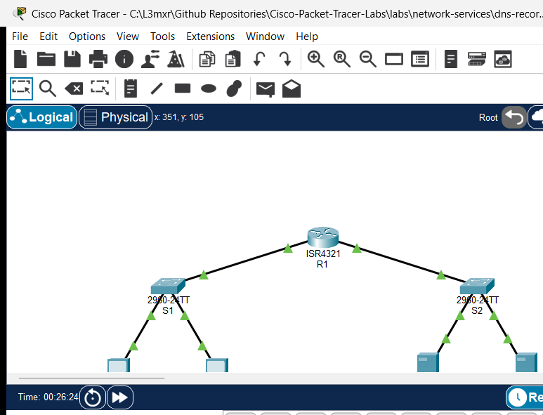

# PTL-0022: DNS Records and HTTP Web Services

> **Category:** network-services · **Difficulty:** beginner · **Lab ID:** PTL-0022 · **Document:** reviewed · **Simulator:** tested pass

The **Domain Name System (DNS)** is one of the core foundation protocols of the modern Internet and enterprise intranets, translating human-friendly Fully Qualified Domain Names (FQDNs)—such as `web.corp.local` or `www.corp.local`—into machine-routable IPv4 addresses. Without DNS, users would be required to remember numeric IP addresses for every network resource, file share, and web service.

At the application layer, the **Hypertext Transfer Protocol (HTTP)** relies directly on DNS: when a client browser requests a website using a Uniform Resource Locator (URL), the client operating system first queries its configured DNS resolver to obtain the target server's IP address. Once the IP address is resolved, the client initiates a TCP three-way handshake on port 80 to establish an HTTP session and request web resources.

In this laboratory, you will explore the relationship between DNS name resolution and HTTP web services in Cisco Packet Tracer. You will configure an authoritative internal DNS server (`DNS-Server`), populate Address (A) resource records and Canonical Name (CNAME) alias records, configure client workstation resolvers across a routed enterprise boundary, and test end-to-end web delivery using `nslookup`, command-line tools, and web browser clients.

---

## Learning Objectives

- Explain the architecture, protocol operation, and hierarchical role of the Domain Name System (DNS).
- Differentiate between primary DNS resource record types, including Address (**A**) records and Canonical Name (**CNAME**) alias records.
- Configure and activate authoritative DNS services on Cisco Packet Tracer server endpoints.
- Configure and manage an HTTP web server, defining custom web portal pages.
- Configure IPv4 network settings, default gateways, and DNS server addresses on client workstations.
- Query and inspect DNS name resolution across subnets using the `nslookup` command-line utility.
- Verify HTTP web page delivery over resolved domain names using the client web browser.
- Troubleshoot common name resolution faults, including disabled services, record typos, and missing alias targets.

---

## Prerequisites

- Basic understanding of IPv4 addressing, subnet masks, and default gateways.
- Completion of **PTL-0014: Default Gateway Troubleshooting** or equivalent basic routing knowledge.
- Familiarity with client command-line utilities (`ping`, `ipconfig`, `nslookup`).
- Cisco Packet Tracer 8.2 or newer (Packet Tracer 9.0+ verified).

---

## Topology



The topology models an enterprise network divided into a client access subnet and a datacenter server farm connected through an inter-subnet router (`R1`):

```text
[PC-1]──Fa0 ───── Fa0/1──[Switch S1]──Gi0/1 ───── Gi0/0/0──[Router R1]
(192.168.10.10)          (Client LAN)                       │ (Gateway Router)
                                                             │ Gi0/0/1 (192.168.20.1/24)
[PC-2]──Fa0 ───── Fa0/2──────────────────────────────────────┘
(192.168.10.20)                                            [Switch S2]
                                                             │ (Server Farm LAN)
                                       ┌─────────────────────┴─────────────────────┐
                                  Fa0/10                                      Fa0/11
                                       │                                           │
                                  [DNS-Server]                                [Web-Server]
                                 (192.168.20.50)                             (192.168.20.80)
```

| Device Name | Model | Interface | Connected Device | Neighbor Interface | Network Role |
|---|---|---|---|---|---|
| **R1** | Cisco ISR 4321 | GigabitEthernet0/0/0 | Switch S1 | GigabitEthernet0/1 | Client LAN Gateway (`192.168.10.1/24`) |
| **R1** | Cisco ISR 4321 | GigabitEthernet0/0/1 | Switch S2 | GigabitEthernet0/1 | Server Farm Gateway (`192.168.20.1/24`) |
| **Switch S1** | Catalyst 2960-24TT | FastEthernet0/1 | PC-1 | FastEthernet0 | Access Port for Workstation 1 |
| **Switch S1** | Catalyst 2960-24TT | FastEthernet0/2 | PC-2 | FastEthernet0 | Access Port for Workstation 2 |
| **Switch S1** | Catalyst 2960-24TT | GigabitEthernet0/1 | Router R1 | GigabitEthernet0/0/0 | Uplink to R1 Client Gateway |
| **Switch S2** | Catalyst 2960-24TT | FastEthernet0/10 | DNS-Server | FastEthernet0 | Access Port for Authoritative DNS Server |
| **Switch S2** | Catalyst 2960-24TT | FastEthernet0/11 | Web-Server | FastEthernet0 | Access Port for Corporate Web Server |
| **Switch S2** | Catalyst 2960-24TT | GigabitEthernet0/1 | Router R1 | GigabitEthernet0/0/1 | Uplink to R1 Server Gateway |
| **PC-1** | PC-PT | FastEthernet0 | Switch S1 | FastEthernet0/1 | Client Workstation 1 |
| **PC-2** | PC-PT | FastEthernet0 | Switch S1 | FastEthernet0/2 | Client Workstation 2 |
| **DNS-Server** | Server-PT | FastEthernet0 | Switch S2 | FastEthernet0/10 | Internal Authoritative DNS Server |
| **Web-Server** | Server-PT | FastEthernet0 | Switch S2 | FastEthernet0/11 | Corporate Intranet Web Server |

---

## Addressing Table

| Device | Interface | IPv4 Address | Subnet Mask | Default Gateway | DNS Server | Network Role |
|---|---|---|---|---|---|---|
| **R1** | `Gi0/0/0` | `192.168.10.1` | `255.255.255.0` | N/A | N/A | Client LAN Gateway |
| **R1** | `Gi0/0/1` | `192.168.20.1` | `255.255.255.0` | N/A | N/A | Server Farm Gateway |
| **S1** | `Vlan1` | `192.168.10.2` | `255.255.255.0` | `192.168.10.1` | N/A | Client Switch Management SVI |
| **S2** | `Vlan1` | `192.168.20.2` | `255.255.255.0` | `192.168.20.1` | N/A | Server Switch Management SVI |
| **PC-1** | `Fa0` | `192.168.10.10` | `255.255.255.0` | `192.168.10.1` | `192.168.20.50` | Workstation 1 (Client LAN) |
| **PC-2** | `Fa0` | `192.168.10.20` | `255.255.255.0` | `192.168.10.1` | `192.168.20.50` | Workstation 2 (Client LAN) |
| **DNS-Server** | `Fa0` | `192.168.20.50` | `255.255.255.0` | `192.168.20.1` | `127.0.0.1` | DNS Server (Port 53 UDP/TCP) |
| **Web-Server** | `Fa0` | `192.168.20.80` | `255.255.255.0` | `192.168.20.1` | `192.168.20.50` | HTTP Server (Port 80 TCP) |

### DNS Resource Records
| Record Name (FQDN) | Record Type | Target / Value | Description |
|---|---|---|---|
| `web.corp.local` | **A** | `192.168.20.80` | Maps primary server hostname to IPv4 address |
| `www.corp.local` | **CNAME** | `web.corp.local` | Canonical alias pointing standard web prefix to primary host |
| `portal.corp.local` | **A** | `192.168.20.80` | Maps corporate portal alias to server IPv4 address |

---

## Lab Tasks

1. Verify physical cabling and inspect IP configuration across all endpoints and switches in the starter topology.
2. Confirm Layer 3 routing by pinging from `PC-1` (`192.168.10.10`) to `Web-Server` (`192.168.20.80`) using its direct IP address.
3. Test initial DNS resolution by running `nslookup web.corp.local` on `PC-1`, and observe that the query fails because DNS service is unconfigured.
4. On `DNS-Server`, navigate to the **Services** tab, select **DNS**, and set the service to **On**.
5. Add an **A Record** named `web.corp.local` pointing to `192.168.20.80`.
6. Add a **CNAME Record** named `www.corp.local` with Host Name `web.corp.local`.
7. Add an **A Record** named `portal.corp.local` pointing to `192.168.20.80`.
8. On `Web-Server`, verify that the **HTTP** service is turned **On** and contains an `index.html` file.
9. Verify name resolution from `PC-1` using `nslookup web.corp.local` and `nslookup www.corp.local`.
10. Verify name resolution from `PC-2` using `nslookup portal.corp.local`.
11. From `PC-1`, open the **Web Browser** application and navigate to `http://www.corp.local` to verify HTTP page delivery.
12. Perform fault injection: simulate a broken DNS record by removing `portal.corp.local`, verify client lookup failure, and restore the record to confirm recovery.

---

## Configuration Walkthrough

### 1. Baseline Verification in Starter State
Open the starter activity file (`assets/starter.pkt`). Verify that client `PC-1` can reach `Web-Server` using its IP address across router `R1`:

```text
PC-1> ping 192.168.20.80

Pinging 192.168.20.80 with 32 bytes of data:

Reply from 192.168.20.80: bytes=32 time<1ms TTL=127
Reply from 192.168.20.80: bytes=32 time<1ms TTL=127
Reply from 192.168.20.80: bytes=32 time<1ms TTL=127

Ping statistics for 192.168.20.80:
    Packets: Sent = 3, Received = 3, Lost = 0 (0% loss)
```

Now execute an `nslookup` query for `web.corp.local`:

```text
PC-1> nslookup web.corp.local

Server: [192.168.20.50]
Address:  192.168.20.50
DNS request timed out.
```

The ping succeeds because router `R1` has active routes for both `192.168.10.0/24` and `192.168.20.0/24`. However, `nslookup` times out because the DNS service on `DNS-Server` is currently disabled.

### 2. Configure the Authoritative DNS Server
Click on `DNS-Server`, navigate to the **Services** tab, and select **DNS** in the left menu:

1. Click the **On** radio button to enable the DNS Service.
2. In the **Resource Records** section:
   - **Name:** `web.corp.local`
   - **Type:** `A Record`
   - **Address:** `192.168.20.80`
   - Click **Add**.
3. Create the CNAME alias:
   - **Name:** `www.corp.local`
   - **Type:** `CNAME`
   - **Host Name:** `web.corp.local`
   - Click **Add**.
4. Create the secondary portal A record:
   - **Name:** `portal.corp.local`
   - **Type:** `A Record`
   - **Address:** `192.168.20.80`
   - Click **Add**.

Verify that all three records appear in the DNS database table.

### 3. Verify HTTP Web Service on Web-Server
Click on `Web-Server`, navigate to the **Services** tab, and select **HTTP**:

1. Ensure the **HTTP** service radio button is set to **On**.
2. Locate `index.html` in the file list. The default Cisco Packet Tracer page or custom portal content should be present:
```html
<html>
<head><title>Corporate Intranet Portal</title></head>
<body>
<h1>Welcome to Corporate Intranet</h1>
<p>DNS and HTTP services operational.</p>
</body>
</html>
```

### 4. Verify Client DNS Configuration
Click on `PC-1`, open **Desktop** -> **IP Configuration**, and verify that the **DNS Server** field is set to `192.168.20.50`. Check `PC-2` to ensure its DNS Server is also set to `192.168.20.50`.

---

## Verification

### 1. Test A Record Resolution with nslookup
On `PC-1`, open the **Command Prompt** and test primary A record resolution:

```text
PC-1> nslookup web.corp.local

Server: [192.168.20.50]
Address:  192.168.20.50

Non-authoritative answer:
Name:   web.corp.local
Address:   192.168.20.80
```

The internal DNS server (`192.168.20.50`) successfully responded with the IPv4 address `192.168.20.80`.

### 2. Test CNAME Alias Resolution
From `PC-1`, resolve the alias hostname `www.corp.local`:

```text
PC-1> nslookup www.corp.local

Server: [192.168.20.50]
Address:  192.168.20.50

Non-authoritative answer:
Name:   web.corp.local
Address:   192.168.20.80

Aliases:   web.corp.local
```

The DNS server returned the alias mapping: `www.corp.local` points to canonical name `web.corp.local`, which resolves to IP `192.168.20.80`.

### 3. Test Secondary A Record Resolution
On `PC-2`, query the secondary portal record:

```text
PC-2> nslookup portal.corp.local

Server: [192.168.20.50]
Address:  192.168.20.50

Non-authoritative answer:
Name:   portal.corp.local
Address:   192.168.20.80
```

Both workstations independently resolve enterprise hostnames through the central DNS server.

### 4. Access Web Service via FQDN in Web Browser
On `PC-1`, close the Command Prompt, open the **Web Browser** application on the Desktop, and enter:
`http://www.corp.local`

Click **Go**. The browser resolves `www.corp.local` to `192.168.20.80` via DNS and displays the intranet web page:
> **Welcome to Corporate Intranet**  
> DNS and HTTP services operational.

---

## Troubleshooting

| Symptom / Error | Root Cause | Verification Command | Resolution |
|---|---|---|---|
| `DNS request timed out` | DNS service is toggled **Off** on `DNS-Server` | `nslookup web.corp.local` | In `DNS-Server` -> **Services** -> **DNS**, set service to **On**. |
| `*** UnKnown can't find host: Non-existent domain` | Hostname misspelled or record missing from DNS database | Check spelling in `nslookup <hostname>` | Verify record spelling in the DNS database table on `DNS-Server`. |
| CNAME query fails to return an IP address | Target canonical name in CNAME does not match an existing A record | `nslookup <cname>` | Ensure the Host Name field in the CNAME record exactly matches an active A record name (`web.corp.local`). |
| Ping by IP succeeds, but ping by hostname fails | Client workstation has incorrect or blank DNS server IP | `ipconfig /all` on client PC | Set DNS Server address on the client to `192.168.20.50`. |
| Web browser reports Host Not Found | HTTP URL uses invalid domain or port 80 blocked | Check browser URL bar | Verify URL syntax (`http://www.corp.local`) and ensure `Web-Server` HTTP service is **On**. |

---

## Key Takeaways

- **Separation of Concerns:** DNS resolves human-readable names to network addresses; HTTP delivers application web content over established transport sessions.
- **Record Types:**
  - **A Record (Address):** Maps a hostname directly to an IPv4 address (`web.corp.local` -> `192.168.20.80`).
  - **CNAME Record (Canonical Name):** Creates an alias pointing to an existing A record (`www.corp.local` -> `web.corp.local`), enabling multiple service names to share a single host record.
- **Client Resolution Process:** When an application requests an FQDN, the client OS queries the configured DNS server using UDP port 53. The returned IP is used for subsequent Layer 3/4 communication.
- **Enterprise Centralization:** A central DNS server serves multiple client subnets across an enterprise router, provided routing and default gateways are configured correctly.

---

## References

- [IETF RFC 1034: Domain Names — Concepts and Facilities](https://datatracker.ietf.org/doc/html/rfc1034)
- [IETF RFC 1035: Domain Names — Implementation and Specification](https://datatracker.ietf.org/doc/html/rfc1035)
- [IETF RFC 7230: Hypertext Transfer Protocol (HTTP/1.1): Message Syntax and Routing](https://datatracker.ietf.org/doc/html/rfc7230)
- [Cisco CCNA 200-301 Official Cert Guide: IP Services and Name Resolution](https://www.ciscopress.com/)

---

## Files and Validation Status

| File Name | File Purpose | Validation Status |
|---|---|---|
| `metadata.json` | Curriculum indexing and specification metadata | Validated against repository JSON schema |
| `README.md` | Primary lab guide and step-by-step instructions | Validated against required 11 canonical H2 sections |
| `verification.md` | In-depth verification and fault recovery matrix | Validated with POS/NEG criteria |
| `assets/starter.pkt` | Initial student activity file | Validated in Cisco Packet Tracer 9.0.1 |
| `assets/completed.pkt` | Fully configured golden reference solution | Validated in Cisco Packet Tracer 9.0.1 |
| `assets/topology.png` | Live simulator topology canvas screenshot | Validated PNG image |
| `configs/R1.txt` | Default gateway router configuration | Verified syntax |
| `configs/S1.txt` | Client LAN switch configuration | Verified syntax |
| `configs/S2.txt` | Server farm switch configuration | Verified syntax |

