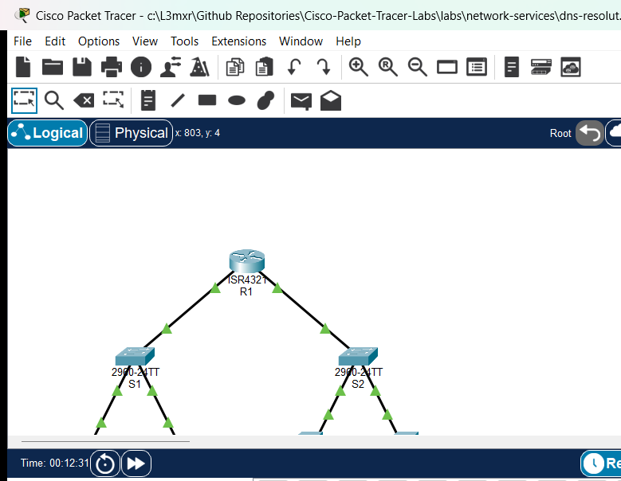

# PTL-0037: DNS Resolution Failure Troubleshooting

> **Category:** network-services · **Difficulty:** beginner · **Lab ID:** PTL-0037 · **Document:** reviewed · **Simulator:** tested pass

The **Domain Name System (DNS)** is a cornerstone network service that translates human-friendly Fully Qualified Domain Names (FQDNs)—such as `corpweb.local`, `portal.corpweb.local`, and `www.corpweb.local`—into machine-routable IPv4 addresses. In production enterprise environments, when users report that "the Internet is down" or "the intranet web portal is unreachable," the root cause is frequently a Domain Name System failure rather than an underlying Layer 1, 2, or 3 physical or routing transport outage.

DNS troubleshooting requires a disciplined, layered diagnostic methodology. A network engineer must first verify whether direct IP connectivity functions before investigating higher-layer name resolution. If a client can ping an internal server by its IPv4 address but cannot open its web portal by hostname, the underlying IP routing infrastructure is intact, isolating the problem specifically to DNS client configuration, network transport to the DNS server, or the authoritative DNS server database itself.

In this laboratory, you will step into an enterprise network environment experiencing multiple Domain Name System failures across routed subnets. You will systematically identify, isolate, and remediate three distinct DNS failure modes:
1. **Misconfigured Client Resolver:** A workstation pointing to an invalid, unreachable DNS server IP address.
2. **Disabled DNS Daemon Service:** A corporate DNS server whose name-resolution daemon is switched off.
3. **Missing Resource Records:** An authoritative DNS server lacking essential Address (A) and Canonical Name (CNAME) records for internal corporate web portals.

Following remediation, you will verify complete restoration of network name resolution using `ipconfig`, `nslookup`, `ping` by FQDN, and web browser clients.

---

## Learning Objectives

- Isolate Domain Name System (DNS) failures from underlying Layer 1 through Layer 3 network routing issues using direct IP and hostname ICMP ping tests.
- Inspect and verify client DNS resolver settings from the command line using `ipconfig /all`.
- Reconfigure incorrect primary DNS server IPv4 addresses on client workstations.
- Diagnose DNS server service states and activate disabled DNS daemon processes on Cisco Packet Tracer server endpoints.
- Identify missing resource records in an authoritative DNS database and create required Address (**A**) and Canonical Name (**CNAME**) alias records.
- Analyze command-line outputs from `nslookup` to differentiate between DNS server timeouts and non-existent domain (**NXDOMAIN**) responses.
- Verify end-to-end name resolution, alias redirection, and HTTP web portal delivery across routed subnets.

---

## Prerequisites

- Basic understanding of IPv4 addressing, subnet masks, and default gateways.
- Completion of **PTL-0014: Default Gateway Troubleshooting** or equivalent routed network fundamentals.
- Completion of **PTL-0022: DNS Records and HTTP Web Services** or familiarity with DNS A and CNAME record concepts.
- Familiarity with client command-line utilities (`ping`, `ipconfig`, `nslookup`).
- Cisco Packet Tracer 8.2 or newer (Packet Tracer 9.0+ verified).

---

## Topology



The topology models an enterprise network partitioned into two separate subnets connected through default gateway router `R1`:
- **Client LAN (`192.168.1.0/24`):** Accommodates client workstations `PC-1` and `PC-2` connected through access switch `S1`.
- **Server Farm LAN (`192.168.2.0/24`):** Houses the corporate `DNS-Server` (`192.168.2.10`) and corporate `Web-Server` (`192.168.2.20`) connected through access switch `S2`.

```text
[PC-1]──Fa0 ───── Fa0/2──[Switch S1]──Fa0/1 ───── Gi0/0/0──[Router R1]
(192.168.1.10)           (Client LAN)                       │ (Gateway Router)
                                                            │ Gi0/0/1 (192.168.2.1/24)
[PC-2]──Fa0 ───── Fa0/3─────────────────────────────────────┘
(192.168.1.20)                                            [Switch S2]
                                                            │ (Server Farm LAN)
                                      ┌─────────────────────┴─────────────────────┐
                                     Fa0/2                                       Fa0/3
                                      │                                           │
                                 [DNS-Server]                                [Web-Server]
                                (192.168.2.10)                              (192.168.2.20)
```

| Device Name | Model | Interface | Connected Device | Neighbor Interface | Network Role |
|---|---|---|---|---|---|
| **R1** | Cisco ISR 4321 | GigabitEthernet0/0/0 | Switch S1 | FastEthernet0/1 | Client LAN Gateway (`192.168.1.1/24`) |
| **R1** | Cisco ISR 4321 | GigabitEthernet0/0/1 | Switch S2 | FastEthernet0/1 | Server Farm Gateway (`192.168.2.1/24`) |
| **Switch S1** | Catalyst 2960-24TT | FastEthernet0/2 | PC-1 | FastEthernet0 | Access Port for Client Workstation 1 |
| **Switch S1** | Catalyst 2960-24TT | FastEthernet0/3 | PC-2 | FastEthernet0 | Access Port for Client Workstation 2 |
| **Switch S1** | Catalyst 2960-24TT | FastEthernet0/1 | Router R1 | GigabitEthernet0/0/0 | Uplink to Gateway Router R1 |
| **Switch S2** | Catalyst 2960-24TT | FastEthernet0/2 | DNS-Server | FastEthernet0 | Access Port for Enterprise DNS Server |
| **Switch S2** | Catalyst 2960-24TT | FastEthernet0/3 | Web-Server | FastEthernet0 | Access Port for Intranet Web Server |
| **Switch S2** | Catalyst 2960-24TT | FastEthernet0/1 | Router R1 | GigabitEthernet0/0/1 | Uplink to Gateway Router R1 |
| **PC-1** | PC-PT | FastEthernet0 | Switch S1 | FastEthernet0/2 | Client Workstation 1 |
| **PC-2** | PC-PT | FastEthernet0 | Switch S1 | FastEthernet0/3 | Client Workstation 2 |
| **DNS-Server** | Server-PT | FastEthernet0 | Switch S2 | FastEthernet0/2 | Corporate Authoritative DNS Server |
| **Web-Server** | Server-PT | FastEthernet0 | Switch S2 | FastEthernet0/3 | Corporate Intranet Web Portal Server |

---

## Addressing Table

| Device | Interface | IPv4 Address | Subnet Mask | Default Gateway | DNS Server | Network Role |
|---|---|---|---|---|---|---|
| **R1** | `Gi0/0/0` | `192.168.1.1` | `255.255.255.0` | N/A | N/A | Client LAN Default Gateway |
| **R1** | `Gi0/0/1` | `192.168.2.1` | `255.255.255.0` | N/A | N/A | Server Farm Default Gateway |
| **S1** | `Vlan1` | Unassigned | Unassigned | `192.168.1.1` | N/A | Layer 2 Client Access Switch |
| **S2** | `Vlan1` | Unassigned | Unassigned | `192.168.2.1` | N/A | Layer 2 Server Access Switch |
| **PC-1** | `Fa0` | `192.168.1.10` | `255.255.255.0` | `192.168.1.1` | `192.168.2.10` *(Fix from .99)* | Client Workstation 1 |
| **PC-2** | `Fa0` | `192.168.1.20` | `255.255.255.0` | `192.168.1.1` | `192.168.2.10` | Client Workstation 2 |
| **DNS-Server** | `Fa0` | `192.168.2.10` | `255.255.255.0` | `192.168.2.1` | `127.0.0.1` | Authoritative DNS Server |
| **Web-Server** | `Fa0` | `192.168.2.20` | `255.255.255.0` | `192.168.2.1` | `192.168.2.10` | Intranet Web Server (Port 80 HTTP) |

### Intranet DNS Resource Records Required

| Record Name (FQDN) | Record Type | Target / Value | Description |
|---|---|---|---|
| `corpweb.local` | **A** | `192.168.2.20` | Authoritative primary address record for corporate intranet |
| `portal.corpweb.local` | **A** | `192.168.2.20` | Direct portal host address record |
| `www.corpweb.local` | **CNAME** | `corpweb.local` | Canonical name alias pointing standard WWW prefix to primary A record |

---

## Lab Tasks

1. **Verify Baseline Layer 1–3 Network Transport:** Test end-to-end IP reachability by pinging default gateways and the target web server (`192.168.2.20`) directly by IP address from `PC-1`.
2. **Diagnose Client DNS Resolver Faults (Fault 1):** Execute `ipconfig /all` and `nslookup corpweb.local` on `PC-1`. Observe the DNS request timeout to invalid address `192.168.2.99`.
3. **Remediate Client DNS Configuration:** Reconfigure `PC-1` with the correct primary DNS server address (`192.168.2.10`).
4. **Diagnose and Enable DNS Server Daemon (Fault 2):** Inspect `DNS-Server` and observe that the DNS service process is disabled (`Off`). Toggle the service to `On`.
5. **Diagnose and Populate Missing Resource Records (Fault 3):** Test resolution of `corpweb.local`, `portal.corpweb.local`, and `www.corpweb.local`. Populate the authoritative database with required A and CNAME records.
6. **Verify End-to-End Name Resolution:** Use `nslookup` on `PC-1` and `PC-2` to confirm that all three domain names resolve to `192.168.2.20`.
7. **Verify Integrated Hostname Resolution with Ping:** Test `ping corpweb.local` from client workstations and verify successful name resolution and ICMP echo reply reception.
8. **Verify Web Service Access via Web Browser:** Launch the desktop Web Browser on `PC-1` and load `http://www.corpweb.local` and `http://www.corpweb.local` to confirm end-user service delivery.

---

## Configuration Walkthrough

### 1. Baseline Verification in Starter State
Open the starter activity file (`assets/starter.pkt`). Begin by verifying whether basic Layer 3 IP routing functions between the client subnet and the server subnet. On `PC-1`, open the **Command Prompt** and ping the default gateway and web server by IP:

```text
C:\>ping 192.168.1.1

Pinging 192.168.1.1 with 32 bytes of data:

Reply from 192.168.1.1: bytes=32 time<1ms TTL=255
Reply from 192.168.1.1: bytes=32 time<1ms TTL=255
Reply from 192.168.1.1: bytes=32 time<1ms TTL=255
Reply from 192.168.1.1: bytes=32 time<1ms TTL=255

Ping statistics for 192.168.1.1:
    Packets: Sent = 4, Received = 4, Lost = 0 (0% loss)
```

Now ping `Web-Server` (`192.168.2.20`):

```text
C:\>ping 192.168.2.20

Pinging 192.168.2.20 with 32 bytes of data:

Reply from 192.168.2.20: bytes=32 time<1ms TTL=127
Reply from 192.168.2.20: bytes=32 time<1ms TTL=127
Reply from 192.168.2.20: bytes=32 time<1ms TTL=127
Reply from 192.168.2.20: bytes=32 time<1ms TTL=127

Ping statistics for 192.168.2.20:
    Packets: Sent = 4, Received = 4, Lost = 0 (0% loss)
```

> [!NOTE]
> Direct IP reachability across router `R1` succeeds with 0% packet loss. This proves that Layer 1 cabling, Layer 2 switch ports, and Layer 3 IP addressing and routing are operating normally.

### 2. Identify Fault 1: Misconfigured Client DNS Server IP
Attempt to resolve the intranet portal hostname from `PC-1`:

```text
C:\>nslookup corpweb.local

Server: [192.168.2.99]
Address:  192.168.2.99
DNS request timed out.
	timeout was 15000 milli seconds.
DNS request timed out.
	timeout was 15000 milli seconds.
*** Request to 192.168.2.99 timed-out
```

Notice that `nslookup` attempted to query `192.168.2.99`. Inspect the network configuration of `PC-1` using `ipconfig /all`:

```text
C:\>ipconfig /all

FastEthernet0 Connection:(default port)

   Connection-specific DNS Suffix..: 
   Physical Address................: 0001.43B8.5E7E
   IPv4 Address....................: 192.168.1.10
   Subnet Mask.....................: 255.255.255.0
   Default Gateway.................: 192.168.1.1
   DNS Servers.....................: 192.168.2.99
```

The DNS server address is configured as `192.168.2.99`, which does not exist in the topology. The legitimate corporate DNS server is located at `192.168.2.10`.

#### Remediation for Fault 1:
1. Click on `PC-1` and open the **Desktop** tab.
2. Open **IP Configuration**.
3. Under IPv4 configuration, locate the **DNS Server** field.
4. Replace `192.168.2.99` with `192.168.2.10`.
5. Close the IP Configuration window.

### 3. Identify Fault 2: Disabled DNS Daemon Service
Now test name resolution again on `PC-1` or `PC-2` (which is already configured with DNS server `192.168.2.10`):

```text
C:\>nslookup corpweb.local

Server: [192.168.2.10]
Address:  192.168.2.10
DNS request timed out.
	timeout was 15000 milli seconds.
*** Request to 192.168.2.10 timed-out
```

Notice the crucial difference: the workstation is now querying the correct server address (`192.168.2.10`), but queries still time out. Pinging `192.168.2.10` directly confirms that the host is reachable:

```text
C:\>ping 192.168.2.10

Reply from 192.168.2.10: bytes=32 time<1ms TTL=127
```

If the server responds to ICMP echo requests on port 0 but drops or fails to respond to DNS queries on UDP port 53, the DNS service daemon itself is inactive.

#### Remediation for Fault 2:
1. Click on `DNS-Server`.
2. Navigate to the **Services** tab in the top menu.
3. In the left services menu, select **DNS**.
4. Observe that the **Service** radio button is currently set to **Off**.
5. Select the **On** radio button to activate the DNS daemon.

### 4. Identify Fault 3: Missing Resource Records
With the DNS daemon running on `DNS-Server`, execute an `nslookup` query from `PC-2`:

```text
C:\>nslookup corpweb.local

Server: [192.168.2.10]
Address:  192.168.2.10
*** UnKnown can't find corpweb.local: Non-existent domain.
```

Notice the change in error response:
- When the DNS server was unreachable or the service was disabled, the client output was `DNS request timed out`.
- Now, the DNS server is actively responding on UDP port 53, but it explicitly answers that the requested domain does not exist in its database (`Non-existent domain` or `NXDOMAIN`).

Inspecting the DNS database on `DNS-Server` reveals that no resource records are defined.

#### Remediation for Fault 3:
On `DNS-Server`, under **Services** -> **DNS**:
1. Add the primary Address (A) record for the corporate domain:
   - **Name:** `corpweb.local`
   - **Type:** `A Record`
   - **Address:** `192.168.2.20`
   - Click **Add**.
2. Add the secondary portal Address (A) record:
   - **Name:** `portal.corpweb.local`
   - **Type:** `A Record`
   - **Address:** `192.168.2.20`
   - Click **Add**.
3. Add the Canonical Name (CNAME) alias record for web clients:
   - **Name:** `www.corpweb.local`
   - **Type:** `CNAME`
   - **Host Name:** `corpweb.local`
   - Click **Add**.

Verify that all three records are listed in the DNS Service database table:

| Name | Type | Detail |
|---|---|---|
| `corpweb.local` | A Record | `192.168.2.20` |
| `portal.corpweb.local` | A Record | `192.168.2.20` |
| `www.corpweb.local` | CNAME | `corpweb.local` |

---

## Verification

### 1. Verify Primary Name Resolution with nslookup
On `PC-1`, open the **Command Prompt** and query `corpweb.local`:

```text
C:\>nslookup corpweb.local

Server: [192.168.2.10]
Address:  192.168.2.10

Non-authoritative answer:
Name:   corpweb.local
Address:   192.168.2.20
```

`DNS-Server` (`192.168.2.10`) successfully resolved `corpweb.local` to the target web server IPv4 address `192.168.2.20`.

### 2. Verify Secondary Portal Resolution
On `PC-2`, query the secondary portal FQDN:

```text
C:\>nslookup portal.corpweb.local

Server: [192.168.2.10]
Address:  192.168.2.10

Non-authoritative answer:
Name:   portal.corpweb.local
Address:   192.168.2.20
```

### 3. Verify CNAME Alias Redirection
From `PC-2`, query the canonical alias `www.corpweb.local`:

```text
C:\>nslookup www.corpweb.local

Server: [192.168.2.10]
Address:  192.168.2.10

Non-authoritative answer:
Name:   corpweb.local
Address:   192.168.2.20
           
Aliases:   corpweb.local
```

The DNS server returned the alias pointer: `www.corpweb.local` maps to `corpweb.local`, which resolves directly to `192.168.2.20`.

### 4. Verify Hostname Ping Integration
On `PC-1`, test integrated operating system name resolution by pinging `corpweb.local` by FQDN:

```text
C:\>ping corpweb.local

Pinging 192.168.2.20 with 32 bytes of data:

Reply from 192.168.2.20: bytes=32 time=1ms TTL=127
Reply from 192.168.2.20: bytes=32 time<1ms TTL=127
Reply from 192.168.2.20: bytes=32 time<1ms TTL=127
Reply from 192.168.2.20: bytes=32 time<1ms TTL=127

Ping statistics for 192.168.2.20:
    Packets: Sent = 4, Received = 4, Lost = 0 (0% loss),
Approximate round trip times in milli-seconds:
    Minimum = 0ms, Maximum = 1ms, Average = 0ms
```

> [!NOTE]
> The command prompt indicates: `Pinging 192.168.2.20 with 32 bytes of data:`. The operating system transparently submitted a background DNS lookup to `192.168.2.10`, received the IPv4 address `192.168.2.20`, and then dispatched ICMP echo requests to that destination.

### 5. Verify HTTP Web Portal Access in Web Browser
1. On `PC-1`, close the Command Prompt and open the **Web Browser** application on the Desktop.
2. In the URL bar, enter `http://www.corpweb.local` and click **Go**.
3. Verify that the corporate intranet portal page renders:
   > **Welcome to Corporate Intranet**  
   > DNS and HTTP services operational.
4. In the URL bar, test the direct FQDN `http://corpweb.local`. Confirm that the portal page loads cleanly.

---

## Troubleshooting

| Symptom / Error | Probable Root Cause | Diagnostic Command | Remediation Action |
|---|---|---|---|
| `*** Request to <IP> timed-out` | Client points to a non-existent or unreachable DNS server address | `ipconfig /all` on client PC | Verify DNS Server address. In client Desktop -> IP Configuration, set DNS Server to `192.168.2.10`. |
| `DNS request timed out` to legitimate server IP (`192.168.2.10`) | DNS daemon service is toggled **Off** on `DNS-Server` | `ping 192.168.2.10` succeeds, but `nslookup` times out | On `DNS-Server`, navigate to **Services** -> **DNS** and set the service radio button to **On**. |
| `*** UnKnown can't find <name>: Non-existent domain` | Hostname is misspelled or resource record is absent from the authoritative database | `nslookup <name>` | Verify spelling of the FQDN. In `DNS-Server` -> **Services** -> **DNS**, add the missing A or CNAME record. |
| CNAME query returns alias but fails to resolve to an IP | Canonical target name in CNAME record does not match any existing A record | `nslookup <cname>` | Ensure the **Host Name** field of the CNAME record exactly matches the **Name** of an active A record (`corpweb.local`). |
| Ping by IP succeeds, but ping by hostname fails with `Ping request could not find host` | Operating system cannot resolve the FQDN through configured DNS resolvers | Test `nslookup <hostname>` in Command Prompt | Check client DNS configuration (`ipconfig /all`) and ensure authoritative records exist on the DNS server. |
| Direct IP ping fails across subnets with `Request timed out` | Layer 3 default gateway missing or router interfaces shutdown | `ipconfig /all` and `R1# show ip interface brief` | Ensure client Default Gateway is set to `192.168.1.1` and router interfaces `Gi0/0/0` and `Gi0/0/1` are `up/up`. |

---

## Key Takeaways

- **Differentiating Transport vs. Application Failures:** Always test Layer 3 direct IP connectivity first using `ping <IP>`. If IP ping succeeds while hostname queries fail, the failure is isolated to DNS name resolution.
- **Interpreting nslookup Diagnostic Output:**
  - `Server: [IP]` indicates which DNS resolver the client is querying.
  - `timed out` indicates a network connectivity failure between client and DNS server, an invalid DNS server IP, or an inactive DNS daemon process.
  - `Non-existent domain` (NXDOMAIN) indicates successful transport to an active DNS server, but the requested domain record does not exist in the server's database.
- **Client Resolver Configuration:** Workstations cannot resolve hostnames unless configured with a valid, reachable DNS server address matching the network IP addressing plan.
- **Resource Record Roles:**
  - **A Records:** Establish direct mappings between hostnames and 32-bit IPv4 addresses.
  - **CNAME Records:** Establish alias references pointing to canonical hostnames, facilitating service migration and multi-service hosting.
- **Integration across the Protocol Stack:** End-user applications (such as web browsers) rely on client OS resolver libraries to perform transparent DNS lookups before establishing TCP/IP transport connections.

---

## References

- [IETF RFC 1034: Domain Names — Concepts and Facilities](https://datatracker.ietf.org/doc/html/rfc1034)
- [IETF RFC 1035: Domain Names — Implementation and Specification](https://datatracker.ietf.org/doc/html/rfc1035)
- [IETF RFC 7230: Hypertext Transfer Protocol (HTTP/1.1): Message Syntax and Routing](https://datatracker.ietf.org/doc/html/rfc7230)
- [Cisco CCNA 200-301 Official Cert Guide: IP Services and Name Resolution](https://www.ciscopress.com/)

---

## Files and Validation Status

| File Name | File Purpose | Validation Status |
|---|---|---|
| `metadata.json` | Curriculum indexing and specification metadata | Validated against repository JSON schema |
| `README.md` | Primary lab guide and step-by-step instructions | Validated against required 11 canonical H2 sections |
| `verification.md` | In-depth verification and fault recovery matrix | Validated with POS/NEG criteria |
| `assets/starter.pkt` | Initial student activity file with intentional DNS faults | Validated in Cisco Packet Tracer 9.0.1 |
| `assets/completed.pkt` | Fully configured golden reference solution | Validated in Cisco Packet Tracer 9.0.1 |
| `assets/topology.png` | Live simulator topology canvas screenshot | Validated PNG image |
| `configs/R1.txt` | Default gateway router configuration | Verified syntax |
| `configs/S1.txt` | Client LAN switch configuration | Verified syntax |
| `configs/S2.txt` | Server farm switch configuration | Verified syntax |

