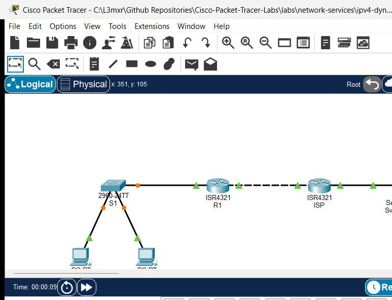

# PTL-0020: IPv4 Dynamic PAT at the Edge

> **Category:** network-services · **Difficulty:** intermediate · **Lab ID:** PTL-0020 · **Document:** reviewed · **Simulator:** tested pass

Network Address Translation (NAT) is an essential technology in modern IPv4 networks designed to conserve the global public IPv4 address space and provide network perimeter security. While Static NAT provides a one-to-one mapping and Dynamic NAT maps private hosts to a finite pool of public addresses, **Port Address Translation (PAT)**—also known as **NAT Overload**—enables thousands of internal private hosts to share a single registered public IP address simultaneously. PAT achieves this multiplexing by tracking distinct Layer 4 transport-layer port numbers (TCP and UDP) and ICMP query identifiers for each outbound conversation.

In this laboratory, you will configure and verify dynamic PAT on an enterprise Cisco ISR 4321 edge router. You will define a standard access control list (ACL) to match RFC 1918 private branch traffic, designate inside and outside NAT interfaces, activate dynamic PAT using interface overloading, and verify translation table operation against a simulated external Internet service.

---

## Learning Objectives

- Differentiate between Static NAT, Dynamic NAT, and Port Address Translation (NAT Overload).
- Configure a standard Cisco IOS Access Control List (ACL) to identify internal private source traffic eligible for address translation.
- Designate inside and outside NAT boundaries using the `ip nat inside` and `ip nat outside` interface configuration commands.
- Configure dynamic Port Address Translation using the `ip nat inside source list <acl> interface <interface> overload` command.
- Inspect and interpret active address translations using `show ip nat translations`.
- Analyze operational NAT statistics, pool utilization, and translation counters using `show ip nat statistics`.
- Troubleshoot common NAT edge issues including missing interface designations, ACL mismatches, and asymmetric return routing.

---

## Prerequisites

- Understanding of IPv4 addressing, subnetting, and default gateway concepts.
- Familiarity with Cisco IOS router configuration and basic interface management.
- Completion of **PTL-0013: Standard and Extended Access Control Lists** (or solid understanding of standard ACL matching syntax).
- Cisco Packet Tracer 8.2 or newer (Packet Tracer 9.0+ verified).

---

## Topology



The topology represents an enterprise branch office connected across a WAN transit link to a simulated Internet Service Provider (ISP) and an external public server:

```text
[PC-A]──Fa0 ───── Fa0/1──[Switch S1]──Gi0/1 ───── Gi0/0/0──[Router R1] (Edge PAT)
(192.168.10.10)          (Branch LAN)                       │ Gi0/0/1 (203.0.113.1/30)
                                                             │ (WAN Transit Link)
[PC-B]──Fa0 ───── Fa0/2──────────────────────────────────────┘ Gi0/0/0 (203.0.113.2/30)
(192.168.10.20)                                            [Router ISP]
                                                             │ Gi0/0/1 (198.51.100.1/24)
                                                             │ (Public Server Subnet)
                                                           [Server Svr-Public]
                                                             (198.51.100.10)
```

| Device Name | Model | Interface | Connected Device | Neighbor Interface | Network Role |
|---|---|---|---|---|---|
| **R1** | Cisco ISR 4321 | GigabitEthernet0/0/0 | Switch S1 | GigabitEthernet0/1 | Inside Branch LAN Gateway (`192.168.10.1/24`) |
| **R1** | Cisco ISR 4321 | GigabitEthernet0/0/1 | Router ISP | GigabitEthernet0/0/0 | Outside WAN Transit Link (`203.0.113.1/30`) |
| **ISP** | Cisco ISR 4321 | GigabitEthernet0/0/0 | Router R1 | GigabitEthernet0/0/1 | ISP Customer Uplink (`203.0.113.2/30`) |
| **ISP** | Cisco ISR 4321 | GigabitEthernet0/0/1 | Svr-Public | FastEthernet0 | Public Server LAN (`198.51.100.1/24`) |
| **Switch S1** | Catalyst 2960-24TT | FastEthernet0/1 | PC-A | FastEthernet0 | Branch Access Port (VLAN 1) |
| **Switch S1** | Catalyst 2960-24TT | FastEthernet0/2 | PC-B | FastEthernet0 | Branch Access Port (VLAN 1) |
| **Switch S1** | Catalyst 2960-24TT | GigabitEthernet0/1 | Router R1 | GigabitEthernet0/0/0 | Trunk/Access Uplink to R1 |
| **PC-A** | PC-PT | FastEthernet0 | Switch S1 | FastEthernet0/1 | Inside Workstation A |
| **PC-B** | PC-PT | FastEthernet0 | Switch S1 | FastEthernet0/2 | Inside Workstation B |
| **Svr-Public** | Server-PT | FastEthernet0 | Router ISP | GigabitEthernet0/0/1 | Simulated Public Web/Application Server |

---

## Addressing Table

| Device | Interface | IPv4 Address | Subnet Mask | Default Gateway | NAT Domain |
|---|---|---|---|---|---|
| **R1** | `Gi0/0/0` | `192.168.10.1` | `255.255.255.0` | N/A | Inside (`ip nat inside`) |
| **R1** | `Gi0/0/1` | `203.0.113.1` | `255.255.255.252` | N/A | Outside (`ip nat outside`) |
| **ISP** | `Gi0/0/0` | `203.0.113.2` | `255.255.255.252` | N/A | External ISP WAN |
| **ISP** | `Gi0/0/1` | `198.51.100.1` | `255.255.255.0` | N/A | External Server Gateway |
| **S1** | `Vlan1` | `192.168.10.2` | `255.255.255.0` | `192.168.10.1` | Inside Management |
| **PC-A** | `FastEthernet0` | `192.168.10.10` | `255.255.255.0` | `192.168.10.1` | Inside Private Host |
| **PC-B** | `FastEthernet0` | `192.168.10.20` | `255.255.255.0` | `192.168.10.1` | Inside Private Host |
| **Svr-Public** | `FastEthernet0` | `198.51.100.10` | `255.255.255.0` | `198.51.100.1` | Outside Public Destination |

---

## Lab Tasks

1. Verify physical cabling and existing baseline IP addressing on all devices in the starter topology.
2. Confirm local intra-subnet connectivity: verify that PC-A and PC-B can successfully ping default gateway R1 (`192.168.10.1`).
3. Attempt an initial ping from PC-A to public server `198.51.100.10` and observe that it fails due to the absence of NAT.
4. On Edge Router R1, configure a standard Access Control List (numbered ACL `1`) to permit outbound traffic from the private subnet `192.168.10.0/24`.
5. Designate interface `GigabitEthernet0/0/0` as the inside NAT interface (`ip nat inside`).
6. Designate interface `GigabitEthernet0/0/1` as the outside NAT interface (`ip nat outside`).
7. Configure dynamic Port Address Translation using the `ip nat inside source list 1 interface GigabitEthernet0/0/1 overload` command.
8. Verify outbound connectivity: execute pings from PC-A and PC-B to public server `198.51.100.10` and verify successful communication.
9. Inspect the active NAT table on R1 with `show ip nat translations` and verify that both inside local IP addresses share the single outside global interface address (`203.0.113.1`).
10. Verify NAT operation counters using `show ip nat statistics`.
11. Test fault conditions and negative scenarios: observe traffic drop when `ip nat inside` is omitted, and verify subnet filtering behavior when the ACL is altered.

---

## Configuration Walkthrough

### 1. Baseline Verification in Starter State
In the starter activity (`assets/starter.pkt`), the interfaces and routing are pre-configured. First verify connectivity between PC-A and its default gateway on R1:
```text
PC-A> ping 192.168.10.1

Pinging 192.168.10.1 with 32 bytes of data:

Reply from 192.168.10.1: bytes=32 time<1ms TTL=255
Reply from 192.168.10.1: bytes=32 time<1ms TTL=255
Reply from 192.168.10.1: bytes=32 time<1ms TTL=255
```

Now ping the public server `198.51.100.10`:
```text
PC-A> ping 198.51.100.10

Pinging 198.51.100.10 with 32 bytes of data:

Request timed out.
Request timed out.
Request timed out.
```
*Why does this fail?* R1 forwards the packet to ISP using its default route (`ip route 0.0.0.0 0.0.0.0 203.0.113.2`). However, because NAT is not active, the packet retains its private source IP (`192.168.10.10`). ISP has no routing entry for RFC 1918 space (`192.168.10.0/24`) and immediately drops return traffic.

### 2. Configure Standard ACL on Edge Router R1
Create a standard ACL permitting the branch private subnet:
```text
R1> enable
R1# configure terminal
R1(config)# access-list 1 permit 192.168.10.0 0.0.0.255
```

### 3. Designate NAT Inside and Outside Boundaries
Specify which interfaces connect to the private inside network and the public outside network:
```text
R1(config)# interface GigabitEthernet0/0/0
R1(config-if)# description Inside Private Branch LAN
R1(config-if)# ip nat inside
R1(config-if)# exit

R1(config)# interface GigabitEthernet0/0/1
R1(config-if)# description Outside Uplink to ISP
R1(config-if)# ip nat outside
R1(config-if)# exit
```

### 4. Enable Dynamic PAT (Overload)
Bind the access list to the outside interface with the `overload` keyword:
```text
R1(config)# ip nat inside source list 1 interface GigabitEthernet0/0/1 overload
R1(config)# end
R1# copy running-config startup-config
```

---

## Verification

### 1. Verify Outbound PAT Connectivity from Workstations
From PC-A, ping external public server `198.51.100.10`:
```text
PC-A> ping 198.51.100.10

Pinging 198.51.100.10 with 32 bytes of data:

Reply from 198.51.100.10: bytes=32 time<1ms TTL=126
Reply from 198.51.100.10: bytes=32 time<1ms TTL=126
Reply from 198.51.100.10: bytes=32 time<1ms TTL=126
```

From PC-B, generate concurrent outbound traffic to `198.51.100.10`:
```text
PC-B> ping 198.51.100.10

Pinging 198.51.100.10 with 32 bytes of data:

Reply from 198.51.100.10: bytes=32 time<1ms TTL=126
Reply from 198.51.100.10: bytes=32 time<1ms TTL=126
Reply from 198.51.100.10: bytes=32 time<1ms TTL=126
```

### 2. Inspect Active Translations on Edge Router R1
Execute `show ip nat translations` on R1:
```text
R1# show ip nat translations
Pro  Inside global     Inside local       Outside local      Outside global
icmp 203.0.113.1:5     192.168.10.20:5    198.51.100.10:5    198.51.100.10:5
icmp 203.0.113.1:6     192.168.10.20:6    198.51.100.10:6    198.51.100.10:6
icmp 203.0.113.1:7     192.168.10.20:7    198.51.100.10:7    198.51.100.10:7
```
**NAT Terminology Review:**
- **Inside Local:** The private IPv4 address assigned to a host on the inside network (`192.168.10.20`).
- **Inside Global:** The registered public IPv4 address that represents one or more inside local hosts to the outside world (`203.0.113.1`).
- **Outside Local:** The IPv4 address of an outside host as known to hosts on the inside network (`198.51.100.10`).
- **Outside Global:** The registered public IPv4 address assigned to a host on the outside network (`198.51.100.10`).

### 3. Inspect NAT Statistics
```text
R1# show ip nat statistics
Total translations: 4 (0 static, 4 dynamic, 4 extended)
Outside Interfaces: GigabitEthernet0/0/1
Inside Interfaces: GigabitEthernet0/0/0
Hits: 13  Misses: 14
Expired translations: 9
Dynamic mappings:
R1#
```

---

## Troubleshooting

- **Problem:** PC-A receives `Request timed out` when attempting to access the public server.
  - **Check 1:** Confirm interface roles with `show ip nat statistics`. Ensure `GigabitEthernet0/0/0` is listed under `Inside Interfaces` and `GigabitEthernet0/0/1` is listed under `Outside Interfaces`.
  - **Check 2:** Verify that the ACL permits the client's IP. If `access-list 1` permits `192.168.10.0 0.0.0.255`, verify using `show ip access-lists` that the packet match counters are incrementing.
  - **Check 3:** Verify default routing on R1. R1 must have `ip route 0.0.0.0 0.0.0.0 203.0.113.2` so translated packets can reach ISP.
- **Problem:** Some hosts in the branch can connect, while others time out.
  - **Check:** Ensure the ACL wildcard mask encompasses the entire subnet (`0.0.0.255`). A host mask (`0.0.0.0`) will only translate the single specified IP address.
- **Problem:** Stale translation table entries block immediate testing after a configuration change.
  - **Fix:** Clear existing dynamic translation table entries in privileged EXEC mode using `clear ip nat translation *`.

---

## Key Takeaways

- Port Address Translation (NAT Overload) multiplexes multiple private IP addresses onto a single public IP address using Layer 4 port numbers.
- Dynamic PAT is unidirectional: inside hosts initiate connections to outside servers, and the router dynamically creates stateful translation table entries to route return traffic back to the originator.
- External hosts cannot initiate unsolicited connections to inside private hosts across dynamic PAT without static port forwarding.
- The `overload` keyword is mandatory; omitting it configures traditional Dynamic NAT, which requires a one-to-one public IP address for each concurrent host and quickly exhausts public pools.
- Standard ACLs used with NAT define *interesting traffic* to translate; they do not filter packets entering or exiting the interfaces unless also applied with `ip access-group`.

---

## References

- IETF, *RFC 3022: Traditional IP Network Address Translator (Traditional NAT)*: [RFC 3022](https://datatracker.ietf.org/doc/html/rfc3022).
- Cisco Systems, *Verifying and Troubleshooting Network Address Translation*: [Cisco NAT Verification Guide](https://www.cisco.com/c/en/us/support/docs/ip/network-address-translation-nat/13772-12.html).
- IETF, *RFC 1918: Address Allocation for Private Internets*: [RFC 1918](https://datatracker.ietf.org/doc/html/rfc1918).

---

## Files and Validation Status

- Starter Packet Tracer File: [assets/starter.pkt](assets/starter.pkt)
- Completed Packet Tracer File: [assets/completed.pkt](assets/completed.pkt)
- Topology Diagram: [assets/topology.png](assets/topology.png)
- Configuration Scripts: [configs/R1.txt](configs/R1.txt), [configs/ISP.txt](configs/ISP.txt), [configs/S1.txt](configs/S1.txt)
- Verification Guide: [verification.md](verification.md)
- Documentation Quality: **REVIEWED** (Follows canonical 11-heading structure; technically validated against Cisco IOS documentation).
- Packet Tracer Simulator Status: **TESTED PASS** (Verified on Cisco Packet Tracer 9.0.1; authentic starter/completed `.pkt` generated and reopened; telemetry recorded in [PTL-0020-SIMULATOR-RESULTS.md](../../../AI_AGENT_GUIDE/state/PTL-0020-SIMULATOR-RESULTS.md)).

> Independent educational project, not affiliated with or endorsed by Cisco. Lab configurations are provided for educational simulation purposes only.

