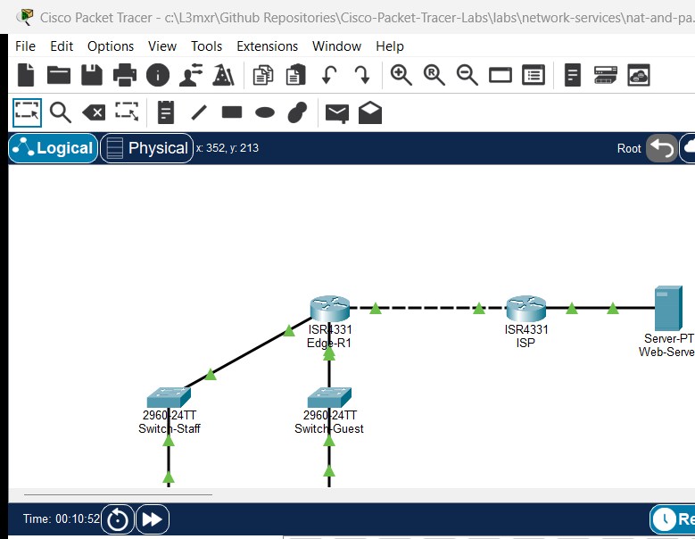

# PTL-0043: NAT and PAT Troubleshooting Challenge

> **Category:** network-services · **Difficulty:** intermediate · **Lab ID:** PTL-0043 · **Document:** reviewed · **Simulator:** tested pass

Network Address Translation (NAT) and Port Address Translation (PAT / NAT Overload) are foundational edge routing technologies that conserve global public IPv4 addresses and secure internal network boundaries. In an enterprise environment, an edge router translates private RFC 1918 IPv4 addresses into a single or pooled public IPv4 address, multiplexing thousands of concurrent connections using Layer 4 transport port numbers (TCP and UDP) and ICMP query identifiers.

When NAT or PAT fails, internal users experience complete loss of Internet access, inability to reach cloud services, or intermittent service degradation. Because NAT operates silently at the interface boundary between inside private networks and outside public transit links, identifying root causes requires a systematic, structured troubleshooting methodology.

Common NAT and PAT implementation errors encountered in enterprise networks include:
- **Interface NAT Boundary Misconfigurations:** Cisco IOS requires that each participating interface be explicitly designated as either `ip nat inside` or `ip nat outside`. If an internal interface lacks the `ip nat inside` command, outbound traffic arriving on that interface is routed without translation. Conversely, if an external WAN interface is mistakenly configured with `ip nat inside` or omits `ip nat outside`, the router never triggers the inside-to-outside translation engine, leaking untranslated private packets to upstream Internet Service Providers (ISPs) where they are promptly discarded.
- **Translation ACL Filtering and Subnet Mismatches:** Dynamic NAT and PAT rely on standard or extended Access Control Lists (ACLs) to classify which internal private source addresses are eligible for address translation. Common errors include typos in the network ID (e.g., configuring `192.168.1.0/24` instead of `192.168.10.0/24`), omitting newly added department subnets (such as guest or IoT VLANs), or confusing wildcard masks with subnet masks. Packets that fail to match the translation ACL bypass NAT and are transmitted with private source addresses.
- **NAT Overload Syntax and Parameter Omissions:** Omitting the `overload` keyword from the `ip nat inside source list <acl> interface <interface> overload` command restricts the router to one-to-one dynamic NAT. In this failure mode, the very first internal host exhausts the single public IP address, and all subsequent internal hosts are denied connectivity until the translation timer expires.
- **Routing and Upstream Provider Asymmetry:** NAT operates in tandem with routing tables. If the default route (`ip route 0.0.0.0 0.0.0.0 <next-hop>`) is missing or pointing to an invalid next hop, translated packets cannot depart the autonomous system. Furthermore, upstream provider routers do not route private RFC 1918 address space; any packet leaving the edge router without translation cannot receive return traffic.

In this troubleshooting challenge, you will assume the role of an enterprise network engineer responding to a high-priority ticket: users in both the Staff Department and the Guest Wireless network report total loss of external Internet and web connectivity. You will inspect operational state tables, audit access lists and interface boundaries, diagnose multiple compounding configuration errors on edge router `Edge-R1`, implement remediation steps, and verify full two-way communication using live packet probes and translation tables.

---

## Learning Objectives

- Apply structured troubleshooting methodologies to diagnose NAT and PAT failures in a multi-subnet enterprise branch topology.
- Inspect and interpret the Cisco IOS NAT translation table using `show ip nat translations`.
- Analyze operational translation counters, pool utilization, and interface assignments using `show ip nat statistics`.
- Identify and correct interface NAT domain errors (`ip nat inside` and `ip nat outside`).
- Diagnose standard Access Control List (ACL) errors that prevent private subnets from matching dynamic PAT rules.
- Remediate and verify dynamic Port Address Translation (NAT Overload) sharing a single public WAN interface address (`203.0.113.1/30`).
- Validate end-to-end transport layer communication for ICMP echo and TCP web traffic (HTTP port 80).

---

## Prerequisites

- Thorough understanding of IPv4 addressing, RFC 1918 private address ranges, and default gateway routing concepts.
- Completion of **PTL-0020: IPv4 Dynamic PAT at the Edge** or equivalent hands-on experience with Cisco IOS NAT/PAT configuration.
- Familiarity with standard Access Control Lists (ACLs) and wildcard mask calculation.
- Cisco Packet Tracer 8.2 or newer (Packet Tracer 9.0+ verified).

---

## Topology



The topology models an enterprise branch network connected across an ISP transit link to a public internet web server:

```text
[PC-Staff] ── Fa0 ──── Fa0/1 ── [Switch-Staff] ── Gi0/1 ──── Gi0/0/0 ──┐
(192.168.10.10)                 (Staff Access)                         │
                                                                       ▼
                                                                  [Edge-R1] (PAT Gateway)
                                                                       ▲  Gi0/0/2 (203.0.113.1/30)
                                                                       │  (WAN Transit Link)
[Laptop-Guest] ─ Fa0 ── Fa0/1 ─ [Switch-Guest] ── Gi0/1 ──── Gi0/0/1 ──┘  │ (Copper Cross)
(192.168.20.10)                 (Guest Access)                           ▼  Gi0/0/0 (203.0.113.2/30)
                                                                       [ISP Router]
                                                                          │ Gi0/0/1 (198.51.100.1/24)
                                                                          │ (Public Server LAN)
                                                                          ▼
                                                                    [Web-Server]
                                                                    (198.51.100.10)
```

| Device Name | Model | Interface | Connected Device | Neighbor Interface | Network Role |
|---|---|---|---|---|---|
| **Edge-R1** | Cisco ISR 4331 | `Gi0/0/0` | Switch-Staff | `Gi0/1` | Staff LAN Gateway (`192.168.10.1/24`, NAT Inside) |
| **Edge-R1** | Cisco ISR 4331 | `Gi0/0/1` | Switch-Guest | `Gi0/1` | Guest LAN Gateway (`192.168.20.1/24`, NAT Inside) |
| **Edge-R1** | Cisco ISR 4331 | `Gi0/0/2` | ISP | `Gi0/0/0` | WAN Transit Link (`203.0.113.1/30`, NAT Outside) |
| **ISP** | Cisco ISR 4331 | `Gi0/0/0` | Edge-R1 | `Gi0/0/2` | ISP WAN Gateway (`203.0.113.2/30`) |
| **ISP** | Cisco ISR 4331 | `Gi0/0/1` | Web-Server | `Fa0` | Simulated Internet LAN (`198.51.100.1/24`) |
| **Switch-Staff** | Catalyst 2960-24TT | `Fa0/1` | PC-Staff | `Fa0` | Staff LAN Access Port (VLAN 1) |
| **Switch-Staff** | Catalyst 2960-24TT | `Gi0/1` | Edge-R1 | `Gi0/0/0` | Uplink to Edge Router |
| **Switch-Guest** | Catalyst 2960-24TT | `Fa0/1` | Laptop-Guest | `Fa0` | Guest LAN Access Port (VLAN 1) |
| **Switch-Guest** | Catalyst 2960-24TT | `Gi0/1` | Edge-R1 | `Gi0/0/1` | Uplink to Edge Router |
| **PC-Staff** | PC-PT | `Fa0` | Switch-Staff | `Fa0/1` | Corporate Workstation (`192.168.10.10/24`) |
| **Laptop-Guest** | Laptop-PT | `Fa0` | Switch-Guest | `Fa0/1` | Visitor Laptop (`192.168.20.10/24`) |
| **Web-Server** | Server-PT | `Fa0` | ISP | `Gi0/0/1` | Public Web Server (`198.51.100.10/24`, HTTP port 80) |

---

## Addressing Table

| Device | Interface | IPv4 Address | Subnet Mask | Default Gateway | NAT Role |
|---|---|---|---|---|---|
| **Edge-R1** | `Gi0/0/0` | `192.168.10.1` | `255.255.255.0` | N/A | Inside (`ip nat inside`) |
| **Edge-R1** | `Gi0/0/1` | `192.168.20.1` | `255.255.255.0` | N/A | Inside (`ip nat inside`) |
| **Edge-R1** | `Gi0/0/2` | `203.0.113.1` | `255.255.255.252` | N/A | Outside (`ip nat outside`) |
| **ISP** | `Gi0/0/0` | `203.0.113.2` | `255.255.255.252` | N/A | Upstream Provider WAN |
| **ISP** | `Gi0/0/1` | `198.51.100.1` | `255.255.255.0` | N/A | Public Server Gateway |
| **Switch-Staff**| `Vlan1` | `192.168.10.2` | `255.255.255.0` | `192.168.10.1` | Inside Management |
| **Switch-Guest**| `Vlan1` | `192.168.20.2` | `255.255.255.0` | `192.168.20.1` | Inside Management |
| **PC-Staff** | `FastEthernet0`| `192.168.10.10`| `255.255.255.0` | `192.168.10.1` | Inside Local Host |
| **Laptop-Guest**| `FastEthernet0`| `192.168.20.10`| `255.255.255.0` | `192.168.20.1` | Inside Local Host |
| **Web-Server** | `FastEthernet0`| `198.51.100.10`| `255.255.255.0` | `198.51.100.1` | Outside Global Destination |

---

## Lab Tasks

1. **Verify Baseline Local Connectivity:** Open `assets/starter.pkt` and confirm that `PC-Staff` can reach its default gateway (`192.168.10.1`) and `Laptop-Guest` can reach its default gateway (`192.168.20.1`).
2. **Reproduce the Outage:** Attempt to ping the public server (`198.51.100.10`) from both `PC-Staff` and `Laptop-Guest`. Record the failure symptoms and observe that external traffic is dropped.
3. **Audit NAT Interface Roles:** On `Edge-R1`, inspect interface NAT boundaries using `show ip nat statistics` and `show running-config interface`. Identify which interfaces have missing or incorrect `ip nat inside` and `ip nat outside` designations.
4. **Audit Translation Access List:** Inspect standard ACL `1` using `show access-lists 1`. Identify subnet mismatches, typos, and missing network statements that prevent internal hosts from being translated.
5. **Remediate NAT Interface Boundaries:** Reconfigure `Edge-R1` interfaces so that both internal LAN gateways (`Gi0/0/0` and `Gi0/0/1`) are designated as inside NAT interfaces and WAN interface `Gi0/0/2` is designated as the outside NAT interface.
6. **Remediate the Translation ACL:** Replace ACL `1` with statements that permit outbound traffic from both the Staff subnet (`192.168.10.0/24`) and the Guest subnet (`192.168.20.0/24`).
7. **Verify Dynamic PAT Configuration:** Confirm that dynamic PAT overload is active on `Edge-R1` referencing ACL `1` and interface `GigabitEthernet0/0/2`.
8. **Verify Outbound Traffic & Translations:** Execute pings and HTTP connections from both internal workstations to `Web-Server` (`198.51.100.10`).
9. **Analyze Real-Time NAT State Tables:** Inspect `show ip nat translations` and `show ip nat statistics` to verify concurrent multiplexing across port numbers and confirm that hit counters increment.
10. **Persist the Remediated Configuration:** Save running configurations to NVRAM on `Edge-R1` and verify reboot persistence.

---

## Configuration Walkthrough

### 1. Reproducing the Outbound Failure in Starter State

Begin by loading `assets/starter.pkt`. Verify that internal hosts can communicate with their local default gateways:

```text
PC-Staff> ping 192.168.10.1

Pinging 192.168.10.1 with 32 bytes of data:

Reply from 192.168.10.1: bytes=32 time<1ms TTL=255
Reply from 192.168.10.1: bytes=32 time<1ms TTL=255
Reply from 192.168.10.1: bytes=32 time<1ms TTL=255
Reply from 192.168.10.1: bytes=32 time<1ms TTL=255

Ping statistics for 192.168.10.1:
    Packets: Sent = 4, Received = 4, Lost = 0 (0% loss)
```

Now attempt to reach the external web server at `198.51.100.10`:

```text
PC-Staff> ping 198.51.100.10

Pinging 198.51.100.10 with 32 bytes of data:

Request timed out.
Request timed out.
Request timed out.
Request timed out.

Ping statistics for 198.51.100.10:
    Packets: Sent = 4, Received = 0, Lost = 4 (100% loss)
```

The ping fails completely. Similarly, tests from `Laptop-Guest` to `198.51.100.10` result in 100% loss.

### 2. Investigating NAT Operational State on Edge-R1

Log into `Edge-R1` and inspect the active NAT translation table:

```text
Edge-R1> enable
Edge-R1# show ip nat translations
```

The command returns completely blank. No translations exist in the table. Next, inspect the NAT statistics:

```text
Edge-R1# show ip nat statistics
Total translations: 0 (0 static, 0 dynamic, 0 extended)
Outside Interfaces: 
Inside Interfaces: GigabitEthernet0/0/0 , GigabitEthernet0/0/2
Hits: 0  Misses: 0
Expired translations: 0
Dynamic mappings:
-- Inside Source
access-list 1 pool GigabitEthernet0/0/2 refcount 0
```

Notice the critical anomalies:
1. **Outside Interfaces is completely empty.**
2. **`GigabitEthernet0/0/2` (the WAN uplink) is listed under Inside Interfaces!**
3. **`GigabitEthernet0/0/1` (the Guest LAN) is not listed anywhere!**

Because `Edge-R1` has no outside interface, traffic exiting `Gi0/0/2` never traverses an inside-to-outside boundary. The NAT translation engine never triggers. Furthermore, packets arriving from the Guest LAN on `Gi0/0/1` are not marked as inside traffic.

### 3. Auditing the Translation Access List

Now inspect standard Access Control List 1:

```text
Edge-R1# show access-lists 1
Standard IP access list 1
    permit 192.168.1.0 0.0.0.255
```

Notice the second critical flaw:
- ACL `1` permits `192.168.1.0/24`. However, the Staff LAN uses `192.168.10.0/24`, and the Guest LAN uses `192.168.20.0/24`.
- There is a typo in the third octet (`1` instead of `10`), and the Guest subnet is completely absent.
- Even if the interface roles were corrected, internal packets would fail to match ACL `1` and would be denied translation by the implicit deny at the end of the access list.

### 4. Remediating Interface NAT Roles

Enter interface configuration mode to repair the interface NAT designations:

```cisco
Edge-R1# configure terminal
Enter configuration commands, one per line.  End with CNTL/Z.

! Remove the incorrect inside designation from WAN interface Gi0/0/2 and assign outside
Edge-R1(config)# interface GigabitEthernet0/0/2
Edge-R1(config-if)# no ip nat inside
Edge-R1(config-if)# ip nat outside
Edge-R1(config-if)# exit

! Assign the inside NAT role to Guest LAN interface Gi0/0/1
Edge-R1(config)# interface GigabitEthernet0/0/1
Edge-R1(config-if)# ip nat inside
Edge-R1(config-if)# exit

! Verify Gi0/0/0 is also designated inside
Edge-R1(config)# interface GigabitEthernet0/0/0
Edge-R1(config-if)# ip nat inside
Edge-R1(config-if)# exit
```

### 5. Remediating Translation Access List 1

Remove the erroneous ACL `1` statement and configure explicit permit entries for both internal subnets:

```cisco
Edge-R1(config)# no access-list 1
Edge-R1(config)# access-list 1 permit 192.168.10.0 0.0.0.255
Edge-R1(config)# access-list 1 permit 192.168.20.0 0.0.0.255
```

### 6. Ensuring Dynamic PAT Overload Statement

Verify that the dynamic overload statement is properly bound:

```cisco
Edge-R1(config)# ip nat inside source list 1 interface GigabitEthernet0/0/2 overload
Edge-R1(config)# end
Edge-R1#
```

### 7. Saving Configuration to NVRAM

Save the verified configuration to NVRAM so it persists across reboots:

```cisco
Edge-R1# write memory
Building configuration...
[OK]
```

---

## Verification

### 1. Confirming Remediated NAT Interface Roles & ACL

Execute `show ip nat statistics` on `Edge-R1` to confirm that all three interfaces are correctly bound:

```text
Edge-R1# show ip nat statistics
Total translations: 0 (0 static, 0 dynamic, 0 extended)
Outside Interfaces: GigabitEthernet0/0/2
Inside Interfaces: GigabitEthernet0/0/0 , GigabitEthernet0/0/1
Hits: 0  Misses: 0
Expired translations: 0
Dynamic mappings:
-- Inside Source
access-list 1 pool GigabitEthernet0/0/2 refcount 0
```

Verify that ACL `1` contains both subnets:

```text
Edge-R1# show access-lists 1
Standard IP access list 1
    permit 192.168.10.0 0.0.0.255
    permit 192.168.20.0 0.0.0.255
```

### 2. Testing Outbound ICMP Traffic from Both LANs

From `PC-Staff` (`192.168.10.10`), ping public server `198.51.100.10`:

```text
PC-Staff> ping 198.51.100.10

Pinging 198.51.100.10 with 32 bytes of data:

Reply from 198.51.100.10: bytes=32 time<1ms TTL=126
Reply from 198.51.100.10: bytes=32 time<1ms TTL=126
Reply from 198.51.100.10: bytes=32 time<1ms TTL=126
Reply from 198.51.100.10: bytes=32 time<1ms TTL=126

Ping statistics for 198.51.100.10:
    Packets: Sent = 4, Received = 4, Lost = 0 (0% loss),
Approximate round trip times in milli-seconds:
    Minimum = 0ms, Maximum = 0ms, Average = 0ms
```

From `Laptop-Guest` (`192.168.20.10`), ping public server `198.51.100.10`:

```text
Laptop-Guest> ping 198.51.100.10

Pinging 198.51.100.10 with 32 bytes of data:

Reply from 198.51.100.10: bytes=32 time<1ms TTL=126
Reply from 198.51.100.10: bytes=32 time<1ms TTL=126
Reply from 198.51.100.10: bytes=32 time<1ms TTL=126
Reply from 198.51.100.10: bytes=32 time<1ms TTL=126

Ping statistics for 198.51.100.10:
    Packets: Sent = 4, Received = 4, Lost = 0 (0% loss),
Approximate round trip times in milli-seconds:
    Minimum = 0ms, Maximum = 0ms, Average = 0ms
```

### 3. Testing Outbound TCP/HTTP Web Services

From `PC-Staff`, test Layer 4 TCP port translation by initiating a telnet probe to port 80 of `Web-Server`:

```text
PC-Staff> telnet 198.51.100.10 80
Trying 198.51.100.10 ...Open
```

The `Open` prompt confirms that the TCP three-way handshake completed successfully across the PAT gateway.

### 4. Inspecting the Active NAT Translation Table

Return to `Edge-R1` and execute `show ip nat translations`:

```text
Edge-R1# show ip nat translations
Pro  Inside global     Inside local       Outside local      Outside global
icmp 203.0.113.1:1024  192.168.20.10:5    198.51.100.10:5    198.51.100.10:1024
icmp 203.0.113.1:1025  192.168.20.10:6    198.51.100.10:6    198.51.100.10:1025
icmp 203.0.113.1:1026  192.168.10.10:7    198.51.100.10:7    198.51.100.10:1026
icmp 203.0.113.1:1027  192.168.10.10:8    198.51.100.10:8    198.51.100.10:1027
tcp 203.0.113.1:1025   192.168.10.10:1025 198.51.100.10:80   198.51.100.10:80
```

Notice how both private hosts (`192.168.10.10` and `192.168.20.10`) share the identical Inside Global address (`203.0.113.1`), with unique Layer 4 port numbers allocated to each session.

### 5. Inspecting NAT Hit Counters and ACL Matches

Verify that NAT hit counters and ACL match counts increment:

```text
Edge-R1# show access-lists 1
Standard IP access list 1
    permit 192.168.10.0 0.0.0.255 (8 match(es))
    permit 192.168.20.0 0.0.0.255 (8 match(es))

Edge-R1# show ip nat statistics
Total translations: 5 (0 static, 5 dynamic, 5 extended)
Outside Interfaces: GigabitEthernet0/0/2
Inside Interfaces: GigabitEthernet0/0/0 , GigabitEthernet0/0/1
Hits: 20  Misses: 17
Expired translations: 0
Dynamic mappings:
-- Inside Source
access-list 1 pool GigabitEthernet0/0/2 refcount 5
```

---

## Troubleshooting

### Diagnostic Decision Flowchart

```text
Outbound NAT/PAT Translation Fails?
  |
  +---> 1. Check Interface NAT Boundaries:
  |        Execute 'show ip nat statistics'.
  |        Are inside LAN interfaces listed under 'Inside Interfaces'?
  |        Is the WAN interface listed under 'Outside Interfaces'?
  |        --> FIX: Enter interface configuration mode and assign 'ip nat inside'
  |                 to private LAN gateways and 'ip nat outside' to the WAN transit port.
  |
  +---> 2. Check Translation ACL:
  |        Execute 'show access-lists'.
  |        Does the ACL include permits for ALL internal subnets?
  |        Are there typos in the network address or wildcard mask?
  |        --> FIX: Update standard ACL with 'permit <subnet> <wildcard>' for each LAN.
  |
  +---> 3. Check Dynamic NAT Overload Statement:
  |        Execute 'show running-config | include ip nat inside source'.
  |        Does it include the 'overload' keyword?
  |        --> FIX: Configure 'ip nat inside source list <acl> interface <wan> overload'.
  |
  +---> 4. Verify Edge Default Route:
           Execute 'show ip route static'.
           Does a default route '0.0.0.0/0' exist pointing to the ISP next-hop?
           --> FIX: Configure 'ip route 0.0.0.0 0.0.0.0 <isp-next-hop>'.
```

### Common Faults and Solutions

| Symptom | Probable Cause | Diagnostic Command | Remediation |
|---|---|---|---|
| No translations in table, 0 outside interfaces | WAN interface missing `ip nat outside` or configured as inside | `show ip nat statistics` | Configure `no ip nat inside` and `ip nat outside` on WAN interface. |
| One subnet works, another subnet fails | LAN interface missing `ip nat inside` or subnet absent from ACL | `show access-lists 1`, `show ip nat statistics` | Add `ip nat inside` to interface; append subnet permit to standard ACL. |
| Single host works, all subsequent hosts fail | Omitted `overload` keyword in NAT statement | `show running-config | include ip nat` | Re-enter NAT command with `overload` keyword appended. |
| Pings fail, translations exist in table | Missing return routing on upstream provider or server gateway | `show ip nat translations`, ping tests | Ensure default gateway on endpoints and server point to their respective routers. |

---

## Key Takeaways

- **Explicit Boundary Enforcement:** Cisco IOS requires deliberate designation of both inside (`ip nat inside`) and outside (`ip nat outside`) interfaces; the translation engine will never trigger without crossing these boundaries.
- **Access List Classification Accuracy:** The translation ACL acts as the interesting traffic filter. Any packet failing to match an explicit permit statement will hit the implicit deny and bypass the NAT engine untranslated.
- **Port Multiplexing via Overload:** The `overload` keyword enables Port Address Translation (PAT), allowing thousands of concurrent private connections to share a single public IPv4 address by tracking unique Layer 4 transport port numbers.
- **Diagnostic Command Synergy:** Effective NAT troubleshooting relies on three core commands: `show ip nat translations` (active state table), `show ip nat statistics` (operational counters and interface roles), and `show access-lists` (packet match counts).

---

## References

- [IETF RFC 3022 — Traditional IP Network Address Translator (Traditional NAT)](https://datatracker.ietf.org/doc/html/rfc3022)
- [IETF RFC 1918 — Address Allocation for Private Internets](https://datatracker.ietf.org/doc/html/rfc1918)
- [Cisco IOS IP Addressing Services Configuration Guide: Configuring NAT](https://www.cisco.com/c/en/us/td/docs/ios-xml/ios/ipaddr_nat/configuration/15-mt/nat-15-mt-book.html)
- [Cisco Support Document 13772: Verifying and Troubleshooting NAT Operation](https://www.cisco.com/c/en/us/support/docs/ip/network-address-translation-nat/13772-12.html)
- [Cisco Support Document 26704: Cisco Network Address Translation FAQ](https://www.cisco.com/c/en/us/support/docs/ip/network-address-translation-nat/26704-nat-faq-00.html)

---

## Files and Validation Status

This laboratory provides verified Cisco Packet Tracer files and configuration artifacts:

- **`assets/starter.pkt`:** Baseline faulted topology with misconfigured NAT boundaries and ACL subnet typos for student troubleshooting.
- **`assets/completed.pkt`:** Fully remediated reference topology with operational dynamic PAT and verified translation table state.
- **`assets/topology.png`:** Visual network topology diagram.
- **`configs/Edge-R1.txt`:** Full sanitized Cisco IOS running configuration for router `Edge-R1`.
- **`configs/ISP.txt`:** Full sanitized Cisco IOS running configuration for upstream router `ISP`.
- **`metadata.json`:** Machine-readable catalog metadata and learning objectives.
- **`verification.md`:** Complete positive and negative test acceptance matrix.
- **`AI_AGENT_GUIDE/state/PTL-0043-SIMULATOR-RESULTS.md`:** Live simulator verification evidence recorded in Packet Tracer 9.0.1.

