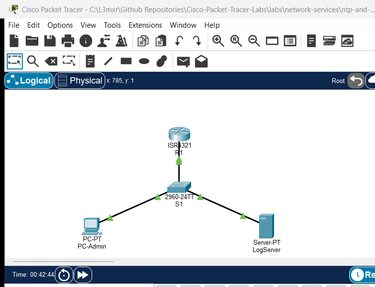

# PTL-0023: NTP and Syslog Network Monitoring

> **Category:** network-services · **Difficulty:** intermediate · **Lab ID:** PTL-0023 · **Document:** reviewed · **Simulator:** tested pass

Network observability and event correlation are fundamental pillars of modern enterprise infrastructure operations. When security incidents, intermittent outages, or configuration errors occur, network engineers rely on system log messages (**Syslog**) generated by routers, switches, and firewalls to reconstruct timelines and diagnose root causes.

However, log messages from distributed devices are nearly useless unless all network nodes share an identical, synchronized time source. If Router A logs an interface failure at 04:12:00 while Firewall B logs a related packet drop at 08:35:10 due to unsynchronized hardware clocks, security analysts cannot correlate the events. The **Network Time Protocol (NTP)** provides hierarchical, microsecond-to-millisecond clock synchronization across IP networks, ensuring that all devices share an authoritative reference time.

In this laboratory, you will configure an enterprise Cisco ISR router (`R1`) to synchronize its system clock with an authoritative time server (`LogServer`) using NTP. You will configure high-precision millisecond log timestamping, establish centralized remote Syslog forwarding over UDP port 514, and verify real-time event transmission and time correlation by triggering administrative interface state transitions.

---

## Learning Objectives

- Explain the critical role of the Network Time Protocol (NTP) and centralized Syslog in enterprise observability and security event correlation.
- Configure a Cisco IOS router as an NTP client synchronized to an authoritative Stratum 1 NTP server.
- Configure high-resolution millisecond datetime timestamps for system logs and debug output using `service timestamps log datetime msec`.
- Direct system logging output to a centralized remote Syslog server daemon using `logging host`.
- Verify NTP client associations, stratum levels, dispersion, and clock synchronization status using `show ntp status` and `show ntp associations`.
- Validate centralized Syslog reception and identify RFC 5424 / Cisco standard log formatting and severity codes.
- Troubleshoot common time synchronization and logging faults, including unreachable time servers and missing timestamp services.

---

## Prerequisites

- Understanding of IPv4 addressing, subnetting, and default gateways.
- Familiarity with Cisco IOS privileged EXEC mode and configuration commands.
- Completion of **PTL-0008: Router Configuration Baseline** or equivalent introductory routing experience.
- Cisco Packet Tracer 8.2 or newer (Packet Tracer 9.0+ verified).

---

## Topology



The topology represents a management LAN segment where an infrastructure router (`R1`) connects via an access switch (`S1`) to an administrative workstation (`PC-Admin`) and a multi-service monitoring host (`LogServer`):

```text
               [R1 Router] (ISR 4321)
               Gi0/0/0 (192.168.1.1/24)
                    │
                    │ Gi0/1
              [Switch S1] (Catalyst 2960)
              Fa0/1 │     │ Fa0/2
        ┌───────────┘     └───────────┐
        │                             │
   [PC-Admin]                    [LogServer]
 (192.168.1.10)                (192.168.1.100)
                              NTP: UDP 123
                              Syslog: UDP 514
```

| Device Name | Model | Interface | Connected Device | Neighbor Interface | Network Role |
|---|---|---|---|---|---|
| **R1** | Cisco ISR 4321 | GigabitEthernet0/0/0 | Switch S1 | GigabitEthernet0/1 | Gateway & Monitored Device (`192.168.1.1/24`) |
| **R1** | Cisco ISR 4321 | GigabitEthernet0/0/1 | None | N/A | Diagnostic / Event Simulation Link |
| **Switch S1** | Catalyst 2960-24TT | GigabitEthernet0/1 | R1 | GigabitEthernet0/0/0 | Uplink to Gateway Router |
| **Switch S1** | Catalyst 2960-24TT | FastEthernet0/1 | PC-Admin | FastEthernet0 | Access Port for Admin Host |
| **Switch S1** | Catalyst 2960-24TT | FastEthernet0/2 | LogServer | FastEthernet0 | Access Port for Monitoring Server |
| **PC-Admin** | PC-PT | FastEthernet0 | Switch S1 | FastEthernet0/1 | Management Client Workstation |
| **LogServer** | Server-PT | FastEthernet0 | Switch S1 | FastEthernet0/2 | NTP Reference Server & Syslog Daemon |

---

## Addressing Table

| Device | Interface | IPv4 Address | Subnet Mask | Default Gateway | Service Daemons |
|---|---|---|---|---|---|
| **R1** | `Gi0/0/0` | `192.168.1.1` | `255.255.255.0` | N/A | NTP Client, Syslog Source |
| **R1** | `Gi0/0/1` | Unnumbered | N/A | N/A | Event Simulation (Admin Down) |
| **Switch S1** | `Vlan1` | `192.168.1.2` | `255.255.255.0` | `192.168.1.1` | Switch SVI Management |
| **PC-Admin** | `FastEthernet0` | `192.168.1.10` | `255.255.255.0` | `192.168.1.1` | Administrative Host |
| **LogServer** | `FastEthernet0` | `192.168.1.100` | `255.255.255.0` | `192.168.1.1` | NTP (UDP 123), Syslog (UDP 514) |

---

## Lab Tasks

1. **Verify Baseline LAN IP Reachability:** Ensure `PC-Admin` and `LogServer` can ping their default gateway `R1` (`192.168.1.1`).
2. **Verify Server Application Services:** Ensure `NTP` and `Syslog` services are enabled on `LogServer`.
3. **Configure NTP Synchronization on R1:** Direct `R1` to synchronize with time server `192.168.1.100`.
4. **Configure High-Resolution Logging Timestamps:** Configure datetime timestamps with millisecond precision on `R1`.
5. **Configure Remote Syslog Forwarding:** Configure `R1` to transmit system logging datagrams to `LogServer` (`192.168.1.100`).
6. **Verify Clock Synchronization & Peer Associations:** Check `show ntp status`, `show ntp associations`, and `show clock`.
7. **Simulate Network Events & Validate Central Log Reception:** Toggle interface administrative states to generate real-time `%LINK-3-UPDOWN` and `%SYS-5-CONFIG_I` messages, and observe them on `LogServer`.

---

## Configuration Walkthrough

### Task 1: Verify Baseline Connectivity
From `PC-Admin`, open the Command Prompt and ping `R1` and `LogServer`:

```text
ping 192.168.1.1
ping 192.168.1.100
```

Both tests should complete with a 100% success rate (4/4 replies).

### Task 2: Verify LogServer Services
Click on **LogServer**, select the **Services** tab:
1. Under **NTP**: Set **Service** to **On**.
2. Under **SYSLOG**: Set **Service** to **On**.

### Task 3: Configure NTP Client Synchronization on R1
Access the CLI of router `R1` and enter privileged configuration mode:

```cisco
enable
configure terminal
ntp server 192.168.1.100
exit
```

### Task 4: Configure Millisecond-Precision Logging Timestamps
By default, Cisco IOS logs show uptime in seconds or simple dates without fractions of a second. Enable millisecond precision:

```cisco
configure terminal
service timestamps log datetime msec
service timestamps debug datetime msec
exit
```

### Task 5: Configure Centralized Syslog Forwarding
Direct the router's logging engine to forward system messages to `LogServer`:

```cisco
configure terminal
logging host 192.168.1.100
logging trap informational
end
copy running-config startup-config
```

---

## Verification

### 1. Verify NTP Synchronization
Allow 30–60 seconds of simulation time for initial clock polling and phase lock (or click Fast Forward Time in Packet Tracer):

```cisco
R1#show ntp status
Clock is synchronized, stratum 2, reference is 192.168.1.100
nominal freq is 250.0000 Hz, actual freq is 249.9990 Hz, precision is 2**24
reference time is EE6342EC.00000321 (7:23:24.801 UTC Sat Oct 31 2026)
clock offset is 0.00 msec, root delay is 0.00  msec
root dispersion is 36.88 msec, peer dispersion is 0.24 msec.
```

Verify peer associations:

```cisco
R1#show ntp associations

address         ref clock       st   when     poll    reach  delay          offset            disp
*~192.168.1.100 127.127.1.1     1    13       32      377    0.00           0.00              0.24
 * sys.peer, # selected, + candidate, - outlyer, x falseticker, ~ configured
```

Key indicators of success:
- `*` next to the address denotes the configured peer is chosen as the active system peer.
- `~` denotes the peer was explicitly configured in NVRAM.
- `reach` of `377` (octal) indicates that all eight of the last 8 polling packets received successful replies.
- `st` (stratum) of `1` on the server results in `R1` operating at Stratum 2.

### 2. Verify Router Logging State
Check the logging subsystem status on `R1`:

```cisco
R1#show logging
Syslog logging: enabled (0 messages dropped, 0 messages rate-limited)
    Logging to 192.168.1.100
```

### 3. Verify Centralized Log Reception on LogServer
Click on **LogServer**, navigate to **Services > SYSLOG**. You will observe entries generated during configuration:

```text
%SYS-6-LOGGINGHOST_STARTSTOP: Logging to host 192.168.1.100 port 514 started - CLI initiated
%SYS-5-CONFIG_I: Configured from console by console
```

---

## Troubleshooting

### Issue 1: NTP Status Shows "Clock is unsynchronized"
- **Symptom:** `show ntp status` reports `Clock is unsynchronized, stratum 16`.
- **Cause:** NTP uses exponential polling intervals (typically 16 to 64 seconds). Newly configured clients take multiple polling cycles before calculating dispersion and synchronizing.
- **Remediation:** Click **Fast Forward Time** (Alt+D) in Packet Tracer several times to advance simulation time by 60–120 seconds. Ensure IP connectivity exists by pinging the NTP server IP address.

### Issue 2: Syslog Messages Do Not Appear on the Remote Server
- **Symptom:** Commands executed on `R1` do not generate log records on `LogServer`.
- **Cause 1:** Syslog service is turned off on `LogServer`.
- **Cause 2:** Logging level trap is set too high (e.g., `logging trap errors` ignores informational events).
- **Remediation:** Verify that **Services > SYSLOG** on `LogServer` is set to **On**. On `R1`, verify `logging trap informational` is configured.

### Issue 3: Timestamps Show Default March 1993 Date
- **Symptom:** Syslog entries display timestamps like `03.01.1993 12:00:15.123 AM`.
- **Cause:** Messages were generated before NTP synchronization completed, or `service timestamps log datetime` was omitted.
- **Remediation:** Verify `service timestamps log datetime msec` is present in running-config. Once NTP achieves `Clock is synchronized`, subsequent messages automatically reflect the synchronized calendar year.

---

## Key Takeaways

1. **Time Correlation in Incident Response:** High-severity security and network events can only be correlated across firewalls, switches, and servers when all system clocks are accurately synchronized via NTP.
2. **NTP Stratum Hierarchy:** NTP servers operate on a stratum scale from 1 (direct connection to atomic clocks/GPS) to 15 (valid synchronized clients). Stratum 16 signifies an unsynchronized or unreachable state.
3. **Syslog Severity Levels:** Cisco IOS supports eight logging severity levels (0=Emergency to 7=Debugging). The `logging trap informational` command forwards severity 0 through 6 to the remote server.
4. **Millisecond Timestamps:** Standard Cisco IOS log timestamps must be explicitly enabled with `service timestamps log datetime msec` to provide forensic-grade timing analysis.

---

## References

- [IETF RFC 5905 — Network Time Protocol Version 4: Protocol and Algorithms Specification](https://datatracker.ietf.org/doc/html/rfc5905)
- [IETF RFC 5424 — The Syslog Protocol](https://datatracker.ietf.org/doc/html/rfc5424)
- [Cisco IOS Basic System Management Command Reference](https://www.cisco.com/c/en/us/td/docs/ios-xml/ios/bsm/command/bsm-cr-book.html)
- [Cisco Network Management and Monitoring Best Practices Guide](https://www.cisco.com/c/en/us/support/docs/ip/network-management/13768-5.html)

---

## Files and Validation Status

- `assets/starter.pkt`: Baseline network topology with IP addressing established; NTP and remote Syslog unconfigured.
- `assets/completed.pkt`: Fully configured and validated laboratory topology with active NTP synchronization and remote Syslog forwarding.
- `assets/topology.png`: Visual layout of the laboratory topology.
- `configs/R1.txt`: Running configuration for router `R1`.
- `configs/S1.txt`: Running configuration for switch `S1`.
- `verification.md`: Complete positive and negative testing matrix with live Packet Tracer simulation evidence.

