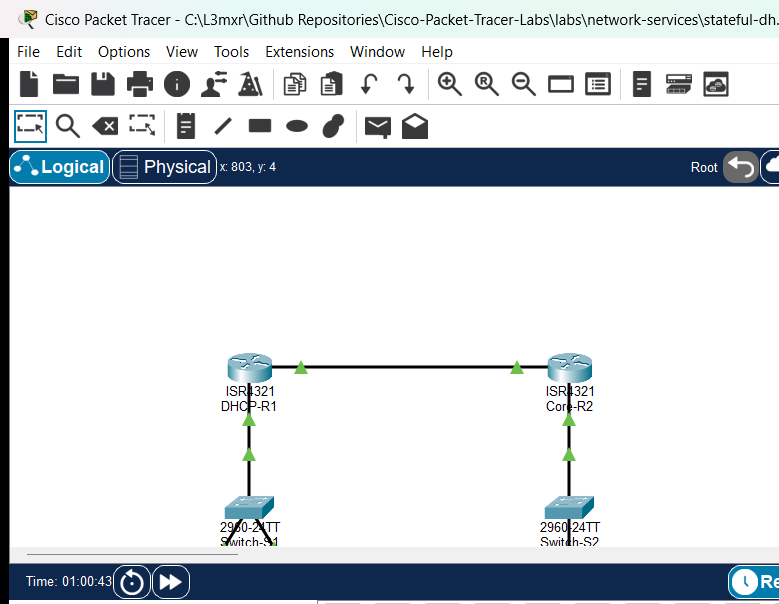

# Stateful DHCPv6 Address Assignment

## Learning Objectives
- Differentiate between Stateless Address Autoconfiguration (SLAAC), Stateless DHCPv6, and Stateful DHCPv6 operation.
- Configure an enterprise Cisco IOS router as a Stateful DHCPv6 server supplying IPv6 global unicast addresses (GUA), recursive DNS server addresses, and domain search lists.
- Adjust ICMPv6 Router Advertisement (RA) flags (`managed-config-flag` and `no-autoconfig`) on local gateway interfaces to instruct clients to seek stateful leases.
- Configure Windows/Cisco host PC clients to request IPv6 addresses dynamically via Stateful DHCPv6.
- Inspect and interpret active DHCPv6 client bindings and DUID database entries on Cisco IOS.
- Verify routed end-to-end IPv6 packet transport across dual-router network segments.

## Prerequisites
- Completion of IPv6 Static and Default Routing labs (`PTL-0027`) or equivalent understanding of IPv6 unicast routing and link-local addressing.
- Familiarity with ICMPv6 Neighbor Discovery Protocol (NDP), Router Solicitation (RS), and Router Advertisement (RA) messages.
- Basic knowledge of Cisco IOS interface configuration and static routing syntax.

## Topology


The topology consists of two Cisco 4321 Integrated Services Routers connected via a point-to-point transit link (`2001:DB8:ACAD:A::/64`). `DHCP-R1` serves as the default gateway and Stateful DHCPv6 server for LAN 1 (`2001:DB8:ACAD:1::/64`), where `PC1` and `PC2` connect via access switch `Switch-S1`. `Core-R2` serves as the default gateway for remote LAN 2 (`2001:DB8:ACAD:2::/64`), where `Server-Remote` provides network services through `Switch-S2`.

## Addressing Table
| Device | Interface | IPv6 Address / Prefix | IPv6 Link-Local Address | Default Gateway | Purpose |
| :--- | :--- | :--- | :--- | :--- | :--- |
| `DHCP-R1` | Gi0/0/0 | `2001:DB8:ACAD:A::1/64` | `FE80::1` | N/A | Transit link to Core-R2 |
| `DHCP-R1` | Gi0/0/1 | `2001:DB8:ACAD:1::1/64` | `FE80::1` | N/A | LAN 1 Gateway & DHCPv6 Server |
| `Core-R2` | Gi0/0/0 | `2001:DB8:ACAD:A::2/64` | `FE80::2` | N/A | Transit link to DHCP-R1 |
| `Core-R2` | Gi0/0/1 | `2001:DB8:ACAD:2::1/64` | `FE80::2` | N/A | LAN 2 Gateway to Server-Remote |
| `Switch-S1` | VLAN 1 | Unassigned (L2 Access) | N/A | N/A | LAN 1 Layer 2 Switching |
| `Switch-S2` | VLAN 1 | Unassigned (L2 Access) | N/A | N/A | LAN 2 Layer 2 Switching |
| `PC1` | FastEthernet0 | DHCPv6 Leased (`2001:DB8:ACAD:1::/64`) | Auto (EUI-64/Random) | `FE80::1` (via RA) | LAN 1 Client A |
| `PC2` | FastEthernet0 | DHCPv6 Leased (`2001:DB8:ACAD:1::/64`) | Auto (EUI-64/Random) | `FE80::1` (via RA) | LAN 1 Client B |
| `Server-Remote` | FastEthernet0 | `2001:DB8:ACAD:2::100/64` | Auto | `2001:DB8:ACAD:2::1` | Remote LAN 2 Server |

## Lab Tasks
1. Verify baseline IPv6 physical connectivity and static routing between `DHCP-R1` and `Core-R2`.
2. Verify that end-hosts `PC1` and `PC2` have no stateful IPv6 global unicast leases in the starter state (`NEG-01` and `NEG-02`).
3. Create and configure Stateful DHCPv6 pool `IPV6-STATEFUL-LAN1` on `DHCP-R1` with an address prefix, recursive DNS server address, and domain search list.
4. Bind the DHCPv6 pool to interface `GigabitEthernet0/0/1` on `DHCP-R1`.
5. Adjust Router Advertisement flags on `DHCP-R1` Gi0/0/1 by setting the Managed configuration flag (`M=1`) and suppressing autonomous address autoconfiguration (`A=0`).
6. Trigger DHCPv6 renewals on `PC1` and `PC2` and inspect acquired leases (`POS-01`, `POS-02`, and `POS-03`).
7. Verify active client pools and client DUID bindings in Cisco IOS (`POS-04` and `POS-05`).
8. Validate end-to-end routing and reachability from LAN 1 clients across the inter-router link to `Server-Remote` (`POS-06` and `POS-07`).

## Configuration Walkthrough

### 1. Configure the Stateful DHCPv6 Pool on DHCP-R1
Define the DHCPv6 pool name and allocate the global address prefix and network parameters:

```cisco
DHCP-R1# configure terminal
DHCP-R1(config)# ipv6 dhcp pool IPV6-STATEFUL-LAN1
DHCP-R1(config-dhcpv6)# address prefix 2001:DB8:ACAD:1::/64
DHCP-R1(config-dhcpv6)# dns-server 2001:4860:4860::8888
DHCP-R1(config-dhcpv6)# domain-name cisco.lab
DHCP-R1(config-dhcpv6)# exit
```

### 2. Bind the DHCPv6 Service and Set RA Flags
To direct clients to query the DHCPv6 server for their global addresses rather than generating them using SLAAC, activate the server on LAN 1 interface `GigabitEthernet0/0/1` and manipulate the ICMPv6 RA flags:

```cisco
DHCP-R1(config)# interface GigabitEthernet0/0/1
DHCP-R1(config-if)# ipv6 dhcp server IPV6-STATEFUL-LAN1
DHCP-R1(config-if)# ipv6 nd managed-config-flag
DHCP-R1(config-if)# ipv6 nd prefix 2001:DB8:ACAD:1::/64 no-autoconfig
DHCP-R1(config-if)# end
DHCP-R1# copy running-config startup-config
```

> [!NOTE]
> The `ipv6 nd managed-config-flag` sets the M-flag bit in outgoing ICMPv6 Type 134 Router Advertisement messages. This informs receiving hosts that stateful addresses are available via DHCPv6.
> The `ipv6 nd prefix ... no-autoconfig` directive clears the Autonomous flag (A-flag bit), instructing clients not to use SLAAC to build addresses from the RA prefix.

### 3. Verify Client Host Address Acquisition
On `PC1` and `PC2`, issue the renewal command from the command prompt:

```cmd
C:\> ipv6config /renew
```

Check the assigned configuration on `PC1`:

```cmd
C:\> ipv6config

FastEthernet0 Connection:(default port)

   Connection-specific DNS Suffix..: cisco.lab 
   Link-local IPv6 Address.........: FE80::250:FFF:FE15:6ECB
   IPv6 Address....................: 2001:DB8:ACAD:1:717D:5548:5548:47B6
   Default Gateway.................: FE80::1
   DHCPv6 IAID.....................: 1684834516
   DHCPv6 Client DUID..............: 00-01-00-01-95-10-3B-14-00-50-0F-15-6E-CB
```

## Verification
Confirm operational status on the router using the following commands:

1. **Verify DHCPv6 Pool Statistics:**
   ```cisco
   DHCP-R1# show ipv6 dhcp pool
   DHCPv6 pool: IPV6-STATEFUL-LAN1
     Address allocation prefix: 2001:DB8:ACAD:1::/64 valid 172800 preferred 86400 (6 in use, 0 conflicts)
     DNS server: 2001:4860:4860::8888
     Domain name: cisco.lab
     Active clients: 2
   ```

2. **Verify DHCPv6 Client Bindings:**
   ```cisco
   DHCP-R1# show ipv6 dhcp binding
   Client: FE80::250:FFF:FE15:6ECB
     DUID: 0001000195103B1400500F156ECB
     IA NA: IA ID 1684834516, T1 0, T2 0
       Address: 2001:DB8:ACAD:1:717D:5548:5548:47B6
               preferred lifetime 86400, valid lifetime 172800
   ```

3. **Verify End-to-End Ping Reachability:**
   From `PC1` and `PC2`, ping `Server-Remote` at `2001:DB8:ACAD:2::100`:
   ```cmd
   C:\> ping 2001:DB8:ACAD:2::100
   
   Pinging 2001:DB8:ACAD:2::100 with 32 bytes of data:
   Reply from 2001:DB8:ACAD:2::100: bytes=32 time<1ms TTL=126
   Reply from 2001:DB8:ACAD:2::100: bytes=32 time<1ms TTL=126
   Reply from 2001:DB8:ACAD:2::100: bytes=32 time<1ms TTL=126
   Reply from 2001:DB8:ACAD:2::100: bytes=32 time<1ms TTL=126
   
   Ping statistics for 2001:DB8:ACAD:2::100:
       Packets: Sent = 4, Received = 4, Lost = 0 (0% loss)
   ```

For detailed test logs, see [verification.md](verification.md).

## Troubleshooting
- **Client receives Link-Local address only:** Ensure that `ipv6 unicast-routing` is globally enabled on `DHCP-R1`. Without this directive, the router does not transmit unsolicited ICMPv6 Router Advertisements.
- **Client generates SLAAC address instead of DHCPv6:** Verify that `ipv6 nd managed-config-flag` is set on the LAN interface and that `ipv6 nd prefix ... no-autoconfig` is applied to suppress SLAAC autoconfiguration.
- **Pool shows 0 active clients:** Confirm that the pool prefix matches the subnet configured on the router interface (`2001:DB8:ACAD:1::/64`) and that `ipv6 dhcp server <pool-name>` is bound to the correct physical interface.
- **Client cannot reach remote subnets:** Check that static route `ipv6 route 2001:DB8:ACAD:2::/64 2001:DB8:ACAD:A::2` exists on `DHCP-R1` and that return route `ipv6 route 2001:DB8:ACAD:1::/64 2001:DB8:ACAD:A::1` exists on `Core-R2`.

## Key Takeaways
- Unlike DHCPv4 where default gateway is provided via DHCP Option 3, IPv6 hosts always learn their default gateway from ICMPv6 Router Advertisements (`FE80::` link-local address of the router), regardless of whether DHCPv6 or SLAAC is used.
- Stateful DHCPv6 operates on UDP port 546 (client) and UDP port 547 (server). Clients locate servers by sending Solicit messages to all-DHCPv6-servers multicast address `FF02::1:2`.
- The DHCP Unique Identifier (DUID) identifies the client host uniquely across restarts, while the Identity Association for Non-Temporary Addresses (IA_NA) tracks individual leased addresses.

## References
- [Cisco IOS IPv6 Configuration Guide: Implementing DHCP for IPv6](https://www.cisco.com/c/en/us/td/docs/ios-xml/ios/ipaddr_dhcp/configuration/15-mt/dhcp-15-mt-book/ip6-dhcp-server.html)
- [RFC 8415: Dynamic Host Configuration Protocol for IPv6 (DHCPv6)](https://tools.ietf.org/html/rfc8415)
- [Cisco CCNA Exam Topics (Topic 4.4: Configure and verify DHCP client and relay)](https://learningnetwork.cisco.com/s/ccna-exam-topics)

## Files and Validation Status
- **Starter Topology:** [assets/starter.pkt](assets/starter.pkt)
- **Completed Topology:** [assets/completed.pkt](assets/completed.pkt)
- **Topology Diagram:** [assets/topology.png](assets/topology.png)
- **DHCP-R1 Running Config:** [configs/DHCP-R1.txt](configs/DHCP-R1.txt)
- **Core-R2 Running Config:** [configs/Core-R2.txt](configs/Core-R2.txt)
- **Switch-S1 Running Config:** [configs/Switch-S1.txt](configs/Switch-S1.txt)
- **Switch-S2 Running Config:** [configs/Switch-S2.txt](configs/Switch-S2.txt)
- **Simulator Results Evidence:** [PTL-0033-SIMULATOR-RESULTS.md](../../../AI_AGENT_GUIDE/state/PTL-0033-SIMULATOR-RESULTS.md)
- **Validation Status:** Simulator tested and verified in Packet Tracer 9.0.1. All positive and negative test cases passing.

