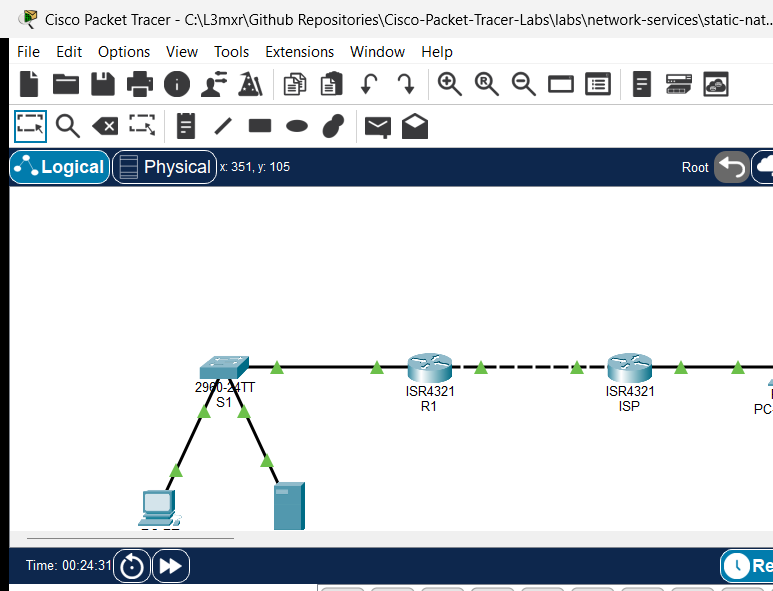

# PTL-0021: Static NAT and Inside Server Publishing

> **Category:** network-services · **Difficulty:** intermediate · **Lab ID:** PTL-0021 · **Document:** reviewed · **Simulator:** tested pass

Network Address Translation (NAT) plays a dual role in modern network architecture: while Port Address Translation (PAT) allows many private hosts to multiplex over a single public IPv4 address for outbound internet access, **Static NAT** provides a permanent, fixed, one-to-one mapping between an internal private IPv4 address (**Inside Local**) and an externally visible public IPv4 address (**Inside Global**).

Static NAT is the standard architectural solution for publishing internal enterprise servers—such as web servers, mail transfer agents, VPN endpoints, or application gateways—to external users across the public Internet. Because the translation entry is statically configured into the router's NAT lookup table, translation operates bidirectionally: external clients can initiate connections inbound to the inside global IP address, and the internal server can initiate outbound connections using its assigned public identity. Simultaneously, internal private workstations that do not possess a static translation remain hidden and unreachable from external unsolicited traffic, maintaining perimeter network security.

In this laboratory, you will configure and verify one-to-one Static NAT on a Cisco ISR 4321 edge router (`R1`) to publish an internal corporate server (`Svr-Internal`) to an external public client (`PC-External`) across a simulated ISP transit network.

---

## Learning Objectives

- Understand the architectural principles, bidirectional operation, and security considerations of one-to-one Static NAT.
- Accurately distinguish between the four Cisco IOS NAT address designations: **Inside Local**, **Inside Global**, **Outside Local**, and **Outside Global**.
- Configure inside and outside NAT boundaries on router interfaces using `ip nat inside` and `ip nat outside`.
- Configure a persistent one-to-one static translation mapping using the `ip nat inside source static` command.
- Verify static translation state using `show ip nat translations` and `show ip nat statistics`.
- Validate that external internet clients can successfully reach the internal server via its published Inside Global address.
- Verify perimeter isolation by confirming that unmapped internal private workstations remain inaccessible to the external network.
- Perform fault isolation and recovery when NAT boundaries or static translation statements are altered.

---

## Prerequisites

- Strong foundation in IPv4 addressing, subnet masks, and default gateway routing concepts.
- Familiarity with Cisco IOS command-line interface (CLI) navigation and interface configuration.
- Completion of **PTL-0020: IPv4 Dynamic PAT at the Edge** or equivalent understanding of NAT boundary definitions (`ip nat inside` / `ip nat outside`).
- Cisco Packet Tracer 8.2 or newer (Packet Tracer 9.0+ verified).

---

## Topology



The topology models an enterprise branch network connected to an upstream Internet Service Provider (ISP), providing external access to an internal application server:

```text
[PC-Internal]──Fa0 ───── Fa0/1──[Switch S1]──Gi0/1 ───── Gi0/0/0──[Router R1] (Static NAT Gateway)
(192.168.10.10)         (Corporate LAN)                     │ Gi0/0/1 (203.0.113.1/29)
                                                             │ (WAN Public Transit Link)
[Svr-Internal]──Fa0 ──── Fa0/10──────────────────────────────┘ Gi0/0/0 (203.0.113.2/29)
(192.168.10.80)                                            [Router ISP]
(Published: 203.0.113.5)                                    │ Gi0/0/1 (198.51.100.1/24)
                                                             │ (External Client Network)
                                                           [PC-External]
                                                             (198.51.100.50)
```

| Device Name | Model | Interface | Connected Device | Neighbor Interface | Network Role |
|---|---|---|---|---|---|
| **R1** | Cisco ISR 4321 | GigabitEthernet0/0/0 | Switch S1 | GigabitEthernet0/1 | Inside LAN Gateway (`192.168.10.1/24`) |
| **R1** | Cisco ISR 4321 | GigabitEthernet0/0/1 | Router ISP | GigabitEthernet0/0/0 | Outside Public Transit Link (`203.0.113.1/29`) |
| **ISP** | Cisco ISR 4321 | GigabitEthernet0/0/0 | Router R1 | GigabitEthernet0/0/1 | Upstream ISP Gateway (`203.0.113.2/29`) |
| **ISP** | Cisco ISR 4321 | GigabitEthernet0/0/1 | PC-External | FastEthernet0 | External Client Gateway (`198.51.100.1/24`) |
| **Switch S1** | Catalyst 2960-24TT | FastEthernet0/1 | PC-Internal | FastEthernet0 | Access Port for Private Host |
| **Switch S1** | Catalyst 2960-24TT | FastEthernet0/10 | Svr-Internal | FastEthernet0 | Access Port for Server |
| **Switch S1** | Catalyst 2960-24TT | GigabitEthernet0/1 | Router R1 | GigabitEthernet0/0/0 | Access Uplink to R1 |
| **PC-Internal** | PC-PT | FastEthernet0 | Switch S1 | FastEthernet0/1 | Private Corporate Workstation (Unmapped) |
| **Svr-Internal** | Server-PT | FastEthernet0 | Switch S1 | FastEthernet0/10 | Internal Enterprise Application Server |
| **PC-External** | PC-PT | FastEthernet0 | Router ISP | GigabitEthernet0/0/1 | External Internet Client Workstation |

---

## Addressing Table

| Device | Interface | IPv4 Address | Subnet Mask | Default Gateway | NAT Address Classification |
|---|---|---|---|---|---|
| **R1** | `Gi0/0/0` | `192.168.10.1` | `255.255.255.0` | N/A | Inside Boundary (`ip nat inside`) |
| **R1** | `Gi0/0/1` | `203.0.113.1` | `255.255.255.248` | N/A | Outside Boundary (`ip nat outside`) |
| **ISP** | `Gi0/0/0` | `203.0.113.2` | `255.255.255.248` | N/A | Outside Public Transit Network |
| **ISP** | `Gi0/0/1` | `198.51.100.1` | `255.255.255.0` | N/A | External Client Network Gateway |
| **S1** | `Vlan1` | `192.168.10.2` | `255.255.255.0` | `192.168.10.1` | Inside Management SVI |
| **PC-Internal** | `Fa0` | `192.168.10.10` | `255.255.255.0` | `192.168.10.1` | Inside Local (Unmapped RFC 1918 Private) |
| **Svr-Internal** | `Fa0` | `192.168.10.80` | `255.255.255.0` | `192.168.10.1` | Inside Local: `192.168.10.80` / Inside Global: `203.0.113.5` |
| **PC-External** | `Fa0` | `198.51.100.50` | `255.255.255.0` | `198.51.100.1` | Outside Global (`198.51.100.50`) |

> [!NOTE]
> The WAN transit subnet `203.0.113.0/29` provides usable host addresses from `203.0.113.1` through `203.0.113.6`. Router `R1` uses `203.0.113.1` on its physical interface, while `203.0.113.5` is statically allocated from this public allocation as the **Inside Global** IP address for `Svr-Internal`.

---

## Lab Tasks

1. Verify physical topology cabling and inspect baseline IP addressing across all hosts and routers.
2. Confirm local LAN reachability by executing a ping from `PC-Internal` to `Svr-Internal` (`192.168.10.80`).
3. Attempt an inbound ping from `PC-External` to the server's planned public IP (`203.0.113.5`) and verify that it fails in the starter state.
4. On edge router `R1`, verify that interfaces `GigabitEthernet0/0/0` and `GigabitEthernet0/0/1` are configured with `ip nat inside` and `ip nat outside` respectively.
5. Configure a permanent one-to-one Static NAT mapping on `R1` binding inside local IP `192.168.10.80` to inside global IP `203.0.113.5`.
6. Verify inbound connectivity: ping `203.0.113.5` from `PC-External` and observe successful responses.
7. Verify outbound connectivity: ping `198.51.100.50` from `Svr-Internal` and confirm bidirectional translation.
8. Inspect the translation table on `R1` using `show ip nat translations` and analyze the persistent static table entry.
9. Review translation statistics and counters using `show ip nat statistics`.
10. Verify security isolation: verify that `PC-External` cannot ping the private IP of unmapped workstation `PC-Internal` (`192.168.10.10`).
11. Perform fault injection: temporarily remove the static NAT statement, verify external communication loss, and restore the configuration.

---

## Configuration Walkthrough

### 1. Baseline Verification in Starter State
Open the starter activity file (`assets/starter.pkt`). Verify that internal LAN devices can communicate across switch `S1`:

```text
PC-Internal> ping 192.168.10.80

Pinging 192.168.10.80 with 32 bytes of data:

Reply from 192.168.10.80: bytes=32 time<1ms TTL=128
Reply from 192.168.10.80: bytes=32 time<1ms TTL=128
Reply from 192.168.10.80: bytes=32 time<1ms TTL=128

Ping statistics for 192.168.10.80:
    Packets: Sent = 3, Received = 3, Lost = 0 (0% loss)
```

Now attempt to reach the server's public IP from the external internet client:

```text
PC-External> ping 203.0.113.5

Pinging 203.0.113.5 with 32 bytes of data:

Request timed out.
Request timed out.
```

In the starter state, router `R1` has interface IP addresses and routing configured, but no static NAT rule exists. External requests to `203.0.113.5` cannot be translated to the server's private address and are dropped.

### 2. Verify NAT Interface Boundaries on R1
Access router `R1` and inspect the interface configuration to confirm inside and outside domain assignments:

```text
R1# show running-config interface GigabitEthernet0/0/0
interface GigabitEthernet0/0/0
 ip address 192.168.10.1 255.255.255.0
 ip nat inside
 duplex auto
 speed auto
end

R1# show running-config interface GigabitEthernet0/0/1
interface GigabitEthernet0/0/1
 ip address 203.0.113.1 255.255.255.248
 ip nat outside
 duplex auto
 speed auto
end
```

If these commands are missing, apply them in global configuration mode:
```text
R1(config)# interface GigabitEthernet0/0/0
R1(config-if)# ip nat inside
R1(config-if)# exit
R1(config)# interface GigabitEthernet0/0/1
R1(config-if)# ip nat outside
R1(config-if)# exit
```

### 3. Configure the Static NAT Mapping on R1
Configure a one-to-one static translation mapping the inside local address of the server (`192.168.10.80`) to the allocated inside global address (`203.0.113.5`):

```text
R1(config)# ip nat inside source static 192.168.10.80 203.0.113.5
R1(config)# end
R1# copy running-config startup-config
Destination filename [startup-config]? 
Building configuration...
[OK]
```

Unlike dynamic NAT or PAT, static NAT does not require an access control list (ACL) or an address pool. The command creates a permanent bidirectional translation rule immediately upon execution.

---

## Verification

### 1. Test Inbound Reachability from the External Client
From `PC-External`, send ICMP echo requests to the server's Inside Global IP address (`203.0.113.5`):

```text
PC-External> ping 203.0.113.5

Pinging 203.0.113.5 with 32 bytes of data:

Reply from 203.0.113.5: bytes=32 time<1ms TTL=126
Reply from 203.0.113.5: bytes=32 time<1ms TTL=126
Reply from 203.0.113.5: bytes=32 time<1ms TTL=126

Ping statistics for 203.0.113.5:
    Packets: Sent = 3, Received = 3, Lost = 0 (0% loss),
Approximate round trip times in milli-seconds:
    Minimum = 0ms, Maximum = 0ms, Average = 0ms
```

The ping succeeds. Router `R1` intercepts inbound packets on its outside interface destined for `203.0.113.5`, translates the destination IPv4 address to `192.168.10.80`, and forwards the packet onto the inside LAN.

### 2. Test Outbound Communication from the Server
Verify bidirectional translation by sending a ping from `Svr-Internal` to `PC-External` (`198.51.100.50`):

```text
Svr-Internal> ping 198.51.100.50

Pinging 198.51.100.50 with 32 bytes of data:

Reply from 198.51.100.50: bytes=32 time<1ms TTL=126
Reply from 198.51.100.50: bytes=32 time<1ms TTL=126
Reply from 198.51.100.50: bytes=32 time<1ms TTL=126
```

When `Svr-Internal` initiates traffic towards the external network, `R1` intercepts outbound packets on its inside interface, translates the source IPv4 address from `192.168.10.80` to `203.0.113.5`, and forwards them out `GigabitEthernet0/0/1`.

### 3. Inspect Active NAT Translations on R1
Execute `show ip nat translations` on `R1`:

```text
R1# show ip nat translations
Pro  Inside global     Inside local       Outside local      Outside global
icmp 203.0.113.5:5     192.168.10.80:5    198.51.100.50:5    198.51.100.50:5
icmp 203.0.113.5:6     192.168.10.80:6    198.51.100.50:6    198.51.100.50:6
icmp 203.0.113.5:7     192.168.10.80:7    198.51.100.50:7    198.51.100.50:7
---  203.0.113.5       192.168.10.80      ---                ---
```

Notice the bottom entry:
`---  203.0.113.5       192.168.10.80      ---                ---`
This entry is permanent and persists indefinitely in RAM without expiring. The dynamic lines above it represent active transport/ICMP sessions created when packets traverse the router.

### 4. Review NAT Operational Counters
Execute `show ip nat statistics` on `R1`:

```text
R1# show ip nat statistics
Total translations: 5 (1 static, 4 dynamic, 4 extended)
Outside Interfaces: GigabitEthernet0/0/1
Inside Interfaces: GigabitEthernet0/0/0
Hits: 17  Misses: 18
Expired translations: 14
Dynamic mappings:
```

### 5. Verify Unmapped Internal Host Shielding
Verify that internal private hosts without a static NAT mapping remain completely unreachable from the internet:

```text
PC-External> ping 192.168.10.10

Pinging 192.168.10.10 with 32 bytes of data:

Reply from 198.51.100.1: Destination host unreachable.
Reply from 198.51.100.1: Destination host unreachable.
```

Because `192.168.10.0/24` is an RFC 1918 private subnet, the upstream ISP has no route for it, and router `R1` has no static translation rule for `192.168.10.10`. Private workstations remain protected from external probing.

---

## Troubleshooting

| Symptom / Error | Root Cause | Verification Command | Resolution |
|---|---|---|---|
| External client ping to Inside Global IP times out | Missing or reversed `ip nat inside` / `ip nat outside` interface commands | `show ip nat statistics` (verify Inside/Outside interface lists) | Ensure `Gi0/0/0` is `ip nat inside` and `Gi0/0/1` is `ip nat outside`. |
| External client ping times out despite correct interface roles | Inside Local and Inside Global addresses inverted in the configuration command | `show ip nat translations` | The syntax is `ip nat inside source static <local-ip> <global-ip>`. Re-enter with local IP first. |
| Inbound ping fails; ISP returns `Destination host unreachable` | Inside Global IP does not belong to the outside subnet routed to R1 | `show ip interface brief` on R1 and ISP | Ensure the Inside Global IP (`203.0.113.5`) falls within the `/29` WAN subnet (`203.0.113.0/29`). |
| Server cannot reach external client | Server has incorrect or missing default gateway | `ipconfig` on `Svr-Internal` | Configure default gateway on `Svr-Internal` as `192.168.10.1`. |
| Switch management unreachable from R1 | Switch `Vlan1` shutdown or missing default gateway | `show interface vlan 1` and `show ip default-gateway` on S1 | Configure `ip default-gateway 192.168.10.1` and issue `no shutdown` on `interface Vlan1`. |

---

## Key Takeaways

- **One-to-One Persistent Mapping:** Static NAT assigns a dedicated public IPv4 address to a single internal private device, creating a permanent translation entry that does not time out.
- **Bidirectional Initiation:** Unlike PAT (which requires inside hosts to initiate the connection), Static NAT allows outside clients to initiate connections directly to the inside server.
- **Address Terminology:**
  - **Inside Local:** The private RFC 1918 address assigned to the host inside the network (`192.168.10.80`).
  - **Inside Global:** The globally routable public address that represents the inside host to the outside world (`203.0.113.5`).
  - **Outside Local:** The address of the external host as known to the inside network (`198.51.100.50`).
  - **Outside Global:** The public address assigned to the external host on the outside network (`198.51.100.50`).
- **Selective Perimeter Exposure:** Only explicitly published internal hosts are exposed; unmapped private workstations remain shielded behind the enterprise border router.

---

## References

- [IETF RFC 3022: Traditional IP Network Address Translator (Traditional NAT)](https://datatracker.ietf.org/doc/html/rfc3022)
- [Cisco IOS IP Addressing Services Command Reference: ip nat inside source static](https://www.cisco.com/c/en/us/support/docs/ip/network-address-translation-nat/13772-12.html)
- [Cisco CCNA 200-301 Official Cert Guide: Implementing Network Address Translation](https://www.ciscopress.com/)

---

## Files and Validation Status

| File Name | File Purpose | Validation Status |
|---|---|---|
| `metadata.json` | Curriculum indexing and specification metadata | Validated against repository JSON schema |
| `README.md` | Primary lab guide and step-by-step instructions | Validated against required 11 canonical H2 sections |
| `verification.md` | In-depth verification and fault recovery matrix | Validated with POS/NEG criteria |
| `assets/starter.pkt` | Initial student activity file | Validated in Cisco Packet Tracer 9.0.1 |
| `assets/completed.pkt` | Fully configured golden reference solution | Validated in Cisco Packet Tracer 9.0.1 |
| `assets/topology.png` | Live simulator topology canvas screenshot | Validated PNG image |
| `configs/R1.txt` | Edge router golden running configuration | Verified syntax |
| `configs/ISP.txt` | Upstream ISP router configuration | Verified syntax |
| `configs/S1.txt` | Access switch configuration | Verified syntax |

