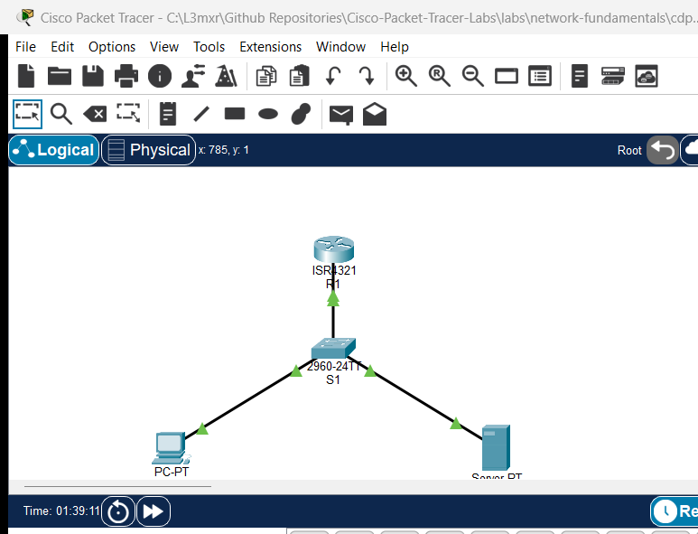

# PTL-0025: TFTP Configuration Backup and Restore

> **Category:** network-services · **Difficulty:** intermediate · **Lab ID:** PTL-0025 · **Document:** reviewed · **Simulator:** tested pass

Enterprise infrastructure reliability depends on robust, regular, and automated configuration management. Network devices such as routers, firewalls, and switches maintain operational state in dynamic RAM (**running-config**) and persistent NVRAM (**startup-config**). However, physical hardware failures, catastrophic power anomalies, corrupted storage modules, or erroneous administrative configurations can suddenly render an enterprise gateway non-functional.

To protect against downtime and configuration loss, network engineers rely on the **Trivial File Transfer Protocol (TFTP)**. Operating over UDP port 69, TFTP is a lightweight file transfer protocol designed specifically for embedded devices, network appliances, and bootstrapping environments. Because TFTP requires minimal memory and protocol overhead, it serves as the universal standard across Cisco IOS platforms for off-device configuration backups, disaster recovery restorations, and remote IOS software image distribution.

In this laboratory, you will configure an enterprise network management topology consisting of an infrastructure gateway router (`R1`), an access switch (`S1`), an administrator workstation (`PC-Admin`), and a centralized TFTP backup server (`TFTP-Server`). You will back up the running configuration of `R1` to the TFTP server, inspect the file archive, simulate a critical operational disaster where router settings are altered and compromised, and execute systematic disaster recovery by restoring the baseline configuration directly from the remote TFTP repository.

---

## Learning Objectives

- Explain the protocol mechanics, packet transaction model, and architectural role of the Trivial File Transfer Protocol (TFTP) over UDP port 69.
- Differentiate between volatile running-config (RAM), persistent startup-config (NVRAM), and remote configuration archives stored on external file servers.
- Execute interactive Cisco IOS running configuration backups to a centralized TFTP server using `copy running-config tftp:`.
- Verify file transmission integrity, transfer byte counts, and inspect stored configuration archives on the TFTP server file repository.
- Simulate an operational disaster by altering router hostnames, interfaces, and system security banners.
- Execute full disaster recovery by pulling configuration archives from the TFTP server directly into the active running configuration using `copy tftp: running-config`.
- Validate that restored router parameters, interface states, and system banners match the pre-disaster operational baseline.
- Diagnose and troubleshoot common TFTP transfer failures, including invalid filenames, destination server IP typos, and UDP network reachability timeouts.

---

## Prerequisites

- Thorough understanding of IPv4 addressing, subnet masks, and default gateways.
- Familiarity with Cisco IOS user EXEC, privileged EXEC, and global configuration modes.
- Completion of **PTL-0008: Router Configuration Baseline** or equivalent Cisco IOS administrative experience.
- Cisco Packet Tracer 8.2 or newer (Packet Tracer 9.0+ verified).

---

## Topology



The topology models an enterprise management segment where an access switch (`S1`) connects the corporate gateway router (`R1`) to an administrative workstation (`PC-Admin`) and a dedicated management TFTP server (`TFTP-Server`):

```text
                  [R1 Gateway Router] (ISR 4321)
                  Gi0/0/0 (192.168.1.1/24)
                  Loopback0 (10.25.1.1/24)
                           │
                           │ Gi0/1
                    [Switch S1] (Catalyst 2960)
                    Fa0/1 │     │ Fa0/2
              ┌───────────┘     └───────────┐
              │                             │
         [PC-Admin]                   [TFTP-Server]
       (192.168.1.10)                (192.168.1.250)
                                      TFTP: UDP 69
```

| Device Name | Model | Interface | Connected Device | Neighbor Interface | Network Role |
|---|---|---|---|---|---|
| **R1** | Cisco ISR 4321 | GigabitEthernet0/0/0 | Switch S1 | GigabitEthernet0/1 | Core Gateway & Managed Node (`192.168.1.1/24`) |
| **R1** | Cisco ISR 4321 | Loopback0 | N/A | N/A | Management Diagnostic Loopback (`10.25.1.1/24`) |
| **Switch S1** | Catalyst 2960-24TT | GigabitEthernet0/1 | R1 | GigabitEthernet0/0/0 | Uplink to Gateway Router |
| **Switch S1** | Catalyst 2960-24TT | FastEthernet0/1 | PC-Admin | FastEthernet0 | Access Port for Admin Workstation |
| **Switch S1** | Catalyst 2960-24TT | FastEthernet0/2 | TFTP-Server | FastEthernet0 | Access Port for Backup TFTP Server |
| **PC-Admin** | PC-PT | FastEthernet0 | Switch S1 | FastEthernet0/1 | Administrator Workstation (`192.168.1.10/24`) |
| **TFTP-Server** | Server-PT | FastEthernet0 | Switch S1 | FastEthernet0/2 | Central Management & TFTP Server (`192.168.1.250/24`) |

---

## Addressing Table

| Device | Interface | IPv4 Address | Subnet Mask | Default Gateway | Service Daemons |
|---|---|---|---|---|---|
| **R1** | `Gi0/0/0` | `192.168.1.1` | `255.255.255.0` | N/A | Production Gateway |
| **R1** | `Loopback0` | `10.25.1.1` | `255.255.255.0` | N/A | Management Diagnostic Interface |
| **Switch S1** | `Vlan1` | `192.168.1.2` | `255.255.255.0` | `192.168.1.1` | Switch SVI Management |
| **PC-Admin** | `FastEthernet0` | `192.168.1.10` | `255.255.255.0` | `192.168.1.1` | Administrative Host |
| **TFTP-Server** | `FastEthernet0` | `192.168.1.250` | `255.255.255.0` | `192.168.1.1` | TFTP Daemon (UDP Port 69) |

---

## Lab Tasks

1. **Verify Baseline Network Connectivity:**
   - Confirm ICMP reachability from `PC-Admin` and `R1` to the centralized `TFTP-Server` (`192.168.1.250`).
   - Validate that the TFTP service daemon is active on `TFTP-Server`.

2. **Execute Interactive Cisco IOS Configuration Backup:**
   - Connect to `R1` privileged EXEC mode.
   - Use the `copy running-config tftp:` command to back up the active configuration.
   - Specify `192.168.1.250` as the remote host and `R1-backup.cfg` as the destination filename.
   - Confirm successful transmission of configuration data blocks and verify byte count.

3. **Inspect the Centralized File Archive:**
   - Access `TFTP-Server` and examine the TFTP file repository under **Services > TFTP**.
   - Verify that `R1-backup.cfg` is present and records the expected size.

4. **Simulate a Catastrophic Configuration Disaster:**
   - On `R1`, intentionally alter key configuration parameters to simulate corruption or an administrative mishap:
     - Change hostname to `R1-DISASTER`.
     - Remove the corporate MOTD security banner (`no banner motd`).
     - Administratively disable `Loopback0` (`shutdown`).
     - Corrupt the `GigabitEthernet0/0/0` interface description.
   - Verify that the active running configuration is in an altered, compromised state.

5. **Perform Disaster Recovery and State Restoration:**
   - On `R1-DISASTER`, execute `copy tftp: running-config`.
   - Specify remote host `192.168.1.250` and source file `R1-backup.cfg`.
   - Observe how Cisco IOS merges the incoming configuration archive into active memory.
   - Validate that the prompt reverts to `R1#`, the MOTD banner is restored, and `Loopback0` is operational.
   - Save the restored running configuration to NVRAM with `copy running-config startup-config`.

6. **Test Negative Scenarios and Failure Modes:**
   - Attempt a TFTP transfer requesting a non-existent file name to observe error code handling.
   - Attempt a TFTP transfer to an unreachable destination IP to observe retransmission timeouts.

---

## Configuration Walkthrough

### Task 1: Verify Baseline Reachability

From `PC-Admin`, ping the TFTP server and gateway router:

```text
C:\>ping 192.168.1.250
Pinging 192.168.1.250 with 32 bytes of data:
Reply from 192.168.1.250: bytes=32 time<1ms TTL=128
Reply from 192.168.1.250: bytes=32 time<1ms TTL=128
Reply from 192.168.1.250: bytes=32 time<1ms TTL=128
Reply from 192.168.1.250: bytes=32 time<1ms TTL=128

Ping statistics for 192.168.1.250:
    Packets: Sent = 4, Received = 4, Lost = 0 (0% loss)
```

From `R1`, confirm reachability to `192.168.1.250`:

```cisco
R1#ping 192.168.1.250
Type escape sequence to abort.
Sending 5, 100-byte ICMP Echos to 192.168.1.250, timeout is 2 seconds:
.!!!!
Success rate is 80 percent (4/5), round-trip min/avg/max = 0/0/0 ms
```

### Task 2: Back Up Running Configuration to TFTP

On `R1`, enter privileged EXEC mode and initiate the backup:

```cisco
R1#copy running-config tftp:
Address or name of remote host []? 192.168.1.250
Destination filename [R1-confg]? R1-backup.cfg

Writing running-config...!!
[OK - 762 bytes]

762 bytes copied in 0 secs
```

> **Command Explanation:**
> - `Address or name of remote host []?`: Enter the IPv4 address of the TFTP server (`192.168.1.250`).
> - `Destination filename [R1-confg]?`: By default, Cisco IOS proposes `<hostname>-confg`. Overwrite this with a standardized name such as `R1-backup.cfg`.
> - Each exclamation point (`!`) indicates successful transmission of a UDP data packet block (512 bytes).
> - `[OK - 762 bytes]` confirms the server successfully acknowledged and wrote the file to disk.

### Task 3: Inspect TFTP Server Storage

1. Click on **TFTP-Server** in Packet Tracer.
2. Select the **Config** or **Services** tab and click **TFTP**.
3. Confirm that the **Service** radio button is set to **On**.
4. Scroll through the file list to locate `R1-backup.cfg`. You will observe the transferred configuration file stored alongside the factory Cisco IOS boot images.

### Task 4: Simulate Catastrophic Configuration Disaster

On `R1`, enter global configuration mode and execute changes to alter the device identity and operational state:

```cisco
R1#configure terminal
R1(config)#hostname R1-DISASTER
R1-DISASTER(config)#no banner motd
R1-DISASTER(config)#interface Loopback0
R1-DISASTER(config-if)#shutdown
R1-DISASTER(config-if)#exit
R1-DISASTER(config)#interface GigabitEthernet0/0/0
R1-DISASTER(config-if)#description CORRUPTED_STATE
R1-DISASTER(config-if)#exit
R1-DISASTER(config)#end
```

Notice the console prompt changed to `R1-DISASTER#`. Verifying with `show run | include hostname` confirms the disaster state.

### Task 5: Execute Disaster Recovery from TFTP

On `R1-DISASTER`, initiate restoration directly from the TFTP backup:

```cisco
R1-DISASTER#copy tftp: running-config
Address or name of remote host []? 192.168.1.250
Source filename []? R1-backup.cfg
Destination filename [running-config]? 

Accessing tftp://192.168.1.250/R1-backup.cfg...
Loading R1-backup.cfg from 192.168.1.250: !
[OK - 762 bytes]

762 bytes copied in 0 secs
R1#
%SYS-5-CONFIG_I: Configured from console by console
```

> **Operational Insight:** When copying a configuration into `running-config`, Cisco IOS performs an intelligent configuration **merge**. Existing commands are overwritten by matching commands from the backup file, and omitted commands that are set in the backup are applied. The hostname immediately shifts back from `R1-DISASTER#` to `R1#`.

To make the restoration permanent, commit the recovered state to NVRAM:

```cisco
R1#copy running-config startup-config
Destination filename [startup-config]? 
Building configuration...
[OK]
```

---

## Verification

### 1. Verify Restored Hostname and Banners
Examine the active configuration on `R1`:

```cisco
R1#show running-config | include hostname
hostname R1

R1#show running-config | section banner
banner motd ^C
=====================================================
Authorized Access Only - R1 Production Gateway
=====================================================
^C
```

### 2. Verify Restored Interface States
Confirm that `Loopback0` and `Gi0/0/0` have returned to operational condition:

```cisco
R1#show ip interface brief
Interface              IP-Address      OK? Method Status                Protocol
GigabitEthernet0/0/0   192.168.1.1     YES manual up                    up
GigabitEthernet0/0/1   unassigned      YES unset  administratively down down
GigabitEthernet0/0/2   unassigned      YES unset  administratively down down
Loopback0              10.25.1.1       YES manual up                    up

R1#show interfaces GigabitEthernet0/0/0 | include Description
  Description: Link to Corporate Access Switch S1
```

### 3. Verify Startup Configuration Consistency
Confirm NVRAM matches the restored operational configuration:

```cisco
R1#show startup-config | include hostname
hostname R1
```

---

## Troubleshooting

### Issue 1: `%Error opening tftp://... (Timed out)`
- **Symptom:** Router prints dots (`........`) for 10–20 seconds followed by a timeout error.
- **Root Cause 1:** The TFTP server IPv4 address was entered incorrectly.
- **Root Cause 2:** Physical link or IP layer connectivity failure (e.g., interface `shutdown`, wrong subnet mask).
- **Root Cause 3:** The TFTP service daemon on `TFTP-Server` is turned **Off**.
- **Remediation:** Verify basic Layer 3 reachability using `ping 192.168.1.250`. Ensure `TFTP-Server` has the TFTP service toggled to **On** in its **Services** panel.

### Issue 2: `%Error opening tftp://... (No such file or directory)`
- **Symptom:** TFTP connection completes immediately with error code 1: File not found.
- **Root Cause:** A typographical error in the source filename (e.g., `R1-backp.cfg` instead of `R1-backup.cfg`). TFTP filenames are case-sensitive.
- **Remediation:** Inspect the file list under `TFTP-Server > Services > TFTP` to verify the exact spelling of the archive file.

### Issue 3: Restored Config Does Not Delete Extraneous Commands
- **Symptom:** Extra static routes or access lists configured during the disaster still exist in running-config after restoration.
- **Root Cause:** `copy tftp: running-config` is a **merge** operation, not a clean overwrite. New lines in the backup overwrite existing lines, but lines present only in the running config are not removed.
- **Remediation:** For a complete clean disaster recovery of a heavily corrupted device, copy the TFTP file directly to NVRAM (`copy tftp: startup-config`) and reload the router (`reload`), or manually negate extraneous commands.

---

## Key Takeaways

1. **TFTP Protocol Simplicity:** TFTP operates over UDP port 69 without authentication or session negotiation, making it universally available across all Cisco IOS devices regardless of hardware state.
2. **Volatile vs Persistent Storage:** Cisco devices store the active configuration in volatile RAM (`running-config`) and saved state in NVRAM (`startup-config`). Regularly exporting configurations to an external TFTP server protects against hardware destruction and disaster events.
3. **Merge vs Overwrite Behavior:** Restoring a configuration archive directly to `running-config` performs a merge. When restoring to replace a corrupted device completely, copying to `startup-config` followed by a `reload` ensures zero remnant configuration pollution.
4. **Standardized Archiving Conventions:** Employ systematic naming conventions (such as `<device-name>-<date>.cfg`) to maintain chronological disaster recovery archives across enterprise management infrastructure.

---

## References

- [IETF RFC 1350 — The TFTP Protocol (Revision 2)](https://datatracker.ietf.org/doc/html/rfc1350)
- [Cisco Technical Support Guide: Copying Configurations Between Devices and a TFTP Server](https://www.cisco.com/c/en/us/support/docs/routers/2500-series-routers/15092-copy-config.html)
- [Cisco IOS Configuration Fundamentals Command Reference: copy](https://www.cisco.com/c/en/us/td/docs/ios-xml/ios/fundamentals/configuration/15-mt/fundamentals-15-mt-book.html)
- [IETF RFC 2347 — TFTP Option Extension](https://datatracker.ietf.org/doc/html/rfc2347)

---

## Files and Validation Status

- `assets/starter.pkt`: Baseline network topology with IP addressing established; TFTP backup unconfigured and no configuration archives on the TFTP server.
- `assets/completed.pkt`: Validated laboratory topology with `R1-backup.cfg` archived on `TFTP-Server` and confirmed restored baseline configuration on `R1`.
- `assets/topology.png`: Visual layout of the laboratory topology.
- `configs/R1.txt`: Baseline running configuration for router `R1`.
- `configs/S1.txt`: Running configuration for switch `S1`.
- `verification.md`: Complete positive and negative testing matrix with live Packet Tracer simulation evidence.
