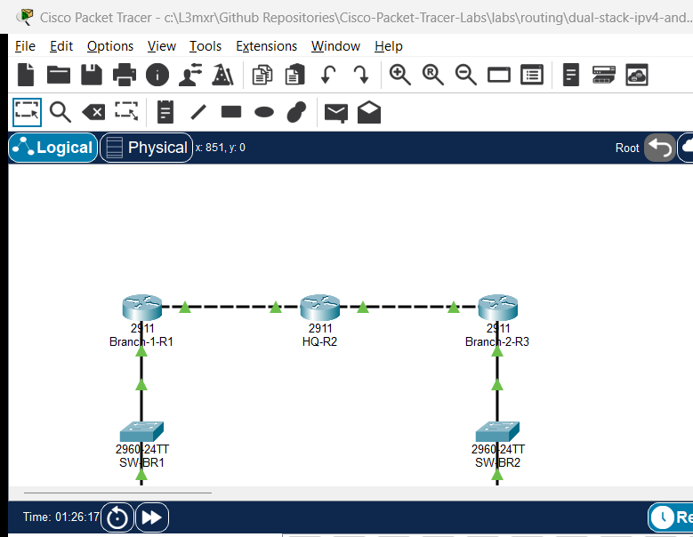

# PTL-0054: Dual-Stack IPv4 and IPv6 Branch Network

## Learning Objectives
- Configure dual-stack IPv4 and IPv6 interface addressing and link-local scopes on branch and core routers.
- Implement simultaneous IPv4 and IPv6 static and default routes across point-to-point transit networks.
- Verify end-to-end bidirectional dual-stack reachability between remote branch LAN subnets.
- Diagnose and resolve routing anomalies including invalid next-hop IP addresses and missing IPv6 default routes.
- Validate routing tables, neighbor discovery tables, and ARP tables for deterministic dual-stack forwarding.

## Prerequisites
- Completion of [PTL-0001: Dual-Stack Static Routing](../../routing/dual-stack-static-routing/)
- Completion of [PTL-0027: IPv6 Static and Default Route Troubleshooting](../../routing/ipv6-static-and-default-routing-troubleshooting/)
- Understanding of IPv4 CIDR subnetting, IPv6 global unicast addressing, and link-local scopes (`FE80::/10`)

## Topology



```
[ PC-BR1 ] (192.168.10.10 / 2001:db8:acad:10::10)
    | Fa0
    | Fa0/10
[ SW-BR1 ] (Catalyst 2960)
    | Gi0/1
    | Gi0/0
[ Branch-1-R1 ] (Cisco 2911)
    | Gi0/1 (WAN 1: 10.1.12.1/30 / 2001:db8:acad:12::1/64)
    |
    | Gi0/1
[ HQ-R2 ] (Cisco 2911) [Loopback0: 172.16.1.1/24 / 2001:db8:acad:100::1/64]
    | Gi0/2
    |
    | Gi0/2 (WAN 2: 10.1.23.3/30 / 2001:db8:acad:23::3/64)
[ Branch-2-R3 ] (Cisco 2911)
    | Gi0/0
    | Gi0/1
[ SW-BR2 ] (Catalyst 2960)
    | Fa0/10
    | Fa0
[ PC-BR2 ] (192.168.20.10 / 2001:db8:acad:20::10)
```

## Addressing Table

| Device Name | Interface | IPv4 Address / Prefix | IPv6 Address / Prefix | Default Gateway (IPv4 / IPv6) | Purpose / Connection |
|---|---|---|---|---|---|
| **Branch-1-R1** | Gi0/0 | 192.168.10.1 /24 | 2001:db8:acad:10::1 /64 | N/A | LAN Gateway (Branch 1) |
| **Branch-1-R1** | Gi0/1 | 10.1.12.1 /30 | 2001:db8:acad:12::1 /64 | N/A | WAN Transit to HQ-R2 Gi0/1 |
| **HQ-R2** | Gi0/1 | 10.1.12.2 /30 | 2001:db8:acad:12::2 /64 | N/A | WAN Transit to Branch-1-R1 Gi0/1 |
| **HQ-R2** | Gi0/2 | 10.1.23.1 /30 | 2001:db8:acad:23::2 /64 | N/A | WAN Transit to Branch-2-R3 Gi0/2 |
| **HQ-R2** | Loopback0 | 172.16.1.1 /24 | 2001:db8:acad:100::1 /64 | N/A | Central Services / Management |
| **Branch-2-R3** | Gi0/2 | 10.1.23.2 /30 | 2001:db8:acad:23::3 /64 | N/A | WAN Transit to HQ-R2 Gi0/2 |
| **Branch-2-R3** | Gi0/0 | 192.168.20.1 /24 | 2001:db8:acad:20::1 /64 | N/A | LAN Gateway (Branch 2) |
| **PC-BR1** | FastEthernet0 | 192.168.10.10 /24 | 2001:db8:acad:10::10 /64 | 192.168.10.1 / 2001:db8:acad:10::1 | Branch 1 Client Host |
| **PC-BR2** | FastEthernet0 | 192.168.20.10 /24 | 2001:db8:acad:20::10 /64 | 192.168.20.1 / 2001:db8:acad:20::1 | Branch 2 Client Host |

## Lab Tasks
1. Enable `ipv6 unicast-routing` globally on all Cisco routers (`Branch-1-R1`, `HQ-R2`, `Branch-2-R3`).
2. Configure dual-stack IPv4 and IPv6 addresses on all router physical and loopback interfaces.
3. Configure dual-stack static default routes on spoke branch routers (`Branch-1-R1` and `Branch-2-R3`) pointing to `HQ-R2`.
4. Configure explicit static IPv4 and IPv6 routes on core router `HQ-R2` to reach both branch LAN subnets.
5. Configure static dual-stack addressing on end devices (`PC-BR1` and `PC-BR2`).
6. Identify and resolve intentional routing faults present in the starter network.

## Configuration Walkthrough

### Step 1: Configure Branch-1 Router (Branch-1-R1)

Enable dual-stack routing and configure LAN and WAN interfaces:

```ios
Branch-1-R1# configure terminal
Branch-1-R1(config)# hostname Branch-1-R1
Branch-1-R1(config)# ipv6 unicast-routing
Branch-1-R1(config)# no ip domain-lookup

Branch-1-R1(config)# interface GigabitEthernet0/0
Branch-1-R1(config-if)# description Branch 1 LAN Gateway
Branch-1-R1(config-if)# ip address 192.168.10.1 255.255.255.0
Branch-1-R1(config-if)# ipv6 address 2001:db8:acad:10::1/64
Branch-1-R1(config-if)# ipv6 address fe80::1 link-local
Branch-1-R1(config-if)# no shutdown
Branch-1-R1(config-if)# exit

Branch-1-R1(config)# interface GigabitEthernet0/1
Branch-1-R1(config-if)# description WAN to HQ-R2
Branch-1-R1(config-if)# ip address 10.1.12.1 255.255.255.252
Branch-1-R1(config-if)# ipv6 address 2001:db8:acad:12::1/64
Branch-1-R1(config-if)# ipv6 address fe80::1 link-local
Branch-1-R1(config-if)# no shutdown
Branch-1-R1(config-if)# exit

Branch-1-R1(config)# ip route 0.0.0.0 0.0.0.0 10.1.12.2
Branch-1-R1(config)# ipv6 route ::/0 2001:db8:acad:12::2
Branch-1-R1(config)# end
Branch-1-R1# copy running-config startup-config
```

### Step 2: Configure Central Hub Router (HQ-R2)

Configure core WAN links, loopback service interface, and static routes to both branches:

```ios
HQ-R2# configure terminal
HQ-R2# hostname HQ-R2
HQ-R2(config)# ipv6 unicast-routing
HQ-R2(config)# no ip domain-lookup

HQ-R2(config)# interface Loopback0
HQ-R2(config-if)# description Central Services Loopback
HQ-R2(config-if)# ip address 172.16.1.1 255.255.255.0
HQ-R2(config-if)# ipv6 address 2001:db8:acad:100::1/64
HQ-R2(config-if)# exit

HQ-R2(config)# interface GigabitEthernet0/1
HQ-R2(config-if)# description WAN to Branch-1-R1
HQ-R2(config-if)# ip address 10.1.12.2 255.255.255.252
HQ-R2(config-if)# ipv6 address 2001:db8:acad:12::2/64
HQ-R2(config-if)# ipv6 address fe80::2 link-local
HQ-R2(config-if)# no shutdown
HQ-R2(config-if)# exit

HQ-R2(config)# interface GigabitEthernet0/2
HQ-R2(config-if)# description WAN to Branch-2-R3
HQ-R2(config-if)# ip address 10.1.23.1 255.255.255.252
HQ-R2(config-if)# ipv6 address 2001:db8:acad:23::2/64
HQ-R2(config-if)# ipv6 address fe80::2 link-local
HQ-R2(config-if)# no shutdown
HQ-R2(config-if)# exit

HQ-R2(config)# ip route 192.168.10.0 255.255.255.0 10.1.12.1
HQ-R2(config)# ip route 192.168.20.0 255.255.255.0 10.1.23.2
HQ-R2(config)# ipv6 route 2001:db8:acad:10::/64 2001:db8:acad:12::1
HQ-R2(config)# ipv6 route 2001:db8:acad:20::/64 2001:db8:acad:23::3
HQ-R2(config)# end
HQ-R2# copy running-config startup-config
```

### Step 3: Configure Branch-2 Router (Branch-2-R3)

Enable dual-stack routing and configure interfaces and default routes:

```ios
Branch-2-R3# configure terminal
Branch-2-R3(config)# hostname Branch-2-R3
Branch-2-R3(config)# ipv6 unicast-routing
Branch-2-R3(config)# no ip domain-lookup

Branch-2-R3(config)# interface GigabitEthernet0/0
Branch-2-R3(config-if)# description Branch 2 LAN Gateway
Branch-2-R3(config-if)# ip address 192.168.20.1 255.255.255.0
Branch-2-R3(config-if)# ipv6 address 2001:db8:acad:20::1/64
Branch-2-R3(config-if)# ipv6 address fe80::3 link-local
Branch-2-R3(config-if)# no shutdown
Branch-2-R3(config-if)# exit

Branch-2-R3(config)# interface GigabitEthernet0/2
Branch-2-R3(config-if)# description WAN to HQ-R2
Branch-2-R3(config-if)# ip address 10.1.23.2 255.255.255.252
Branch-2-R3(config-if)# ipv6 address 2001:db8:acad:23::3/64
Branch-2-R3(config-if)# ipv6 address fe80::3 link-local
Branch-2-R3(config-if)# no shutdown
Branch-2-R3(config-if)# exit

Branch-2-R3(config)# ip route 0.0.0.0 0.0.0.0 10.1.23.1
Branch-2-R3(config)# ipv6 route ::/0 2001:db8:acad:23::2
Branch-2-R3(config)# end
Branch-2-R3# copy running-config startup-config
```

## Verification

### Verification Matrix

| Check ID | Device / Source | Target / Destination | Protocol | Expected Result |
|---|---|---|---|---|
| **POS-01** | `PC-BR1` | `PC-BR2` (`192.168.20.10`) | IPv4 ICMP | 4/4 replies (0% packet loss) |
| **POS-02** | `PC-BR1` | `PC-BR2` (`2001:db8:acad:20::10`) | IPv6 ICMP | 4/4 replies (0% packet loss) |
| **POS-03** | `PC-BR2` | `HQ-R2` Loopback0 (`172.16.1.1`) | IPv4 ICMP | 4/4 replies (0% packet loss) |
| **POS-04** | `PC-BR2` | `HQ-R2` Loopback0 (`2001:db8:acad:100::1`) | IPv6 ICMP | 4/4 replies (0% packet loss) |
| **POS-05** | All Routers | Routing Engines | System | `ipv6 unicast-routing` active on all 3 routers |

### IOS Command Verification

Execute the following commands on each router to inspect dual-stack routing:

```ios
Branch-1-R1# show ip route static
Branch-1-R1# show ipv6 route static
Branch-1-R1# show ip interface brief
Branch-1-R1# show ipv6 interface brief
```

On `PC-BR1`, verify dual-stack address assignment:

```text
C:\> ipconfig
C:\> ping 192.168.20.10
C:\> ping 2001:db8:acad:20::10
```

## Troubleshooting

1. **IPv6 Ping Fails with "Request timed out"**:
   - Verify that `ipv6 unicast-routing` is enabled on all routers. Without this command, Cisco IOS routers drop IPv6 transit packets.
   - Verify that `Branch-2-R3` has a default route `ipv6 route ::/0 2001:db8:acad:23::2`.
   - Inspect `show ipv6 route` on `HQ-R2` to confirm return routes exist for both branch prefixes.

2. **IPv4 Ping Fails with Destination Host Unreachable**:
   - Inspect `show ip route` on `Branch-1-R1`. If the default route points to an unreachable next-hop IP (e.g. `10.1.12.5`), traffic will be dropped.
   - Update the default route to point to the correct next hop `10.1.12.2`:
     ```ios
     Branch-1-R1(config)# no ip route 0.0.0.0 0.0.0.0 10.1.12.5
     Branch-1-R1(config)# ip route 0.0.0.0 0.0.0.0 10.1.12.2
     ```

## Key Takeaways
- Dual-stack operation allows IPv4 and IPv6 to operate concurrently over identical physical infrastructure without mutual interference.
- Every dual-stack router requires global unicast addresses and automatic or configured link-local addresses (`FE80::/10`) on all active interfaces.
- Cisco IOS requires `ipv6 unicast-routing` to be explicitly configured; IPv6 routing is disabled by default on Cisco routers.
- Hub-and-spoke transit networks achieve symmetric reachability when spokes deploy default routes and the core hub router maintains explicit static routes to each branch prefix.

## References
- Cisco IOS IPv6 Configuration Guide: Static Routing: https://www.cisco.com/c/en/us/td/docs/ios-xml/ios/ipv6/configuration/xe-16/ipv6-xe-16-book/ip6-stat-routes.html
- Cisco Dual-Stack Architecture Design Guide: https://www.cisco.com/c/en/us/td/docs/ios-xml/ios/ipv6_nman/configuration/15-mt/ip6n-15-mt-book/ip6-dual-stack.html

## Files and Validation Status

- `assets/starter.pkt`: Initial topology with deliberate next-hop routing faults.
- `assets/completed.pkt`: Validated dual-stack network with full IPv4 and IPv6 reachability.
- `assets/topology.png`: Visual layout of the dual-stack multi-branch network.
- `assets/test_evidence.json`: Verification test logs demonstrating 100% test pass rate.
- `configs/Branch-1-R1.txt`: Baseline running configuration for Branch 1 router.
- `configs/HQ-R2.txt`: Baseline running configuration for HQ central router.
- `configs/Branch-2-R3.txt`: Baseline running configuration for Branch 2 router.
