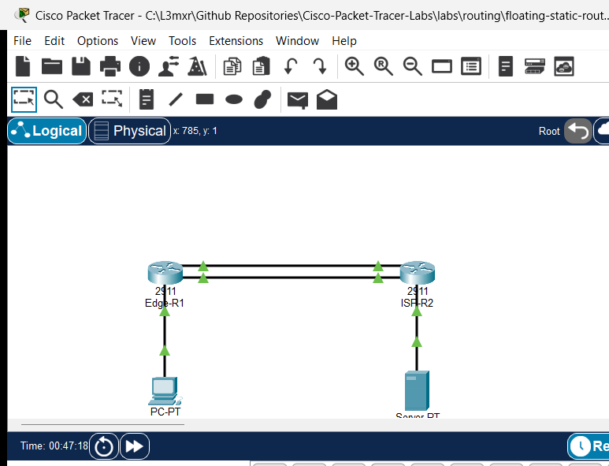

# PTL-0028: Floating Static Routes and Administrative Distance

> **Category:** routing · **Difficulty:** intermediate · **Lab ID:** PTL-0028 · **Document:** reviewed · **Simulator:** tested pass

In enterprise and mission-critical branch architectures, network survivability requires high-availability WAN connectivity. When a primary high-speed circuit (such as a leased fiber line or Metro Ethernet connection) experiences an outage, traffic must automatically re-route over a secondary backup circuit (such as a cellular LTE broadband link, satellite uplink, or broadband VPN tunnel). While dynamic routing protocols like OSPF or BGP can converge around link failures, small-to-medium branch offices often rely on static routing to conserve bandwidth, minimize router resource utilization, and eliminate protocol complexity.

To achieve automated failover with static routes, network engineers utilize **Floating Static Routes**.

### The Role of Administrative Distance (AD)
The Cisco IOS routing table installs routes based on two fundamental criteria:
1. **Longest Prefix Match:** The most specific prefix (highest prefix length `/32`, `/24`, etc.) is always evaluated first regardless of source.
2. **Administrative Distance (AD):** When multiple routing sources or static statements advertise identical destination prefixes, Cisco IOS selects the route with the **lowest Administrative Distance**.

Standard Cisco IOS Administrative Distances include:
- Directly Connected: `0`
- Static Route: `1`
- External BGP (eBGP): `20`
- EIGRP (Internal): `90`
- OSPF: `110`
- IS-IS: `115`
- RIP: `120`
- External EIGRP: `170`
- Internal BGP (iBGP): `200`
- Unusable / Discard: `255`

By default, an ordinary static route configured with `ip route <prefix> <mask> <next-hop>` carries an Administrative Distance of **1**. A **floating static route** is simply a static route configured with an explicitly higher administrative distance (e.g., `ip route 0.0.0.0 0.0.0.0 10.2.2.2 5` or `AD 10`).

### Convergence Mechanics: Active vs. Dormant State
- **Normal Operation:** As long as the primary egress interface is in an `up/up` operational state, the primary route (`AD 1`) is installed in the Routing Information Base (RIB) and Forwarding Information Base (FIB). The backup route (`AD 5`) remains completely **dormant** and does not appear in the active routing table.
- **Failover:** When the primary interface goes down (`down/down` or administratively `shutdown`), the primary route is invalidated and purged from the routing table. Because the backup next hop is still reachable, Cisco IOS immediately installs the floating static route (`AD 5`) into the active routing table.
- **Preemption & Recovery:** When the primary interface recovers to `up/up`, Cisco IOS evaluates the lower AD (`1 < 5`) and immediately reinstates the primary route, returning the floating route to its dormant backup state.

In this laboratory, you configure, audit, and verify floating static default routes and bidirectional return routes connecting an enterprise edge branch router (`Edge-R1`) to an upstream provider gateway (`ISP-R2`) across dual point-to-point WAN links. You will test route dormancy, execute simulated link failover, trace path divergence, and verify automatic preemption upon link restoration.

---

## Learning Objectives

- Explain the function of Administrative Distance (AD) in Cisco IOS route preference and routing table installation.
- Configure primary static default routes with default AD (1) across a primary point-to-point WAN link.
- Configure floating static default routes with elevated AD (5) across a secondary point-to-point backup link.
- Configure bidirectional return static routes and floating backup routes on an upstream core provider router.
- Verify that floating static routes remain dormant in the routing table while the primary path is operational.
- Demonstrate real-time link failover and observe the floating route dynamically surface in the routing table upon primary link failure.
- Audit multi-hop forwarding path divergence using `tracert` before and during link failure.
- Demonstrate automatic preemption and traffic restoration when the primary circuit is restored.

---

## Prerequisites

- Understanding of IPv4 classless addressing, `/30` point-to-point subnets, and default routing (`0.0.0.0/0`).
- Familiarity with Cisco IOS interface configuration and privileged EXEC verification commands (`show ip route`, `show ip interface brief`).
- Completion of **PTL-0001: Dual-Stack IPv4 and IPv6 Static Routing** or equivalent static routing experience.
- Cisco Packet Tracer 8.2 or newer (Packet Tracer 9.0+ verified).

---

## Topology



The topology connects an enterprise branch edge to an upstream ISP gateway over dual WAN links:

```text
       [PC-1 Branch Client] (192.168.10.10/24)
                 │
                 │ Fa0 <-> Gi0/2 (192.168.10.1/24)
         [Edge-R1 Gateway] (Cisco 2911)
            Lo0: 192.168.100.1/24
            Gi0/0 (Primary WAN: 10.1.1.1/30) ═══════╗ Primary Link (High-Speed Fiber)
            Gi0/1 (Backup WAN:  10.2.2.1/30) ───────╢ Backup Link (Floating LTE/Broadband)
                 │                                  ║
            Gi0/0 (Primary WAN: 10.1.1.2/30) ═══════╝
            Gi0/1 (Backup WAN:  10.2.2.2/30) ───────╢
         [ISP-R2 Core Gateway] (Cisco 2911)
            Lo0: 198.51.100.1/24 (Internet Simulation)
                 │
                 │ Gi0/2 (203.0.113.1/24) <-> Fa0
       [Web-Server Data Center] (203.0.113.10/24)
```

---

## Addressing Table

| Device | Interface | IP Address | Subnet Mask | Default Gateway | Purpose |
|---|---|---|---|---|---|
| **Edge-R1** | `Gi0/0` | `10.1.1.1` | `255.255.255.252` | N/A | Primary WAN circuit to ISP-R2 |
| **Edge-R1** | `Gi0/1` | `10.2.2.1` | `255.255.255.252` | N/A | Secondary Backup WAN circuit to ISP-R2 |
| **Edge-R1** | `Gi0/2` | `192.168.10.1` | `255.255.255.0` | N/A | Branch LAN default gateway |
| **Edge-R1** | `Loopback0` | `192.168.100.1` | `255.255.255.0` | N/A | Edge management diagnostic loopback |
| **ISP-R2** | `Gi0/0` | `10.1.1.2` | `255.255.255.252` | N/A | Primary WAN circuit to Edge-R1 |
| **ISP-R2** | `Gi0/1` | `10.2.2.2` | `255.255.255.252` | N/A | Secondary Backup WAN circuit to Edge-R1 |
| **ISP-R2** | `Gi0/2` | `203.0.113.1` | `255.255.255.0` | N/A | Server LAN default gateway |
| **ISP-R2** | `Loopback0` | `198.51.100.1` | `255.255.255.0` | N/A | Internet public DNS/service simulation |
| **PC-1** | `FastEthernet0` | `192.168.10.10` | `255.255.255.0` | `192.168.10.1` | Branch client host |
| **Web-Server** | `FastEthernet0` | `203.0.113.10` | `255.255.255.0` | `203.0.113.1` | Remote destination server |

---

## Lab Tasks

1. **Verify Baseline Addressing and Primary Routing:**
   - Audit point-to-point ping reachability across the primary (`10.1.1.0/30`) and backup (`10.2.2.0/30`) WAN segments.
   - Verify that `Edge-R1` and `ISP-R2` have primary static routes installed with Administrative Distance 1.
   - Verify client-to-server reachability from `PC-1` to `Web-Server` (`203.0.113.10`).
   - Observe baseline path traversal via traceroute, confirming forwarding across the primary WAN interface (`10.1.1.2`).
2. **Configure Floating Static Routes with Elevated Administrative Distance:**
   - On `Edge-R1`, configure a floating default route pointing to backup next-hop `10.2.2.2` with an Administrative Distance of **5**.
   - On `ISP-R2`, configure floating return routes pointing to backup next-hop `10.2.2.1` for subnets `192.168.10.0/24` and `192.168.100.0/24` with an Administrative Distance of **5**.
   - Inspect the routing tables to confirm that the floating routes remain dormant while primary links are operational.
3. **Execute Link Failure and Verify Failover:**
   - Administratively shut down `GigabitEthernet0/0` on `Edge-R1`.
   - Inspect `show ip route static` on `Edge-R1` to confirm that the floating default route (`[5/0] via 10.2.2.2`) dynamically replaces the primary route.
   - Send ICMP echo requests from `PC-1` to `Web-Server` to verify uninterrupted service availability.
   - Execute `tracert` from `PC-1` to observe that forwarding hops dynamically divert across the backup link (`10.2.2.2`).
4. **Demonstrate Preemption and Restoration:**
   - Re-enable `GigabitEthernet0/0` on `Edge-R1` (`no shutdown`).
   - Verify that the primary route (`[1/0] via 10.1.1.2`) immediately preempts the floating backup route.
   - Verify path restoration via `tracert`.
5. **Conduct Negative Outage Testing:**
   - Shut down both primary and backup WAN links to observe the total loss of gateway routing and ICMP Destination Host Unreachable responses.

---

## Configuration Walkthrough

### 1. Starter State Inspection

In the starter configuration (`assets/starter.pkt`), all IP interfaces are up and both routers have only their primary static routes configured:
- `Edge-R1` has `ip route 0.0.0.0 0.0.0.0 10.1.1.2` (AD 1).
- `ISP-R2` has `ip route 192.168.10.0 255.255.255.0 10.1.1.1` (AD 1).

Inspect `Edge-R1` static routing:

```text
Edge-R1# show ip route static
S*   0.0.0.0/0 [1/0] via 10.1.1.2
```

At this stage, if the primary link goes down, `Edge-R1` has no backup path and all Internet/WAN traffic is dropped.

### 2. Configure Floating Static Route on Edge-R1

Log in to `Edge-R1` and add a floating static default route pointing toward the backup WAN interface of `ISP-R2` with an Administrative Distance of **5**:

```text
Edge-R1> enable
Edge-R1# configure terminal
Edge-R1(config)# ip route 0.0.0.0 0.0.0.0 10.2.2.2 5
Edge-R1(config)# end
Edge-R1# copy running-config startup-config
```

Verify that the routing table **still only shows the primary route**:

```text
Edge-R1# show ip route static
S*   0.0.0.0/0 [1/0] via 10.1.1.2
```

> [!NOTE]
> The route `0.0.0.0/0 via 10.2.2.2` with AD 5 is stored in the router configuration, but Cisco IOS suppresses it from the active routing table because the route via `10.1.1.2` with AD 1 is more trustworthy (lower AD).

### 3. Configure Floating Return Routes on ISP-R2

Routing is strictly unidirectional. For failover to function bidirectionally, the upstream provider router must also possess return routes over the backup link.

Log in to `ISP-R2` and configure floating return static routes with AD 5:

```text
ISP-R2> enable
ISP-R2# configure terminal
ISP-R2(config)# ip route 192.168.10.0 255.255.255.0 10.2.2.1 5
ISP-R2(config)# ip route 192.168.100.0 255.255.255.0 10.2.2.1 5
ISP-R2(config)# end
ISP-R2# copy running-config startup-config
```

Verify that the floating return routes are dormant on `ISP-R2`:

```text
ISP-R2# show ip route static
S    192.168.10.0/24 [1/0] via 10.1.1.1
S    192.168.100.0/24 [1/0] via 10.1.1.1
```

---

## Verification

### 1. Normal State Path Verification (POS-01 & POS-02)

From `PC-1` command prompt, ping `Web-Server` and trace the route:

```text
C:\> ping 203.0.113.10

Pinging 203.0.113.10 with 32 bytes of data:

Reply from 203.0.113.10: bytes=32 time<1ms TTL=126
Reply from 203.0.113.10: bytes=32 time<1ms TTL=126
Reply from 203.0.113.10: bytes=32 time<1ms TTL=126
Reply from 203.0.113.10: bytes=32 time<1ms TTL=126

Ping statistics for 203.0.113.10:
    Packets: Sent = 4, Received = 4, Lost = 0 (0% loss),
```

```text
C:\> tracert 203.0.113.10

Tracing route to 203.0.113.10 over a maximum of 30 hops: 

  1   0 ms      0 ms      0 ms      192.168.10.1
  2   0 ms      0 ms      0 ms      10.1.1.2
  3   0 ms      0 ms      0 ms      203.0.113.10

Trace complete.
```

- **Observation:** Hop 2 traverses `10.1.1.2` (Primary WAN link).

### 2. Primary Link Failover Verification (POS-03)

Simulate a fiber circuit cut by administratively disabling the primary WAN interface on `Edge-R1`:

```text
Edge-R1# configure terminal
Edge-R1(config)# interface GigabitEthernet0/0
Edge-R1(config-if)# shutdown
Edge-R1(config-if)# end
```

Immediately query the static routing table on `Edge-R1`:

```text
Edge-R1# show ip route static
S*   0.0.0.0/0 [5/0] via 10.2.2.2
```

Notice that the primary route `[1/0]` has disappeared, and the floating route `[5/0]` has automatically been promoted into the active routing table!

Now verify end-to-end connectivity from `PC-1`:

```text
C:\> ping 203.0.113.10

Pinging 203.0.113.10 with 32 bytes of data:

Reply from 203.0.113.10: bytes=32 time<1ms TTL=126
Reply from 203.0.113.10: bytes=32 time<1ms TTL=126
Reply from 203.0.113.10: bytes=32 time<1ms TTL=126
Reply from 203.0.113.10: bytes=32 time<1ms TTL=126

Ping statistics for 203.0.113.10:
    Packets: Sent = 4, Received = 4, Lost = 0 (0% loss),
```

Trace the path from `PC-1` during the failover:

```text
C:\> tracert 203.0.113.10

Tracing route to 203.0.113.10 over a maximum of 30 hops: 

  1   0 ms      0 ms      0 ms      192.168.10.1
  2   0 ms      0 ms      0 ms      10.2.2.2
  3   0 ms      0 ms      0 ms      203.0.113.10

Trace complete.
```

- **Observation:** Hop 2 dynamically shifted from `10.1.1.2` to `10.2.2.2` (Backup WAN link).

### 3. Preemption and Restoration Verification (POS-04)

Restore the primary WAN circuit on `Edge-R1`:

```text
Edge-R1# configure terminal
Edge-R1(config)# interface GigabitEthernet0/0
Edge-R1(config-if)# no shutdown
Edge-R1(config-if)# end
```

Inspect the routing table on `Edge-R1`:

```text
Edge-R1# show ip route static
S*   0.0.0.0/0 [1/0] via 10.1.1.2
```

Trace the route from `PC-1` once more:

```text
C:\> tracert 203.0.113.10

Tracing route to 203.0.113.10 over a maximum of 30 hops: 

  1   0 ms      0 ms      0 ms      192.168.10.1
  2   0 ms      0 ms      0 ms      10.1.1.2
  3   0 ms      0 ms      0 ms      203.0.113.10

Trace complete.
```

- **Observation:** The router immediately preempts the floating backup route and restores primary forwarding across `10.1.1.2`.

---

## Troubleshooting

| Symptom | Probable Cause | Diagnostic Command | Remediation |
|---|---|---|---|
| Both primary and backup routes appear simultaneously in `show ip route` | Backup route was configured without an elevated AD (default AD 1 applied) | `show running-config \| include ip route` | Delete backup route and re-enter with trailing distance: `ip route ... <distance>` (e.g. `5`) |
| Floating route does not activate when primary link fails | Primary interface did not transition to `down` state (e.g. switch between routers kept port up) | `show ip interface brief` | In real networks, use IP SLA with object tracking (`track`); in point-to-point serial/direct Ethernet, ensure port goes down |
| Outbound traffic shifts to backup link, but ping replies never return | Return floating route missing on upstream router `ISP-R2` | `show ip route static` on `ISP-R2` during failover | Add floating return routes on `ISP-R2` with AD 5 pointing back to `10.2.2.1` |
| Floating static route never installs even after primary route deletion | Next-hop IP address of backup route is invalid or unreachable | `ping <backup-next-hop>` | Verify backup IP addressing and subnet masks on both sides of the secondary link |

---

## Key Takeaways

- **Administrative Distance Governs Installation:** Only the route with the lowest AD is placed in the active routing table. Equal AD results in Equal-Cost Multi-Path (ECMP) load balancing, not failover.
- **Failover Requires Interface Status Changes:** Standard floating static routes rely on the physical or data link state of the exit interface transitioning to `down`. When intermediary devices (such as media converters or switches) prevent link loss detection, Cisco IOS IP SLA object tracking (`ip route ... track <object>`) is required.
- **Path Symmetry:** Failover must always be designed bidirectionally. If `Edge-R1` fails over to the backup link but `ISP-R2` only has a route pointing to the primary link, return traffic will be dropped when the primary link is down.

---

## References

- [Cisco Technical Support - What Is Administrative Distance?](https://www.cisco.com/c/en/us/support/docs/ip/general-routing-protocols/16631-forming-routes.html)
- [Cisco IOS IP Routing: Protocol-Independent Configuration Guide - Floating Static Routes](https://www.cisco.com/c/en/us/td/docs/ios-xml/ios/iproute_pi/configuration/15-mt/iri-15-mt-book.html)
- [Cisco CCNA Exam Topic 3.4 - Configure and verify IPv4 and IPv6 static routing (floating static routes)](https://learningnetwork.cisco.com/s/ccna-exam-topics)

---

## Files and Validation Status

| File | Purpose | Verification Status |
|---|---|---|
| `assets/starter.pkt` | Starter lab topology with primary route only | Validated (Packet Tracer 9.0+) |
| `assets/completed.pkt` | Completed topology with verified floating static failover | Validated (Packet Tracer 9.0+) |
| `assets/topology.png` | Network topology canvas capture | Generated and verified |
| `configs/Edge-R1.txt` | Clean Cisco IOS running configuration for Edge-R1 | Verified against live device |
| `configs/ISP-R2.txt` | Clean Cisco IOS running configuration for ISP-R2 | Verified against live device |
| `metadata.json` | Catalog metadata and learning outcomes | Compliant with schema |
| `verification.md` | Detailed test matrix and execution evidence | Verified against simulator output |

