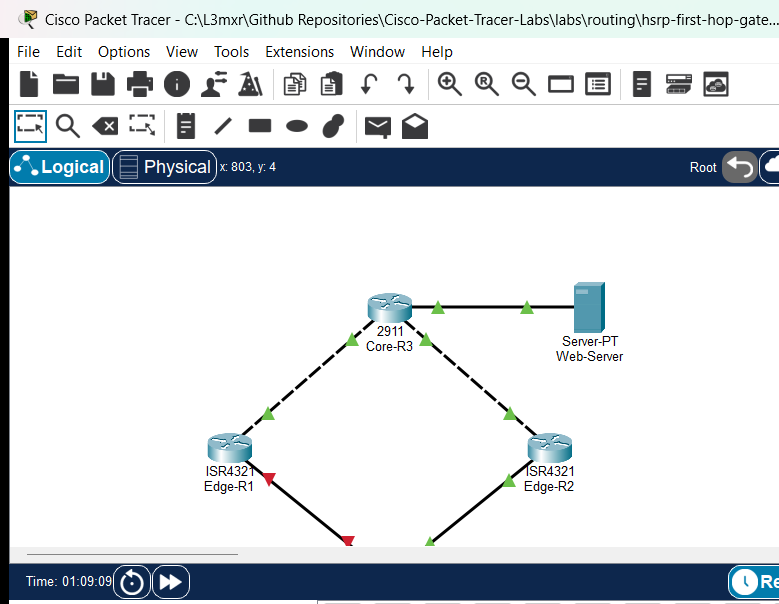

# PTL-0032: HSRP First-Hop Gateway Failover

In traditional IP networks, end-user workstations are configured with a single default gateway address (e.g., `192.168.1.1`). If the physical router interface serving as that gateway fails, or if the router loses its upstream connection, all local hosts lose external network access until manual re-addressing or dynamic DHCP reconfiguration occurs.

**Hot Standby Router Protocol (HSRP)** is a Cisco proprietary First-Hop Redundancy Protocol (FHRP) designed to eliminate this single point of failure. Redundant routers share a **Virtual IP (VIP)** address and a **Virtual MAC address**. One router is elected as the **Active** router and actively processes and forwards traffic destined to the virtual MAC. A second router acts as the **Standby** router, monitoring hello heartbeats. If the Active router stops sending hello packets, the Standby router seamlessly assumes the Active forwarding role without requiring client configuration changes.

In this advanced laboratory, you will configure HSRP version 2 on two Cisco 4321 edge routers (`Edge-R1` and `Edge-R2`). You will establish deterministic active/standby roles using priority configuration, enforce preemption, test end-to-end client connectivity, and simulate an active gateway failure to observe state transitions and verify transparent failover.

---

## Learning Objectives
- Explain the necessity of First-Hop Redundancy Protocols (FHRP) in avoiding single points of failure at the default gateway.
- Configure Hot Standby Router Protocol version 2 (HSRPv2) on Cisco IOS edge routers.
- Assign and verify virtual IP (VIP) and virtual MAC addresses within an HSRP standby group.
- Configure custom HSRP priority and preemption to establish deterministic Active and Standby gateway forwarding roles.
- Examine HSRP state machine transitions (Listen, Speak, Standby, Active) using Cisco IOS verification commands.
- Simulate an active router interface failure and verify transparent gateway failover to the standby router with uninterrupted host connectivity.
- Validate HSRP preemption behavior when the primary gateway recovers from failure.

---

## Prerequisites
- Completion of `PTL-0010` (Router-on-a-Stick Inter-VLAN Routing) or `PTL-0019` (Layer 3 Switch SVIs and Routed Ports).
- Understanding of default gateway operation, ARP resolution, and proxy ARP mechanics.
- Familiarity with basic OSPF single-area routing convergence.

---

## Topology
The enterprise topology consists of two redundant edge routers connecting an internal client LAN to an upstream core router and external web server:



```text
                  +---------------------------+
                  |    Core-R3 (Cisco 2911)   |
                  |  Lo0: 3.3.3.3/32          |
                  +-------------+-------------+
                         /             \
       Gi0/0 (10.10.12.2/30)         Gi0/1 (10.10.23.2/30)
                       /                 \
                      /                   \
    Gi0/0/0 (10.10.12.1/30)           Gi0/0/0 (10.10.23.1/30)
+---------------------------+       +---------------------------+
|    Edge-R1 (Cisco 4321)   |       |    Edge-R2 (Cisco 4321)   |
|  Primary Gateway          |       |  Standby Gateway          |
|  Gi0/0/1: 192.168.1.2/24  |       |  Gi0/0/1: 192.168.1.3/24  |
|  HSRP Grp 1: Pri 110, VIP |       |  HSRP Grp 1: Pri 100, VIP |
|  Preempt Enabled          |       |  Preempt Enabled          |
+-------------+-------------+       +-------------+-------------+
       Gi0/0/1 \                         / Gi0/0/1
                \                       /
           Fa0/1 \                     / Fa0/2
              +---------------------------+
              |   Switch-S1 (2960-24TT)   |
              |   VLAN 1: 192.168.1.5/24  |
              +-------------+-------------+
                     /             \
               Fa0/10               Fa0/11
                 /                     \
       +-------------------+ +-------------------+
       |   PC1 (PC-PT)     | |   PC2 (PC-PT)     |
       |  192.168.1.10/24  | |  192.168.1.20/24  |
       |  GW: 192.168.1.1  | |  GW: 192.168.1.1  |
       +-------------------+ +-------------------+
```

---

## Addressing Table

| Device | Interface | IP Address | Subnet Mask | Default Gateway | HSRP Role & Group |
| :--- | :--- | :--- | :--- | :--- | :--- |
| **Edge-R1** | Gi0/0/0 | `10.10.12.1` | `255.255.255.252` | N/A | Uplink to Core-R3 |
| | Gi0/0/1 | `192.168.1.2` | `255.255.255.0` | N/A | Physical LAN IP |
| | Gi0/0/1 (HSRP) | `192.168.1.1` | `255.255.255.0` | N/A | **Active Gateway** (Priority 110, Preempt) |
| **Edge-R2** | Gi0/0/0 | `10.10.23.1` | `255.255.255.252` | N/A | Uplink to Core-R3 |
| | Gi0/0/1 | `192.168.1.3` | `255.255.255.0` | N/A | Physical LAN IP |
| | Gi0/0/1 (HSRP) | `192.168.1.1` | `255.255.255.0` | N/A | **Standby Gateway** (Priority 100, Preempt) |
| **Core-R3** | Gi0/0 | `10.10.12.2` | `255.255.255.252` | N/A | Link to Edge-R1 |
| | Gi0/1 | `10.10.23.2` | `255.255.255.252` | N/A | Link to Edge-R2 |
| | Gi0/2 | `203.0.113.1` | `255.255.255.0` | N/A | Link to Web-Server |
| | Loopback0 | `3.3.3.3` | `255.255.255.255` | N/A | Router ID / Loopback |
| **Switch-S1**| VLAN 1 | `192.168.1.5` | `255.255.255.0` | `192.168.1.1` | Management SVI |
| **PC1** | Fa0 | `192.168.1.10` | `255.255.255.0` | `192.168.1.1` | LAN Client 1 |
| **PC2** | Fa0 | `192.168.1.20` | `255.255.255.0` | `192.168.1.1` | LAN Client 2 |
| **Web-Server**| Fa0 | `203.0.113.100` | `255.255.255.0` | `203.0.113.1` | Enterprise Web Server |

---

## Lab Tasks
1. Verify initial problem state: LAN clients pointing to default gateway `192.168.1.1` fail to reach external destinations because no node responds to ARP for `192.168.1.1`.
2. Configure HSRP version 2 on `Edge-R1` LAN interface `Gi0/0/1` with Virtual IP `192.168.1.1`, priority `110`, and preemption.
3. Configure HSRP version 2 on `Edge-R2` LAN interface `Gi0/0/1` with Virtual IP `192.168.1.1`, priority `100`, and preemption.
4. Verify HSRP state convergence and virtual MAC address generation (`0000.0c9f.f001`).
5. Verify end-to-end IP communication from `PC1` and `PC2` to both the virtual gateway (`192.168.1.1`) and external Web Server (`203.0.113.100`).
6. Simulate active gateway failure by shutting down `Gi0/0/1` on `Edge-R1` and verify automatic, seamless failover to `Edge-R2`.
7. Re-enable `Gi0/0/1` on `Edge-R1` and verify preemption restores `Edge-R1` as the Active forwarder.

---

## Configuration Walkthrough

### Step 1: Verify Initial Problem State
From `PC1`, open the Command Prompt and attempt to ping the configured default gateway:
```cmd
ping 192.168.1.1
```
*Expected Result:* The ping fails with `Request timed out` because no active router is currently assigned the virtual IP `192.168.1.1`.

### Step 2: Configure HSRPv2 on Primary Gateway (Edge-R1)
Enter global configuration mode on `Edge-R1`. Configure HSRP on LAN interface `GigabitEthernet0/0/1`:
```ios
Edge-R1# configure terminal
Edge-R1(config)# interface GigabitEthernet0/0/1
Edge-R1(config-if)# standby version 2
Edge-R1(config-if)# standby 1 ip 192.168.1.1
Edge-R1(config-if)# standby 1 priority 110
Edge-R1(config-if)# standby 1 preempt
Edge-R1(config-if)# end
Edge-R1# write memory
```
*Note:* The default HSRP priority is `100`. Setting the priority to `110` ensures `Edge-R1` wins the active election. Enabling `preempt` permits `Edge-R1` to reclaim the active role if it rejoins after an outage.

### Step 3: Configure HSRPv2 on Secondary Gateway (Edge-R2)
Enter global configuration mode on `Edge-R2`. Configure HSRP on LAN interface `GigabitEthernet0/0/1`:
```ios
Edge-R2# configure terminal
Edge-R2(config)# interface GigabitEthernet0/0/1
Edge-R2(config-if)# standby version 2
Edge-R2(config-if)# standby 1 ip 192.168.1.1
Edge-R2(config-if)# standby 1 priority 100
Edge-R2(config-if)# standby 1 preempt
Edge-R2(config-if)# end
Edge-R2# write memory
```

---

## Verification

### 1. Primary Gateway Role (Edge-R1)
Execute `show standby brief` on `Edge-R1`:
```ios
Edge-R1# show standby brief
                     P indicates configured to preempt.
                     |
Interface   Grp  Pri P State    Active          Standby         Virtual IP
Gig0/0/1    1    110 P Active   local           192.168.1.3     192.168.1.1
```

### 2. Standby Gateway Role (Edge-R2)
Execute `show standby brief` on `Edge-R2`:
```ios
Edge-R2# show standby brief
                     P indicates configured to preempt.
                     |
Interface   Grp  Pri P State    Active          Standby         Virtual IP
Gig0/0/1    1    100 P Standby  192.168.1.2     local           192.168.1.1
```

### 3. Client IP Connectivity
From `PC1`, ping the virtual default gateway:
```cmd
ping 192.168.1.1
```
*Result:* 4/4 replies received (100% success).

From `PC1`, ping the external Web Server:
```cmd
ping 203.0.113.100
```
*Result:* 4/4 replies received (100% success).

### 4. Failover Simulation
Shut down LAN interface on `Edge-R1`:
```ios
Edge-R1(config)# interface GigabitEthernet0/0/1
Edge-R1(config-if)# shutdown
```
Observe `Edge-R2`:
```ios
Edge-R2# show standby brief
Interface   Grp  Pri P State    Active          Standby         Virtual IP
Gig0/0/1    1    100 P Active   local           unknown         192.168.1.1
```
Verify `PC1` continues to ping `203.0.113.100` with 0% packet loss!

### 5. Preemption and Recovery
Restore `Edge-R1` LAN interface:
```ios
Edge-R1(config)# interface GigabitEthernet0/0/1
Edge-R1(config-if)# no shutdown
```
Verify `Edge-R1` immediately preempts and reclaims `Active` state, while `Edge-R2` gracefully returns to `Standby`.

---

## Troubleshooting
- **State Stuck in `Speak` or `Init`:** Ensure physical LAN interfaces on both routers are in the `up/up` operational state. Verify that both routers are in the same IP subnet (`192.168.1.0/24`) and that switchports on `Switch-S1` are not blocked by STP.
- **Both Routers Active (Split-Brain):** Check that both routers are configured with matching HSRP versions (`standby version 2`) and group numbers (`1`). If version 1 and version 2 are mixed, they use different multicast addresses (`224.0.0.2` vs `224.0.0.102`) and will fail to see each other's hello packets.
- **Failover Does Not Occur:** Ensure hello and hold timers match across both routers. In Packet Tracer, allow sufficient simulation time (at least 10 seconds hold time) for the standby router to detect missing hellos.
- **Primary Does Not Reclaim Active Role:** Verify that `standby 1 preempt` is configured on `Edge-R1`. Without preemption, a higher-priority router will remain in Standby state indefinitely until the currently active router fails.

---

## Key Takeaways
- First-Hop Redundancy Protocols allow redundant physical routers to present a single virtual gateway IP and MAC address to local clients, eliminating default gateway single points of failure.
- HSRP version 2 uses multicast address `224.0.0.102` and virtual MAC range `0000.0C9F.F000` through `0000.0C9F.FFFF` (where the last three hex digits match the group number).
- HSRP priority defaults to `100` (range 1-255). The router with the highest priority becomes Active.
- Preemption is disabled by default in Cisco IOS. It must be explicitly configured with `standby <group> preempt` on any router intended to deterministically assume the Active role after recovery.

---

## References
- Cisco IOS IP Application Services Command Reference: HSRP Commands
- RFC 2281: Cisco Hot Standby Router Protocol (HSRP)
- Cisco CCNA Exam Topics (Topic 3.5: First Hop Redundancy Protocols)

---

## Files and Validation Status

| File | Purpose | Verification Status |
| :--- | :--- | :--- |
| `assets/starter.pkt` | Starter lab file with cabling, addressing, and OSPF active, but HSRP unconfigured | Verified: Pings to VIP `192.168.1.1` fail |
| `assets/completed.pkt` | Fully completed and converged lab with HSRPv2 priority, preemption, and failover verified | Verified: Pings succeed, state transitions pass |
| `assets/topology.png` | Topology diagram captured from Packet Tracer canvas | Verified |
| `configs/Edge-R1.txt` | Complete running configuration for Edge-R1 | Verified |
| `configs/Edge-R2.txt` | Complete running configuration for Edge-R2 | Verified |
| `configs/Core-R3.txt` | Complete running configuration for Core-R3 | Verified |
| `configs/Switch-S1.txt` | Complete running configuration for Switch-S1 | Verified |
