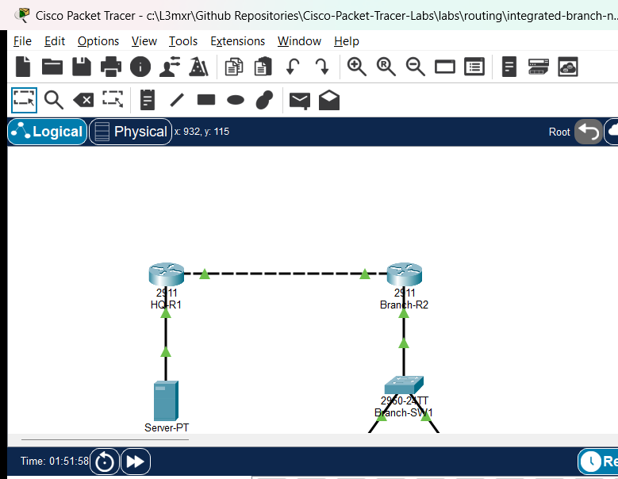

# Integrated Branch Network Troubleshooting Challenge

## Learning Objectives
- Perform multi-domain fault isolation across Layer 2 switching, Layer 3 routing, network services, and security policies.
- Diagnose and resolve IEEE 802.1Q trunk allowed-VLAN pruning misconfigurations that isolate access subnets.
- Troubleshoot Cisco IOS DHCP relay agent functionality (`ip helper-address`) forwarding client broadcasts across router boundaries.
- Inspect and correct mispointed or missing static routes causing asymmetric or complete traffic blackholing.
- Evaluate extended access control list (ACL) rules and remove unintended traffic deny statements blocking authorized enterprise flows.

## Prerequisites
- Completion of [DHCP Relay Troubleshooting Across VLANs](../../network-services/dhcp-relay-troubleshooting-across-vlans/README.md) (PTL-0052) or equivalent enterprise networking experience.
- Thorough understanding of 802.1Q trunking, router-on-a-stick subinterfaces, DHCP relay operation, and standard/extended IPv4 access control lists.
- Familiarity with Cisco IOS diagnostic commands (`show interfaces trunk`, `show ip interface brief`, `show ip route`, `show access-lists`, `show ip dhcp binding`).

## Topology
```
[ HQ-Server ] (10.0.1.100/24, GW: 10.0.1.1)
      | Fa0
      | Gi0/0
[ HQ-R1 ] (Cisco 2911) [DHCP Pools: 192.168.10.0/24, 192.168.20.0/24]
      | Gi0/1 (WAN Transit: 10.1.12.1/30)
      |
      | Gi0/1 (WAN Transit: 10.1.12.2/30)
[ Branch-R2 ] (Cisco 2911)
      | Gi0/0 (802.1Q Trunk: Gi0/0.10, Gi0/0.20)
      | Gi0/1
[ Branch-SW1 ] (Catalyst 2960-24TT)
      |-- Fa0/10 (VLAN 10 Access) <---> [ Staff-PC1 ] (DHCP: 192.168.10.x/24)
      +-- Fa0/20 (VLAN 20 Access) <---> [ Eng-PC2 ] (Static: 192.168.20.10/24, GW: 192.168.20.1)
```



The topology represents a realistic branch office architecture connected to corporate headquarters via a point-to-point transit link:
- **HQ-R1** serves as the central router and DHCP server for all branch office subnets.
- **HQ-Server** hosts critical corporate services within the headquarters LAN.
- **Branch-R2** performs router-on-a-stick inter-VLAN routing and applies branch perimeter security policies.
- **Branch-SW1** segments local branch clients into VLAN 10 (Staff) and VLAN 20 (Engineering).
- **Staff-PC1** relies on dynamic DHCP address assignment forwarded across the WAN by the branch router.
- **Eng-PC2** uses a static IPv4 configuration for administrative workstation connectivity.

## Addressing Table
| Device | Interface | IPv4 Address | Subnet Mask | Default Gateway | Purpose |
|---|---|---|---|---|---|
| **HQ-R1** | `Gi0/0` | `10.0.1.1` | `255.255.255.0` | N/A | Corporate Server LAN Gateway |
| **HQ-R1** | `Gi0/1` | `10.1.12.1` | `255.255.255.252` | N/A | WAN Transit to Branch-R2 |
| **Branch-R2** | `Gi0/1` | `10.1.12.2` | `255.255.255.252` | N/A | WAN Transit to HQ-R1 |
| **Branch-R2** | `Gi0/0.10` | `192.168.10.1` | `255.255.255.0` | N/A | VLAN 10 Gateway & DHCP Relay |
| **Branch-R2** | `Gi0/0.20` | `192.168.20.1` | `255.255.255.0` | N/A | VLAN 20 Gateway |
| **Branch-SW1** | `VLAN 1` | `192.168.10.2` | `255.255.255.0` | `192.168.10.1` | Switch Management SVI |
| **HQ-Server** | `Fa0` | `10.0.1.100` | `255.255.255.0` | `10.0.1.1` | Corporate Services Server |
| **Staff-PC1** | `Fa0` | DHCP (`192.168.10.x`) | `255.255.255.0` | `192.168.10.1` | Staff Client Workstation |
| **Eng-PC2** | `Fa0` | `192.168.20.10` | `255.255.255.0` | `192.168.20.1` | Engineering Workstation |

## Lab Tasks
1. **Audit Branch Layer 2 Trunking:** Inspect `Branch-SW1` trunk interface `Gi0/1` to ensure all required branch VLANs (10 and 20) are permitted across the trunk to `Branch-R2`.
2. **Restore DHCP Relay Functionality:** Verify that `Branch-R2` subinterface `Gi0/0.10` correctly forwards DHCP discover broadcasts to the headquarters server at `10.0.1.1`.
3. **Correct HQ Routing Blackhole:** Investigate `HQ-R1` routing table to ensure return routes to `192.168.10.0/24` and `192.168.20.0/24` point to the valid branch next-hop `10.1.12.2`.
4. **Remediate Perimeter Security ACL:** Analyze extended ACL `101` applied to `Branch-R2` WAN interface `Gi0/1` and eliminate unnecessary deny entries blocking ICMP communication to `HQ-Server`.
5. **Validate End-to-End Traffic Matrix:** Confirm dynamic IP allocation on `Staff-PC1`, local gateway reachability, inter-VLAN routing, and bidirectional communication to `HQ-Server`.

## Configuration Walkthrough

### 1. Diagnosing and Repairing Trunk Allowed VLANs on Branch-SW1
In the starter network, `Eng-PC2` is unable to communicate with its default gateway `192.168.20.1`. Inspecting the trunk interface shows that VLAN 20 is pruned from the allowed list:
```text
Branch-SW1# show interfaces trunk
Port        Mode             Encapsulation  Status        Native vlan
Gi0/1       on               802.1q         trunking      1

Port        Vlans allowed on trunk
Gi0/1       10
```
To restore VLAN 20 traffic across the trunk, allow all VLANs or add VLAN 20 explicitly:
```text
Branch-SW1# configure terminal
Branch-SW1(config)# interface GigabitEthernet0/1
Branch-SW1(config-if)# switchport trunk allowed vlan add 20
Branch-SW1(config-if)# exit
Branch-SW1(config)# exit
Branch-SW1# copy running-config startup-config
```

### 2. Restoring DHCP Relay on Branch-R2
In the starter network, `Staff-PC1` cannot obtain an IP address via DHCP and defaults to `0.0.0.0` or an APIPA address. Inspecting `Branch-R2` reveals that subinterface `Gi0/0.10` does not have an `ip helper-address` configured:
```text
Branch-R2# show running-config interface GigabitEthernet0/0.10
interface GigabitEthernet0/0.10
 encapsulation dot1Q 10
 ip address 192.168.10.1 255.255.255.0
end
```
Configure `ip helper-address` pointing to `HQ-R1` LAN gateway `10.0.1.1`:
```text
Branch-R2# configure terminal
Branch-R2(config)# interface GigabitEthernet0/0.10
Branch-R2(config-subif)# ip helper-address 10.0.1.1
Branch-R2(config-subif)# exit
Branch-R2(config)# exit
Branch-R2# copy running-config startup-config
```
Upon issuing `ipconfig /renew` on `Staff-PC1`, the client receives a dynamic lease in `192.168.10.0/24`.

### 3. Repairing Static Return Routes on HQ-R1
Although branch clients can send traffic outbound toward HQ, return packets never reach the branch because `HQ-R1` has an invalid summary route next-hop `10.1.12.6`:
```text
HQ-R1# show ip route static
S    192.168.0.0/16 [1/0] via 10.1.12.6
```
Remove the erroneous static route and install precise routes to the branch subnets via `10.1.12.2`:
```text
HQ-R1# configure terminal
HQ-R1(config)# no ip route 192.168.0.0 255.255.0.0 10.1.12.6
HQ-R1(config)# ip route 192.168.10.0 255.255.255.0 10.1.12.2
HQ-R1(config)# ip route 192.168.20.0 255.255.255.0 10.1.12.2
HQ-R1(config)# exit
HQ-R1# copy running-config startup-config
```

### 4. Correcting Edge Security Filtering on Branch-R2
When testing connectivity from `Eng-PC2` to `HQ-Server` (`10.0.1.100`), pings fail despite correct routing. Examining the access list on `Branch-R2` reveals an unintended deny rule:
```text
Branch-R2# show access-lists 101
Extended IP access list 101
    10 deny icmp any host 10.0.1.100
    20 permit ip any any
```
Modify or replace the ACL so that legitimate diagnostic ICMP traffic is permitted:
```text
Branch-R2# configure terminal
Branch-R2(config)# no access-list 101
Branch-R2(config)# access-list 101 permit ip any any
Branch-R2(config)# interface GigabitEthernet0/1
Branch-R2(config-if)# ip access-group 101 out
Branch-R2(config-if)# exit
Branch-R2(config)# exit
Branch-R2# copy running-config startup-config
```

## Verification
Execute the following verification commands to confirm all faults have been resolved:

1. **Verify DHCP Allocation on Staff-PC1:**
   ```text
   C:\> ipconfig
   FastEthernet0 Connection:
      IPv4 Address........: 192.168.10.50
      Subnet Mask.........: 255.255.255.0
      Default Gateway.....: 192.168.10.1
      DHCP Server.........: 10.0.1.1
   ```

2. **Verify Inter-VLAN Routing:**
   From `Eng-PC2` (192.168.20.10), ping `Staff-PC1`:
   ```text
   C:\> ping 192.168.10.50
   Reply from 192.168.10.50: bytes=32 time<1ms TTL=127
   Ping statistics: Packets: Sent = 4, Received = 4, Lost = 0 (0% loss)
   ```

3. **Verify WAN Reachability to Corporate Server:**
   From `Eng-PC2` and `Staff-PC1`, ping `HQ-Server` (`10.0.1.100`):
   ```text
   C:\> ping 10.0.1.100
   Reply from 10.0.1.100: bytes=32 time<1ms TTL=126
   Ping statistics: Packets: Sent = 4, Received = 4, Lost = 0 (0% loss)
   ```

4. **Verify Active Trunk and Allowed VLANs on Switch:**
   ```text
   Branch-SW1# show interfaces trunk
   Port        Vlans allowed on trunk
   Gi0/1       1-4094
   ```

5. **Verify Routing Table on HQ-R1:**
   ```text
   HQ-R1# show ip route static
   S    192.168.10.0/24 [1/0] via 10.1.12.2
   S    192.168.20.0/24 [1/0] via 10.1.12.2
   ```

## Troubleshooting
| Symptom | Root Cause | Solution |
|---|---|---|
| `Eng-PC2` cannot reach gateway `192.168.20.1` | VLAN 20 omitted from `Branch-SW1 Gi0/1` allowed list | Execute `switchport trunk allowed vlan add 20` on switch trunk interface. |
| `Staff-PC1` receives no DHCP lease (APIPA / 0.0.0.0) | `ip helper-address` missing on `Branch-R2 Gi0/0.10` | Configure `ip helper-address 10.0.1.1` under subinterface `Gi0/0.10`. |
| Outbound traffic leaves branch but pings time out | `HQ-R1` has incorrect next-hop (`10.1.12.6`) for branch subnets | Remove mispointed route and configure static routes pointing to `10.1.12.2`. |
| TCP connects to server but ICMP pings fail | `Branch-R2` ACL 101 has explicit `deny icmp` rule | Reconfigure ACL 101 to permit required diagnostic ICMP traffic. |

## Key Takeaways
- Enterprise network troubleshooting requires systematic Layer 1 through Layer 4 verification; a failure in Layer 2 trunking or Layer 3 return routing manifests similarly to application-level outages.
- Cisco IOS DHCP relay agents convert client broadcast DHCP messages into unicast UDP packets destined for the centralized DHCP server, requiring reliable bidirectional routing.
- Access control lists are processed sequentially in top-down order; explicit deny statements placed ahead of broad permits immediately discard matching traffic.
- Point-to-point `/30` transit links have only two usable host IP addresses; static route next-hops must strictly reference the peer's assigned interface address.

## References
- Cisco Systems, *IP Addressing: DHCP Configuration Guide, Cisco IOS XE Release 16*: [Cisco DHCP Relay Agent Guide](https://www.cisco.com/c/en/us/td/docs/ios-xml/ios/ipaddr_dhcp/configuration/xe-16/dhcp-xe-16-book/dhcp-relay-agent.html).
- Cisco Systems, *Security Configuration Guide: Access Control Lists, Cisco IOS XE Release 16*: [Cisco IOS ACL Configuration Guide](https://www.cisco.com/c/en/us/td/docs/ios-xml/ios/sec_data_acl/configuration/xe-16/sec-data-acl-xe-16-book.html).
- Cisco Systems, *Layer 2 Configuration Guide, Catalyst 2960 Series Switches*: [Catalyst 2960 Trunking Guide](https://www.cisco.com/c/en/us/td/docs/switches/lan/catalyst2960/software/release/12-2_55_se/configuration/guide/scg_2960/swvlan.html).

## Files and Validation Status
- Starter Project: `assets/starter.pkt`
- Completed Reference Project: `assets/completed.pkt`
- Topology Diagram: `assets/topology.png`
- Test Verification Evidence: `assets/test_evidence.json`
- Router Configurations: `configs/HQ-R1.txt`, `configs/Branch-R2.txt`, `configs/Branch-SW1.txt`
- Simulator Status: **TESTED PASS** (Verified on Cisco Packet Tracer 9.0.1; complete multi-domain fault remediation and 100% bidirectional connectivity recorded in [PTL-0055-SIMULATOR-RESULTS.md](../../../AI_AGENT_GUIDE/state/PTL-0055-SIMULATOR-RESULTS.md)).

