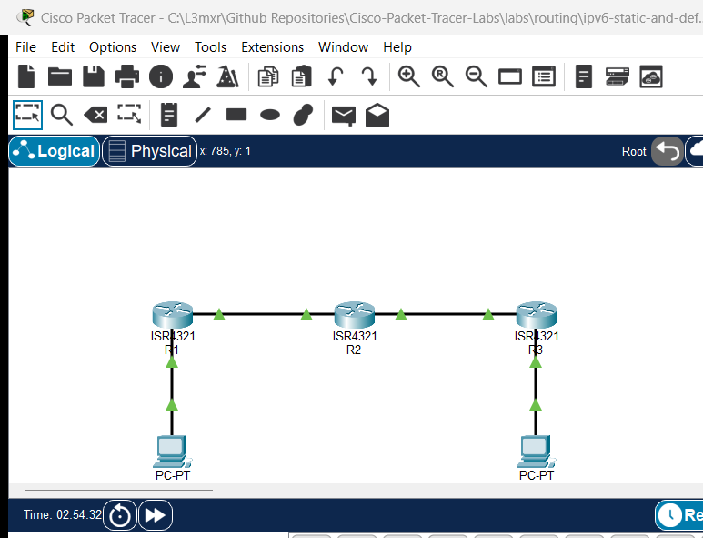

# PTL-0027: IPv6 Static and Default Route Troubleshooting

> **Category:** routing · **Difficulty:** intermediate · **Lab ID:** PTL-0027 · **Document:** reviewed · **Simulator:** tested pass

Static routing in IPv6 operates similarly to legacy IPv4 static routing, but with important protocol distinctions regarding address representation, next-hop resolution, and default prefix notation. In enterprise networks, static routes are widely deployed for stub networks, branch office connectivity, backup links, and routing toward specific management loopback addresses where dynamic routing protocols like OSPFv3 or BGP are either unnecessary or impractical.

An IPv6 static route can be configured in Cisco IOS using several variations:
1. **Recursive Static Route:** Specifies solely the next-hop IPv6 Global Unicast Address (e.g., `ipv6 route 2001:db8:acad:3::/64 2001:db8:acad:23::3`). The router performs a recursive lookup in the IPv6 routing table to determine which egress interface reaches that next hop.
2. **Directly Attached Static Route:** Specifies only the exit interface (e.g., `ipv6 route 2001:db8:acad:3::/64 GigabitEthernet0/0/1`). On multi-access Ethernet links, this requires the router to send Neighbor Solicitation (NS) requests for every destination IPv6 address within that subnet, which is inefficient and generally discouraged on Ethernet interfaces.
3. **Fully Specified Static Route:** Specifies both the exit interface and the next-hop address. When using an IPv6 Link-Local address (`fe80::/10`) as the next hop, Cisco IOS **strictly mandates** a fully specified route because link-local addresses are ambiguous without specifying the interface context.
4. **Default Static Route (`::/0`):** Matches all destinations using the IPv6 unspecified address and a zero-length prefix mask. Edge stub routers utilize `ipv6 route ::/0 <next-hop>` to forward all off-subnet traffic toward upstream aggregation or core routers.

A common pitfall in static routing deployments is **asymmetric routing and missing return paths**: even when packets successfully traverse outbound through multiple routers to reach a destination host, the destination cannot reply if any intermediary router lacks an explicit static route back to the originating source network.

In this laboratory, you troubleshoot and resolve routing failures across a multi-router hub-and-spoke enterprise topology connecting two remote branch offices (`R1` and `R3`) through a central hub router (`R2`). You will identify misconfigured next-hop addresses, supply missing default routes on stub branch routers, install return static routes on the central hub, verify path symmetry using ICMPv6 echo and traceroute, and examine router behavior under route removal.

---

## Learning Objectives

- Analyze IPv6 static routing fundamentals, recursive next-hop resolution, and the role of the default route (`::/0`).
- Identify common IPv6 routing misconfigurations, including typographic next-hop errors and omitted return routes.
- Enable global IPv6 unicast routing across all enterprise routers using `ipv6 unicast-routing`.
- Configure IPv6 default static routes on stub branch routers (`R1` and `R3`) pointing toward the central hub (`R2`).
- Configure recursive IPv6 static routes on the central hub router (`R2`) pointing toward remote branch LAN subnets and diagnostic loopback interfaces.
- Inspect and interpret the Cisco IOS IPv6 routing table using `show ipv6 route` across connected (`C`), local (`L`), and static (`S`) entries.
- Verify end-to-end multi-hop connectivity between branch hosts (`PC-1` to `PC-2`) using ICMPv6 echo requests and `tracert`.
- Demonstrate the impact of missing return routes on bidirectional communication through controlled negative testing.

---

## Prerequisites

- Understanding of IPv6 global unicast addressing (`2001:db8::/32`) and prefix subnetting (`/64`).
- Familiarity with Cisco IOS interface configuration and basic command-line navigation.
- Conceptual knowledge of routing tables, next-hop forwarding, and stub network design.
- Completion of **PTL-0026: IPv6 SLAAC and Neighbor Discovery** or foundational IPv6 experience.
- Cisco Packet Tracer 8.2 or newer (Packet Tracer 9.0+ verified).

---

## Topology



The topology models an enterprise WAN connecting two branch sites to a central data center hub:

```text
[PC-1 Branch 1 Host]
   Fa0: 2001:db8:acad:1::10/64, GW 2001:db8:acad:1::1
      │
      │ Gi0/0/1
[R1 Branch Gateway] (ISR 4321)
   Lo0: 2001:db8:acad:101::1/64
   Gi0/0/0: 2001:db8:acad:12::1/64
      │
      │ Gi0/0/0
[R2 Central Hub Router] (ISR 4321)
   Lo0: 2001:db8:acad:202::1/64
   Gi0/0/1: 2001:db8:acad:23::2/64
      │
      │ Gi0/0/1
[R3 Branch Gateway] (ISR 4321)
   Lo0: 2001:db8:acad:303::1/64
   Gi0/0/0: 2001:db8:acad:3::1/64
      │
      │ Gi0/0/0
[PC-2 Branch 2 Host]
   Fa0: 2001:db8:acad:3::10/64, GW 2001:db8:acad:3::1
```

---

## Addressing Table

| Device | Interface | IPv6 Address | Prefix Length | Default Gateway | Purpose |
|---|---|---|---|---|---|
| **R1** | Gi0/0/0 | `2001:db8:acad:12::1` | `/64` | N/A | WAN link to R2 Hub |
| **R1** | Gi0/0/1 | `2001:db8:acad:1::1` | `/64` | N/A | LAN default gateway for PC-1 |
| **R1** | Loopback0 | `2001:db8:acad:101::1` | `/64` | N/A | Branch 1 management loopback |
| **R2** | Gi0/0/0 | `2001:db8:acad:12::2` | `/64` | N/A | WAN link to R1 Branch |
| **R2** | Gi0/0/1 | `2001:db8:acad:23::2` | `/64` | N/A | WAN link to R3 Branch |
| **R2** | Loopback0 | `2001:db8:acad:202::1` | `/64` | N/A | Central Data Center loopback |
| **R3** | Gi0/0/0 | `2001:db8:acad:3::1` | `/64` | N/A | LAN default gateway for PC-2 |
| **R3** | Gi0/0/1 | `2001:db8:acad:23::3` | `/64` | N/A | WAN link to R2 Hub |
| **R3** | Loopback0 | `2001:db8:acad:303::1` | `/64` | N/A | Branch 2 management loopback |
| **PC-1**| FastEthernet0 | `2001:db8:acad:1::10` | `/64` | `2001:db8:acad:1::1` | Branch 1 client workstation |
| **PC-2**| FastEthernet0 | `2001:db8:acad:3::10` | `/64` | `2001:db8:acad:3::1` | Branch 2 client workstation |

---

## Lab Tasks

1. **Audit Baseline Connectivity and Routing Tables:**
   - Inspect interface status and verify that point-to-point WAN links between R1-R2 and R2-R3 are operational.
   - Inspect IPv6 routing tables on R1, R2, and R3 using `show ipv6 route`.
   - Observe baseline communication failures between PC-1, the central hub, and PC-2.
2. **Troubleshoot and Correct Central Hub Static Routes:**
   - On `R2`, identify the misconfigured static route pointing toward an invalid next-hop address (`2001:db8:acad:23::33`).
   - Remove the erroneous route and configure valid static routes to both branch LAN subnets (`2001:db8:acad:1::/64` via `2001:db8:acad:12::1` and `2001:db8:acad:3::/64` via `2001:db8:acad:23::3`).
   - Add static routes on `R2` for branch management loopback interfaces (`2001:db8:acad:101::/64` and `2001:db8:acad:303::/64`).
3. **Configure Branch Stub Default Routing:**
   - On `R1`, configure an IPv6 default static route (`::/0`) pointing toward R2's WAN interface (`2001:db8:acad:12::2`).
   - On `R3`, configure an IPv6 default static route (`::/0`) pointing toward R2's WAN interface (`2001:db8:acad:23::2`).
4. **Verify End-to-End Inter-Branch Communication:**
   - Test ICMPv6 echo reachability from PC-1 and PC-2 to R2's central loopback (`2001:db8:acad:202::1`).
   - Test inter-branch communication by pinging PC-2 (`2001:db8:acad:3::10`) directly from PC-1.
   - Trace the end-to-end hop path using `tracert 2001:db8:acad:3::10` from PC-1 to confirm symmetric 3-hop traversal.
5. **Conduct Negative Fault Injection Testing:**
   - Temporarily remove the return route on R2 for PC-1's subnet and observe immediate packet loss.
   - Attempt to ping an unrouted destination (`2001:db8:acad:999::1`) to observe ICMPv6 Destination Unreachable signaling.

---

## Configuration Walkthrough

### 1. Starter State Audit and Fault Analysis

In the starter state (`starter.pkt`), all physical interfaces, IP addressing, and global routing (`ipv6 unicast-routing`) are configured and active. However, traffic cannot traverse between branches due to three deliberate routing deficiencies:
- **Fault 1:** `R1` has no static or default routes configured; it only knows its directly connected networks (`2001:db8:acad:1::/64`, `2001:db8:acad:12::/64`, and `2001:db8:acad:101::/64`). Off-subnet packets from PC-1 are discarded.
- **Fault 2:** `R2` has an incorrect next-hop for Branch 2 (`ipv6 route 2001:db8:acad:3::/64 2001:db8:acad:23::33`), where `::33` does not exist on the WAN segment. Furthermore, `R2` lacks return routes to Branch 1's LAN and loopback.
- **Fault 3:** `R3` has no default route toward `R2`, preventing return or outbound traffic to any remote network.

### 2. Configure R1 Branch 1 Gateway

Log in to `R1` and configure an IPv6 default static route forwarding all off-subnet traffic toward `R2`:

```text
R1> enable
R1# configure terminal
R1(config)# ipv6 route ::/0 2001:db8:acad:12::2
R1(config)# end
R1# copy running-config startup-config
```

Verify that the static default route is installed:

```text
R1# show ipv6 route
...
S   ::/0 [1/0]
     via 2001:DB8:ACAD:12::2
C   2001:DB8:ACAD:1::/64 [0/0]
     via GigabitEthernet0/0/1, directly connected
...
```

### 3. Troubleshoot and Correct R2 Central Hub

On `R2`, view the existing static routing table to identify the incorrect route:

```text
R2# show running-config | include ipv6 route
ipv6 route 2001:DB8:ACAD:3::/64 2001:DB8:ACAD:23::33
```

Remove the invalid route and add complete reachability to both branch LANs and branch management loopbacks:

```text
R2> enable
R2# configure terminal
R2(config)# no ipv6 route 2001:db8:acad:3::/64 2001:db8:acad:23::33
R2(config)# ipv6 route 2001:db8:acad:1::/64 2001:db8:acad:12::1
R2(config)# ipv6 route 2001:db8:acad:101::/64 2001:db8:acad:12::1
R2(config)# ipv6 route 2001:db8:acad:3::/64 2001:db8:acad:23::3
R2(config)# ipv6 route 2001:db8:acad:303::/64 2001:db8:acad:23::3
R2(config)# end
R2# copy running-config startup-config
```

### 4. Configure R3 Branch 2 Gateway

Log in to `R3` and configure an IPv6 default static route forwarding all off-subnet traffic toward `R2`:

```text
R3> enable
R3# configure terminal
R3(config)# ipv6 route ::/0 2001:db8:acad:23::2
R3(config)# end
R3# copy running-config startup-config
```

---

## Verification

Execute the following test matrix to confirm that all faults are resolved and bidirectional connectivity is operational:

### 1. Router WAN Link Reachability (POS-01)

Verify that directly connected router interfaces ping successfully:

```text
R1# ping 2001:db8:acad:12::2
Type escape sequence to abort.
Sending 5, 100-byte ICMP Echos to 2001:db8:acad:12::2, timeout is 2 seconds:
!!!!!
Success rate is 100 percent (5/5), round-trip min/avg/max = 0/0/0 ms

R2# ping 2001:db8:acad:23::3
Type escape sequence to abort.
Sending 5, 100-byte ICMP Echos to 2001:db8:acad:23::3, timeout is 2 seconds:
!!!!!
Success rate is 100 percent (5/5), round-trip min/avg/max = 0/0/0 ms
```

### 2. IPv6 Routing Table Inspection (POS-02)

Verify on `R2` that all static routes (`S`) are active in the routing table:

```text
R2# show ipv6 route
IPv6 Routing Table - 11 entries
Codes: C - Connected, L - Local, S - Static, R - RIP, B - BGP
S   2001:DB8:ACAD:1::/64 [1/0]
     via 2001:DB8:ACAD:12::1
S   2001:DB8:ACAD:3::/64 [1/0]
     via 2001:DB8:ACAD:23::3
C   2001:DB8:ACAD:12::/64 [0/0]
     via GigabitEthernet0/0/0, directly connected
L   2001:DB8:ACAD:12::2/128 [0/0]
     via GigabitEthernet0/0/0, receive
C   2001:DB8:ACAD:23::/64 [0/0]
     via GigabitEthernet0/0/1, directly connected
L   2001:DB8:ACAD:23::2/128 [0/0]
     via GigabitEthernet0/0/1, receive
S   2001:DB8:ACAD:101::/64 [1/0]
     via 2001:DB8:ACAD:12::1
C   2001:DB8:ACAD:202::/64 [0/0]
     via Loopback0, directly connected
L   2001:DB8:ACAD:202::1/128 [0/0]
     via Loopback0, receive
S   2001:DB8:ACAD:303::/64 [1/0]
     via 2001:DB8:ACAD:23::3
L   FF00::/8 [0/0]
     via Null0, receive
```

### 3. Central Hub Loopback Reachability from PCs (POS-03)

From PC-1 and PC-2 command prompts, ping the central data center loopback:

```text
C:\> ping 2001:db8:acad:202::1

Pinging 2001:db8:acad:202::1 with 32 bytes of data:

Reply from 2001:DB8:ACAD:202::1: bytes=32 time<1ms TTL=254
Reply from 2001:DB8:ACAD:202::1: bytes=32 time<1ms TTL=254
Reply from 2001:DB8:ACAD:202::1: bytes=32 time<1ms TTL=254
Reply from 2001:DB8:ACAD:202::1: bytes=32 time<1ms TTL=254

Ping statistics for 2001:DB8:ACAD:202::1:
    Packets: Sent = 4, Received = 4, Lost = 0 (0% loss),
```

### 4. End-to-End Inter-Branch Host Reachability (POS-04)

From PC-1, ping PC-2 across all three routers:

```text
C:\> ping 2001:db8:acad:3::10

Pinging 2001:db8:acad:3::10 with 32 bytes of data:

Reply from 2001:DB8:ACAD:3::10: bytes=32 time<1ms TTL=125
Reply from 2001:DB8:ACAD:3::10: bytes=32 time<1ms TTL=125
Reply from 2001:DB8:ACAD:3::10: bytes=32 time<1ms TTL=125
Reply from 2001:DB8:ACAD:3::10: bytes=32 time<1ms TTL=125

Ping statistics for 2001:DB8:ACAD:3::10:
    Packets: Sent = 4, Received = 4, Lost = 0 (0% loss),
```

### 5. Multi-Hop Traceroute Path Audit (POS-05)

Audit the forward path using `tracert`:

```text
C:\> tracert 2001:db8:acad:3::10

Tracing route to 2001:db8:acad:3::10 over a maximum of 30 hops: 

  1   0 ms      0 ms      0 ms      2001:DB8:ACAD:1::1
  2   0 ms      0 ms      0 ms      2001:DB8:ACAD:12::2
  3   0 ms      0 ms      0 ms      2001:DB8:ACAD:23::3
  4   0 ms      0 ms      0 ms      2001:DB8:ACAD:3::10

Trace complete.
```

---

## Troubleshooting

| Symptom | Probable Cause | Diagnostic Command | Remediation |
|---|---|---|---|
| PC-1 can ping its local gateway `2001:db8:acad:1::1`, but cannot reach R2 or PC-2 | Missing default route `::/0` on R1 | `show ipv6 route` on R1 | Add `ipv6 route ::/0 2001:db8:acad:12::2` on R1 |
| Pings from PC-1 reach R3 WAN, but pings to PC-2 time out | Misconfigured next-hop on R2 (e.g. `::33`) or missing return route | `show ipv6 route` on R2 | Replace faulty route with `ipv6 route 2001:db8:acad:3::/64 2001:db8:acad:23::3` on R2 |
| Outbound packets reach PC-2, but PC-2 cannot reply | Missing default route on R3 back to R2 | `show ipv6 route` on R3 | Add `ipv6 route ::/0 2001:db8:acad:23::2` on R3 |
| Router discards IPv6 transit packets with `U.U.U` | Global IPv6 routing disabled | `show running-config \| include ipv6 unicast-routing` | Configure `ipv6 unicast-routing` in global configuration mode |
| Static route configured with link-local address fails with `% Incomplete command` | Link-local address specified without exit interface | `ipv6 route ... fe80::...` | For link-local next hops, specify both interface and address: `ipv6 route <prefix> <interface> <fe80::address>` |

---

## Key Takeaways

- **Default Route Symmetry:** Edge routers in stub topologies require an IPv6 default route (`::/0`) pointing upstream to ensure all non-local destination packets are forwarded.
- **Return Path Requirement:** Routing is strictly hop-by-hop and unidirectional. A successful outbound transmission does not guarantee communication unless every intermediate device also possesses a valid return route back to the source subnet.
- **Static Route Types:** When using Global Unicast Addresses (GUAs), recursive next hops (`ipv6 route <prefix> <next-hop-gua>`) are standard and clean. When using Link-Local addresses (`fe80::/10`), Cisco IOS mandates fully specified static routes containing both the exit interface and link-local address.
- **Verification Disciplines:** Always verify static routing changes with both destination pings and `tracert` to ensure that packets traverse the intended forwarding path rather than being blackholed or looping.

---

## References

- [IETF RFC 4291 - IP Version 6 Addressing Architecture](https://datatracker.ietf.org/doc/html/rfc4291)
- [IETF RFC 2460 - Internet Protocol, Version 6 (IPv6) Specification](https://datatracker.ietf.org/doc/html/rfc2460)
- [Cisco IOS IPv6 Configuration Guide - Implementing IPv6 Addressing and Basic Connectivity](https://www.cisco.com/c/en/us/td/docs/ios-xml/ios/ipv6_basic/configuration/15-mt/ip6-basics-15-mt-book.html)
- [Cisco CCNA Exam Topic 3.4 - Configure and verify IPv4 and IPv6 static routing](https://learningnetwork.cisco.com/s/ccna-exam-topics)

---

## Files and Validation Status

| File | Purpose | Verification Status |
|---|---|---|
| `assets/starter.pkt` | Starter lab topology with deliberate routing faults | Validated (Packet Tracer 9.0+) |
| `assets/completed.pkt` | Fully resolved reference topology with complete reachability | Validated (Packet Tracer 9.0+) |
| `assets/topology.png` | Network topology canvas capture | Generated and verified |
| `configs/R1.txt` | Clean Cisco IOS running configuration for R1 | Verified against live device |
| `configs/R2.txt` | Clean Cisco IOS running configuration for R2 | Verified against live device |
| `configs/R3.txt` | Clean Cisco IOS running configuration for R3 | Verified against live device |
| `metadata.json` | Catalog metadata and learning outcomes | Compliant with schema |
| `verification.md` | Detailed test matrix and execution evidence | Verified against simulator output |

