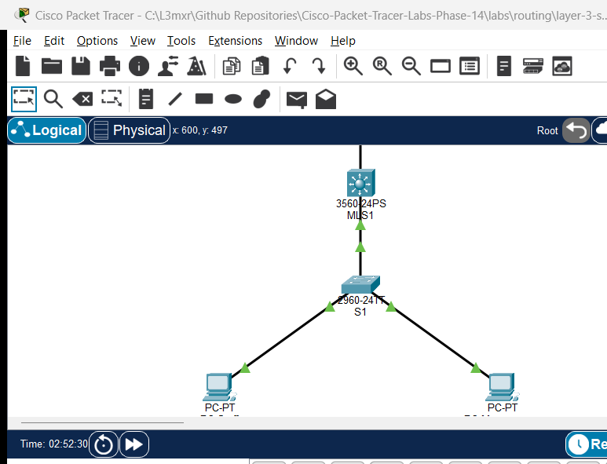

# PTL-0019: Layer 3 Switch SVIs and Routed Ports

## Learning Objectives

- Contrast Layer 2 switches with multilayer Layer 3 switches and explain hardware-accelerated Cisco Express Forwarding (CEF).
- Create and activate Switched Virtual Interfaces (SVIs) as default gateways for multiple VLAN broadcast domains.
- Enable global IPv4 routing on a multilayer switch using the `ip routing` command.
- Convert a physical switchport into a Layer 3 routed port using `no switchport` and assign an IPv4 subnet.
- Configure a default static route to connect a multilayer switch to an upstream router and verify symmetrical return routing.
- Compare multilayer switching performance, scalability, and latency against legacy Router-on-a-Stick architectures.
- Diagnose and troubleshoot SVI operational states, routing table convergence, and asymmetric return routing issues.

## Prerequisites

- Completion of [PTL-0009: VLAN Segmentation and Access Ports](../../switching/vlan-segmentation-and-access-ports/README.md) and [PTL-0010: Router-on-a-Stick Inter-VLAN Routing](../inter-vlan-routing-router-on-a-stick/README.md).
- Understanding of IEEE 802.1Q trunking, IP subnetting, and default gateway concepts.
- Familiarity with Cisco IOS privileged EXEC and global configuration modes.

## Topology



The topology models an enterprise campus network utilizing a collapsed-core/distribution multilayer switch (`MLS1`) connected downstream to a Layer 2 access switch (`S1`) and upstream to an edge router (`R1`):
- **Upstream Routed Link**: `R1` (`Gi0/0`) connects to `MLS1` (`Gi0/1`) across point-to-point network `10.0.0.0/30`.
- **Downstream 802.1Q Trunk**: `MLS1` (`Gi0/2`) connects to `S1` (`Gi0/1`) carrying VLANs 10 and 20.
- **Access End-Devices**: Workstation `PC-Staff` connects to `S1` (`Fa0/10`) in VLAN 10; `PC-Management` connects to `S1` (`Fa0/20`) in VLAN 20.
- **Simulated External Network**: `R1` hosts a simulated external loopback destination at `203.0.113.1/32`.

```text
               +----------------------------------+
               |        R1 (Edge Router)          |
               |  Loopback0: 203.0.113.1/32       |
               +-----------------+----------------+
                                 | Gi0/0 (10.0.0.2/30)
                                 |
                                 | Point-to-Point Routed Link (10.0.0.0/30)
                                 |
                                 | Gi0/1 (10.0.0.1/30) [no switchport]
               +-----------------+----------------+
               |    MLS1 (Catalyst 3560-24PS)     |
               |   SVI Vlan10: 192.168.10.1/24    |
               |   SVI Vlan20: 192.168.20.1/24    |
               +-----------------+----------------+
                                 | Gi0/2 (Trunk)
                                 |
                                 | IEEE 802.1Q Trunk
                                 |
                                 | Gi0/1 (Trunk)
               +-----------------+----------------+
               |     S1 (Catalyst 2960-24TT)      |
               +--------+----------------+--------+
      Fa0/10 (VLAN 10)  |                |  Fa0/20 (VLAN 20)
                        |                |
    +-------------------+--+          +--+-------------------+
    |       PC-Staff       |          |    PC-Management     |
    |   192.168.10.10/24   |          |   192.168.20.10/24   |
    |   GW: 192.168.10.1   |          |   GW: 192.168.20.1   |
    +----------------------+          +----------------------+
```

## Addressing Table

| Device | Interface | IP Address | Subnet Mask | Default Gateway | Purpose / Notes |
|---|---|---|---|---|---|
| R1 | Gi0/0 | 10.0.0.2 | 255.255.255.252 | N/A | Uplink to MLS1 routed port |
| R1 | Loopback0 | 203.0.113.1 | 255.255.255.255 | N/A | Simulated external destination |
| MLS1 | Gi0/1 | 10.0.0.1 | 255.255.255.252 | N/A | Routed port (`no switchport`) to R1 |
| MLS1 | Gi0/2 | Unnumbered | N/A | N/A | 802.1Q trunk link to S1 |
| MLS1 | Vlan10 | 192.168.10.1 | 255.255.255.0 | N/A | SVI Gateway for Staff VLAN |
| MLS1 | Vlan20 | 192.168.20.1 | 255.255.255.0 | N/A | SVI Gateway for Management VLAN |
| S1 | Gi0/1 | Unnumbered | N/A | N/A | 802.1Q trunk link to MLS1 |
| S1 | Fa0/10 | Unnumbered | N/A | N/A | Access switchport (VLAN 10) |
| S1 | Fa0/20 | Unnumbered | N/A | N/A | Access switchport (VLAN 20) |
| PC-Staff | FastEthernet0 | 192.168.10.10 | 255.255.255.0 | 192.168.10.1 | Staff department host |
| PC-Management | FastEthernet0 | 192.168.20.10 | 255.255.255.0 | 192.168.20.1 | Management department host |

## Lab Tasks

1. **Verify Layer 2 Baseline & Inter-Switch Trunk**:
   - Inspect VLAN definitions (VLAN 10 and VLAN 20) on both `MLS1` and `S1`.
   - Confirm that the `Gi0/2` (MLS1) to `Gi0/1` (S1) link operates as an 802.1Q trunk with `switchport trunk encapsulation dot1q` and `switchport mode trunk`.
2. **Configure Switched Virtual Interfaces (SVIs) on MLS1**:
   - Create `interface Vlan10` with IP address `192.168.10.1/24` and issue `no shutdown`.
   - Create `interface Vlan20` with IP address `192.168.20.1/24` and issue `no shutdown`.
   - Confirm that both SVIs enter `up/up` operational status because the trunk link to S1 actively forwards those VLANs.
3. **Enable Global IPv4 Routing on MLS1**:
   - Enable hardware-accelerated routing with the global configuration command `ip routing`.
   - Inspect `show ip route` to confirm that direct connected routes for `192.168.10.0/24` and `192.168.20.0/24` appear in the routing table.
4. **Convert Physical Interface to Layer 3 Routed Port**:
   - Convert `GigabitEthernet0/1` from Layer 2 switchport mode to Layer 3 routed mode using `no switchport`.
   - Assign IP address `10.0.0.1 255.255.255.252` to `Gi0/1` and enable the interface.
   - Verify with `show interfaces GigabitEthernet0/1 switchport` that `Switchport: Disabled` is reported.
5. **Configure Default and Return Static Routing**:
   - Add a default static route on `MLS1` pointing to `R1`: `ip route 0.0.0.0 0.0.0.0 10.0.0.2`.
   - Verify that `R1` has return routes to both VLAN networks: `192.168.10.0/24` and `192.168.20.0/24` via `10.0.0.1`.
6. **Validate Connectivity and Fault Injection Scenarios**:
   - Verify local gateway pings, inter-VLAN pings, and external loopback pings (`POS-01` to `POS-10`).
   - Execute negative fault injection tests (`NEG-01` to `NEG-05`) to observe behavioral impacts when `ip routing`, an SVI, or static routes are missing.

## Configuration Walkthrough

### Step 1: Access Switch S1 VLAN and Port Configuration

Configure access ports and trunk uplink on Catalyst 2960 switch `S1`:

```text
S1# configure terminal
S1(config)# hostname S1
S1(config)# no ip domain-lookup
S1(config)# vlan 10
S1(config-vlan)# name Staff
S1(config-vlan)# vlan 20
S1(config-vlan)# name Management
S1(config-vlan)# exit

S1(config)# interface FastEthernet0/10
S1(config-if)# description Staff Host Access Port
S1(config-if)# switchport mode access
S1(config-if)# switchport access vlan 10
S1(config-if)# no shutdown

S1(config)# interface FastEthernet0/20
S1(config-if)# description Management Host Access Port
S1(config-if)# switchport mode access
S1(config-if)# switchport access vlan 20
S1(config-if)# no shutdown

S1(config)# interface GigabitEthernet0/1
S1(config-if)# description 802.1Q Trunk Link to MLS1
S1(config-if)# switchport mode trunk
S1(config-if)# no shutdown
S1(config-if)# end
S1# copy running-config startup-config
```

### Step 2: Configure Multilayer Switch MLS1 SVIs and Global Routing

On Catalyst 3560 switch `MLS1`, create the VLAN database, configure the trunk link, configure SVIs, and enable `ip routing`:

```text
MLS1# configure terminal
MLS1(config)# hostname MLS1
MLS1(config)# no ip domain-lookup
MLS1(config)# vlan 10
MLS1(config-vlan)# name Staff
MLS1(config-vlan)# vlan 20
MLS1(config-vlan)# name Management
MLS1(config-vlan)# exit

MLS1(config)# interface GigabitEthernet0/2
MLS1(config-if)# description 802.1Q Trunk Link to S1
MLS1(config-if)# switchport trunk encapsulation dot1q
MLS1(config-if)# switchport mode trunk
MLS1(config-if)# no shutdown
MLS1(config-if)# exit

MLS1(config)# interface Vlan10
MLS1(config-if)# description SVI Gateway for Staff
MLS1(config-if)# ip address 192.168.10.1 255.255.255.0
MLS1(config-if)# no shutdown
MLS1(config-if)# exit

MLS1(config)# interface Vlan20
MLS1(config-if)# description SVI Gateway for Management
MLS1(config-if)# ip address 192.168.20.1 255.255.255.0
MLS1(config-if)# no shutdown
MLS1(config-if)# exit

MLS1(config)# ip routing
```

### Step 3: Configure Routed Uplink and Default Route on MLS1

Disable switchport functionality on `Gi0/1` and add the default route toward `R1`:

```text
MLS1(config)# interface GigabitEthernet0/1
MLS1(config-if)# description Routed Point-to-Point Uplink to R1
MLS1(config-if)# no switchport
MLS1(config-if)# ip address 10.0.0.1 255.255.255.252
MLS1(config-if)# no shutdown
MLS1(config-if)# exit

MLS1(config)# ip route 0.0.0.0 0.0.0.0 10.0.0.2
MLS1(config)# end
MLS1# copy running-config startup-config
```

### Step 4: Configure Upstream Router R1

Configure the point-to-point interface, loopback, and static return routes on `R1`:

```text
R1# configure terminal
R1(config)# hostname R1
R1(config)# no ip domain-lookup
R1(config)# interface GigabitEthernet0/0
R1(config-if)# description Point-to-Point Routed Link to MLS1
R1(config-if)# ip address 10.0.0.2 255.255.255.252
R1(config-if)# no shutdown
R1(config-if)# exit

R1(config)# interface Loopback0
R1(config-if)# description Simulated External Destination
R1(config-if)# ip address 203.0.113.1 255.255.255.255
R1(config-if)# no shutdown
R1(config-if)# exit

R1(config)# ip route 192.168.10.0 255.255.255.0 10.0.0.1
R1(config)# ip route 192.168.20.0 255.255.255.0 10.0.0.1
R1(config)# end
R1# copy running-config startup-config
```

## Verification

### 1. Verify SVI Status and IP Addressing

Confirm that SVIs and the routed uplink are in the `up/up` operational state:

```text
MLS1# show ip interface brief
Interface              IP-Address      OK? Method Status                Protocol
GigabitEthernet0/1     10.0.0.1        YES manual up                    up
GigabitEthernet0/2     unassigned      YES unset  up                    up
Vlan10                 192.168.10.1    YES manual up                    up
Vlan20                 192.168.20.1    YES manual up                    up
```

### 2. Verify Routing Table on MLS1

Confirm that direct connected routes for both VLANs and the routed uplink exist, along with the candidate default static route:

```text
MLS1# show ip route
Gateway of last resort is 10.0.0.2 to network 0.0.0.0

     10.0.0.0/30 is subnetted, 1 subnets
C       10.0.0.0 is directly connected, GigabitEthernet0/1
C    192.168.10.0/24 is directly connected, Vlan10
C    192.168.20.0/24 is directly connected, Vlan20
S*   0.0.0.0/0 [1/0] via 10.0.0.2
```

### 3. Verify Routed Port Operation

Confirm that `Gi0/1` operates as a Layer 3 interface with switchport features disabled:

```text
MLS1# show interfaces GigabitEthernet0/1 switchport
Name: Gig0/1
Switchport: Disabled
```

### 4. Verify Workstation Connectivity

From `PC-Staff` (192.168.10.10):
- **Local Gateway**: `ping 192.168.10.1` -> 100% success (4/4 received).
- **Inter-VLAN Host**: `ping 192.168.20.10` -> 100% success (4/4 received, TTL=127 confirming single hop through MLS1).
- **External Loopback**: `ping 203.0.113.1` -> 100% success (4/4 received, TTL=254 confirming two hops: MLS1 -> R1).

## Troubleshooting

### Scenario 1: `ip routing` Is Disabled
- **Symptom:** Workstations can ping their own default gateway (192.168.10.1), but pings between `PC-Staff` and `PC-Management` time out. `show ip route` returns empty or displays a warning that routing is not enabled.
- **Root Cause:** Cisco switches default to Layer 2 bridging. Without the global command `ip routing`, the switch will respond to packets destined for its own local IP addresses but will not forward packets across different subnets.
- **Resolution:** Enter global configuration mode on `MLS1` and issue `ip routing`.

### Scenario 2: SVI Interface Is Down / Down (SVI Autostate Failure)
- **Symptom:** `interface Vlan10` shows `Status: up, Protocol: down` or `down/down`. `192.168.10.0/24` does not appear in `show ip route`.
- **Root Cause:** By default, Cisco SVI autostate logic requires at least one Layer 2 physical port (access port or trunk) in that VLAN to be in the `up/up` and spanning-tree forwarding state. If the trunk to S1 fails, or if VLAN 10 is not allowed on the trunk, the SVI goes down automatically.
- **Resolution:** Verify trunk operational state using `show interfaces trunk` and ensure the VLAN exists in the switch database using `show vlan brief`.

### Scenario 3: Destination Host Unreachable on External Ping
- **Symptom:** When pinging `203.0.113.1`, the workstation receives `Reply from 192.168.10.1: Destination host unreachable`.
- **Root Cause:** `MLS1` has no route for `203.0.113.1` and no gateway of last resort is set.
- **Resolution:** Add default static route `ip route 0.0.0.0 0.0.0.0 10.0.0.2` on `MLS1`.

### Scenario 4: Asymmetric Routing / Missing Return Route on Upstream Router
- **Symptom:** Workstations can ping their gateway and each other, but pings to `203.0.113.1` time out (100% packet loss) without receiving an unreachable error.
- **Root Cause:** The forward packet successfully reaches `R1`, but `R1` has no routing table entry for the source subnet (`192.168.10.0/24`), resulting in silent packet drop on the return path.
- **Resolution:** Configure static return route on `R1`: `ip route 192.168.10.0 255.255.255.0 10.0.0.1`.

## Key Takeaways

### Layer 2 vs. Layer 3 Multilayer Switches

- **Layer 2 Switches (e.g., Catalyst 2960):** Operate exclusively at OSI Layer 2 using MAC address tables (`CAM` table). They can have a single management IP address on an SVI (e.g., `interface Vlan1`), but cannot forward packets between different VLANs.
- **Multilayer Switches (e.g., Catalyst 3560/3650):** Possess dedicated Application-Specific Integrated Circuits (ASICs) and Ternary Content-Addressable Memory (TCAM). They perform Layer 2 frame switching and Layer 3 IP packet forwarding at wire-speed using Cisco Express Forwarding (CEF).

### Switched Virtual Interfaces (SVIs) vs. Routed Ports

- **SVI (`interface Vlan <id>`):** A virtual Layer 3 interface mapped to an internal VLAN broadcast domain. Allows multiple physical switchports (in that VLAN) to share a common default gateway IP address.
- **Routed Port (`no switchport`):** A physical switch interface converted to act identically to a router interface. It does not participate in STP, has no VLAN tag associations, and receives an individual IP address and subnet mask.

### Comparison: Router-on-a-Stick (PTL-0010) vs. Multilayer Switching (PTL-0019)

| Feature | Router-on-a-Stick (ROAS) | Multilayer Switch (MLS) |
|---|---|---|
| **Routing Entity** | External router (e.g., Cisco 2911 / 4321) | Multilayer switch internal ASICs (e.g., Catalyst 3560) |
| **Interface Architecture** | Logical subinterfaces on a single physical link | Switched Virtual Interfaces (SVIs) inside switch fabric |
| **Link Bandwidth** | Shared trunk link bottleneck (traffic traverses trunk twice) | High-speed internal switch backplane (Gbps/Tbps capacity) |
| **Forwarding Engine** | Software / CPU-assisted route lookup | Hardware-based Cisco Express Forwarding (CEF / TCAM) |
| **Latency** | Higher (serialization delay across router link) | Ultra-low (hardware wire-speed switching) |
| **Uplink to WAN/Edge** | Router handles WAN natively | Requires routed port (`no switchport`) or L3 uplink to router |
| **Cost & Scalability** | Low equipment cost for small networks; poor scalability | Industry standard for campus core and distribution layers |

## References

- Cisco Systems. (2016). *Catalyst 3560 Switch Software Configuration Guide, Release 12.2(55)SE - Configuring IP Unicast Routing*.
- Cisco Systems. (2020). *CCNA 200-301 Official Cert Guide, Volume 1: Inter-VLAN Routing*. Cisco Press.
- Cisco TAC. (2021). *How to Configure InterVLAN Routing on Catalyst 3550/3560/3750 Series Switches*. Document ID: 41860.
- RFC 1812. (1995). *Requirements for IP Version 4 Routers*. Internet Engineering Task Force.

## Files and Validation Status

- Starter Topology: [assets/starter.pkt](assets/starter.pkt)
- Completed Topology: [assets/completed.pkt](assets/completed.pkt)
- Multilayer Switch MLS1 Configuration: [configs/MLS1.txt](configs/MLS1.txt)
- Access Switch S1 Configuration: [configs/S1.txt](configs/S1.txt)
- Upstream Router R1 Configuration: [configs/R1.txt](configs/R1.txt)
- Verification Protocol & Test Results: [verification.md](verification.md)
- Authentic Simulator Test Capture: [AI_AGENT_GUIDE/state/PTL-0019-SIMULATOR-RESULTS.md](../../../AI_AGENT_GUIDE/state/PTL-0019-SIMULATOR-RESULTS.md)

| Metric | Status |
|---|---|
| Documentation Review | `reviewed` |
| Packet Tracer Validation | `tested_pass` (Cisco Packet Tracer 9.0.1 IPC Bridge) |
| Checksum Verification | Confirmed (Starter: `31feb931...`, Completed: `074e5a39...`) |
