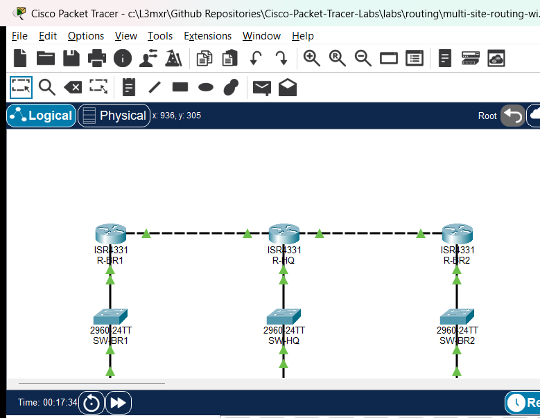

# PTL-0048: Multi-Site Routing with Branch Networks

## Learning Objectives
- Design and implement static routing in an enterprise hub-and-spoke multi-site WAN architecture.
- Configure default static routes (`0.0.0.0/0`) on spoke branch routers to streamline outbound egress to headquarters.
- Configure explicit static network routes on the central headquarters router to ensure symmetric return paths to all branch LANs.
- Diagnose and remediate static route next-hop failures caused by off-subnet gateway IP assignment and recursive lookup exhaustion.
- Verify end-to-end data plane reachability across hub and spoke boundaries, including branch-to-hub and spoke-to-spoke transit paths.

## Prerequisites
- Completion of [PTL-0001: Dual-Stack IPv4 and IPv6 Static Routing](../../routing/dual-stack-static-routing/README.md).
- Completion of [PTL-0014: Default Gateway Operation and Troubleshooting](../../network-fundamentals/default-gateway-troubleshooting/README.md).
- Completion of [PTL-0028: Floating Static Routes and Administrative Distance](../../routing/floating-static-routes-and-administrative-distance/README.md).
- Solid understanding of point-to-point `/30` WAN subnets and routing table lookup mechanics.

## Topology
The enterprise topology connects a central corporate headquarters (`R-HQ`) to two remote regional branches (`R-BR1` in the West and `R-BR2` in the East) via dedicated point-to-point Gigabit WAN links. Each site maintains an access switch and local departmental endpoints.

```
       [Branch 1 Site]                         [HQ Site]                         [Branch 2 Site]
    PC-BR1: 10.20.0.10/24               HQ-Server: 10.10.0.10/24               PC-BR2: 10.30.0.10/24
              |                                     |                                     |
           (Fa0/1)                               (Fa0/1)                               (Fa0/1)
         [SW-BR1]                              [SW-HQ]                               [SW-BR2]
           (Gi0/1)                               (Gi0/1)                               (Gi0/1)
              |                                     |                                     |
           (Gi0/0/0)                             (Gi0/0/0)                             (Gi0/0/0)
          [ R-BR1 ]                             [ R-HQ ]                              [ R-BR2 ]
           (Gi0/0/1)                             (Gi0/0/1)                             (Gi0/0/2)
              |                                     |                                     |
       172.16.12.2/30                        172.16.12.1/30                               |
              +=================== WAN 1 ===========+                                     |
                                                 (Gi0/0/2)                                |
                                              172.16.13.1/30                        172.16.13.2/30
                                                    +============== WAN 2 ================+
```



## Addressing Table
| Device | Interface | IP Address | Subnet Mask | Default Gateway | Description |
|---|---|---|---|---|---|
| **R-HQ** | Gi0/0/0 | 10.10.0.1 | 255.255.255.0 | N/A | Corporate HQ LAN Gateway (`10.10.0.0/24`) |
| **R-HQ** | Gi0/0/1 | 172.16.12.1 | 255.255.255.252 | N/A | WAN Link 1 to R-BR1 (`172.16.12.0/30`) |
| **R-HQ** | Gi0/0/2 | 172.16.13.1 | 255.255.255.252 | N/A | WAN Link 2 to R-BR2 (`172.16.13.0/30`) |
| **R-BR1** | Gi0/0/0 | 10.20.0.1 | 255.255.255.0 | N/A | Branch 1 LAN Gateway (`10.20.0.0/24`) |
| **R-BR1** | Gi0/0/1 | 172.16.12.2 | 255.255.255.252 | N/A | WAN Link 1 to R-HQ (`172.16.12.0/30`) |
| **R-BR2** | Gi0/0/0 | 10.30.0.1 | 255.255.255.0 | N/A | Branch 2 LAN Gateway (`10.30.0.0/24`) |
| **R-BR2** | Gi0/0/2 | 172.16.13.2 | 255.255.255.252 | N/A | WAN Link 2 to R-HQ (`172.16.13.0/30`) |
| **HQ-Server** | FastEthernet0 | 10.10.0.10 | 255.255.255.0 | 10.10.0.1 | Corporate Application Server |
| **PC-BR1** | FastEthernet0 | 10.20.0.10 | 255.255.255.0 | 10.20.0.1 | Branch 1 Client Workstation — Faulted in starter |
| **PC-BR2** | FastEthernet0 | 10.30.0.10 | 255.255.255.0 | 10.30.0.1 | Branch 2 Client Workstation |

## Lab Tasks
1. **Audit Branch 1 Local Network Connectivity**: Inspect `PC-BR1` IP configuration and verify whether the client can communicate with its local branch gateway (`10.20.0.1`).
2. **Diagnose Spoke Default Route on R-BR1**: Inspect the routing table on `R-BR1` with `show ip route`. Determine why outbound traffic destined for headquarters fails to forward and examine the configured next-hop IP.
3. **Remediate Branch 1 Default Routing**: Correct the static default route on `R-BR1` to point to the valid upstream next-hop IP on `R-HQ` (`172.16.12.1`), and update `PC-BR1` default gateway settings.
4. **Audit Headquarters Static Routing Table**: Inspect `R-HQ` routing table with `show ip route static`. Identify missing return routes for remote branch subnets.
5. **Remediate Headquarters Return Routing**: Configure the required explicit static route on `R-HQ` to reach the Branch 2 LAN (`10.30.0.0/24`) via `R-BR2` (`172.16.13.2`).
6. **Verify End-to-End Multi-Site Connectivity**: Validate bidirectional ping reachability from both branch workstations to `HQ-Server` (`10.10.0.10`) and perform inter-branch spoke-to-spoke communication testing (`PC-BR1` to `PC-BR2`).

## Configuration Walkthrough

### 1. Diagnosing Fault 1: PC-BR1 Gateway Misconfiguration
In the starter state, verify local gateway reachability from `PC-BR1`:

```text
PC> ping 10.20.0.1
Pinging 10.20.0.1 with 32 bytes of data:
Request timed out.
Request timed out.
Request timed out.
Request timed out.

Ping statistics for 10.20.0.1:
    Packets: Sent = 4, Received = 0, Lost = 4 (100% loss)
```

Check the IP settings on `PC-BR1` using `ipconfig`:

```text
PC> ipconfig
FastEthernet0 Connection:(default port)
   IP Address......................: 10.20.0.10
   Subnet Mask.....................: 255.255.255.0
   Default Gateway.................: 10.20.0.254
```

Notice that the default gateway was misconfigured as `10.20.0.254` instead of the actual router interface `10.20.0.1`.

**Remediation**: Reconfigure `PC-BR1` with default gateway `10.20.0.1`.

### 2. Diagnosing Fault 2: Invalid Static Route Next-Hop on R-BR1
After fixing the client gateway, attempt to ping `HQ-Server` (`10.10.0.10`) from `PC-BR1`:

```text
PC> ping 10.10.0.10
Pinging 10.10.0.10 with 32 bytes of data:
Reply from 10.20.0.1: Destination host unreachable.
```

Inspect the routing table on `R-BR1`:

```text
R-BR1# show ip route
Gateway of last resort is not set

      10.0.0.0/8 is variably subnetted, 2 subnets, 2 masks
C        10.20.0.0/24 is directly connected, GigabitEthernet0/0/0
L        10.20.0.1/32 is directly connected, GigabitEthernet0/0/0
      172.16.0.0/16 is variably subnetted, 2 subnets, 2 masks
C        172.16.12.0/30 is directly connected, GigabitEthernet0/0/1
L        172.16.12.2/32 is directly connected, GigabitEthernet0/0/1
```

Notice that `Gateway of last resort is not set`! Inspect the running configuration:

```text
R-BR1# show running-config | include ip route
ip route 0.0.0.0 0.0.0.0 172.16.12.5
```

The WAN point-to-point link is `172.16.12.0/30` (usable IPs: `172.16.12.1` and `172.16.12.2`). The configured next-hop `172.16.12.5` resides in the separate subnet `172.16.12.4/30`. Because `172.16.12.5` cannot be recursively resolved, Cisco IOS refuses to install the static route into the forwarding table.

**Remediation**:
```text
R-BR1# configure terminal
R-BR1(config)# no ip route 0.0.0.0 0.0.0.0 172.16.12.5
R-BR1(config)# ip route 0.0.0.0 0.0.0.0 172.16.12.1
R-BR1(config)# end
R-BR1# copy running-config startup-config
```

Verify that the gateway of last resort is now installed:
```text
R-BR1# show ip route static
S*    0.0.0.0/0 [1/0] via 172.16.12.1
```

### 3. Diagnosing Fault 3: Missing Return Route on R-HQ
Test connectivity from `PC-BR2` to `HQ-Server` (`10.10.0.10`):

```text
PC> ping 10.10.0.10
Pinging 10.10.0.10 with 32 bytes of data:
Request timed out.
Request timed out.
Request timed out.
Request timed out.
```

`PC-BR2` has a valid default gateway (`10.30.0.1`) and `R-BR2` has a working default route to `172.16.13.1`. The ICMP request reaches `HQ-Server`. However, `HQ-Server` forwards the echo reply to its default gateway `R-HQ` (`10.10.0.1`). Inspect `R-HQ` routing table:

```text
R-HQ# show ip route static
S     10.20.0.0/24 [1/0] via 172.16.12.2
```

`R-HQ` possesses a route back to Branch 1 (`10.20.0.0/24`), but **lacks any routing entry for Branch 2 (`10.30.0.0/24`)**! When `R-HQ` receives the echo reply destined for `10.30.0.10`, it drops the packet as unroutable.

**Remediation**:
```text
R-HQ# configure terminal
R-HQ(config)# ip route 10.30.0.0 255.255.255.0 172.16.13.2
R-HQ(config)# end
R-HQ# copy running-config startup-config
```

Verify that both branch networks are now reachable from `R-HQ`:
```text
R-HQ# show ip route static
S     10.20.0.0/24 [1/0] via 172.16.12.2
S     10.30.0.0/24 [1/0] via 172.16.13.2
```

## Verification

### 1. Spoke Default Route Audit
Verify default static routes on both branch spoke routers:

```text
R-BR1# show ip route static
S*    0.0.0.0/0 [1/0] via 172.16.12.1

R-BR2# show ip route static
S*    0.0.0.0/0 [1/0] via 172.16.13.1
```

### 2. Hub Explicit Route Audit
Verify that `R-HQ` maintains static routes for all spoke branch LANs:

```text
R-HQ# show ip route static
S     10.20.0.0/24 [1/0] via 172.16.12.2
S     10.30.0.0/24 [1/0] via 172.16.13.2
```

### 3. Spoke-to-Hub Data Plane Verification
Test reachability from `PC-BR1` to `HQ-Server`:

```text
PC> ping 10.10.0.10
Pinging 10.10.0.10 with 32 bytes of data:
Reply from 10.10.0.10: bytes=32 time=1ms TTL=126
Reply from 10.10.0.10: bytes=32 time=1ms TTL=126
Reply from 10.10.0.10: bytes=32 time=1ms TTL=126
Reply from 10.10.0.10: bytes=32 time=1ms TTL=126

Ping statistics for 10.10.0.10:
    Packets: Sent = 4, Received = 4, Lost = 0 (0% loss)
```

Test reachability from `PC-BR2` to `HQ-Server`:

```text
PC> ping 10.10.0.10
Pinging 10.10.0.10 with 32 bytes of data:
Reply from 10.10.0.10: bytes=32 time=1ms TTL=126
Reply from 10.10.0.10: bytes=32 time=1ms TTL=126
Reply from 10.10.0.10: bytes=32 time=1ms TTL=126
Reply from 10.10.0.10: bytes=32 time=1ms TTL=126

Ping statistics for 10.10.0.10:
    Packets: Sent = 4, Received = 4, Lost = 0 (0% loss)
```

### 4. Spoke-to-Spoke Transit Verification
Verify inter-branch routing from `PC-BR1` across `R-HQ` to `PC-BR2`:

```text
PC> ping 10.30.0.10
Pinging 10.30.0.10 with 32 bytes of data:
Reply from 10.30.0.10: bytes=32 time=2ms TTL=125
Reply from 10.30.0.10: bytes=32 time=2ms TTL=125
Reply from 10.30.0.10: bytes=32 time=2ms TTL=125
Reply from 10.30.0.10: bytes=32 time=2ms TTL=125

Ping statistics for 10.30.0.10:
    Packets: Sent = 4, Received = 4, Lost = 0 (0% loss)
```

Notice that the Time-To-Live (TTL) is `125` (decremented once by `R-BR1`, once by `R-HQ`, and once by `R-BR2`), confirming three routed hops.

### Verification Criteria Checklist
| Test ID | Objective | Expected Output | Status |
|---|---|---|---|
| POS-01 | R-HQ Routing Table Audit | Both `10.20.0.0/24` and `10.30.0.0/24` present via WAN next-hops | PASS |
| POS-02 | Spoke Default Route Audit | `0.0.0.0/0` installed on both R-BR1 (`via 172.16.12.1`) and R-BR2 (`via 172.16.13.1`) | PASS |
| POS-03 | Branch 1 Local Gateway Reachability | 0% packet loss (PC-BR1 -> R-BR1 Gi0/0/0) | PASS |
| POS-04 | Branch 2 Local Gateway Reachability | 0% packet loss (PC-BR2 -> R-BR2 Gi0/0/0) | PASS |
| POS-05 | Branch 1 to HQ Server Reachability | 0% packet loss (PC-BR1 -> HQ-Server 10.10.0.10) | PASS |
| POS-06 | Branch 2 to HQ Server Reachability | 0% packet loss (PC-BR2 -> HQ-Server 10.10.0.10) | PASS |
| POS-07 | Inter-Branch Spoke-to-Spoke Reachability | 0% packet loss (PC-BR1 -> PC-BR2 10.30.0.10) | PASS |

## Troubleshooting
- **Gateway of Last Resort Not Installed on Spoke Router**:
  - Verify the static route configuration using `show running-config | include ip route`.
  - Ensure that the specified next-hop address belongs to the subnet of the local outbound interface.
  - Check the outbound interface state with `show ip interface brief`. If the physical link is down or administratively down, Cisco IOS will automatically suppress the static route from the active routing table.
- **Client Receives "Destination Host Unreachable"**:
  - The local router does not have a route to the destination network and lacks a default route.
  - Verify that the spoke router has an active default route pointing toward the hub.
- **Ping Times Out Despite Correct Spoke Default Route (Asymmetric Routing Failure)**:
  - Check the hub router's routing table (`show ip route`).
  - While outbound packets may successfully reach the destination host, return packets will be discarded if the hub router lacks a reverse route back to the source branch LAN.
  - Every remote subnet in a hub-and-spoke topology requires either an explicit static route or a dynamic routing protocol advertisement at the hub.
- **Inter-Branch Traffic Fails While Branch-to-HQ Works**:
  - Verify that both branch LAN routes exist on the hub router.
  - Ensure that the hub router has IP routing enabled (`ip routing`).

## Key Takeaways
- **Hub-and-Spoke Topology**: In a centralized enterprise architecture, branch spoke routers require only a default static route pointing toward the hub, keeping branch routing tables minimal.
- **Routing Symmetry**: IP routing is stateless and hop-by-hop. The fact that a packet successfully travels from Source to Destination does not guarantee return reachability; the return path must be explicitly provisioned at every intermediate router.
- **Next-Hop Validation**: Static routes are only installed in the forwarding table if their next-hop IP is directly reachable or can be resolved through an existing routing table entry.
- **Point-to-Point WAN Subnets**: A `/30` prefix provides exactly 2 usable host addresses, ideal for dedicated inter-router point-to-point links.

## References
- [Cisco 4000 Series ISR Software Configuration Guide](https://www.cisco.com/c/en/us/td/docs/routers/access/4400/software/configuration/guide/isr4400swcfg.html)
- [RFC 1812: Requirements for IPv4 Routers](https://datatracker.ietf.org/doc/html/rfc1812)
- [Cisco Technology Support: Configuring a Default Route or Network](https://www.cisco.com/c/en/us/support/docs/ip/ip-routing/8651-31.html)

## Files and Validation Status
- `assets/starter.pkt`: Initial topology with misconfigured endpoint gateway, invalid next-hop on R-BR1, and missing return route on R-HQ.
- `assets/completed.pkt`: Remediated topology featuring full bidirectional static routing across all three enterprise sites.
- `assets/topology.png`: Visual network diagram illustrating hub and spoke router connections.
- `assets/test_evidence.json`: Automated test execution results captured via Packet Tracer MCP bridge.
- `configs/R-HQ.txt`: Baseline running configuration for Corporate Headquarters Hub Router.
- `configs/R-BR1.txt`: Baseline running configuration for Branch 1 Spoke Router.
- `configs/R-BR2.txt`: Baseline running configuration for Branch 2 Spoke Router.
- `verification.md`: Comprehensive verification matrix detailing positive, negative, and reload tests.

