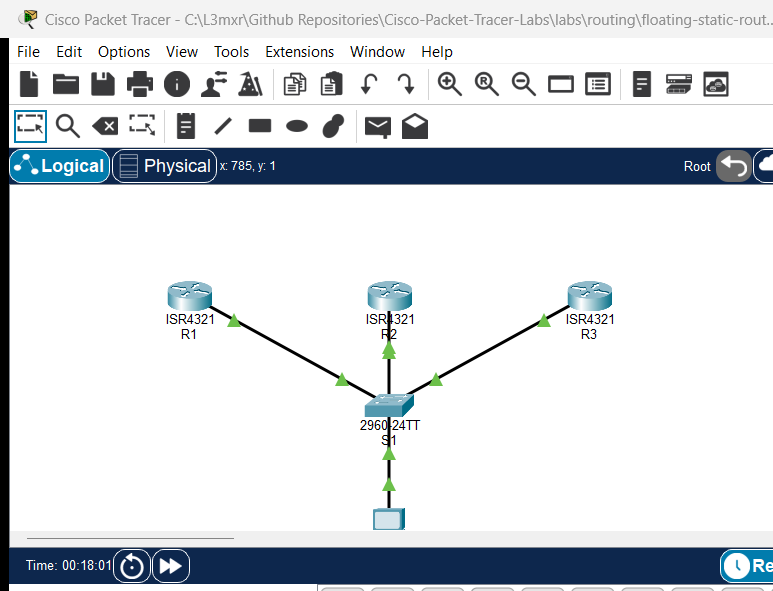

# PTL-0029: OSPFv2 DR and BDR Elections

## Learning Objectives

- Explain the necessity and operational role of DR (Designated Router) and BDR (Backup Designated Router) on multi-access broadcast OSPF networks.
- Examine default OSPF election criteria based on priority, manual router ID, and highest active interface IP address.
- Configure custom OSPF interface priorities using the `ip ospf priority` interface command to deterministically designate DR and BDR routers.
- Prevent a multi-access router from ever participating in elections by configuring priority 0 (`DROTHER` state).
- Verify OSPF adjacency states (`FULL/DR`, `FULL/BDR`, `FULL/DROTHER`) and timer intervals across multi-access broadcast segments.
- Demonstrate deterministic DR failover when the primary DR becomes unavailable.
- Verify the non-preemptive nature of OSPF elections when higher priority routers rejoin an established network.

## Prerequisites

- Thorough understanding of IPv4 subnetting and CIDR notation (`/24`).
- Familiarity with basic OSPF single-area operations, Link-State Advertisements (LSAs), and shortest-path-first (SPF) tree calculations.
- Experience navigating Cisco IOS CLI privileged EXEC and global configuration modes.

## Topology



The topology models an enterprise distribution segment connected through a central Catalyst 2960 switch (`S1`). Three Cisco 4321 routers (`R1`, `R2`, `R3`) connect their `GigabitEthernet0/0/0` interfaces to `S1` on the `192.168.1.0/24` multi-access broadcast subnet. An endpoint test station (`PC-1`) is connected to `S1` on port `FastEthernet0/4` to verify end-to-end data plane reachability across all advertised loopback subnets.

```
                  +-------------------+
                  |   Catalyst 2960   |
                  |     Switch S1     |
                  +---------+---------+
         Fa0/1         Fa0/2|          |Fa0/3        Fa0/4
           |                |          |               |
           |                |          |               |
     Gi0/0/0|          Gi0/0/0|     Gi0/0/0|            Fa0|
     +-----+----+     +-----+----+   +-----+----+   +------+------+
     |    R1    |     |    R2    |   |    R3    |   |    PC-1     |
     | DR (255) |     | BDR(100) |   |DROTHER(0)|   |192.168.1.50 |
     +----------+     +----------+   +----------+   +-------------+
       Lo0: 10.1.1.1    Lo0: 10.2.2.1  Lo0: 10.3.3.1
```

## Addressing Table

| Device | Interface | IP Address | Subnet Mask | Default Gateway | OSPF Priority | Intended Role |
| :--- | :--- | :--- | :--- | :--- | :--- | :--- |
| **R1** | Gi0/0/0 | 192.168.1.1 | 255.255.255.0 | N/A | 255 | Primary DR |
| **R1** | Loopback0 | 10.1.1.1 | 255.255.255.0 | N/A | N/A | Advertised Subnet |
| **R2** | Gi0/0/0 | 192.168.1.2 | 255.255.255.0 | N/A | 100 | Backup DR (BDR) |
| **R2** | Loopback0 | 10.2.2.1 | 255.255.255.0 | N/A | N/A | Advertised Subnet |
| **R3** | Gi0/0/0 | 192.168.1.3 | 255.255.255.0 | N/A | 0 | Non-participating (DROTHER) |
| **R3** | Loopback0 | 10.3.3.1 | 255.255.255.0 | N/A | N/A | Advertised Subnet |
| **S1** | VLAN 1 | Unconfigured | Unconfigured | N/A | N/A | L2 Transparent Switch |
| **PC-1** | FastEthernet0 | 192.168.1.50 | 255.255.255.0 | 192.168.1.1 | N/A | Test Host |

## Lab Tasks

1. **Verify Baseline Multi-Access Layer 2 & 3 Connectivity:**
   - Confirm all router interfaces on `192.168.1.0/24` are operational and pingable.
   - Confirm PC-1 can ping its default gateway `192.168.1.1`.
2. **Inspect Default OSPF Neighbors and DR/BDR Adjacencies:**
   - Review initial OSPF neighbor tables and observe election outcomes before manual priority tuning.
3. **Configure Deterministic OSPF Interface Priorities:**
   - Configure `ip ospf priority 255` on R1's `GigabitEthernet0/0/0` interface to enforce DR status.
   - Configure `ip ospf priority 100` on R2's `GigabitEthernet0/0/0` interface to enforce BDR status.
   - Configure `ip ospf priority 0` on R3's `GigabitEthernet0/0/0` interface to disqualify it from DR/BDR elections.
4. **Trigger OSPF Election Convergence:**
   - Reset the OSPF process across routers using `clear ip ospf process` to force immediate re-election based on updated priorities.
5. **Verify Multi-Access OSPF Neighbors and Roles:**
   - Verify `show ip ospf neighbor` and `show ip ospf interface` output across all routers.
   - Confirm R1 is DR, R2 is BDR, and R3 is DROTHER.
6. **Verify OSPF Route Propagation and End-to-End Connectivity:**
   - Confirm R1, R2, and R3 advertise their respective loopback networks (`10.1.1.0/24`, `10.2.2.0/24`, `10.3.3.0/24`) into Area 0.
   - Verify PC-1 can reach all router loopback IPs.
7. **Conduct DR Failover and Non-Preemption Negative Tests:**
   - Administratively shut down R1's multi-access interface and verify that R2 promotes to DR while R3 remains DROTHER.
   - Re-enable R1's interface and verify that non-preemption prevents R1 from usurping the DR role until the next election event.

## Configuration Walkthrough

### Step 1: Configure R1 Interface Priority and OSPF Settings

```ios
R1(config)# interface GigabitEthernet0/0/0
R1(config-if)# ip ospf priority 255
R1(config-if)# exit
```

### Step 2: Configure R2 Interface Priority and OSPF Settings

```ios
R2(config)# interface GigabitEthernet0/0/0
R2(config-if)# ip ospf priority 100
R2(config-if)# exit
```

### Step 3: Configure R3 Interface Priority to Disqualify from Election

```ios
R3(config)# interface GigabitEthernet0/0/0
R3(config-if)# ip ospf priority 0
R3(config-if)# exit
```

### Step 4: Reset OSPF Process to Force Re-Election

Because OSPF elections are non-preemptive, priority changes do not immediately replace the active DR or BDR. Clear the OSPF process on all participating routers to force a new election:

```ios
R1# clear ip ospf process
Reset ALL OSPF processes? [no]: yes

R2# clear ip ospf process
Reset ALL OSPF processes? [no]: yes

R3# clear ip ospf process
Reset ALL OSPF processes? [no]: yes
```

## Verification

### 1. Multi-Access Neighbor Adjacencies on R1

Verify that R1 has established full adjacencies with R2 (BDR) and R3 (DROTHER):

```text
R1# show ip ospf neighbor

Neighbor ID     Pri   State           Dead Time   Address         Interface
3.3.3.3           0   FULL/DROTHER    00:00:36    192.168.1.3     GigabitEthernet0/0/0
2.2.2.2         100   FULL/BDR        00:00:30    192.168.1.2     GigabitEthernet0/0/0
```

### 2. Interface OSPF Roles and Priorities

Verify the assigned interface roles on each router:

```text
R1# show ip ospf interface GigabitEthernet0/0/0
GigabitEthernet0/0/0 is up, line protocol is up
  Internet address is 192.168.1.1/24, Area 0
  Process ID 1, Router ID 1.1.1.1, Network Type BROADCAST, Cost: 1
  Transmit Delay is 1 sec, State DR, Priority 255
  Designated Router (ID) 1.1.1.1, Interface address 192.168.1.1
  Backup Designated Router (ID) 2.2.2.2, Interface address 192.168.1.2

R2# show ip ospf interface GigabitEthernet0/0/0
GigabitEthernet0/0/0 is up, line protocol is up
  Internet address is 192.168.1.2/24, Area 0
  Process ID 1, Router ID 2.2.2.2, Network Type BROADCAST, Cost: 1
  Transmit Delay is 1 sec, State BDR, Priority 100
  Designated Router (ID) 1.1.1.1, Interface address 192.168.1.1
  Backup Designated Router (ID) 2.2.2.2, Interface address 192.168.1.2

R3# show ip ospf interface GigabitEthernet0/0/0
GigabitEthernet0/0/0 is up, line protocol is up
  Internet address is 192.168.1.3/24, Area 0
  Process ID 1, Router ID 3.3.3.3, Network Type BROADCAST, Cost: 1
  Transmit Delay is 1 sec, State DROTHER, Priority 0
  Designated Router (ID) 1.1.1.1, Interface address 192.168.1.1
  Backup Designated Router (ID) 2.2.2.2, Interface address 192.168.1.2
```

### 3. Loopback Route Propagation

Verify that R3 learns the loopback networks of R1 and R2 via OSPF:

```text
R3# show ip route ospf
     10.0.0.0/8 is variably subnetted, 4 subnets, 2 masks
O       10.1.1.1 [110/2] via 192.168.1.1, 00:05:12, GigabitEthernet0/0/0
O       10.2.2.1 [110/2] via 192.168.1.2, 00:05:12, GigabitEthernet0/0/0
```

### 4. End-to-End Host Reachability

From PC-1, verify ICMP reachability to all router loopback interfaces:

```text
C:\> ping 10.1.1.1
Reply from 10.1.1.1: bytes=32 time=16ms TTL=255

C:\> ping 10.2.2.1
Reply from 10.2.2.1: bytes=32 time=1ms TTL=255

C:\> ping 10.3.3.1
Reply from 10.3.3.1: bytes=32 time=1ms TTL=255
```

## Troubleshooting

- **Symptom: OSPF Neighbor stuck in 2-WAY/DROTHER state.**
  - *Cause:* On a multi-access broadcast network, DROTHER routers form full adjacencies only with the DR and BDR. Adjacencies between two DROTHER routers remain permanently in `2-WAY/DROTHER`. This is expected OSPF design behavior to prevent $N \times (N-1) / 2$ adjacency explosion.
- **Symptom: Changed `ip ospf priority` but router is not elected DR.**
  - *Cause:* OSPF elections are non-preemptive. If a DR and BDR already exist when a router boots or priority is raised, the incumbent DR remains active. Clear the OSPF process (`clear ip ospf process`) on all segment routers to force a new election.
- **Symptom: Router with priority 0 was elected BDR.**
  - *Cause:* Interface priority `0` definitively disables DR/BDR eligibility. Verify `show ip ospf interface <int>` to ensure `Priority 0` is applied to the correct interface and area.

## Key Takeaways

- **DR/BDR Scalability:** On multi-access networks (Ethernet), DR and BDR act as central points of contact for LSA flooding. Routers send LSAs to `224.0.0.6` (AllDRouters); the DR floods updates to `224.0.0.5` (AllSPFRouters).
- **Interface Priority:** The `ip ospf priority <0-255>` command controls election preference (default is 1). Highest priority wins; priority 0 excludes a router completely from becoming DR or BDR.
- **Tie-Breaking Mechanism:** When interface priorities are equal, the router with the highest Router ID (configured RID, highest loopback IP, or highest physical IP) wins.
- **Non-Preemptive Elections:** Once elected, a DR or BDR remains in that role until it fails or its OSPF process restarts, ensuring network stability.

## References

- Cisco Systems: *OSPF Neighbor States and DR/BDR Election Overview* ([cisco.com](https://www.cisco.com/c/en/us/support/docs/ip/open-shortest-path-first-ospf/7039-1.html))
- Cisco IOS IP Routing: *OSPF Configuration Guide, Cisco IOS Release 15M&T* ([cisco.com](https://www.cisco.com/c/en/us/td/docs/ios-xml/ios/iproute_ospf/configuration/15-mt/iro-15-mt-book.html))
- Cisco CCNA 200-301 Official Cert Guide: *OSPFv2 Concepts and Implementation*

## Files and Validation Status

| File | Purpose | Verification Status |
|---|---|---|
| `assets/starter.pkt` | Starter lab topology with default priorities | Validated (Packet Tracer 9.0+) |
| `assets/completed.pkt` | Completed topology with verified DR/BDR election hierarchy | Validated (Packet Tracer 9.0+) |
| `assets/topology.png` | Network topology canvas capture | Generated and verified |
| `configs/R1.txt` | Clean Cisco IOS running configuration for R1 (DR) | Verified against live device |
| `configs/R2.txt` | Clean Cisco IOS running configuration for R2 (BDR) | Verified against live device |
| `configs/R3.txt` | Clean Cisco IOS running configuration for R3 (DROTHER) | Verified against live device |
| `configs/S1.txt` | Clean Cisco IOS running configuration for S1 | Verified against live device |
| `metadata.json` | Catalog metadata and learning outcomes | Compliant with schema |
| `verification.md` | Detailed test matrix and execution evidence | Verified against simulator output |


