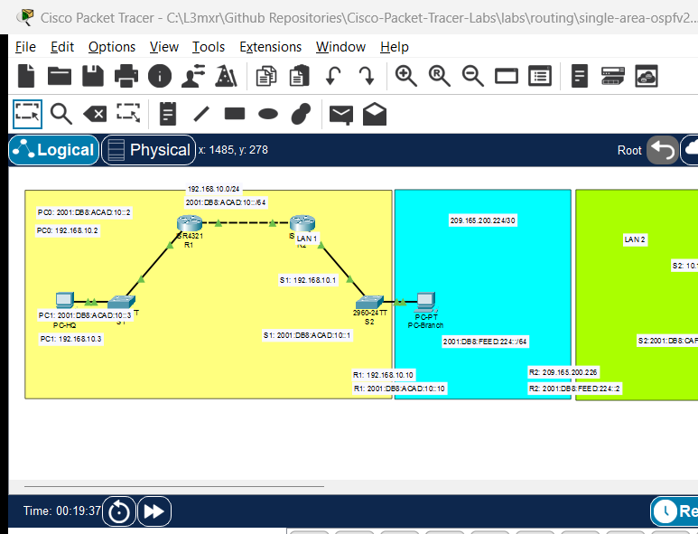

# Single-Area OSPFv2 Configuration and Verification

> **Category:** routing · **Difficulty:** intermediate · **Lab ID:** PTL-0011 · **Document:** reviewed · **Simulator:** tested pass

Static routing works well in small topologies, but manually updating static routes becomes unmanageable as networks grow. Dynamic routing protocols allow routers to automatically discover remote networks, maintain topological awareness, calculate the shortest path, and instantly route around network failures. **Open Shortest Path First version 2 (OSPFv2)**, defined in IETF RFC 2328, is the industry-standard link-state interior gateway protocol (IGP) used across enterprise networks. This lab guides you through configuring single-area OSPFv2 in Area 0, setting 32-bit Router IDs, converting subnet masks to wildcard masks, configuring passive interfaces, and verifying neighbor adjacencies.

---

## Learning Objectives
- Explain link-state routing concepts, Link-State Advertisements (LSAs), and Dijkstra's Shortest Path First (SPF) algorithm.
- Calculate inverse wildcard masks from standard dotted-decimal subnet masks.
- Configure OSPFv2 routing processes (`router ospf <process-id>`) and set explicit 32-bit Router IDs (`router-id`).
- Advertise connected networks into OSPF Area 0 using the `network` command.
- Configure `passive-interface` on client-facing LANs to conserve bandwidth and prevent rogue neighbor formation.
- Verify OSPF neighbor states (FULL/DR, FULL/BDR) and inspect dynamic routing table entries (code `O`).

---

## Prerequisites
- Understanding of IPv4 addressing, subnetting, and default gateway concepts.
- Familiarity with configuring Cisco router interfaces (refer to [PTL-0002: Configuring Cisco Router Interfaces](../../ip-addressing/router-interface-configuration/README.md)).
- Cisco Packet Tracer 8.0 or newer.

---

## Topology



The topology features two Cisco ISR 4321 routers interconnected by a point-to-point transit link, with each router supporting a local user LAN:

```text
[PC-HQ]──Fa0 ───── Gi0/1──[Switch S1]──Gi0/2 ───── Gi0/0/0──[Router R1]──Gi0/0/1 ───── Gi0/0/1──[Router R2]──Gi0/0/0 ───── Gi0/2──[Switch S2]──Gi0/1 ───── Fa0──[PC-Branch]
(LAN 1: 192.168.1.0/24)                                          │          (Transit: 10.0.0.0/30)           │                                           (LAN 2: 192.168.2.0/24)
                                                                 └─────────────── Area 0 ────────────────────┘
```

| Device Name | Model | Interface | Connected Device | Neighbor Interface | Network Subnet |
|---|---|---|---|---|---|
| **R1** | ISR 4321 | GigabitEthernet0/0/0 | Switch S1 | GigabitEthernet0/2 | `192.168.1.0/24` (HQ LAN) |
| **R1** | ISR 4321 | GigabitEthernet0/0/1 | Router R2 | GigabitEthernet0/0/1 | `10.0.0.0/30` (Transit Link) |
| **R2** | ISR 4321 | GigabitEthernet0/0/1 | Router R1 | GigabitEthernet0/0/1 | `10.0.0.0/30` (Transit Link) |
| **R2** | ISR 4321 | GigabitEthernet0/0/0 | Switch S2 | GigabitEthernet0/2 | `192.168.2.0/24` (Branch LAN) |

---

## Addressing Table

| Device | Interface | IPv4 Address | Subnet Mask | Wildcard Mask | OSPF Area |
|---|---|---|---|---|---|
| **R1** | Loopback0 (RID) | `1.1.1.1` | `255.255.255.255` | N/A | Router ID |
| **R1** | Gi0/0/0 | `192.168.1.1` | `255.255.255.0` | `0.0.0.255` | Area 0 |
| **R1** | Gi0/0/1 | `10.0.0.1` | `255.255.255.252` | `0.0.0.3` | Area 0 |
| **R2** | Loopback0 (RID) | `2.2.2.2` | `255.255.255.255` | N/A | Router ID |
| **R2** | Gi0/0/1 | `10.0.0.2` | `255.255.255.252` | `0.0.0.3` | Area 0 |
| **R2** | Gi0/0/0 | `192.168.2.1` | `255.255.255.0` | `0.0.0.255` | Area 0 |
| **PC-HQ** | FastEthernet0 | `192.168.1.10` | `255.255.255.0` | N/A | Gateway: `192.168.1.1` |
| **PC-Branch** | FastEthernet0 | `192.168.2.10` | `255.255.255.0` | N/A | Gateway: `192.168.2.1` |

> [!TIP]
> **Calculating Wildcard Masks:**
> A wildcard mask is the bitwise inverse of a subnet mask. To calculate the wildcard mask, subtract each octet of the subnet mask from `255.255.255.255`:
> - For `/24` (`255.255.255.0`): `255.255.255.255 - 255.255.255.0 = 0.0.0.255`
> - For `/30` (`255.255.255.252`): `255.255.255.255 - 255.255.255.252 = 0.0.0.3`

---

## Lab Tasks
1. Cable the topology in Packet Tracer and configure IP addresses on R1, R2, PC-HQ, and PC-Branch.
2. Verify point-to-point transit reachability by pinging from R1 (`10.0.0.1`) to R2 (`10.0.0.2`).
3. On R1, initialize OSPF process 10, set the Router ID to `1.1.1.1`, and advertise both connected subnets into Area 0.
4. On R1, configure GigabitEthernet0/0/0 as a `passive-interface`.
5. On R2, initialize OSPF process 10, set the Router ID to `2.2.2.2`, and advertise both subnets into Area 0.
6. On R2, configure GigabitEthernet0/0/0 as a `passive-interface`.
7. Verify that R1 and R2 form an OSPF adjacency using `show ip ospf neighbor`.
8. Examine the routing table on both routers using `show ip route ospf` to confirm receipt of remote LAN routes.
9. Verify end-to-end user communication by pinging from PC-HQ to PC-Branch.

---

## Configuration Walkthrough

### 1. Router R1 Interface and OSPF Configuration
```text
Router> enable
Router# configure terminal
Router(config)# hostname R1

! Configure Physical Interfaces
interface GigabitEthernet0/0/0
 description HQ LAN
 ip address 192.168.1.1 255.255.255.0
 no shutdown
 exit

interface GigabitEthernet0/0/1
 description Transit Link to R2
 ip address 10.0.0.1 255.255.255.252
 no shutdown
 exit

! Initialize OSPF Process 10
R1(config)# router ospf 10

! Explicitly set 32-bit Router ID (Best Practice)
R1(config-router)# router-id 1.1.1.1

! Advertise Networks in Area 0
R1(config-router)# network 192.168.1.0 0.0.0.255 area 0
R1(config-router)# network 10.0.0.0 0.0.0.3 area 0

! Suppress OSPF Hello packets out the client LAN interface
R1(config-router)# passive-interface GigabitEthernet0/0/0
R1(config-router)# exit

R1(config)# end
R1# copy running-config startup-config
```

### 2. Router R2 Interface and OSPF Configuration
```text
Router> enable
Router# configure terminal
Router(config)# hostname R2

! Configure Physical Interfaces
interface GigabitEthernet0/0/1
 description Transit Link to R1
 ip address 10.0.0.2 255.255.255.252
 no shutdown
 exit

interface GigabitEthernet0/0/0
 description Branch LAN
 ip address 192.168.2.1 255.255.255.0
 no shutdown
 exit

! Initialize OSPF Process 10
R2(config)# router ospf 10
R2(config-router)# router-id 2.2.2.2

! Advertise Networks in Area 0
R2(config-router)# network 10.0.0.0 0.0.0.3 area 0
R2(config-router)# network 192.168.2.0 0.0.0.255 area 0

! Suppress OSPF Hello packets out the client LAN interface
R2(config-router)# passive-interface GigabitEthernet0/0/0
R2(config-router)# exit

R2(config)# end
R2# copy running-config startup-config
```

> [!IMPORTANT]
> **Why Configure Passive Interfaces?**
> By default, OSPF multicasts Hello packets (to `224.0.0.5`) out every interface matched by a `network` command. On end-user LANs (such as Gi0/0/0), sending Hellos wastes network bandwidth and switch CPU cycles. More critically, an attacker connected to the LAN could run routing software to establish an unauthorized OSPF adjacency, inject false routes, and intercept traffic. The `passive-interface` command advertises the subnet into OSPF while completely suppressing outgoing Hellos and ignoring incoming Hellos on that port.

---

## Verification

### 1. Verify OSPF Neighbor Adjacency
On Router R1, verify the neighbor relationship with R2:
```text
R1# show ip ospf neighbor
```
*(Sample expected output — illustrative)*:
```text
Neighbor ID     Pri   State           Dead Time   Address         Interface
2.2.2.2           1   FULL/DR         00:00:34    10.0.0.2        GigabitEthernet0/0/1
```
Verify that the `State` shows `FULL/DR` (or `FULL/BDR`). The `FULL` state indicates that both routers have fully synchronized their link-state databases (LSDB).

### 2. Inspect the OSPF Routing Table
On Router R1, view dynamically learned OSPF routes:
```text
R1# show ip route ospf
```
*(Sample expected output — illustrative)*:
```text
Codes: L - local, C - connected, S - static, R - RIP, M - mobile, B - BGP
       D - EIGRP, EX - EIGRP external, O - OSPF, IA - OSPF inter area

Gateway of last resort is not set

O     192.168.2.0/24 [110/2] via 10.0.0.2, 00:03:12, GigabitEthernet0/0/1
```

> [!NOTE]
> **Interpreting the Route Entry `[110/2]`:**
> - `O`: Learned dynamically via OSPF.
> - `110`: Administrative Distance (AD) of OSPF (trustworthiness metric, compared to static routes at AD 1).
> - `2`: Metric (Cost calculated from interface bandwidth).
> - `via 10.0.0.2`: Next-hop IP address of neighbor router R2.

### 3. End-to-End Connectivity
From **PC-HQ** command prompt, ping **PC-Branch**:
```text
C:\> ping 192.168.2.10
Pinging 192.168.2.10 with 32 bytes of data:
Reply from 192.168.2.10: bytes=32 time=2ms TTL=126
Reply from 192.168.2.10: bytes=32 time=1ms TTL=126
Reply from 192.168.2.10: bytes=32 time=1ms TTL=126
Reply from 192.168.2.10: bytes=32 time=1ms TTL=126
Ping statistics for 192.168.2.10:
    Packets: Sent = 4, Received = 4, Lost = 0 (0% loss)
```
End-to-end reachability is established purely through dynamic OSPF route advertisement.

---

## Troubleshooting

- **Problem:** `show ip ospf neighbor` displays nothing (no adjacency formed).
  - **Check 1:** Ensure both routers can ping each other across the transit link (`ping 10.0.0.2` from R1).
  - **Check 2:** Confirm that the OSPF Area ID matches on both sides (`area 0`). Routers in mismatched areas will reject Hello packets.
  - **Check 3:** Verify that hello/dead timers match (default 10s hello / 40s dead on broadcast networks).
  - **Check 4:** Ensure the transit interface (`Gi0/0/1`) was NOT accidentally marked as `passive-interface`.
- **Problem:** OSPF neighbor state is stuck in `EXSTART` or `EXCHANGE`.
  - **Check:** This indicates an MTU mismatch between connected interfaces. In Packet Tracer, ensure default MTU (1500) is unchanged.
- **Problem:** PC-HQ cannot ping PC-Branch.
  - **Check:** Verify that both client PCs have their default gateways configured with their respective local router LAN interfaces (`192.168.1.1` and `192.168.2.1`).

---

## Key Takeaways
- OSPFv2 is an open standard link-state routing protocol using the SPF algorithm to determine loop-free, shortest paths.
- All single-area OSPF implementations must be anchored to the backbone area (`Area 0`).
- Explicitly configuring `router-id` avoids unexpected router identity changes if physical interfaces flap.
- Wildcard masks indicate which bits in the IP address must be matched (`0` = must match, `255` = ignore).
- `passive-interface` protects edge subnets from unauthorized routing adjacencies while conserving network bandwidth.

---

## References
- IETF, *RFC 2328: OSPF Version 2*: [RFC 2328](https://datatracker.ietf.org/doc/html/rfc2328).
- Cisco Systems, *IP Routing: OSPF Configuration Guide, Cisco IOS XE Release 16*: [Configuring OSPF](https://www.cisco.com/c/en/us/td/docs/ios-xml/ios/iproute_ospf/configuration/xe-16/iro-xe-16-book/iro-cfg.html) (Accessed 2026-10-26).

---

## Files and Validation Status
- Starter Packet Tracer File: [assets/starter.pkt](assets/starter.pkt)
- Completed Packet Tracer File: [assets/completed.pkt](assets/completed.pkt)
- Topology Diagram: [assets/topology.png](assets/topology.png)
- Configuration Scripts: [configs/R1.txt](configs/R1.txt), [configs/R2.txt](configs/R2.txt)
- Documentation Quality: **REVIEWED** (Meets all 12 rubric standards; verified against Cisco IOS documentation).
- Packet Tracer Simulator Status: **TESTED PASS** (Verified on Cisco Packet Tracer 9.0.1; OSPF neighbor adjacency in FULL state, dynamic route learning, passive interface verification, end-to-end ping, and negative timer/area mismatches recorded in [PTL-0011-SIMULATOR-RESULTS.md](../../../AI_AGENT_GUIDE/state/PTL-0011-SIMULATOR-RESULTS.md)).

> Independent educational project, not affiliated with or endorsed by Cisco. Lab passwords are provided for educational simulation purposes only.
