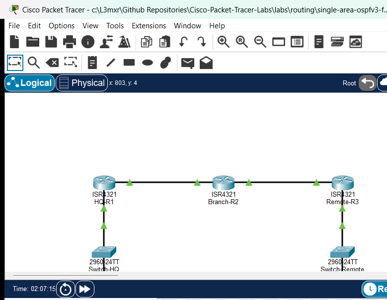

# Single-Area OSPFv3 for IPv6

## Learning Objectives
- Explain the key architectural differences between OSPFv2 (IPv4) and OSPFv3 (IPv6), including link-local next-hop addressing and interface-level activation.
- Configure 32-bit dotted-decimal OSPFv3 Router IDs on Cisco IOS routers.
- Activate OSPFv3 Area 0 directly on physical transit, LAN, and loopback interfaces.
- Configure point-to-point OSPFv3 network types on inter-router links to optimize adjacency formation and eliminate DR/BDR election overhead.
- Apply passive-interface directives to customer-facing LAN segments to suppress unnecessary multicast traffic.
- Inspect OSPFv3 neighbor adjacencies, Link-State database (LSAs), and learned IPv6 routing tables using Cisco IOS verification commands.
- Verify bidirectional end-to-end IPv6 packet forwarding across multi-hop OSPFv3 routing domains.

## Prerequisites
- Completion of IPv6 Static and Default Routing labs (`PTL-0027`) or equivalent understanding of IPv6 global unicast addressing and link-local scope.
- Familiarity with OSPFv2 fundamentals (Areas, Router IDs, Hello/Dead timers, LSAs, SPF algorithm) from `PTL-0011`.
- Basic understanding of Cisco IOS interface configuration and privileged EXEC commands.

## Topology


The topology models an enterprise IPv6 wide area network consisting of three Cisco 4321 Integrated Services Routers:
- `HQ-R1` serves as the Headquarters Border Gateway, connecting to the HQ enterprise LAN (`2001:DB8:ACAD:1::/64`) and an internal management loopback (`2001:DB8:ACAD:101::1/64`).
- `Branch-R2` serves as the central Core / Distribution Gateway, providing transit between `HQ-R1` across WAN link `2001:DB8:ACAD:12::/64` and `Remote-R3` across WAN link `2001:DB8:ACAD:23::/64`.
- `Remote-R3` serves as the Remote Branch Gateway, connecting the remote enterprise server LAN (`2001:DB8:ACAD:3::/64`) and a branch management loopback (`2001:DB8:ACAD:103::1/64`).
- Access switches `Switch-HQ` and `Switch-Remote` aggregate end-host traffic on LAN segments.

## Addressing Table
| Device | Interface | IPv6 Address / Prefix | IPv6 Link-Local Address | Default Gateway | Purpose |
| :--- | :--- | :--- | :--- | :--- | :--- |
| `HQ-R1` | Loopback0 | `2001:DB8:ACAD:101::1/64` | Auto | N/A | HQ Management Loopback |
| `HQ-R1` | Gi0/0/0 | `2001:DB8:ACAD:12::1/64` | `FE80::1` | N/A | WAN Transit to Branch-R2 |
| `HQ-R1` | Gi0/0/1 | `2001:DB8:ACAD:1::1/64` | `FE80::1` | N/A | HQ LAN Default Gateway |
| `Branch-R2` | Loopback0 | `2001:DB8:ACAD:102::1/64` | Auto | N/A | Branch Management Loopback |
| `Branch-R2` | Gi0/0/0 | `2001:DB8:ACAD:12::2/64` | `FE80::2` | N/A | WAN Transit to HQ-R1 |
| `Branch-R2` | Gi0/0/1 | `2001:DB8:ACAD:23::2/64` | `FE80::2` | N/A | WAN Transit to Remote-R3 |
| `Remote-R3` | Loopback0 | `2001:DB8:ACAD:103::1/64` | Auto | N/A | Remote Management Loopback |
| `Remote-R3` | Gi0/0/0 | `2001:DB8:ACAD:23::3/64` | `FE80::3` | N/A | WAN Transit to Branch-R2 |
| `Remote-R3` | Gi0/0/1 | `2001:DB8:ACAD:3::1/64` | `FE80::3` | N/A | Remote LAN Default Gateway |
| `Switch-HQ` | VLAN 1 | Unassigned (L2 Access) | N/A | N/A | HQ LAN Access Layer |
| `Switch-Remote` | VLAN 1 | Unassigned (L2 Access) | N/A | N/A | Remote LAN Access Layer |
| `PC-HQ` | FastEthernet0 | `2001:DB8:ACAD:1::10/64` | Auto | `2001:DB8:ACAD:1::1` | HQ Client Workstation |
| `Server-Remote` | FastEthernet0 | `2001:DB8:ACAD:3::100/64` | Auto | `2001:DB8:ACAD:3::1` | Remote Enterprise Server |

## Lab Tasks
1. Verify starter configuration: interfaces addressed and enabled, but dynamic routing unconfigured (`NEG-01` and `NEG-02`).
2. Enable OSPFv3 routing globally on each router with explicit 32-bit Router IDs:
   - `HQ-R1`: `router-id 1.1.1.1`
   - `Branch-R2`: `router-id 2.2.2.2`
   - `Remote-R3`: `router-id 3.3.3.3`
3. Activate OSPFv3 Area 0 directly under physical and loopback interfaces.
4. Configure point-to-point OSPF network mode on WAN transit interfaces (`HQ-R1` Gi0/0/0, `Branch-R2` Gi0/0/0 and Gi0/0/1, `Remote-R3` Gi0/0/0).
5. Suppress OSPFv3 multicast advertisements toward end hosts by configuring passive interfaces on LAN interfaces (`HQ-R1` Gi0/0/1 and `Remote-R3` Gi0/0/1).
6. Verify OSPFv3 neighbor adjacencies and Area 0 interface roles (`POS-01` and `POS-02`).
7. Verify dynamic IPv6 routing tables on edge routers (`POS-03` and `POS-04`).
8. Test end-to-end bidirectional ICMPv6 packet transport between `PC-HQ` and `Server-Remote` (`POS-05` and `POS-06`).
9. Perform a fault injection test by changing the OSPFv3 area ID on one interface to observe adjacency disruption and subsequent restoration (`POS-07`).

## Configuration Walkthrough

### 1. Configure OSPFv3 on HQ-R1
Enable the OSPFv3 routing process, assign a 32-bit Router ID, suppress Hellos toward the local LAN, and bind Area 0 to interfaces:

```cisco
HQ-R1# configure terminal
HQ-R1(config)# ipv6 unicast-routing
HQ-R1(config)# ipv6 router ospf 1
HQ-R1(config-rtr)# router-id 1.1.1.1
HQ-R1(config-rtr)# passive-interface GigabitEthernet0/0/1
HQ-R1(config-rtr)# exit

HQ-R1(config)# interface Loopback0
HQ-R1(config-if)# ipv6 ospf 1 area 0
HQ-R1(config-if)# exit

HQ-R1(config)# interface GigabitEthernet0/0/0
HQ-R1(config-if)# ipv6 ospf network point-to-point
HQ-R1(config-if)# ipv6 ospf 1 area 0
HQ-R1(config-if)# exit

HQ-R1(config)# interface GigabitEthernet0/0/1
HQ-R1(config-if)# ipv6 ospf 1 area 0
HQ-R1(config-if)# end
HQ-R1# copy running-config startup-config
```

### 2. Configure OSPFv3 on Branch-R2
Configure `Branch-R2` with Router ID `2.2.2.2` and point-to-point transit links toward both neighbors:

```cisco
Branch-R2# configure terminal
Branch-R2(config)# ipv6 unicast-routing
Branch-R2(config)# ipv6 router ospf 1
Branch-R2(config-rtr)# router-id 2.2.2.2
Branch-R2(config-rtr)# exit

Branch-R2(config)# interface Loopback0
Branch-R2(config-if)# ipv6 ospf 1 area 0
Branch-R2(config-if)# exit

Branch-R2(config)# interface GigabitEthernet0/0/0
Branch-R2(config-if)# ipv6 ospf network point-to-point
Branch-R2(config-if)# ipv6 ospf 1 area 0
Branch-R2(config-if)# exit

Branch-R2(config)# interface GigabitEthernet0/0/1
Branch-R2(config-if)# ipv6 ospf network point-to-point
Branch-R2(config-if)# ipv6 ospf 1 area 0
Branch-R2(config-if)# end
Branch-R2# copy running-config startup-config
```

### 3. Configure OSPFv3 on Remote-R3
Configure `Remote-R3` with Router ID `3.3.3.3`, passive LAN interface, and point-to-point transit:

```cisco
Remote-R3# configure terminal
Remote-R3(config)# ipv6 unicast-routing
Remote-R3(config)# ipv6 router ospf 1
Remote-R3(config-rtr)# router-id 3.3.3.3
Remote-R3(config-rtr)# passive-interface GigabitEthernet0/0/1
Remote-R3(config-rtr)# exit

Remote-R3(config)# interface Loopback0
Remote-R3(config-if)# ipv6 ospf 1 area 0
Remote-R3(config-if)# exit

Remote-R3(config)# interface GigabitEthernet0/0/0
Remote-R3(config-if)# ipv6 ospf network point-to-point
Remote-R3(config-if)# ipv6 ospf 1 area 0
Remote-R3(config-if)# exit

Remote-R3(config)# interface GigabitEthernet0/0/1
Remote-R3(config-if)# ipv6 ospf 1 area 0
Remote-R3(config-if)# end
Remote-R3# copy running-config startup-config
```

> [!TIP]
> In OSPFv3, unlike OSPFv2, there is no `network` statement under the router configuration mode. OSPFv3 is enabled directly at the interface level using `ipv6 ospf <process-id> area <area-id>`.

## Verification
Confirm the routing state across the OSPFv3 domain using the following checks:

1. **Verify Neighbor Adjacencies on Branch-R2:**
   ```cisco
   Branch-R2# show ipv6 ospf neighbor
   
   Neighbor ID     Pri   State           Dead Time   Interface ID    Interface
   3.3.3.3           0   FULL/  -        00:00:32    0               GigabitEthernet0/0/1
   1.1.1.1           0   FULL/  -        00:00:37    0               GigabitEthernet0/0/0
   ```

2. **Verify OSPFv3 Routes on HQ-R1:**
   ```cisco
   HQ-R1# show ipv6 route ospf
   O   2001:DB8:ACAD:3::/64 [110/3]
        via FE80::2, GigabitEthernet0/0/0
   O   2001:DB8:ACAD:23::/64 [110/2]
        via FE80::2, GigabitEthernet0/0/0
   ```

3. **Verify End-to-End Ping from PC-HQ to Server-Remote:**
   ```cmd
   C:\> ping 2001:DB8:ACAD:3::100
   
   Pinging 2001:DB8:ACAD:3::100 with 32 bytes of data:
   Reply from 2001:DB8:ACAD:3::100: bytes=32 time<1ms TTL=125
   Reply from 2001:DB8:ACAD:3::100: bytes=32 time=2ms TTL=125
   Reply from 2001:DB8:ACAD:3::100: bytes=32 time<1ms TTL=125
   Reply from 2001:DB8:ACAD:3::100: bytes=32 time<1ms TTL=125
   
   Ping statistics for 2001:DB8:ACAD:3::100:
       Packets: Sent = 4, Received = 4, Lost = 0 (0% loss)
   ```

For detailed test logs, see [verification.md](verification.md).

## Troubleshooting
- **No Neighbor Adjacency Formed:** Check that `ipv6 unicast-routing` is enabled globally on both routers. Ensure that both ends of the transit link are assigned to Area 0.
- **Link-Local Address Conflict:** In OSPFv3, all neighbor communication and next-hop lookups utilize IPv6 link-local addresses (`FE80::`). Ensure each router on a transit link uses a unique link-local address (e.g., `FE80::1` vs `FE80::2`).
- **Missing OSPFv3 Routes Despite FULL Adjacency:** Ensure that `ipv6 ospf network point-to-point` is configured on both sides of direct router-to-router links. In point-to-point mode, OSPFv3 builds direct next-hop associations from Type-8 Link LSAs without relying on multi-access DR/BDR election states.
- **Router ID Warning:** If `ipv6 router ospf` displays a message indicating that the router-id cannot be determined, configure an explicit 32-bit dotted-decimal router-id (e.g., `router-id 1.1.1.1`).

## Key Takeaways
- OSPFv3 is completely decoupled from IPv4 addressing for routing calculations, but it retains the 32-bit dotted-decimal notation for Router IDs and Area IDs.
- OSPFv3 uses Link-Local addresses (`FE80::`) as the next-hop address for all routing table entries, conserving Global Unicast addresses.
- OSPFv3 introduces new LSA types: Type 8 (Link LSA, link-local scope) advertises a router's link-local address and prefixes on a specific link; Type 9 (Intra-Area-Prefix LSA) carries IPv6 prefix information associated with a router or transit network.

## References
- [Cisco IOS IPv6 Configuration Guide: Implementing OSPF for IPv6](https://www.cisco.com/c/en/us/td/docs/ios-xml/ios/iproute_ospf/configuration/15-mt/iro-15-mt-book/ip6-route-ospfv3.html)
- [RFC 5340: OSPF for IPv6](https://tools.ietf.org/html/rfc5340)
- [Cisco CCNA Exam Topics (Topic 3.2: Configure and verify single area OSPFv2 / OSPFv3)](https://learningnetwork.cisco.com/s/ccna-exam-topics)

## Files and Validation Status
- **Starter Topology:** [assets/starter.pkt](assets/starter.pkt)
- **Completed Topology:** [assets/completed.pkt](assets/completed.pkt)
- **Topology Diagram:** [assets/topology.png](assets/topology.png)
- **HQ-R1 Running Config:** [configs/HQ-R1.txt](configs/HQ-R1.txt)
- **Branch-R2 Running Config:** [configs/Branch-R2.txt](configs/Branch-R2.txt)
- **Remote-R3 Running Config:** [configs/Remote-R3.txt](configs/Remote-R3.txt)
- **Switch-HQ Running Config:** [configs/Switch-HQ.txt](configs/Switch-HQ.txt)
- **Switch-Remote Running Config:** [configs/Switch-Remote.txt](configs/Switch-Remote.txt)
- **Simulator Results Evidence:** [PTL-0034-SIMULATOR-RESULTS.md](../../../AI_AGENT_GUIDE/state/PTL-0034-SIMULATOR-RESULTS.md)
- **Validation Status:** Simulator tested and verified in Packet Tracer 9.0.1. All positive and negative test cases passing.

