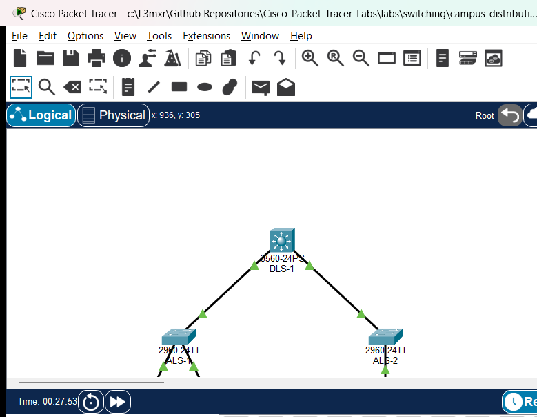

# PTL-0049: Campus Distribution and Access VLAN Design

## Learning Objectives
- Design and implement a two-tier hierarchical campus network featuring a multilayer distribution switch and Layer 2 access switches.
- Configure Switch Virtual Interfaces (SVIs) on a Cisco Catalyst 3560 to act as centralized Layer 3 default gateways for campus VLANs.
- Activate Cisco Express Forwarding (CEF) and hardware inter-VLAN routing using the global `ip routing` command.
- Configure IEEE 802.1Q trunking with explicit `dot1q` encapsulation, custom Native VLAN 99, and pruned allowed VLAN lists.
- Diagnose and remediate common campus distribution failures, including disabled IP routing, trunk pruning omissions, and access port VLAN mismatches.

## Prerequisites
- Completion of [PTL-0009: VLAN Segmentation and Access Port Configuration](../../switching/vlan-segmentation-and-access-ports/README.md).
- Completion of [PTL-0018: Dynamic Trunking Protocol and Native VLAN Security](../../network-security/dtp-and-native-vlan-security/README.md).
- Completion of [PTL-0019: Layer 3 Switch SVIs and Routed Ports](../../routing/layer-3-switch-svis-and-routed-ports/README.md).
- Familiarity with Catalyst switch CLI syntax, SVI autostate mechanics, and inter-VLAN routing principles.

## Topology
The campus network topology implements a classic two-tier hierarchical model. Multilayer distribution switch `DLS-1` aggregates traffic from access switches `ALS-1` (Faculty and Student lab workstations) and `ALS-2` (Campus Application Server farm) across redundant 802.1Q Gigabit trunk uplinks.

```
                                  [ DLS-1: Catalyst 3560-24PS ]
                              (Multilayer Distribution Switch & Core SVI Gateways)
                                SVI 10: 192.168.10.1/24  |  SVI 20: 192.168.20.1/24
                                SVI 30: 192.168.30.1/24  |  SVI 99: 192.168.99.1/24
                                     (Gi0/1)                   (Gi0/2)
                                        |                         |
                                802.1Q Trunk Uplink       802.1Q Trunk Uplink
                              (VLANs 10,20,30,99 Native 99) (VLANs 10,20,30,99 Native 99)
                                        |                         |
                                     (Gi0/1)                   (Gi0/1)
                           [ ALS-1: Catalyst 2960 ]      [ ALS-2: Catalyst 2960 ]
                             (Building A Access)           (Server Farm Access)
                            (Fa0/1)        (Fa0/2)               (Fa0/1)
                               |              |                     |
                            VLAN 10        VLAN 20               VLAN 30
                               |              |                     |
                          [PC-Faculty]   [PC-Student]          [Campus-Srv]
                        192.168.10.10/24 192.168.20.10/24      192.168.30.10/24
```



## Addressing Table
| Device | Interface / Role | IP Address | Subnet Mask | Default Gateway | Description |
|---|---|---|---|---|---|
| **DLS-1** | Vlan10 (SVI) | 192.168.10.1 | 255.255.255.0 | N/A | Faculty Department Gateway |
| **DLS-1** | Vlan20 (SVI) | 192.168.20.1 | 255.255.255.0 | N/A | Student Department Gateway |
| **DLS-1** | Vlan30 (SVI) | 192.168.30.1 | 255.255.255.0 | N/A | Server Farm Gateway |
| **DLS-1** | Vlan99 (SVI) | 192.168.99.1 | 255.255.255.0 | N/A | Management SVI & Native VLAN Gateway |
| **ALS-1** | Vlan99 (SVI) | 192.168.99.11 | 255.255.255.0 | 192.168.99.1 | Building A Switch Management |
| **ALS-2** | Vlan99 (SVI) | 192.168.99.12 | 255.255.255.0 | 192.168.99.1 | Server Farm Switch Management |
| **PC-Faculty** | FastEthernet0 | 192.168.10.10 | 255.255.255.0 | 192.168.10.1 | Academic Faculty Client (VLAN 10) |
| **PC-Student** | FastEthernet0 | 192.168.20.10 | 255.255.255.0 | 192.168.20.1 | Student Lab Client (VLAN 20) — Faulted in starter |
| **Campus-Srv** | FastEthernet0 | 192.168.30.10 | 255.255.255.0 | 192.168.30.1 | Campus Application Server (VLAN 30) |

## Lab Tasks
1. **Audit Access Switch Port Configurations**: Inspect access switchport configurations on `ALS-1`. Verify that `Fa0/1` is assigned to `VLAN 10` and diagnose why `PC-Student` connected to `Fa0/2` cannot reach its default gateway (`192.168.20.1`).
2. **Remediate Access Port VLAN Assignment**: Reconfigure `ALS-1 Fa0/2` as an access port in `VLAN 20` and verify local intra-VLAN gateway ping reachability.
3. **Investigate Multilayer Switch Inter-VLAN Routing**: Test ping reachability between `PC-Faculty` (`192.168.10.10`) and `PC-Student` (`192.168.20.10`). Determine why inter-VLAN forwarding fails despite active SVIs on `DLS-1`.
4. **Activate Hardware IP Routing on DLS-1**: Execute `show ip route` on `DLS-1` to confirm routing status. Issue the global `ip routing` command to activate Layer 3 hardware routing and populate the IPv4 routing table.
5. **Audit Distribution-to-Access Trunk Uplinks**: Run `show interfaces trunk` on `DLS-1` and `ALS-2`. Diagnose why attempts to communicate with `Campus-Srv` (`192.168.30.10`) fail, and identify omitted VLANs in the trunk allowed list.
6. **Remediate Trunk Allowed Lists**: Update `ALS-2 Gi0/1` trunk allowed list to include `VLAN 30` using non-destructive syntax.
7. **Verify Multi-VLAN Campus Reachability**: Validate end-to-end connectivity across all campus user and server VLANs, confirming full routing convergence and management plane accessibility.

## Configuration Walkthrough

### 1. Diagnosing Fault 1: Access Port Misassignment on ALS-1
In the starter state, test default gateway reachability from `PC-Student`:

```text
PC> ping 192.168.20.1
Pinging 192.168.20.1 with 32 bytes of data:
Request timed out.
Request timed out.
Request timed out.
Request timed out.

Ping statistics for 192.168.20.1:
    Packets: Sent = 4, Received = 0, Lost = 4 (100% loss)
```

Inspect switchport assignments on `ALS-1`:

```text
ALS-1# show vlan brief
VLAN Name                             Status    Ports
---- -------------------------------- --------- -------------------------------
1    default                          active    Fa0/2, Fa0/3, Fa0/4, Fa0/5...
10   Faculty                          active    Fa0/1
20   Students                         active    
30   ServerFarm                       active    
99   Management                       active    
```

Notice that `Fa0/2` is still assigned to the default `VLAN 1` instead of `VLAN 20`! `PC-Student` is isolated in an unrouted broadcast domain.

**Remediation**:
```text
ALS-1# configure terminal
ALS-1(config)# interface FastEthernet0/2
ALS-1(config-if)# switchport mode access
ALS-1(config-if)# switchport access vlan 20
ALS-1(config-if)# exit
ALS-1(config)# end
ALS-1# copy running-config startup-config
```

Verify that `PC-Student` can now reach its local SVI gateway:
```text
PC> ping 192.168.20.1
Reply from 192.168.20.1: bytes=32 time<1ms TTL=255
```

### 2. Diagnosing Fault 2: Disabled Global IP Routing on DLS-1
Now attempt an inter-VLAN ping from `PC-Faculty` (`192.168.10.10`) to `PC-Student` (`192.168.20.10`):

```text
PC> ping 192.168.20.10
Pinging 192.168.20.10 with 32 bytes of data:
Request timed out.
Request timed out.
Request timed out.
Request timed out.
```

Both clients can ping their respective SVI gateways (`192.168.10.1` and `192.168.20.1`). However, cross-VLAN packets are dropped by `DLS-1`. Inspect the routing table on `DLS-1`:

```text
DLS-1# show ip route
IP routing not enabled
```

Cisco Catalyst multilayer switches do not perform Layer 3 forwarding by default. When `ip routing` is disabled, the switch responds only to packets directed to its own SVI IP addresses and refuses to forward packets between different SVIs.

**Remediation**:
```text
DLS-1# configure terminal
DLS-1(config)# ip routing
DLS-1(config)# end
DLS-1# copy running-config startup-config
```

Verify that the IPv4 routing table is now populated with connected SVI subnets:
```text
DLS-1# show ip route
Codes: C - connected, S - static, R - RIP, M - mobile, B - BGP
       D - EIGRP, EX - EIGRP external, O - OSPF, IA - OSPF inter area 

Gateway of last resort is not set

C    192.168.10.0/24 is directly connected, Vlan10
C    192.168.20.0/24 is directly connected, Vlan20
C    192.168.30.0/24 is directly connected, Vlan30
C    192.168.99.0/24 is directly connected, Vlan99
```

### 3. Diagnosing Fault 3: Trunk Allowed-List Omission on ALS-2
With IP routing activated on `DLS-1`, test access from `PC-Faculty` to campus server `Campus-Srv` (`192.168.30.10`):

```text
PC> ping 192.168.30.10
Pinging 192.168.30.10 with 32 bytes of data:
Request timed out.
Request timed out.
Request timed out.
Request timed out.
```

Inspect the 802.1Q trunk uplink on `ALS-2`:

```text
ALS-2# show interfaces trunk
Port        Mode         Encapsulation  Status        Native vlan
Gig0/1      on           802.1q         trunking      99

Port        Vlans allowed on trunk
Gig0/1      10,20,99
```

Notice that `Vlan 30` is **missing from the allowed VLAN list on ALS-2 Gi0/1**! Frames tagged for VLAN 30 transmitted by `DLS-1` are blocked at the ingress of `ALS-2`.

**Remediation**:
```text
ALS-2# configure terminal
ALS-2(config)# interface GigabitEthernet0/1
ALS-2(config-if)# switchport trunk allowed vlan add 30
ALS-2(config-if)# exit
ALS-2(config)# end
ALS-2# copy running-config startup-config
```

Verify the updated trunk allowed list:
```text
ALS-2# show interfaces trunk
Port        Vlans allowed on trunk
Gig0/1      10,20,30,99
```

## Verification

### 1. Multilayer Switch Hardware Routing Verification
Confirm on `DLS-1` that all four departmental and management SVIs are active in the routing table:

```text
DLS-1# show ip route connected
C    192.168.10.0/24 is directly connected, Vlan10
C    192.168.20.0/24 is directly connected, Vlan20
C    192.168.30.0/24 is directly connected, Vlan30
C    192.168.99.0/24 is directly connected, Vlan99
```

### 2. 802.1Q Trunk Uplink Consistency Audit
Verify trunk encapsulation, native VLAN 99, and allowed VLAN lists across all switches:

```text
DLS-1# show interfaces trunk
Port        Mode         Encapsulation  Status        Native vlan
Gig0/1      on           802.1q         trunking      99
Gig0/2      on           802.1q         trunking      99

Port        Vlans allowed on trunk
Gig0/1      10,20,30,99
Gig0/2      10,20,30,99
```

### 3. Intra-VLAN Default Gateway Reachability
Test reachability from each endpoint to its respective local SVI gateway:

```text
PC-Faculty> ping 192.168.10.1
Packets: Sent = 4, Received = 4, Lost = 0 (0% loss)

PC-Student> ping 192.168.20.1
Packets: Sent = 4, Received = 4, Lost = 0 (0% loss)

Campus-Srv> ping 192.168.30.1
Packets: Sent = 4, Received = 4, Lost = 0 (0% loss)
```

### 4. End-to-End Inter-VLAN Reachability
Verify client-to-server data plane delivery across distribution SVIs:

```text
PC-Faculty> ping 192.168.30.10
Pinging 192.168.30.10 with 32 bytes of data:
Reply from 192.168.30.10: bytes=32 time=1ms TTL=127
Reply from 192.168.30.10: bytes=32 time=1ms TTL=127
Reply from 192.168.30.10: bytes=32 time=1ms TTL=127
Reply from 192.168.30.10: bytes=32 time=1ms TTL=127

Ping statistics for 192.168.30.10:
    Packets: Sent = 4, Received = 4, Lost = 0 (0% loss)
```

Verify student client-to-server reachability:

```text
PC-Student> ping 192.168.30.10
Pinging 192.168.30.10 with 32 bytes of data:
Reply from 192.168.30.10: bytes=32 time=1ms TTL=127
Reply from 192.168.30.10: bytes=32 time=1ms TTL=127
Reply from 192.168.30.10: bytes=32 time=1ms TTL=127
Reply from 192.168.30.10: bytes=32 time=1ms TTL=127

Ping statistics for 192.168.30.10:
    Packets: Sent = 4, Received = 4, Lost = 0 (0% loss)
```

Verify cross-department client-to-client reachability:

```text
PC-Faculty> ping 192.168.20.10
Pinging 192.168.20.10 with 32 bytes of data:
Reply from 192.168.20.10: bytes=32 time=1ms TTL=127
Reply from 192.168.20.10: bytes=32 time=1ms TTL=127
Reply from 192.168.20.10: bytes=32 time=1ms TTL=127
Reply from 192.168.20.10: bytes=32 time=1ms TTL=127

Ping statistics for 192.168.20.10:
    Packets: Sent = 4, Received = 4, Lost = 0 (0% loss)
```

Notice that TTL is `127` (decremented once by `DLS-1` hardware routing engine), confirming Layer 3 forwarding.

### Verification Criteria Checklist
| Test ID | Objective | Expected Output | Status |
|---|---|---|---|
| POS-01 | DLS-1 Hardware Routing & SVI Audit | Connected routes for 10.0, 20.0, 30.0, 99.0 present in routing table | PASS |
| POS-02 | Trunking & Native VLAN Consistency | 802.1Q trunks active on Gi0/1 and Gi0/2, Native 99, allowed 10,20,30,99 | PASS |
| POS-03 | Faculty Local Gateway Reachability | 0% packet loss (PC-Faculty -> DLS-1 Vlan10 192.168.10.1) | PASS |
| POS-04 | Student Local Gateway Reachability | 0% packet loss (PC-Student -> DLS-1 Vlan20 192.168.20.1) | PASS |
| POS-05 | Faculty to Server Inter-VLAN Ping | 0% packet loss (PC-Faculty -> Campus-Srv 192.168.30.10) | PASS |
| POS-06 | Student to Server Inter-VLAN Ping | 0% packet loss (PC-Student -> Campus-Srv 192.168.30.10) | PASS |
| POS-07 | Inter-VLAN Client-to-Client Ping | 0% packet loss (PC-Faculty -> PC-Student 192.168.20.10) | PASS |

## Troubleshooting
- **Inter-VLAN Forwarding Fails While SVI Pings Succeed**:
  - Verify that global routing is enabled using `show ip route`. If the switch outputs `IP routing not enabled`, enter global configuration mode and execute `ip routing`.
  - Check SVI line protocol status with `show ip interface brief`. An SVI will remain down if no physical ports associated with that VLAN are active (SVI autostate).
- **Endpoint Receives "Request Timed Out" on Local Gateway**:
  - Check the access switchport assignment with `show mac address-table` and `show interfaces switchport`.
  - Ensure the access port is explicitly assigned to the correct VLAN ID (`switchport access vlan <id>`).
  - Verify physical cabling and speed/duplex negotiation.
- **Traffic Dropped on Specific VLAN Across Trunk**:
  - Run `show interfaces trunk` on both ends of the inter-switch link.
  - Check the `Vlans allowed on trunk` and `Vlans allowed and active in management domain` sections.
  - If a VLAN was pruned, use `switchport trunk allowed vlan add <id>` rather than replacing the list.
  - Verify that the Native VLAN matches on both switches to prevent STP inconsistencies and frame misdirection.

## Key Takeaways
- **Hardware-Accelerated Routing**: Multilayer switches route packets at Layer 3 using ASIC-based CEF hardware tables, achieving significantly higher throughput than traditional router-on-a-stick architectures.
- **The `ip routing` Requirement**: Cisco Catalyst multilayer switches require the global `ip routing` command to activate Layer 3 packet processing. Without it, the switch behaves strictly as a Layer 2 device.
- **SVI Autostate Rules**: An SVI transitions to the `up/up` operational state only when at least one access port or trunk carrying that VLAN is in the forwarding state.
- **Trunk Allowed-List Pruning**: Explicitly pruning allowed VLANs enhances campus security and reduces broadcast radiation, but requires disciplined change management to avoid accidental service outages.

## References
- [Cisco Catalyst 3560 Software Configuration Guide: Configuring Inter-VLAN Routing](https://www.cisco.com/c/en/us/td/docs/switches/lan/catalyst3560/software/release/12-2_55_se/configuration/guide/3560_scg/swintvlan.html)
- [Cisco Technical Support: How to Configure Inter-VLAN Routing on Catalyst 3560/3750 Series Switches](https://www.cisco.com/c/en/us/support/docs/lan-switching/inter-vlan-routing/41860-howto-L3-intervlanrouting.html)
- [Cisco Validated Design: Campus Network for High Availability Design Guide](https://www.cisco.com/c/en/us/td/docs/solutions/Enterprise/Campus/camp30BR/campus30SWDG.html)

## Files and Validation Status
- `assets/starter.pkt`: Initial topology with disabled IP routing on DLS-1, misassigned access port on ALS-1, and pruned VLAN 30 on ALS-2 trunk.
- `assets/completed.pkt`: Fully functional campus distribution and access design with active hardware routing and verified inter-VLAN forwarding.
- `assets/topology.png`: Visual network diagram illustrating distribution and access switch layout.
- `assets/test_evidence.json`: Automated test execution results captured via Packet Tracer MCP bridge.
- `configs/DLS-1.txt`: Baseline running configuration for Catalyst 3560 Distribution Switch.
- `configs/ALS-1.txt`: Baseline running configuration for Building A Access Switch.
- `configs/ALS-2.txt`: Baseline running configuration for Server Farm Access Switch.
- `verification.md`: Comprehensive verification matrix detailing positive, negative, and reload tests.

