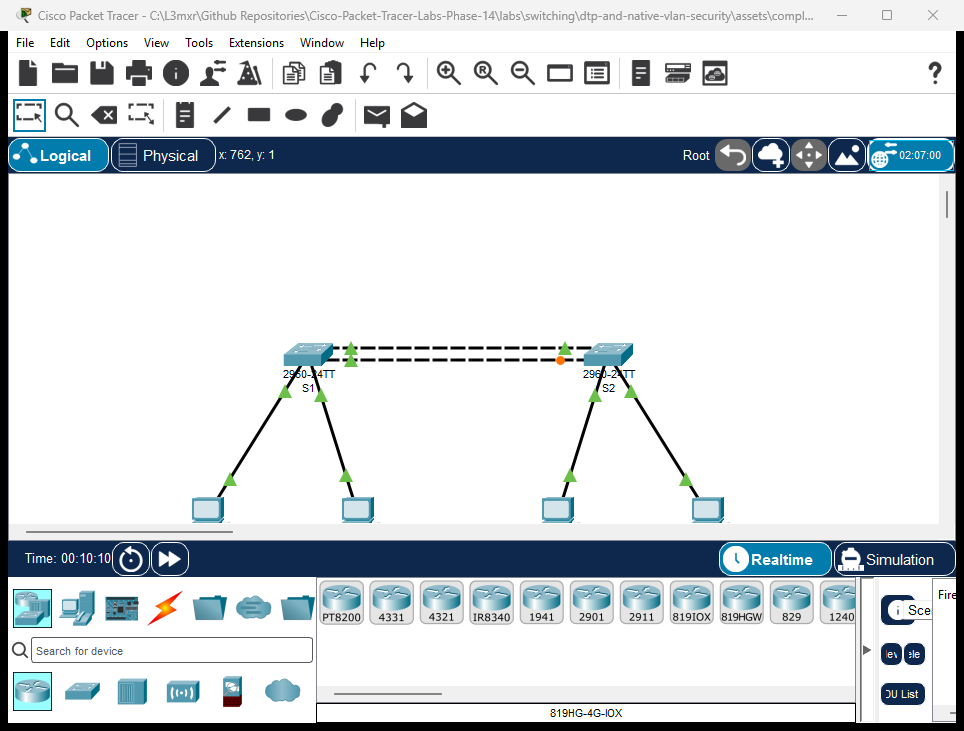

# PTL-0018: Dynamic Trunking Protocol and Native VLAN Security


In multi-switch campus networks, trunk links carry traffic for multiple Virtual Local Area Networks (VLANs) across common physical connections using IEEE 802.1Q encapsulation. Cisco Catalyst switches historically support the proprietary Dynamic Trunking Protocol (DTP) to negotiate whether an interconnection operates as an access port or an 802.1Q trunk. While DTP simplifies initial deployment, it poses significant security vulnerabilities in production environments. An adversary connecting a rogue switch or host machine capable of generating DTP frames can trick an access port into becoming a trunk port (DTP spoofing), thereby gaining unauthorized visibility into all transmitted VLANs.

Furthermore, IEEE 802.1Q transmits frames belonging to the **Native VLAN** without an 802.1Q tag. By default, Cisco switches assign Native VLAN 1 to all ports. If Native VLAN 1 is left active across trunks, attackers can execute **double-tagging VLAN hopping attacks**—encapsulating an outer tag matching Native VLAN 1 and an inner tag matching a target victim VLAN. Because the first switch strips the outer untagged native header without inspecting the payload, the downstream switch processes the inner tag and forwards the frame into the victim's isolated broadcast domain.

To harden campus interconnections against these attacks, enterprise security standards dictate two mandatory practices:
1. **Disable DTP negotiation:** Unconditionally configure trunks using `switchport mode trunk` and deactivate DTP frame transmission using `switchport nonegotiate`.
2. **Isolate and change the Native VLAN:** Reassign the native VLAN to a dedicated, unused non-default VLAN (such as VLAN 99) across all trunk interconnections, and explicitly restrict forwarded traffic using `switchport trunk allowed vlan`.

---

## Learning Objectives

- Explain the operational mechanics of Cisco Dynamic Trunking Protocol (DTP) and differentiate between `dynamic auto`, `dynamic desirable`, and static `trunk` modes.
- Understand the threat model of DTP spoofing and eliminate unauthorized trunk negotiation using `switchport nonegotiate`.
- Describe the vulnerability mechanics of 802.1Q double-tagging and VLAN hopping when using default Native VLAN 1.
- Configure dedicated, non-routable Native VLAN 99 across redundant inter-switch trunks.
- Implement explicit VLAN pruning using `switchport trunk allowed vlan 10,20,99` to restrict unnecessary broadcast domain propagation.
- Observe, interpret, and resolve Native VLAN mismatch errors signaled by Cisco Discovery Protocol (CDP) and Spanning Tree Protocol (STP).
- Verify end-to-end intra-VLAN reachability across hardened trunks while proving complete inter-VLAN layer-2 isolation.

---

## Prerequisites

- Completion of [PTL-0009: VLAN Segmentation and Access Port Configuration](../vlan-segmentation-and-access-ports/README.md).
- Knowledge of Spanning Tree Protocol operations from [PTL-0017: Rapid Spanning Tree Protocol, PortFast, and BPDU Guard](../rapid-stp-portfast-bpduguard/README.md).
- Understanding of Ethernet frame structure and IEEE 802.1Q tag insertion (TPID `0x8100`, 12-bit VID).
- Familiarity with the diagnostic methodology outlined in the [Troubleshooting Guide](../../../docs/troubleshooting.md).

---

## Topology



The topology connects two Cisco Catalyst 2960-24TT switches across parallel GigabitEthernet trunk interconnections, serving two isolated enterprise VLANs:
- **VLAN 10 (`Admin`):** `192.168.10.0/24` subnet connecting `PC1-Admin` on `S1` and `PC3-Admin` on `S2`.
- **VLAN 20 (`Sales`):** `192.168.20.0/24` subnet connecting `PC2-Sales` on `S1` and `PC4-Sales` on `S2`.
- **VLAN 99 (`Native`):** Dedicated, untagged Native VLAN for trunk security.
- **Trunks:** Redundant links connecting `S1` and `S2` via `GigabitEthernet0/1` and `GigabitEthernet0/2`.

---

## Addressing Table

| Device | Interface | IP Address | Subnet Mask | Default Gateway | VLAN Assignment | Switch Port Mode |
|---|---|---|---|---|---|---|
| **S1** | `Gi0/1` | Unassigned | N/A | N/A | Native: 99 / Allowed: 10,20,99 | Static Trunk (`nonegotiate`) |
| **S1** | `Gi0/2` | Unassigned | N/A | N/A | Native: 99 / Allowed: 10,20,99 | Static Trunk (`nonegotiate`) |
| **S1** | `Fa0/10` | Unassigned | N/A | N/A | Access VLAN 10 (`Admin`) | Static Access |
| **S1** | `Fa0/20` | Unassigned | N/A | N/A | Access VLAN 20 (`Sales`) | Static Access |
| **S2** | `Gi0/1` | Unassigned | N/A | N/A | Native: 99 / Allowed: 10,20,99 | Static Trunk (`nonegotiate`) |
| **S2** | `Gi0/2` | Unassigned | N/A | N/A | Native: 99 / Allowed: 10,20,99 | Static Trunk (`nonegotiate`) |
| **S2** | `Fa0/10` | Unassigned | N/A | N/A | Access VLAN 10 (`Admin`) | Static Access |
| **S2** | `Fa0/20` | Unassigned | N/A | N/A | Access VLAN 20 (`Sales`) | Static Access |
| **PC1-Admin** | `FastEthernet0` | `192.168.10.10` | `255.255.255.0` | `192.168.10.1` | VLAN 10 | Host Interface |
| **PC2-Sales** | `FastEthernet0` | `192.168.20.10` | `255.255.255.0` | `192.168.20.1` | VLAN 20 | Host Interface |
| **PC3-Admin** | `FastEthernet0` | `192.168.10.20` | `255.255.255.0` | `192.168.10.1` | VLAN 10 | Host Interface |
| **PC4-Sales** | `FastEthernet0` | `192.168.20.20` | `255.255.255.0` | `192.168.20.1` | VLAN 20 | Host Interface |

---

## Lab Tasks

1. **Inspect Baseline DTP State:** Open `assets/starter.pkt` and examine the default switchport configuration on trunk ports `Gi0/1` and `Gi0/2` using `show interfaces GigabitEthernet0/1 switchport`. Note the administrative mode (`dynamic auto`) and operational mode.
2. **Observe Dynamic Trunk Negotiation:** Change `S1` `Gi0/1` to `switchport mode dynamic desirable`. Observe how `S2` (`dynamic auto`) detects DTP frames and transitions its operational mode to trunk.
3. **Deactivate DTP Negotiation:** Enforce security best practices by converting both trunk ports on `S1` and `S2` to unconditional trunk mode (`switchport mode trunk`) and disabling DTP packet generation using `switchport nonegotiate`.
4. **Isolate Native VLAN:** Change the native VLAN on both switches from default VLAN 1 to dedicated VLAN 99 (`switchport trunk native vlan 99`).
5. **Prune Allowed VLANs:** Restrict trunk forwarding to only legitimate VLANs (`switchport trunk allowed vlan 10,20,99`).
6. **Simulate Native VLAN Mismatch:** Change `S2`'s native VLAN back to VLAN 1 while leaving `S1` on VLAN 99. Observe CDP syslog warnings and spanning-tree port-inconsistency blocking.
7. **Verify Intra-VLAN Reachability:** Confirm ping success between `PC1-Admin` and `PC3-Admin` in VLAN 10, and between `PC2-Sales` and `PC4-Sales` in VLAN 20.
8. **Verify Inter-VLAN Isolation:** Verify that `PC1-Admin` cannot communicate with `PC2-Sales` or `PC4-Sales`.

---

## Configuration Walkthrough

### 1. Switch S1 Trunk Hardening & VLAN Configuration

```text
S1> enable
S1# configure terminal
S1(config)# hostname S1
S1(config)# vlan 10
S1(config-vlan)# name Admin
S1(config-vlan)# vlan 20
S1(config-vlan)# name Sales
S1(config-vlan)# vlan 99
S1(config-vlan)# name Native
S1(config-vlan)# exit

! Assign Access Ports
S1(config)# interface FastEthernet0/10
S1(config-if)# switchport mode access
S1(config-if)# switchport access vlan 10
S1(config-if)# no shutdown
S1(config-if)# exit

S1(config)# interface FastEthernet0/20
S1(config-if)# switchport mode access
S1(config-if)# switchport access vlan 20
S1(config-if)# no shutdown
S1(config-if)# exit

! Harden Inter-Switch Trunks
S1(config)# interface range GigabitEthernet0/1 - 2
S1(config-if-range)# switchport mode trunk
S1(config-if-range)# switchport nonegotiate
S1(config-if-range)# switchport trunk native vlan 99
S1(config-if-range)# switchport trunk allowed vlan 10,20,99
S1(config-if-range)# no shutdown
S1(config-if-range)# exit
S1(config)# end
S1# copy running-config startup-config
```

### 2. Switch S2 Trunk Hardening & VLAN Configuration

```text
S2> enable
S2# configure terminal
S2(config)# hostname S2
S2(config)# vlan 10
S2(config-vlan)# name Admin
S2(config-vlan)# vlan 20
S2(config-vlan)# name Sales
S2(config-vlan)# vlan 99
S2(config-vlan)# name Native
S2(config-vlan)# exit

! Assign Access Ports
S2(config)# interface FastEthernet0/10
S2(config-if)# switchport mode access
S2(config-if)# switchport access vlan 10
S2(config-if)# no shutdown
S2(config-if)# exit

S2(config)# interface FastEthernet0/20
S2(config-if)# switchport mode access
S2(config-if)# switchport access vlan 20
S2(config-if)# no shutdown
S2(config-if)# exit

! Harden Inter-Switch Trunks
S2(config)# interface range GigabitEthernet0/1 - 2
S2(config-if-range)# switchport mode trunk
S2(config-if-range)# switchport nonegotiate
S2(config-if-range)# switchport trunk native vlan 99
S2(config-if-range)# switchport trunk allowed vlan 10,20,99
S2(config-if-range)# no shutdown
S2(config-if-range)# exit
S2(config)# end
S2# copy running-config startup-config
```

---

## Verification

### Positive Test 1: Operational Trunk Status and Native VLAN

Verify trunking state on `S1`:

```text
S1# show interfaces trunk
Port        Mode         Encapsulation  Status        Native vlan
Gig0/1      on           802.1q         trunking      99
Gig0/2      on           802.1q         trunking      99

Port        Vlans allowed on trunk
Gig0/1      10,20,99
Gig0/2      10,20,99

Port        Vlans allowed and active in management domain
Gig0/1      10,20,99
Gig0/2      10,20,99

Port        Vlans in spanning tree forwarding state and not pruned
Gig0/1      10,20
Gig0/2      10,20,99
```

### Positive Test 2: Verify DTP Negotiation Deactivated

Verify that DTP negotiation has been disabled on `Gi0/1`:

```text
S1# show interfaces GigabitEthernet0/1 switchport
Name: Gi0/1
Switchport: Enabled
Administrative Mode: trunk
Operational Mode: trunk
Administrative Trunking Encapsulation: dot1q
Operational Trunking Encapsulation: dot1q
Negotiation of Trunking: Off
Access Mode VLAN: 1 (default)
Trunking Native Mode VLAN: 99 (Native)
Trunking VLANs Enabled: 10,20,99
```
*Note the line `Negotiation of Trunking: Off`, confirming that the switch does not emit DTP frames.*

### Positive Test 3: Intra-VLAN Inter-Switch Reachability

From `PC1-Admin` (`192.168.10.10`), ping `PC3-Admin` (`192.168.10.20`):

```text
C:\> ping 192.168.10.20

Pinging 192.168.10.20 with 32 bytes of data:

Reply from 192.168.10.20: bytes=32 time<1ms TTL=128
Reply from 192.168.10.20: bytes=32 time<1ms TTL=128
Reply from 192.168.10.20: bytes=32 time<1ms TTL=128
Reply from 192.168.10.20: bytes=32 time<1ms TTL=128

Ping statistics for 192.168.10.20:
    Packets: Sent = 4, Received = 4, Lost = 0 (0% loss)
```

From `PC2-Sales` (`192.168.20.10`), ping `PC4-Sales` (`192.168.20.20`):

```text
C:\> ping 192.168.20.20

Pinging 192.168.20.20 with 32 bytes of data:

Reply from 192.168.20.20: bytes=32 time<1ms TTL=128
Reply from 192.168.20.20: bytes=32 time<1ms TTL=128
Reply from 192.168.20.20: bytes=32 time<1ms TTL=128
Reply from 192.168.20.20: bytes=32 time<1ms TTL=128

Ping statistics for 192.168.20.20:
    Packets: Sent = 4, Received = 4, Lost = 0 (0% loss)
```

### Negative Test 1: Inter-VLAN Layer 2 Segmentation Isolation

Attempt to ping across VLANs without a Layer 3 routing device:

```text
C:\> ping 192.168.20.10

Pinging 192.168.20.10 with 32 bytes of data:

Request timed out.
Request timed out.
Request timed out.
Request timed out.

Ping statistics for 192.168.20.10:
    Packets: Sent = 4, Received = 0, Lost = 4 (100% loss)
```
*Expected Result: Complete packet drop, confirming Layer 2 broadcast domain boundary isolation.*

### Negative Test 2: Native VLAN Mismatch Symptoms

When one side of a trunk is configured with Native VLAN 99 and the opposite side uses Native VLAN 1, Cisco Discovery Protocol detects the mismatch and triggers syslog notifications:

```text
%CDP-4-NATIVE_VLAN_MISMATCH: Native VLAN mismatch discovered on GigabitEthernet0/1 (99), with S2 GigabitEthernet0/1 (1).
%SPANTREE-2-BLOCK_PVID_LOCAL: Blocking GigabitEthernet0/1 on VLAN0001. Inconsistent port type.
```
*Spanning Tree automatically blocks traffic on the inconsistent VLAN to prevent cross-VLAN frame leakage and forwarding loops.*

---

## Troubleshooting

1. **Trunk fails to form when `switchport nonegotiate` is applied:**
   - Both ends of the connection must be explicitly configured with `switchport mode trunk`.
   - `switchport nonegotiate` cannot be configured if the interface is in `dynamic auto` or `dynamic desirable` mode.
2. **`%CDP-4-NATIVE_VLAN_MISMATCH` console error:**
   - Inspect the native VLAN on both switches: `show interfaces trunk`.
   - Ensure both ends match: `switchport trunk native vlan 99`.
3. **PC cannot reach neighbor on the same VLAN across the trunk:**
   - Check the allowed VLAN list on both switches: `show interfaces trunk`.
   - Ensure the user VLAN is included: `switchport trunk allowed vlan add <vlan-id>`.
   - Be cautious not to overwrite the existing allowed list with `switchport trunk allowed vlan <id>`; use `add` or specify the complete comma-separated list (`10,20,99`).
4. **Traffic leaking into management VLAN 1:**
   - Verify that Native VLAN 1 is nowhere in active use on trunk links and access ports have been explicitly moved away from VLAN 1.

---

## Key Takeaways

- **DTP Attack Vector:** Leaving ports in dynamic negotiation modes allows unauthorized hosts to initiate trunk negotiation, exposing all broadcast domains.
- **Unconditional Hardening:** Production enterprise trunks should always use static `switchport mode trunk` and disable negotiation with `switchport nonegotiate`.
- **Native VLAN Isolation:** Changing the native VLAN to a dedicated, non-default VLAN ID (e.g. VLAN 99) neutralizes double-tagging VLAN hopping exploits.
- **Explicit Pruning:** The default allowed list (`1-4094`) unnecessarily floods broadcast traffic; always restrict trunks to required VLANs with `switchport trunk allowed vlan`.

---

## References

- [Cisco Catalyst 2960 Switch Software Configuration Guide — Configuring VLANs and Trunks](https://www.cisco.com/c/en/us/td/docs/switches/lan/catalyst2960/software/release/12-2_55_se/configuration/guide/scg_2960/swvlan.html)
- [Cisco CCNA 200-301 Official Cert Guide — Implementing VLANs and Trunks](https://www.ciscopress.com/)
- [RFC 7727 — Spanning Tree Protocol (STP) Application and VLAN Tagging](https://datatracker.ietf.org/doc/html/rfc7727)

---

## Files and Validation Status

- **Status**: `tested_pass`
- **Simulator Evidence**: [AI_AGENT_GUIDE/state/PTL-0018-SIMULATOR-RESULTS.md](../../../AI_AGENT_GUIDE/state/PTL-0018-SIMULATOR-RESULTS.md)
- **Verified Deliverables**:
  - `assets/starter.pkt`: Baseline dual-switch topology with default dynamic trunk settings.
  - `assets/completed.pkt`: Fully hardened trunks with `nonegotiate`, Native VLAN 99, and allowed list pruning.
  - `assets/topology.png`: Authentic simulation capture showing redundant inter-switch trunks.
