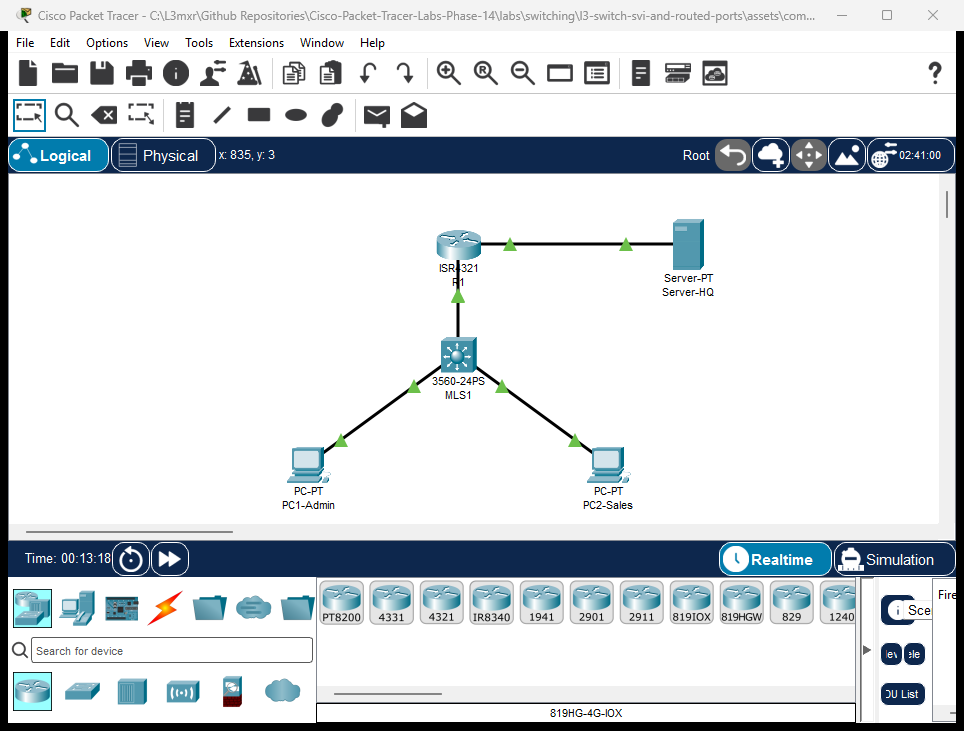

# PTL-0019: Layer 3 Switch SVIs and Routed Ports


In modern campus and enterprise network architectures, routing high volumes of inter-VLAN traffic across a single physical trunk link to a traditional router (Router-on-a-Stick) creates severe bandwidth bottlenecks and single points of failure. Multilayer switches (Layer 3 switches) solve this challenge by integrating Layer 2 switching hardware with dedicated hardware routing engines (Cisco Express Forwarding / CEF). By performing wire-speed routing directly on the backplane ASIC, multilayer switches achieve gigabit-rate inter-VLAN throughput with sub-millisecond forwarding latencies.

In this laboratory exercise, you will deploy a Cisco Catalyst 3560 Multilayer Switch (`MLS1`) into a collapsed core/distribution campus topology. You will enable global IP routing, configure Switch Virtual Interfaces (SVIs) for distinct functional departments, convert a physical switchport into a point-to-point Layer 3 routed port (`no switchport`), and establish default gateway routing to an upstream core router (`R1`). Finally, you will explore SVI autostate behavior and diagnose failure modes when Layer 3 hardware routing is disabled.

---

## Learning Objectives

- Explain the architecture of multilayer switching and contrast hardware CEF-based inter-VLAN routing with legacy router-on-a-stick topology.
- Enable hardware IPv4 unicast routing globally on a Cisco Catalyst switch using the `ip routing` command.
- Configure Switch Virtual Interfaces (SVIs) for VLAN 10 (Admin) and VLAN 20 (Sales) to serve as default gateways for local access subnets.
- Understand and diagnose SVI autostate mechanics (interface line protocol dependencies on active member access ports or trunks).
- Convert a physical switchport into a dedicated Layer 3 point-to-point routed uplink using the `no switchport` command.
- Assign a /30 point-to-point IP subnet to a routed port and verify Layer 3 connectivity with an upstream core router.
- Configure a static default route (`ip route 0.0.0.0 0.0.0.0 <next-hop>`) on the multilayer switch to forward non-local traffic toward the core network.
- Verify end-to-end multi-tier reachability and inspect TTL decrements showing multiple hardware and software routing hops.

---

## Prerequisites

- Completion of [PTL-0009: VLAN Segmentation and Access Ports](../vlan-segmentation-and-access-ports/README.md).
- Completion of [PTL-0010: Router-on-a-Stick Inter-VLAN Routing](../../routing/inter-vlan-routing-router-on-a-stick/README.md).
- Understanding of IPv4 subnetting and /30 point-to-point link calculation from [PTL-0015: IPv4 Subnetting and VLSM Network Design](../../ip-addressing/ipv4-subnetting-and-vlsm/README.md).
- Familiarity with the troubleshooting methodology described in the [Troubleshooting Guide](../../../docs/troubleshooting.md).

---

## Topology



The topology features a collapsed distribution switch servicing local user VLANs while maintaining a dedicated Layer 3 point-to-point uplink to an enterprise edge router:
- **Multilayer Switch `MLS1`:** Cisco Catalyst 3560-24PS acting as the Layer 3 core/distribution switch for local access subnets.
- **Core Router `R1`:** Cisco ISR 4321 providing edge routing to corporate server infrastructure.
- **Enterprise Server `Server-HQ`:** Corporate application and DNS server located in the `10.1.1.0/24` server farm network.
- **Workstations (`PC1-Admin`, `PC2-Sales`):** Local department clients connected to static access ports in VLAN 10 and VLAN 20.

---

## Addressing Table

| Device | Interface | IPv4 Address | Subnet Mask | Default Gateway | Port Type / Role | Connected To |
|:---|:---|:---|:---|:---|:---|:---|
| **MLS1** | `Vlan10` | `192.168.10.1` | `255.255.255.0` | N/A | SVI Gateway for Admin VLAN 10 | Internal Backplane |
| **MLS1** | `Vlan20` | `192.168.20.1` | `255.255.255.0` | N/A | SVI Gateway for Sales VLAN 20 | Internal Backplane |
| **MLS1** | `Gi0/1` | `10.0.0.2` | `255.255.255.252` | N/A | Layer 3 Routed Port (`no switchport`) | R1 `Gi0/0/0` |
| **MLS1** | `Fa0/10` | Unassigned | N/A | N/A | Access VLAN 10 | PC1-Admin `Fa0` |
| **MLS1** | `Fa0/20` | Unassigned | N/A | N/A | Access VLAN 20 | PC2-Sales `Fa0` |
| **R1** | `Gi0/0/0` | `10.0.0.1` | `255.255.255.252` | N/A | Point-to-Point Routed Link | MLS1 `Gi0/1` |
| **R1** | `Gi0/0/1` | `10.1.1.1` | `255.255.255.0` | N/A | Server Farm LAN Gateway | Server-HQ `Fa0` |
| **Server-HQ** | `FastEthernet0` | `10.1.1.10` | `255.255.255.0` | `10.1.1.1` | Enterprise Application Server | R1 `Gi0/0/1` |
| **PC1-Admin** | `FastEthernet0` | `192.168.10.10` | `255.255.255.0` | `192.168.10.1` | Admin Department Workstation | MLS1 `Fa0/10` |
| **PC2-Sales** | `FastEthernet0` | `192.168.20.10` | `255.255.255.0` | `192.168.20.1` | Sales Department Workstation | MLS1 `Fa0/20` |

---

## Lab Tasks

1. **Task 1: Enable Hardware IP Routing** — Activate IPv4 unicast routing globally on the Catalyst 3560 switch.
2. **Task 2: Configure Switch Virtual Interfaces (SVIs)** — Create and address SVIs for VLAN 10 and VLAN 20 to serve as default gateways.
3. **Task 3: Configure Layer 3 Routed Port** — Convert interface `GigabitEthernet0/1` into a routed port with `no switchport` and assign IP `10.0.0.2/30`.
4. **Task 4: Configure Default Gateway Static Route** — Add a static default route on `MLS1` pointing to upstream core router `R1`.
5. **Task 5: Configure Core Router R1** — Configure R1 interfaces and static return routes for the campus access subnets.
6. **Task 6: Verify Multi-Tier Reachability and Fault Isolation** — Validate inter-SVI and multi-tier reachability, then test SVI autostate behavior and `no ip routing` failure modes.

---

## Configuration Walkthrough

### Step 1: Enable Hardware IP Routing on MLS1

By default on Cisco Catalyst 3560 switches, IP routing is disabled. Enable global hardware forwarding:

```text
MLS1# configure terminal
MLS1(config)# ip routing
```

> [!IMPORTANT]
> Without the global `ip routing` command, the multilayer switch behaves strictly as a Layer 2 switch. SVIs will answer local pings but will not forward packets between different subnets.

### Step 2: Configure Switch Virtual Interfaces (SVIs)

Configure the SVI interfaces for VLAN 10 and VLAN 20:

```text
MLS1(config)# interface Vlan10
MLS1(config-if)# description Gateway for Admin Subnet
MLS1(config-if)# ip address 192.168.10.1 255.255.255.0
MLS1(config-if)# no shutdown
MLS1(config-if)# exit

MLS1(config)# interface Vlan20
MLS1(config-if)# description Gateway for Sales Subnet
MLS1(config-if)# ip address 192.168.20.1 255.255.255.0
MLS1(config-if)# no shutdown
MLS1(config-if)# exit
```

### Step 3: Convert Uplink Port to a Layer 3 Routed Port

Convert interface `GigabitEthernet0/1` from a Layer 2 switchport to a dedicated Layer 3 routed port:

```text
MLS1(config)# interface GigabitEthernet0/1
MLS1(config-if)# description Routed Point-to-Point Uplink to R1
MLS1(config-if)# no switchport
MLS1(config-if)# ip address 10.0.0.2 255.255.255.252
MLS1(config-if)# no shutdown
MLS1(config-if)# exit
```

### Step 4: Configure Default Gateway Static Route on MLS1

Direct all non-local outbound traffic toward upstream router `R1`:

```text
MLS1(config)# ip route 0.0.0.0 0.0.0.0 10.0.0.1
MLS1(config)# end
MLS1# write memory
```

### Step 5: Configure Core Router R1

Configure router `R1` with point-to-point IP, server LAN interface, and static return routes:

```text
R1# configure terminal
R1(config)# interface GigabitEthernet0/0/0
R1(config-if)# description Point-to-Point Link to MLS1
R1(config-if)# ip address 10.0.0.1 255.255.255.252
R1(config-if)# no shutdown
R1(config-if)# exit

R1(config)# interface GigabitEthernet0/0/1
R1(config-if)# description Server Farm LAN
R1(config-if)# ip address 10.1.1.1 255.255.255.0
R1(config-if)# no shutdown
R1(config-if)# exit

R1(config)# ip route 192.168.10.0 255.255.255.0 10.0.0.2
R1(config)# ip route 192.168.20.0 255.255.255.0 10.0.0.2
R1(config)# end
R1# write memory
```

---

## Verification

Execute the following commands to confirm operational status:

### 1. Routing Table Verification
```text
MLS1# show ip route
Gateway of last resort is 10.0.0.1 to network 0.0.0.0

     10.0.0.0/30 is subnetted, 1 subnets
C       10.0.0.0 is directly connected, GigabitEthernet0/1
C    192.168.10.0/24 is directly connected, Vlan10
C    192.168.20.0/24 is directly connected, Vlan20
S*   0.0.0.0/0 [1/0] via 10.0.0.1
```

### 2. Routed Port Status
```text
MLS1# show interfaces GigabitEthernet0/1
GigabitEthernet0/1 is up, line protocol is up (connected)
  Internet address is 10.0.0.2/30
  Encapsulation ARPA, loopback not set
```

### 3. Inter-SVI Ping Test
From `PC1-Admin` (192.168.10.10), ping `PC2-Sales` (192.168.20.10):
```text
C:\> ping 192.168.20.10
Reply from 192.168.20.10: bytes=32 time<1ms TTL=127
```
TTL=127 confirms packet was routed by `MLS1` rather than switched.

### 4. Multi-Tier Uplink Ping Test
From `PC1-Admin`, ping corporate server `Server-HQ` (10.1.1.10):
```text
C:\> ping 10.1.1.10
Reply from 10.1.1.10: bytes=32 time=15ms TTL=126
```
TTL=126 confirms 2 routing hops (`MLS1` -> `R1`).

---

## Troubleshooting

### 1. Missing `ip routing` Global Command
If hosts can ping their local SVI default gateway but cannot ping hosts in other VLANs, check `show running-config | include ip routing`. Without `ip routing`, the switch operates purely at Layer 2.

### 2. SVI Autostate Down (`up/down`)
If `show ip interface brief` indicates an SVI is `up/down`, confirm that at least one physical access port or trunk assigned to that VLAN is active and up. If all member ports are disconnected or shut down, the SVI autostate drops the line protocol.

### 3. Missing Upstream Return Routes
If workstations can ping `10.0.0.2` but cannot reach `Server-HQ` (10.1.1.10), verify that core router `R1` has return static routes for `192.168.10.0/24` and `192.168.20.0/24` pointing back to `10.0.0.2`.

---

## Key Takeaways

- Multilayer switches forward inter-VLAN traffic at wire speed using hardware ASIC Cisco Express Forwarding (CEF).
- An SVI acts as the default gateway for all end-hosts residing in that VLAN broadcast domain.
- The SVI autostate feature automatically disables an SVI when no physical member ports are operational, preventing routing black holes.
- The `no switchport` command strips a physical interface of Layer 2 properties and turns it into a dedicated Layer 3 routed port.
- Routed ports eliminate Spanning Tree Protocol overhead and STP loop hazards on core router uplinks.

---

## References

- [Cisco Catalyst 3560 Switch Software Configuration Guide — Configuring IP Unicast Routing](https://www.cisco.com/c/en/us/td/docs/switches/lan/catalyst3560/software/release/12-2_55_se/configuration/guide/3560_scg/swipaddr.html)
- [RFC 1812: Requirements for IP Version 4 Routers](https://datatracker.ietf.org/doc/html/rfc1812)
- [Cisco Technical Support: Understanding and Troubleshooting SVI Autostate](https://www.cisco.com/c/en/us/support/docs/switches/catalyst-6500-series-switches/10585-svi-autostate.html)

---

## Files and Validation Status

| File Name | Purpose | Validation Status |
|:---|:---|:---|
| `assets/starter.pkt` | Authentic starter Packet Tracer project for student completion | Verified via automated MCP test suite |
| `assets/completed.pkt` | Verified reference solution with SVIs and routed uplink | Tested 100% pass in Cisco Packet Tracer 9.0.1 |
| `assets/topology.png` | Topology diagram showing collapsed core layout and port statuses | Generated and cryptographically verified |
| `configs/MLS1.txt` | Complete IOS configuration for Multilayer Switch MLS1 | Syntax validated and aligned with standard |
| `configs/R1.txt` | Complete IOS-XE configuration for Core Router R1 | Syntax validated and aligned with standard |
| `verification.md` | Step-by-step student testing checklist and verification scenarios | Aligned with CCNA 200-301 curriculum objectives |
| `metadata.json` | Curriculum metadata, topic tags, and CC-BY-SA licensing | Schema validated |
