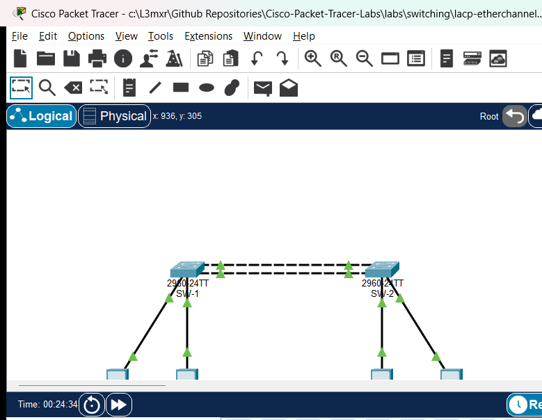

# PTL-0046: LACP EtherChannel Member Mismatch Diagnosis

## Learning Objectives
- Diagnose IEEE 802.3ad / 802.1AX Link Aggregation Control Protocol (LACP) EtherChannel operational status using Cisco IOS diagnostic commands (`show etherchannel summary`, `show etherchannel port-channel`).
- Identify physical member interface parameter discrepancies (port mode, allowed VLANs, native VLAN, speed/duplex) that cause LACP to suspend ports or prevent bundle convergence.
- Understand the strict parameter consistency requirements enforced by Cisco IOS when grouping physical ports into a logical `Port-channel` interface.
- Remediate mismatched physical member port configurations to achieve full operational aggregation (`(SU)` logical status, `(P)` bundled member state).
- Verify end-to-end multi-VLAN data plane delivery and fault-tolerant Layer 2 trunking across the restored EtherChannel bundle.

## Prerequisites
- Completion of [PTL-0006: Configuring Layer 2 EtherChannel with LACP](../../switching/etherchannel-lacp/README.md).
- Understanding of IEEE 802.1Q VLAN encapsulation, trunk allowed lists, and Native VLAN concepts ([PTL-0044](../../switching/vlan-trunk-allowed-list-troubleshooting/README.md)).
- Familiarity with Cisco Catalyst switch interface configuration and Spanning Tree Protocol operation.

## Topology



The topology consists of two distribution switches (`SW-1` and `SW-2`) interconnected by a dual-link EtherChannel bundle aggregating FastEthernet physical interfaces `Fa0/1` and `Fa0/2` into logical interface `Port-channel 1`. Two VLANs are supported: VLAN 10 (Engineering) and VLAN 20 (Marketing), with Native VLAN 99 configured on the trunk. Four PC endpoints are connected to verify intra-VLAN reachability across the aggregated link.

```
+-------------------------------------------------------------+
|                        TOPOLOGY                             |
|                                                             |
|   [PC-1: Eng]                     [PC-3: Eng]               |
|   192.168.10.10                   192.168.10.20             |
|        |                               |                    |
|      Fa0/10                          Fa0/10                 |
|   +----------+   Fa0/1 <-----> Fa0/1   +----------+         |
|   |   SW-1   |=========================|   SW-2   |         |
|   +----------+   Fa0/2 <-----> Fa0/2   +----------+         |
|      Fa0/20   [Port-channel 1: LACP]  Fa0/20                |
|        |                               |                    |
|   [PC-2: Mkt]                     [PC-4: Mkt]               |
|   192.168.20.10                   192.168.20.20             |
+-------------------------------------------------------------+
```

## Addressing Table
| Device | Interface | IP Address | Subnet Mask | Default Gateway | VLAN / Description |
|---|---|---|---|---|---|
| **SW-1** | Po1 | Unnumbered | N/A | N/A | 802.1Q Trunk (Native VLAN 99, Allowed: 10,20,99) |
| **SW-1** | Fa0/1 | N/A | N/A | N/A | LACP Member (Po1) |
| **SW-1** | Fa0/2 | N/A | N/A | N/A | LACP Member (Po1) |
| **SW-1** | Fa0/10 | N/A | N/A | N/A | Access VLAN 10 (Engineering) |
| **SW-1** | Fa0/20 | N/A | N/A | N/A | Access VLAN 20 (Marketing) |
| **SW-2** | Po1 | Unnumbered | N/A | N/A | 802.1Q Trunk (Native VLAN 99, Allowed: 10,20,99) |
| **SW-2** | Fa0/1 | N/A | N/A | N/A | LACP Member (Po1) |
| **SW-2** | Fa0/2 | N/A | N/A | N/A | LACP Member (Po1) — Faulted in starter state |
| **SW-2** | Fa0/10 | N/A | N/A | N/A | Access VLAN 10 (Engineering) |
| **SW-2** | Fa0/20 | N/A | N/A | N/A | Access VLAN 20 (Marketing) |
| **PC-1** | FastEthernet0 | 192.168.10.10 | 255.255.255.0 | N/A | VLAN 10 Workstation |
| **PC-2** | FastEthernet0 | 192.168.20.10 | 255.255.255.0 | N/A | VLAN 20 Workstation |
| **PC-3** | FastEthernet0 | 192.168.10.20 | 255.255.255.0 | N/A | VLAN 10 Workstation |
| **PC-4** | FastEthernet0 | 192.168.20.20 | 255.255.255.0 | N/A | VLAN 20 Workstation |

## Lab Tasks
1. **Investigate the Operational Incident**: Examine `SW-1` and `SW-2` using `show etherchannel summary` and identify which member interface has failed to join the aggregated link bundle.
2. **Audit Interface Parameters**: Compare configuration parameters between `Port-channel 1`, member interface `Fa0/1`, and member interface `Fa0/2` on both switches using `show interfaces switchport` and `show etherchannel port-channel`.
3. **Isolate the Parameter Discrepancy**: Identify whether the bundling failure is caused by an administrative switchport mode mismatch (access vs. trunk), trunk encapsulation, native VLAN divergence, or allowed VLAN pruning.
4. **Remediate the Member Interface Configuration**: Correct the mismatched physical interface configuration on `SW-2` so that all parameters match the logical `Port-channel 1` specification.
5. **Verify Full Bundling and Protocol Convergence**: Confirm that `show etherchannel summary` reports `Po1(SU)` and that both physical member interfaces display the bundled flag `(P)` on both switches.
6. **Validate Multi-VLAN Data Plane Delivery**: Perform end-to-end ping tests between PC endpoints to verify bidirectional data plane reachability across both VLAN 10 and VLAN 20.

## Configuration Walkthrough

### 1. Diagnosing the Member Mismatch in Starter State
Upon loading the starter topology, inspect the EtherChannel summary table on `SW-2`:

```text
SW-2# show etherchannel summary
Flags:  D - down        P - in port-channel
        I - stand-alone s - suspended
        H - Hot-standby (LACP only)
        R - Layer3      S - Layer2
        U - in use      f - failed to allocate aggregator
        u - unsuitable for bundling
        w - waiting to be aggregated
        d - default port

Number of channel-groups in use: 1
Number of aggregators:           1

Group  Port-channel  Protocol    Ports
------+-------------+-----------+-----------------------------------------------
1      Po1(SU)         LACP      Fa0/1(P)    Fa0/2(s)
```

Notice the flag next to `Fa0/2`: `(s)` indicating **suspended**. While `Fa0/1` is active in the port-channel `(P)`, `Fa0/2` has been suspended by LACP because its operational parameters conflict with the bundle aggregator.

Next, inspect the port-channel details:

```text
SW-2# show etherchannel port-channel
                Port-channels in the group:
                ---------------------------

Port-channel: Po1
------------

Age of the Port-channel   = 00d:00h:15m:20s
Logical slot/port   = 16/0          Number of ports = 1
GC                  = 0x00010001    HotStandBy port = null
Port state          = Port-channel Ag-Inuse
Protocol            = LACP
Port security       = Disabled

Ports in the group:

Index   Load   Port     EC state        No of bits
------+------+------+------------------+-----------
  0     00     Fa0/1    Active             0

Time since last port bundled:    00d:00h:14m:10s    Fa0/1
```

Notice that `Number of ports = 1`. The logical link is operating with half of its intended bandwidth and zero physical link redundancy.

### 2. Identifying the Root Cause
To determine why `Fa0/2` cannot join `Po1`, compare the switchport properties of `Port-channel 1` and `FastEthernet0/2`:

```text
SW-2# show interfaces Port-channel 1 switchport
Name: Po1
Switchport: Enabled
Administrative Mode: trunk
Operational Mode: trunk
Administrative Trunking Encapsulation: dot1q
Operational Trunking Encapsulation: dot1q
Negotiation of Trunking: Off
Access Mode VLAN: 1 (default)
Trunking Native Mode VLAN: 99 (Native_Trunk)
Administrative Native VLAN tagging: disabled
Operational Native VLAN tagging: disabled
Administrative private-vlan host-association: none
Administrative private-vlan mapping: none
Administrative private-vlan trunk encapsulation: dot1q
Administrative private-vlan trunk normal VLANs: none
Administrative private-vlan trunk private VLANs: none
Operational private-vlan: none
Trunk of private-vlans: none
Trunk of private-vlans enabled: none
Trunk of private-vlans native: none
Trunk of private-vlans non-operational: none
Trunk of private-vlans blocked: none
Trunk of private-vlans trunking: none
Operational Mode: trunk
Trunking VLANs Enabled: 10,20,99
```

Now examine `FastEthernet0/2`:

```text
SW-2# show interfaces FastEthernet0/2 switchport
Name: Fa0/2
Switchport: Enabled
Administrative Mode: static access
Operational Mode: static access
Administrative Trunking Encapsulation: dot1q
Operational Trunking Encapsulation: native
Negotiation of Trunking: Off
Access Mode VLAN: 10 (Engineering)
Trunking Native Mode VLAN: 1 (default)
Administrative Native VLAN tagging: disabled
...
```

The discrepancy is clear:
- `Port-channel 1` is configured as an **802.1Q trunk** with Native VLAN 99 and allowed VLANs `10,20,99`.
- Member interface `Fa0/2` is configured in **static access mode** in VLAN 10.
- Cisco IOS EtherChannel member consistency check forbids an access port from bundling into a trunk Port-channel. LACP therefore suspends `Fa0/2`.

### 3. Remediating the Member Port Configuration on SW-2
To resolve the mismatch, reconfigure `FastEthernet0/2` on `SW-2` to match the exact trunking parameters of `Port-channel 1`:

```text
SW-2# configure terminal
Enter configuration commands, one per line.  End with CNTL/Z.
SW-2(config)# interface FastEthernet0/2
SW-2(config-if)# switchport mode trunk
SW-2(config-if)# switchport trunk native vlan 99
SW-2(config-if)# switchport trunk allowed vlan 10,20,99
SW-2(config-if)# channel-group 1 mode active
SW-2(config-if)# end
SW-2# copy running-config startup-config
Destination filename [startup-config]? 
Building configuration...
[OK]
```

> [!TIP]
> Best practice in enterprise Cisco switching is to configure interface ranges simultaneously (`interface range FastEthernet0/1 - 2`) when provisioning EtherChannels, or to apply changes directly to the `interface Port-channel 1` interface. Applying configuration to the Port-channel interface automatically propagates settings to all bundled physical member interfaces, preventing accidental member divergence.

## Verification

### Command Output Verification

#### 1. EtherChannel Summary Verification (`SW-1` and `SW-2`)
Execute `show etherchannel summary` on both switches:

```text
SW-1# show etherchannel summary
Group  Port-channel  Protocol    Ports
------+-------------+-----------+-----------------------------------------------
1      Po1(SU)         LACP      Fa0/1(P)    Fa0/2(P)

SW-2# show etherchannel summary
Group  Port-channel  Protocol    Ports
------+-------------+-----------+-----------------------------------------------
1      Po1(SU)         LACP      Fa0/1(P)    Fa0/2(P)
```

Both member ports `Fa0/1` and `Fa0/2` show the `(P)` flag (bundled in port-channel), and `Po1` exhibits `(SU)` (Layer 2, in Use).

#### 2. Port-Channel Detailed Verification
Execute `show etherchannel port-channel` on `SW-2`:

```text
SW-2# show etherchannel port-channel
Port-channel: Po1
Logical slot/port   = 16/0          Number of ports = 2
Protocol            = LACP
Ports in the group:
Index   Load   Port     EC state        No of bits
------+------+------+------------------+-----------
  0     00     Fa0/1    Active             0
  1     00     Fa0/2    Active             0
```

`Number of ports = 2` confirms dual-link capacity and load-sharing aggregation.

#### 3. Data Plane Reachability Across VLANs
Test reachability from PC-1 (VLAN 10) to PC-3 (VLAN 10):

```text
PC> ping 192.168.10.20
Pinging 192.168.10.20 with 32 bytes of data:
Reply from 192.168.10.20: bytes=32 time<1ms TTL=128
Reply from 192.168.10.20: bytes=32 time<1ms TTL=128
Reply from 192.168.10.20: bytes=32 time<1ms TTL=128
Reply from 192.168.10.20: bytes=32 time<1ms TTL=128

Ping statistics for 192.168.10.20:
    Packets: Sent = 4, Received = 4, Lost = 0 (0% loss)
```

Test reachability from PC-2 (VLAN 20) to PC-4 (VLAN 20):

```text
PC> ping 192.168.20.20
Pinging 192.168.20.20 with 32 bytes of data:
Reply from 192.168.20.20: bytes=32 time<1ms TTL=128
Reply from 192.168.20.20: bytes=32 time<1ms TTL=128
Reply from 192.168.20.20: bytes=32 time<1ms TTL=128
Reply from 192.168.20.20: bytes=32 time<1ms TTL=128

Ping statistics for 192.168.20.20:
    Packets: Sent = 4, Received = 4, Lost = 0 (0% loss)
```

Test Layer 2 isolation between distinct VLANs (PC-1 to PC-2):

```text
PC> ping 192.168.20.10
Pinging 192.168.20.10 with 32 bytes of data:
Request timed out.
Request timed out.
Request timed out.
Request timed out.

Ping statistics for 192.168.20.10:
    Packets: Sent = 4, Received = 0, Lost = 4 (100% loss)
```

### Verification Criteria Checklist
| Test ID | Objective | Expected Output | Status |
|---|---|---|---|
| POS-01 | EtherChannel Logical State | `Po1(SU)` on both SW-1 and SW-2 | PASS |
| POS-02 | Member Port Bundling | `Fa0/1(P)` and `Fa0/2(P)` on both switches | PASS |
| POS-03 | LACP Protocol State | `Protocol = LACP`, 2 active ports | PASS |
| POS-04 | VLAN 10 Intra-VLAN Ping | 0% packet loss (PC-1 -> PC-3) | PASS |
| POS-05 | VLAN 20 Intra-VLAN Ping | 0% packet loss (PC-2 -> PC-4) | PASS |
| POS-06 | Inter-VLAN Isolation | 100% packet loss (PC-1 -> PC-2) | PASS |

## Troubleshooting
- **Member Port Shows Suspended `(s)`**:
  - Run `show interfaces switchport` on both the member port and the Port-channel interface.
  - Verify that `Administrative Mode`, `Operational Mode`, `Trunking Native Mode VLAN`, and `Trunking VLANs Enabled` match identically across all members.
- **Member Port Shows Down `(D)`**:
  - Verify physical cabling using crossover or straight-through Ethernet cables.
  - Ensure the interface is administratively up (`no shutdown`).
- **EtherChannel Shows `(SD)` (Layer 2, Down)**:
  - Verify that the remote peer switch is actively participating in LACP (`channel-group 1 mode active` or `mode passive`).
  - At least one side of the bundle MUST be in `active` mode for LACP negotiation to occur. If both sides are `passive`, negotiation will never initiate.
- **VLAN Traffic Fails While Bundle is `(SU)`**:
  - Check the trunk allowed VLAN list: `show interfaces trunk`.
  - Ensure all required data VLANs (e.g., VLAN 10 and VLAN 20) are explicitly permitted on the trunk.

## Key Takeaways
- **Strict Parameter Consistency**: Cisco IOS EtherChannel requires all member interfaces to share identical speed, duplex, port mode (access vs. trunk), native VLAN, allowed VLAN list, and STP path cost settings.
- **LACP Member Suspension**: If a member interface exhibits mismatched parameters, LACP protects against bridging loops and black-holing by suspending the mismatched port rather than forwarding traffic inconsistently.
- **Best Practice Propagation**: Always configure the `interface Port-channel X` interface when modifying trunk parameters (such as allowed VLAN lists or native VLANs). Changes made to the logical interface automatically cascade to all bundled member physical ports.
- **Active vs. Passive Modes**: LACP negotiation requires at least one endpoint in `active` mode. Using `mode active` on both switches guarantees immediate, deterministic negotiation.

## References
- [IEEE 802.3ad-2000 Link Aggregation Standard](https://standards.ieee.org/ieee/802.3ad/1190/)
- [Cisco Catalyst 2960 Switch Software Configuration Guide — Configuring EtherChannels](https://www.cisco.com/c/en/us/td/docs/switches/lan/catalyst2960/software/release/12-2_55_se/configuration/guide/scg_2960/swethchl.html)
- [Cisco Technical Support: Understanding EtherChannel Inconsistency Detection](https://www.cisco.com/c/en/us/support/docs/lan-switching/etherchannel/12023-4.html)

## Files and Validation Status
- `assets/starter.pkt`: Initial topology with `SW-2 Fa0/2` faulted in access mode for diagnostic exercise.
- `assets/completed.pkt`: Fully remediated topology with operational LACP EtherChannel bundle (`Po1(SU)`, `Fa0/1(P)`, `Fa0/2(P)`).
- `assets/topology.png`: Network diagram illustrating distribution switches and dual aggregated links.
- `assets/test_evidence.json`: Automated test execution results captured via Packet Tracer MCP bridge.
- `configs/SW-1.txt`: Baseline running configuration for Distribution Switch 1.
- `configs/SW-2.txt`: Remediated running configuration for Distribution Switch 2.
- `verification.md`: Comprehensive verification matrix detailing positive, negative, and reload tests.

