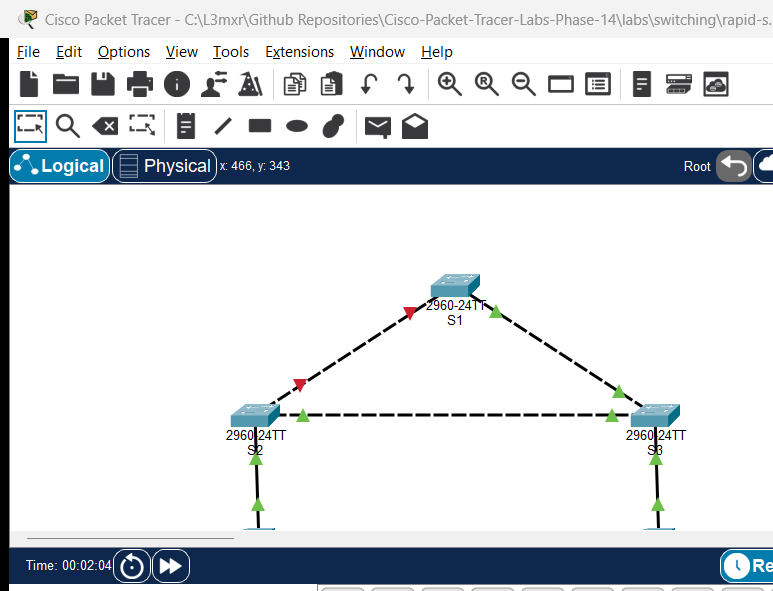

# PTL-0017: Rapid Spanning Tree Protocol, PortFast, and BPDU Guard


In a switched local area network (LAN), redundant physical links provide high availability and fault tolerance. However, without a Layer 2 loop prevention protocol, redundant physical connections cause broadcast storms, multiple frame copies, and Content Addressable Memory (CAM) table thrashing that can collapse the network in seconds. The Spanning Tree Protocol (STP) creates a loop-free logical topology by systematically placing redundant switchports into an Alternate Blocking state while maintaining an active forwarding path.

While legacy IEEE 802.1D Spanning Tree requires 30 to 50 seconds to converge (transitioning sequentially through Listening and Learning states before Forwarding), IEEE 802.1w Rapid Spanning Tree Protocol (RSTP, implemented on Cisco devices as **Rapid PVST+**) achieves convergence in milliseconds through an explicit handshake mechanism (Proposal and Agreement). To optimize end-device connectivity, **PortFast** transitions edge switchports immediately to the Forwarding state, eliminating DHCP lease timeouts and host boot delays. To safeguard edge security, **BPDU Guard** monitors PortFast-enabled switchports and immediately disables (`err-disabled`) any edge port that receives unexpected Bridge Protocol Data Units (BPDUs), preventing rogue switches from disrupting the spanning-tree hierarchy.

In this laboratory exercise, you will deploy Rapid PVST+ across a redundant 3-switch triangle topology, deterministically establish Root and Secondary Root bridges using priority values, enable PortFast and BPDU Guard on host access switchports, and verify rapid failover convergence during a trunk link failure.

---

## Learning Objectives

- Explain the operation of Spanning Tree Protocol (STP) and how IEEE 802.1w Rapid PVST+ improves convergence speed over legacy 802.1D.
- Configure and verify Rapid PVST+ mode across a redundant triangle topology of Cisco Catalyst 2960 switches.
- Influence the root bridge election deterministically using the `spanning-tree vlan <id> priority <value>` command.
- Identify spanning-tree port roles (Root, Designated, Alternate) and operational states (Forwarding, Blocking).
- Configure edge access ports with Spanning Tree PortFast to eliminate listening and learning delays for host workstations.
- Implement Spanning Tree BPDU Guard to protect edge switchports from rogue switch attachments and bridge loop injection.
- Verify dynamic failover convergence when a primary trunk link fails and observe rapid port unblocking.

---

## Prerequisites

- Completion of [PTL-0009: VLAN Segmentation and Access Port Configuration](../vlan-segmentation-and-access-ports/README.md).
- Understanding of Layer 2 frame forwarding and MAC learning from [PTL-0016: MAC Address Learning and ARP Operation](../../network-fundamentals/mac-learning-and-arp/README.md).
- Basic understanding of 802.1Q trunking concepts and native VLANs.
- Familiarity with the diagnostic methodology outlined in the [Troubleshooting Guide](../../../docs/troubleshooting.md).

---

## Topology



The topology forms a classic 3-switch redundant loop connecting two host workstations:
- **Switch `S1`:** Primary Root Bridge for VLAN 10 (Priority: `4096`). Both trunk interfaces (`Gi0/1` and `Gi0/2`) operate as Designated Forwarding ports.
- **Switch `S2`:** Secondary Root Bridge for VLAN 10 (Priority: `8192`). `Gi0/1` is the Root Port facing `S1`, `Gi0/2` is Designated Forwarding facing `S3`, and `Fa0/10` is an access port for `PC1`.
- **Switch `S3`:** Non-Root Access Switch (Default Priority: `32768`). `Gi0/1` is the Root Port facing `S1`, `Gi0/2` is the Alternate Blocking (`Altn BLK`) port facing `S2` to break the physical loop, and `Fa0/10` is an access port for `PC2`.
- **Workstations (`PC1`, `PC2`):** End-user PCs in VLAN 10 (`192.168.10.0/24`) connected to edge access ports configured with PortFast and BPDU Guard.

---

## Addressing Table

| Device | Interface | IP Address | Subnet Mask | Default Gateway | VLAN / Type | Connected To |
|---|---|---|---|---|---|---|
| **S1** | `Gi0/1` | Unassigned | N/A | N/A | 802.1Q Trunk (Designated, FWD) | S2 `Gi0/1` |
| **S1** | `Gi0/2` | Unassigned | N/A | N/A | 802.1Q Trunk (Designated, FWD) | S3 `Gi0/1` |
| **S2** | `Gi0/1` | Unassigned | N/A | N/A | 802.1Q Trunk (Root, FWD) | S1 `Gi0/1` |
| **S2** | `Gi0/2` | Unassigned | N/A | N/A | 802.1Q Trunk (Designated, FWD) | S3 `Gi0/2` |
| **S2** | `Fa0/10` | Unassigned | N/A | N/A | Access VLAN 10 (PortFast, FWD) | PC1 `FastEthernet0` |
| **S3** | `Gi0/1` | Unassigned | N/A | N/A | 802.1Q Trunk (Root, FWD) | S1 `Gi0/2` |
| **S3** | `Gi0/2` | Unassigned | N/A | N/A | 802.1Q Trunk (Alternate, BLK) | S2 `Gi0/2` |
| **S3** | `Fa0/10` | Unassigned | N/A | N/A | Access VLAN 10 (PortFast, FWD) | PC2 `FastEthernet0` |
| **PC1** | `FastEthernet0` | `192.168.10.10` | `255.255.255.0` | `192.168.10.1` | Host Workstation (VLAN 10) | S2 `Fa0/10` |
| **PC2** | `FastEthernet0` | `192.168.10.20` | `255.255.255.0` | `192.168.10.1` | Host Workstation (VLAN 10) | S3 `Fa0/10` |

---

## Lab Tasks

1. **Inspect Baseline Spanning Tree State:** Open `assets/starter.pkt` and examine the baseline configuration. Verify that VLAN 10 (`Staff`), 802.1Q trunks, and host access ports are created, and observe default PVST+ behavior with priority `32768`.
2. **Transition to Rapid PVST+ Mode:** On switches `S1`, `S2`, and `S3`, transition the spanning-tree engine to IEEE 802.1w Rapid Spanning Tree using `spanning-tree mode rapid-pvst`.
3. **Configure Deterministic Root Bridge Priorities:**
   - Configure `S1` as the Primary Root Bridge for VLAN 10 with priority `4096`.
   - Configure `S2` as the Secondary Root Bridge for VLAN 10 with priority `8192`.
   - Leave `S3` at the default priority `32768`.
4. **Identify Spanning Tree Port Roles and Blocking State:**
   - Use `show spanning-tree vlan 10` on each switch.
   - Confirm that `S1` is elected Root Bridge (`This bridge is the root`) and both trunk ports are `Desg FWD`.
   - Confirm that `S2` has `Gi0/1` as Root Port (`Root FWD`) and `Gi0/2` as Designated (`Desg FWD`).
   - Confirm that `S3` has `Gi0/1` as Root Port (`Root FWD`) and places `Gi0/2` into Alternate Blocking (`Altn BLK`) to break the triangular loop.
5. **Configure PortFast on Host Access Switchports:**
   - On `S2` and `S3`, enter interface `FastEthernet0/10` and configure `spanning-tree portfast` to bypass listening/learning delays for end-user workstations.
6. **Implement BPDU Guard Edge Protection:**
   - On `S2` and `S3`, enter interface `FastEthernet0/10` and configure `spanning-tree bpduguard enable` to defend against rogue switch attachment.
7. **Verify Host Communication:**
   - Ping from `PC1` (`192.168.10.10`) to `PC2` (`192.168.10.20`) and confirm 0% packet loss across the switched fabric.
8. **Simulate Trunk Link Failure and Rapid Failover:**
   - Disable the primary trunk link between `S1` and `S2` by shutting down `Gi0/1` on `S1`.
   - Observe `S3` immediately transition `Gi0/2` from Alternate Blocking (`Altn BLK`) to Root Forwarding (`Root FWD`).
   - Retest host ping reachability to verify connectivity across the failover path.
9. **Restore Primary Trunk Link:**
   - Re-enable `Gi0/1` on `S1` (`no shutdown`).
   - Observe RSTP reconverge deterministically, returning `S3 Gi0/2` to the Alternate Blocking state.
10. **Test BPDU Guard Violation and Recovery:**
    - Attach an unauthorized switch emitting BPDUs to edge port `Fa0/10` on `S2`.
    - Verify that BPDU Guard immediately transitions `Fa0/10` into the `err-disabled` state.
    - Disconnect the rogue device, reconnect `PC1`, and recover the port using `shutdown` followed by `no shutdown`.

---

## Configuration Walkthrough

### 1. Switch S1 Configuration (Primary Root Bridge)

```text
S1> enable
S1# configure terminal
S1(config)# hostname S1
S1(config)# spanning-tree mode rapid-pvst
S1(config)# spanning-tree vlan 10 priority 4096
S1(config)# end
S1# copy running-config startup-config
```

### 2. Switch S2 Configuration (Secondary Root Bridge & Edge Access Switch)

```text
S2> enable
S2# configure terminal
S2(config)# hostname S2
S2(config)# spanning-tree mode rapid-pvst
S2(config)# spanning-tree vlan 10 priority 8192
S2(config)# interface FastEthernet0/10
S2(config-if)# switchport mode access
S2(config-if)# switchport access vlan 10
S2(config-if)# spanning-tree portfast
S2(config-if)# spanning-tree bpduguard enable
S2(config-if)# exit
S2(config)# end
S2# copy running-config startup-config
```

### 3. Switch S3 Configuration (Non-Root Switch with Alternate Blocking Port)

```text
S3> enable
S3# configure terminal
S3(config)# hostname S3
S3(config)# spanning-tree mode rapid-pvst
S3(config)# interface FastEthernet0/10
S3(config-if)# switchport mode access
S3(config-if)# switchport access vlan 10
S3(config-if)# spanning-tree portfast
S3(config-if)# spanning-tree bpduguard enable
S3(config-if)# exit
S3(config)# end
S3# copy running-config startup-config
```

---

## Verification

### Positive Test 1: Rapid PVST+ Mode Verification
Verify that all switches are operating in Rapid PVST+ mode:

```text
S1# show spanning-tree summary
Switch is in rapid-pvst mode
Root bridge for: default Staff
Extended system ID           is enabled
...
```

### Positive Test 2: S1 Root Bridge Status for VLAN 10
Verify that `S1` is elected the Root Bridge with priority `4096` (+ sys-id-ext 10 = `4106`):

```text
S1# show spanning-tree vlan 10
VLAN0010
  Spanning tree enabled protocol rstp
  Root ID    Priority    4106
             Address     0002.4A9E.8A98
             This bridge is the root
             Hello Time  2 sec  Max Age 20 sec  Forward Delay 15 sec

  Bridge ID  Priority    4106  (priority 4096 sys-id-ext 10)
             Address     0002.4A9E.8A98
             Hello Time  2 sec  Max Age 20 sec  Forward Delay 15 sec
             Aging Time  20

Interface        Role Sts Cost      Prio.Nbr Type
---------------- ---- --- --------- -------- --------------------------------
Gi0/1            Desg FWD 4         128.25   P2p
Gi0/2            Desg FWD 4         128.26   P2p
```

### Positive Test 3: S3 Alternate Blocking Port
Confirm that `S3` has selected `Gi0/1` as its Root Port (Cost 4 to Root Bridge `S1`) and places `Gi0/2` into `Altn BLK` (Alternate Blocking) to prevent a Layer 2 loop:

```text
S3# show spanning-tree vlan 10
Interface        Role Sts Cost      Prio.Nbr Type
---------------- ---- --- --------- -------- --------------------------------
Fa0/10           Desg FWD 19        128.10   P2p
Gi0/1            Root FWD 4         128.25   P2p
Gi0/2            Altn BLK 4         128.26   P2p
```

Inspect port details on `S3` to verify the Alternate Blocking state:

```text
S3# show spanning-tree interface GigabitEthernet0/2 detail
Port 26 (GigabitEthernet0/2) of VLAN0010 is alternate blocking
  Port path cost 4, Port priority 128, Port Identifier 128.26
  Designated root has priority 4106, address 0002.4A9E.8A98
  Designated bridge has priority 8202, address 0090.0CA0.3695
  Timers: message age 16, forward delay 0, hold 0
  Number of transitions to forwarding state: 1
  Link type is point-to-point by default
```

### Positive Test 4: Host-to-Host Connectivity
From `PC1`, ping `PC2` (`192.168.10.20`):

```text
C:\> ping 192.168.10.20
Pinging 192.168.10.20 with 32 bytes of data:
Reply from 192.168.10.20: bytes=32 time<1ms TTL=128
Reply from 192.168.10.20: bytes=32 time<1ms TTL=128
Reply from 192.168.10.20: bytes=32 time<1ms TTL=128
Reply from 192.168.10.20: bytes=32 time<1ms TTL=128

Ping statistics for 192.168.10.20:
    Packets: Sent = 4, Received = 4, Lost = 0 (0% loss)
```

### Positive Test 5: Dynamic Failover on Primary Trunk Failure
Simulate a trunk link failure between `S1` and `S2` by shutting down `Gi0/1` on `S1`:

```text
S1(config)# interface GigabitEthernet0/1
S1(config-if)# shutdown
```

Within milliseconds, RSTP detects the topology change and unblocks `S3 Gi0/2` to Forwarding (`Root FWD`), maintaining uninterrupted host communication:

```text
S3# show spanning-tree vlan 10
Interface        Role Sts Cost      Prio.Nbr Type
---------------- ---- --- --------- -------- --------------------------------
Fa0/10           Desg FWD 19        128.10   P2p
Gi0/1            Root FWD 4         128.25   P2p
Gi0/2            Root FWD 4         128.26   P2p
```

### Positive Test 6: Primary Trunk Restoration
Re-enable `Gi0/1` on `S1` (`no shutdown`). `S3` immediately returns `Gi0/2` to `Altn BLK` as deterministic root path costs are re-established.

### Positive Test 7: Edge PortFast Verification
Verify PortFast operation on host-facing interface `Fa0/10`:

```text
S2# show spanning-tree interface FastEthernet0/10 detail
Port 10 (FastEthernet0/10) of VLAN0010 is designated forwarding
  Port path cost 19, Port priority 128, Port Identifier 128.10
  Designated root has priority 4106, address 0002.4A9E.8A98
  The port is in the portfast mode
  Link type is point-to-point by default
```

### Negative Test 1: BPDU Guard Violation and err-disabled Enforcement
Connect an unauthorized switch to edge port `Fa0/10` on `S2`. As soon as the switch emits a BPDU, BPDU Guard immediately transitions `Fa0/10` into `err-disabled`:

```text
S2# show interfaces FastEthernet0/10 status
Port      Name               Status       Vlan       Duplex  Speed Type
Fa0/10                       err-disabled 10         auto    auto  10/100BaseTX
```

> [!NOTE]
> In Cisco Packet Tracer 9.0.1 on the Catalyst 2960 platform, the port transition to `err-disabled` is verified via `show interfaces <interface> status`. The global command `show interfaces status err-disabled` is unsupported on this virtual hardware platform.

### Negative Test 2: Port Recovery Procedure
Disconnect the unauthorized device, reconnect `PC1`, and recover the interface:

```text
S2(config)# interface FastEthernet0/10
S2(config-if)# shutdown
S2(config-if)# no shutdown
```

Verify that the port returns to `connected` and `PC1` ping to `PC2` succeeds with 0% loss.

---

## Troubleshooting

1. **Slow Convergence (Port Stuck in Listening/Learning for 30–50 Seconds):**
   - Verify that the switch is operating in Rapid PVST+ mode rather than legacy 802.1D PVST+:
     ```text
     S1# show spanning-tree summary
     ```
   - If the output shows `pvst` instead of `rapid-pvst`, enter global configuration and execute `spanning-tree mode rapid-pvst`.
2. **Unintentional Root Bridge Election:**
   - By default, all switches share the default priority `32768`. If no priority is tuned, the switch with the lowest MAC address wins the election, which may result in an access switch becoming the root.
   - Always assign explicit priorities in multiples of `4096`:
     ```text
     S1(config)# spanning-tree vlan 10 priority 4096
     S2(config)# spanning-tree vlan 10 priority 8192
     ```
3. **PortFast Configured on Trunk Uplinks:**
   - Never configure `spanning-tree portfast` on ports connecting switches, routers, or access points. PortFast bypasses loop detection; enabling it on inter-switch uplinks can cause immediate broadcast storms upon link up.
4. **Port in `err-disabled` State After Rogue Attachment:**
   - BPDU Guard does not automatically recover a port unless `errdisable recovery cause bpduguard` is configured.
   - To manually restore an `err-disabled` port, disconnect the rogue BPDU source and toggle the administrative state:
     ```text
     S2(config)# interface FastEthernet0/10
     S2(config-if)# shutdown
     S2(config-if)# no shutdown
     ```

---

## Key Takeaways

- **Loop Prevention Invariant:** Layer 2 redundant paths are essential for reliability but catastrophic without STP. STP breaks physical loops logically by maintaining redundant ports in an Alternate Blocking state.
- **RSTP Speed:** IEEE 802.1w Rapid PVST+ converges in milliseconds through explicit Proposal/Agreement handshakes, bypassing legacy 30–50 second timers.
- **Root Bridge Determinism:** Configuring explicit bridge priorities (`4096` primary, `8192` secondary) ensures traffic flows predictively through high-capacity distribution switches.
- **Edge Acceleration:** PortFast immediately transitions host ports to Forwarding, preventing DHCP timeouts and client boot delays.
- **Edge Perimeter Defense:** BPDU Guard disables edge switchports upon detecting rogue BPDUs, protecting the core switching fabric from unauthorized topology changes.

---

## References

- [Cisco Catalyst 2960 Switch Software Configuration Guide — Configuring STP](https://www.cisco.com/c/en/us/td/docs/switches/lan/catalyst2960/software/release/12-2_55_se/configuration/guide/scg_2960/swstp.html)
- [RFC 7727 — Spanning Tree Protocol (STP) Application](https://datatracker.ietf.org/doc/html/rfc7727)
- [IEEE 802.1w — Rapid Reconfiguration of Spanning Tree](https://standards.ieee.org/)
- [Cisco CCNA 200-301 Official Cert Guide — Spanning Tree Protocol](https://www.ciscopress.com/)

---

## Files and Validation Status

- **Status**: `tested_pass`
- **Simulator Evidence**: [AI_AGENT_GUIDE/state/PTL-0017-SIMULATOR-RESULTS.md](../../../AI_AGENT_GUIDE/state/PTL-0017-SIMULATOR-RESULTS.md)
- **Verified Deliverables**:
  - `assets/starter.pkt`: Baseline redundant triangle topology with default PVST+.
  - `assets/completed.pkt`: Verified Rapid PVST+, Root priority 4096, PortFast, and BPDU Guard.
  - `assets/topology.png`: Authentic simulation capture showing Alternate Blocking link indicator.
