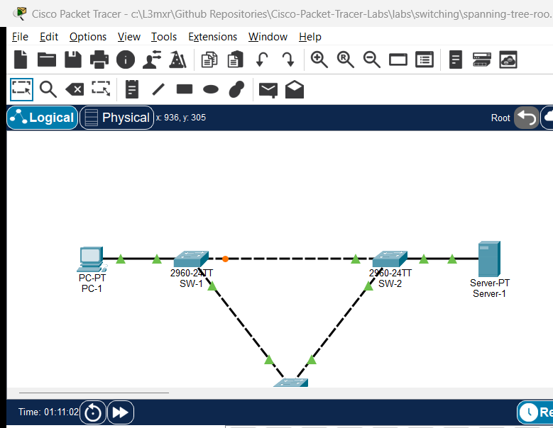

# PTL-0045: Spanning Tree Root and Blocked-Port Investigation

> **Category:** switching · **Difficulty:** intermediate · **Lab ID:** PTL-0045 · **Document:** reviewed · **Simulator:** tested pass

Redundant physical cabling is an indispensable design principle in enterprise Local Area Networks (LANs), eliminating single points of failure between access, distribution, and core switching tiers. However, redundant Layer 2 links naturally introduce physical loops. Without a loop-prevention mechanism, broadcast, multicast, and unknown unicast frames circulate indefinitely, resulting in catastrophic broadcast storms, multiple frame copies arriving at end devices, and rapid MAC address table instability (table thrashing).

The IEEE 802.1D Spanning Tree Protocol (STP) and IEEE 802.1w Rapid Spanning Tree Protocol (RSTP) prevent loops by dynamically discovering the network topology, electing a single central **Root Bridge**, and calculating the shortest loop-free tree. Redundant paths that would otherwise create a physical loop are placed into an **Alternate / Blocking (`Altn BLK`)** state.

In an ideal, well-architected campus network:
1. The **Primary Root Bridge** is deterministically assigned to a high-capacity core or distribution switch (e.g., `SW-1`) using an explicitly lowered Bridge Priority (such as `4096`).
2. The **Secondary Root Bridge** is assigned to a redundant distribution peer switch (e.g., `SW-2`) using the next priority step (`8192`), ensuring immediate, deterministic failover if the primary root fails.
3. Edge **Access Switches** remain at the default priority (`32768`), ensuring they never win a root bridge election.
4. High-capacity transit trunks (GigabitEthernet, 10-GigabitEthernet, or EtherChannel bundles) remain in the **Forwarding (`FWD`)** state, while low-capacity edge access uplinks absorb loop-prevention blocking (`BLK`).

### The Problem: Accidental Root Inversion and Core Blocking

When network administrators leave bridge priorities unmanaged (defaulting to 32768) or misconfigure priority values during switch replacement, disaster strikes:
- **Lowest MAC Address Tiebreaker:** If all switches share the default priority of 32768, the switch with the numerically lowest MAC address wins the election. Older or lower-end access switches frequently have lower factory MAC addresses than newer, high-performance distribution chassis.
- **Inverted Traffic Patterns:** When an edge access switch (`SW-3`) becomes the root bridge, every switch in the campus calculates its shortest path to that access switch.
- **Suboptimal Core Blocking:** High-speed distribution links between `SW-1` and `SW-2` (which carry inter-VLAN routing, server traffic, and WAN traffic) are placed into an Alternate / Blocking (`Altn BLK`) state by STP because their root path cost through the access switch is deemed equal or worse. High-bandwidth distribution traffic is forced to bottleneck through 100 Mbps access uplinks, introducing severe congestion and jitter.
- **Topology Fragility:** Edge access switches are frequently rebooted, power-cycled, or unplugged. If an access switch is the root bridge, every reboot triggers global Topology Change Notifications (TCNs), forcing all switches across the campus to prematurely flush their CAM tables and flood frames.

In this troubleshooting laboratory, you assume the role of a network engineer investigating severe latency and throughput bottlenecks between core resources. You will audit bridge IDs, trace root path costs, diagnose an unintended access-layer root bridge takeover, remediate switch priorities to establish deterministic primary and secondary roots, and verify that high-speed distribution trunks remain fully unblocked while edge uplinks safely provide redundancy.

---

## Learning Objectives

- Analyze the IEEE 802.1D / 802.1w bridge election algorithm, including the 16-bit Priority field, 12-bit System ID Extension, and 48-bit MAC address.
- Investigate root bridge takeovers and suboptimal blocking states using `show spanning-tree` and `show spanning-tree vlan <id>`.
- Calculate cumulative Root Path Costs across mixed GigabitEthernet (Cost 4) and FastEthernet (Cost 19) links.
- Deterministically configure primary (`spanning-tree vlan 1 priority 4096`) and secondary (`spanning-tree vlan 1 priority 8192`) root bridges.
- Verify that inter-switch distribution links transition to Forwarding (`Desg FWD` and `Root FWD`) while redundant access uplinks absorb loop-breaking Alternate Blocking (`Altn BLK`).
- Validate end-to-end host reachability and traffic flow across the optimized Spanning Tree topology.

---

## Prerequisites

- Understanding of Ethernet frame forwarding, MAC address tables, and Layer 2 switching loops.
- Completion of **PTL-0009: VLAN Segmentation and Access Port Configuration** and **PTL-0017: Rapid Spanning Tree Protocol, PortFast, and BPDU Guard** or equivalent experience.
- Familiarity with STP port roles (Root, Designated, Alternate) and states (Forwarding, Blocking).
- Cisco Packet Tracer 8.2 or newer (Packet Tracer 9.0+ verified).

---

## Topology



The topology consists of a classic three-switch campus distribution-and-access triangle loop:
- **Distribution Layer:** `SW-1` and `SW-2` connected via a high-capacity GigabitEthernet trunk link (`Gi0/1` <-> `Gi0/1`).
- **Access Layer:** `SW-3` dual-homed to `SW-1` via `Fa0/1` and to `SW-2` via `Fa0/2`.
- **End Hosts:** Workstation `PC-1` connected to `SW-1`, Enterprise Server `Server-1` connected to `SW-2`, and Access Workstation `PC-2` connected to `SW-3`.

```text
               +-------------------------------------------------------+
               |             Distribution Inter-Switch Trunk           |
               |                Gi0/1 <=================> Gi0/1        |
               |           (High-Speed Gigabit Link, Cost 4)           |
               +-------------------------------------------------------+
                                           |
                    +----------------------+----------------------+
                    |                                             |
             [Distribution SW-1]                           [Distribution SW-2]
           (Target: Primary Root)                        (Target: Secondary Root)
             (Priority: 4096)                              (Priority: 8192)
              Fa0/10       Fa0/1                            Fa0/10       Fa0/1
                |            |                                |            |
                v            |                                v            |
             [PC-1]          | (Access Uplink 1)         [Server-1]        | (Access Uplink 2)
           192.168.1.10      |   FastEthernet 0/1       192.168.1.100      |   FastEthernet 0/2
                             |     (Cost 19)                               |     (Cost 19)
                             +--------------------+ +----------------------+
                                                  | |
                                                  v v
                                           [Access SW-3]
                                         (Target: Access)
                                         (Priority: 32768)
                                                Fa0/10
                                                  |
                                                  v
                                               [PC-2]
                                             192.168.1.20
```

---

## Addressing Table

| Device | Interface | IP Address | Subnet Mask | Default Gateway | Purpose / Connected To |
|---|---|---|---|---|---|
| **SW-1** | Gi0/1 | N/A | N/A | N/A | Core Trunk to SW-2 (`Gi0/1`) |
| **SW-1** | Fa0/1 | N/A | N/A | N/A | Uplink to Access SW-3 (`Fa0/1`) |
| **SW-1** | Fa0/10 | N/A | N/A | N/A | Access Port to PC-1 |
| **SW-2** | Gi0/1 | N/A | N/A | N/A | Core Trunk to SW-1 (`Gi0/1`) |
| **SW-2** | Fa0/1 | N/A | N/A | N/A | Uplink to Access SW-3 (`Fa0/2`) |
| **SW-2** | Fa0/10 | N/A | N/A | N/A | Access Port to Server-1 |
| **SW-3** | Fa0/1 | N/A | N/A | N/A | Uplink to SW-1 (`Fa0/1`) |
| **SW-3** | Fa0/2 | N/A | N/A | N/A | Uplink to SW-2 (`Fa0/1`) |
| **SW-3** | Fa0/10 | N/A | N/A | N/A | Access Port to PC-2 |
| **PC-1** | Fa0 | 192.168.1.10 | 255.255.255.0 | N/A | Distribution Workstation 1 |
| **PC-2** | Fa0 | 192.168.1.20 | 255.255.255.0 | N/A | Access Workstation 2 |
| **Server-1** | Fa0 | 192.168.1.100 | 255.255.255.0 | N/A | Enterprise Application Server |

---

## Lab Tasks

1. **Investigate the Faulted Starter Topology:**
   - Execute `show spanning-tree vlan 1` across `SW-1`, `SW-2`, and `SW-3`.
   - Identify which switch is currently acting as the Root Bridge and record its Bridge Priority and MAC address.
   - Audit port roles (`Root`, `Desg`, `Altn`) and port states (`FWD`, `BLK`) across all three switches.
   - Identify the blocked port in the topology and explain why high-speed distribution link `Gi0/1` is blocked.
2. **Calculate Path Costs and Root Port Elections:**
   - Trace path costs from `SW-1` and `SW-2` to the unexpected root `SW-3`.
   - Compare the FastEthernet cost (19) against the GigabitEthernet cost (4) to understand why the core trunk was blocked.
3. **Configure Deterministic Primary and Secondary Root Bridges:**
   - On `SW-1`, configure Bridge Priority `4096` for VLAN 1 to establish deterministic Primary Root status.
   - On `SW-2`, configure Bridge Priority `8192` for VLAN 1 to establish deterministic Secondary Root status.
   - On `SW-3`, configure Bridge Priority `32768` (default) to ensure it acts as an access bridge.
4. **Verify Remediated Spanning Tree Topology:**
   - Confirm that `SW-1` is recognized as Root Bridge across all switches (`This bridge is the root`).
   - Confirm that `SW-1 Gi0/1` is `Desg FWD` and `SW-2 Gi0/1` is `Root FWD` (core trunk unblocked).
   - Confirm that `SW-3 Fa0/2` transitions to `Altn BLK` (Alternate / Blocked), safely breaking the loop on the edge uplink.
5. **Verify Data Plane Reachability:**
   - Ping from `PC-1` to `Server-1` across the unblocked distribution trunk.
   - Ping from `PC-2` to `Server-1` through the active access uplink.
   - Save running configurations to NVRAM on all three switches.

---

## Configuration Walkthrough

### Step 1: Investigating the Faulted Starter State

Launch the starter topology (`assets/starter.pkt`). Open the CLI on distribution switch `SW-1` and inspect the Spanning Tree state:

```text
SW-1> enable
SW-1# show spanning-tree vlan 1
VLAN0001
  Spanning tree enabled protocol ieee
  Root ID    Priority    4097
             Address     0004.9A6C.D07C
             Cost        19
             Port        1(FastEthernet0/1)
             Hello Time  2 sec  Max Age 20 sec  Forward Delay 15 sec

  Bridge ID  Priority    32769  (priority 32768 sys-id-ext 1)
             Address     0030.F298.40C3
             Hello Time  2 sec  Max Age 20 sec  Forward Delay 15 sec
             Aging Time  20

Interface        Role Sts Cost      Prio.Nbr Type
---------------- ---- --- --------- -------- --------------------------------
Fa0/1            Root FWD 19        128.1    P2p
Gi0/1            Altn BLK 4         128.25   P2p
Fa0/10           Desg FWD 19        128.10   P2p
```

Notice the critical findings on `SW-1`:
1. **The Root Bridge is NOT `SW-1`:** The Root ID MAC is `0004.9A6C.D07C`, which does not match `SW-1`'s local bridge address (`0030.F298.40C3`).
2. **`SW-1` Root Port is `FastEthernet0/1`:** `SW-1` reaches the root through its 100 Mbps edge access link with Cost 19.
3. **Core Trunk `Gi0/1` is BLOCKED (`Altn BLK`):** The high-speed 1 Gbps distribution trunk connecting `SW-1` to `SW-2` is blocked!

Now open the CLI on access switch `SW-3`:

```text
SW-3> enable
SW-3# show spanning-tree vlan 1
VLAN0001
  Spanning tree enabled protocol ieee
  Root ID    Priority    4097
             Address     0004.9A6C.D07C
             This bridge is the root
             Hello Time  2 sec  Max Age 20 sec  Forward Delay 15 sec

  Bridge ID  Priority    4097  (priority 4096 sys-id-ext 1)
             Address     0004.9A6C.D07C
             Hello Time  2 sec  Max Age 20 sec  Forward Delay 15 sec
             Aging Time  20

Interface        Role Sts Cost      Prio.Nbr Type
---------------- ---- --- --------- -------- --------------------------------
Fa0/1            Desg FWD 19        128.1    P2p
Fa0/2            Desg FWD 19        128.2    P2p
Fa0/10           Desg FWD 19        128.10   P2p
```

The root cause is clear:
`SW-3` has Bridge Priority `4096` (`4097` with sys-id-ext 1), causing this wiring-closet access switch to win the root election! Because `SW-3` is root, both `SW-1` and `SW-2` view `SW-3` as their shortest path. On the inter-switch link between `SW-1` and `SW-2`, `SW-1` receives a superior BPDU from `SW-2` and places its own `Gi0/1` interface into `Altn BLK`, crippling the distribution layer.

### Step 2: Remediating SW-1 as Primary Root Bridge

To ensure `SW-1` permanently and deterministically wins the root election, configure its bridge priority to `4096` (the lowest standard recommended priority):

```text
SW-1# configure terminal
SW-1(config)# spanning-tree vlan 1 priority 4096
SW-1(config)# exit
SW-1# write memory
```

### Step 3: Remediating SW-2 as Secondary Root Bridge

Configure `SW-2` with priority `8192`. If `SW-1` ever suffers a hardware failure, `SW-2` will immediately take over as root, preventing `SW-3` from ever usurping the root role:

```text
SW-2# configure terminal
SW-2(config)# spanning-tree vlan 1 priority 8192
SW-2(config)# exit
SW-2# write memory
```

### Step 4: Reverting SW-3 to Default Access Priority

Remove the misconfigured priority on `SW-3` by resetting it to the default value (`32768`):

```text
SW-3# configure terminal
SW-3(config)# spanning-tree vlan 1 priority 32768
SW-3(config)# exit
SW-3# write memory
```

---

## Verification

### 1. Verify Primary Root Bridge on SW-1

Execute `show spanning-tree vlan 1` on `SW-1`:

```text
SW-1# show spanning-tree vlan 1
VLAN0001
  Spanning tree enabled protocol ieee
  Root ID    Priority    4097
             Address     0030.F298.40C3
             This bridge is the root
             Hello Time  2 sec  Max Age 20 sec  Forward Delay 15 sec

  Bridge ID  Priority    4097  (priority 4096 sys-id-ext 1)
             Address     0030.F298.40C3
             Hello Time  2 sec  Max Age 20 sec  Forward Delay 15 sec
             Aging Time  20

Interface        Role Sts Cost      Prio.Nbr Type
---------------- ---- --- --------- -------- --------------------------------
Fa0/1            Desg FWD 19        128.1    P2p
Fa0/10           Desg FWD 19        128.10   P2p
Gi0/1            Desg FWD 4         128.25   P2p
```

Verification Highlights:
- `This bridge is the root` is present.
- Root ID and Bridge ID match with Priority `4097`.
- All ports on `SW-1` are in the **`Desg FWD`** state.
- Core link `Gi0/1` is forwarding!

### 2. Verify Secondary Root Bridge on SW-2

Execute `show spanning-tree vlan 1` on `SW-2`:

```text
SW-2# show spanning-tree vlan 1
VLAN0001
  Spanning tree enabled protocol ieee
  Root ID    Priority    4097
             Address     0030.F298.40C3
             Cost        4
             Port        25(GigabitEthernet0/1)
             Hello Time  2 sec  Max Age 20 sec  Forward Delay 15 sec

  Bridge ID  Priority    8193  (priority 8192 sys-id-ext 1)
             Address     0001.4363.5092
             Hello Time  2 sec  Max Age 20 sec  Forward Delay 15 sec
             Aging Time  20

Interface        Role Sts Cost      Prio.Nbr Type
---------------- ---- --- --------- -------- --------------------------------
Fa0/1            Desg FWD 19        128.1    P2p
Fa0/10           Desg FWD 19        128.10   P2p
Gi0/1            Root FWD 4         128.25   P2p
```

Verification Highlights:
- `SW-2` selects `GigabitEthernet0/1` as its **Root Port (`Root FWD`)** with path cost `4`.
- Core trunk between `SW-1` and `SW-2` is 100% active and unblocked.
- Local bridge priority is `8193` (Secondary Root).

### 3. Verify Alternate Blocked Port on Access Switch SW-3

Execute `show spanning-tree vlan 1` on `SW-3`:

```text
SW-3# show spanning-tree vlan 1
VLAN0001
  Spanning tree enabled protocol ieee
  Root ID    Priority    4097
             Address     0030.F298.40C3
             Cost        19
             Port        1(FastEthernet0/1)
             Hello Time  2 sec  Max Age 20 sec  Forward Delay 15 sec

  Bridge ID  Priority    32769  (priority 32768 sys-id-ext 1)
             Address     0004.9A6C.D07C
             Hello Time  2 sec  Max Age 20 sec  Forward Delay 15 sec
             Aging Time  20

Interface        Role Sts Cost      Prio.Nbr Type
---------------- ---- --- --------- -------- --------------------------------
Fa0/1            Root FWD 19        128.1    P2p
Fa0/2            Altn BLK 19        128.2    P2p
Fa0/10           Desg FWD 19        128.10   P2p
```

Verification Highlights:
- `SW-3` selects `Fa0/1` as its **Root Port (`Root FWD`)** with cost `19` directly to `SW-1`.
- `SW-3` redundant uplink `Fa0/2` is in **`Altn BLK` (Alternate / Blocked)** state.
- The loop is broken at the edge uplink, leaving the high-speed distribution backbone completely unencumbered.

### 4. Verify End-to-End Data Plane Reachability

Test reachability across the core distribution link from `PC-1` to `Server-1`:

```text
PC-1> ping 192.168.1.100

Pinging 192.168.1.100 with 32 bytes of data:

Reply from 192.168.1.100: bytes=32 time<1ms TTL=128
Reply from 192.168.1.100: bytes=32 time<1ms TTL=128
Reply from 192.168.1.100: bytes=32 time<1ms TTL=128
Reply from 192.168.1.100: bytes=32 time<1ms TTL=128

Ping statistics for 192.168.1.100:
    Packets: Sent = 4, Received = 4, Lost = 0 (0% loss)
```

Now test reachability from access workstation `PC-2` to `Server-1`:

```text
PC-2> ping 192.168.1.100

Pinging 192.168.1.100 with 32 bytes of data:

Reply from 192.168.1.100: bytes=32 time<1ms TTL=128
Reply from 192.168.1.100: bytes=32 time<1ms TTL=128
Reply from 192.168.1.100: bytes=32 time<1ms TTL=128
Reply from 192.168.1.100: bytes=32 time<1ms TTL=128

Ping statistics for 192.168.1.100:
    Packets: Sent = 4, Received = 4, Lost = 0 (0% loss)
```

---

## Troubleshooting

### Systematic Spanning Tree Diagnosis Flowchart

```text
[Start: High Latency or Core Bottlenecks Detected]
  |
  +---> 1. Identify the Root Bridge:
  |        Execute 'show spanning-tree' on distribution switches.
  |        Does 'This bridge is the root' appear on the intended core/distribution switch?
  |        --> If NO: Check Bridge Priorities. Look for an access switch with lower priority or lowest MAC.
  |
  +---> 2. Audit Blocked Ports:
  |        Search for 'Altn BLK' or 'BLOCKING' across all switches.
  |        Is a high-capacity core or distribution link blocked?
  |        --> If YES: Realign Bridge Priorities so distribution switches have lowest path cost to root.
  |
  +---> 3. Check Bridge Priority Configuration:
  |        Primary Root: Set to 4096 ('spanning-tree vlan <id> priority 4096').
  |        Secondary Root: Set to 8192 ('spanning-tree vlan <id> priority 8192').
  |        Access Switches: Retain default 32768.
  |
  +---> 4. Verify Port Path Costs:
           Inspect 'Cost' column in 'show spanning-tree'.
           - 10 Gbps = Cost 2
           - 1 Gbps  = Cost 4
           - 100 Mbps = Cost 19
           - 10 Mbps = Cost 100
           Ensure port speeds are auto-negotiating properly (not duplex/speed mismatched).
```

### Common Faults and Remediation Matrix

| Symptom | Probable Cause | Diagnostic Command | Remediation |
|---|---|---|---|
| Access switch is unexpectedly root bridge | Priority left at default 32768 and access switch has lowest MAC, or priority was set manually | `show spanning-tree vlan 1` | Configure `spanning-tree vlan 1 priority 4096` on core distribution switch; reset access switch to 32768. |
| High-speed Gigabit core trunk is blocked | Root bridge is located at the access layer, making core link a higher-cost redundant path | `show spanning-tree vlan 1` | Correct root bridge placement to distribution layer to ensure core trunk has lowest root cost (Cost 4). |
| Command rejected: `% Priority must be in increments of 4096` | Bridge priority entered is not a multiple of 4096 (due to 12-bit Sys-ID Extension) | `spanning-tree vlan 1 priority <val>` | Enter valid priority: 0, 4096, 8192, 12288, 16384, 20480, 24576, 28672, 32768, etc. |
| Root bridge flips intermittently | Multiple switches configured with equal priority, causing MAC address flapping during reboot | `show spanning-tree detail` | Hardcode distinct priorities: 4096 on primary, 8192 on secondary, 32768 on access. |
| End-host access port takes 30-50s to connect | PortFast not enabled on access port; port undergoing standard Listening/Learning delay | `show spanning-tree interface <int>` | Configure `spanning-tree portfast` on edge access ports connecting to PCs and servers. |

---

## Key Takeaways

- **Deterministic Root Placement is Mandatory:** Never leave bridge priorities at default (32768). Unmanaged priorities allow random edge switches with lower factory MAC addresses to hijack the campus root bridge role.
- **Priority Increments of 4096:** With the IEEE 802.1t System ID Extension enabled, the 16-bit Priority field is divided into a 4-bit Priority multiplier (increments of 4096) and a 12-bit VLAN ID.
- **Path Cost Hierarchy:** Spanning Tree selects the shortest cumulative path to the root. GigabitEthernet has a default path cost of 4, while FastEthernet has a cost of 19.
- **Protecting Core Bandwidth:** When the distribution layer hosts the primary and secondary roots, high-capacity core trunks are guaranteed to remain in the Forwarding state, while low-capacity edge uplinks absorb loop-prevention blocking.

---

## References

- [IEEE Standard for Local and Metropolitan Area Networks: Media Access Control (MAC) Bridges (802.1D)](https://standards.ieee.org/ieee/802.1D/1381/)
- [Cisco Support Document 5234: Understanding and Configuring Spanning Tree Protocol (STP) on Catalyst Switches](https://www.cisco.com/c/en/us/support/docs/lan-switching/spanning-tree-protocol/5234-5.html)
- [Cisco Catalyst 2960 Switch Software Configuration Guide: Configuring STP](https://www.cisco.com/c/en/us/td/docs/switches/lan/catalyst2960/software/release/12-2_55_se/configuration/guide/scg_2960/swstp.html)

---

## Files and Validation Status

This laboratory provides verified Cisco Packet Tracer files and configuration artifacts:

- **`assets/starter.pkt`:** Baseline faulted topology with inverted access root bridge and blocked core Gigabit link for student investigation.
- **`assets/completed.pkt`:** Fully remediated reference topology with deterministic primary root (4096), secondary root (8192), unblocked core trunk, and verified reachability.
- **`assets/topology.png`:** Visual network topology diagram.
- **`configs/SW-1.txt`:** Full sanitized Cisco IOS running configuration for primary distribution switch `SW-1`.
- **`configs/SW-2.txt`:** Full sanitized Cisco IOS running configuration for secondary distribution switch `SW-2`.
- **`configs/SW-3.txt`:** Full sanitized Cisco IOS running configuration for access switch `SW-3`.
- **`metadata.json`:** Machine-readable catalog metadata and learning objectives.
- **`verification.md`:** Complete positive and negative test acceptance matrix.
- **`AI_AGENT_GUIDE/state/PTL-0045-SIMULATOR-RESULTS.md`:** Live simulator verification evidence recorded in Packet Tracer 9.0.1.

