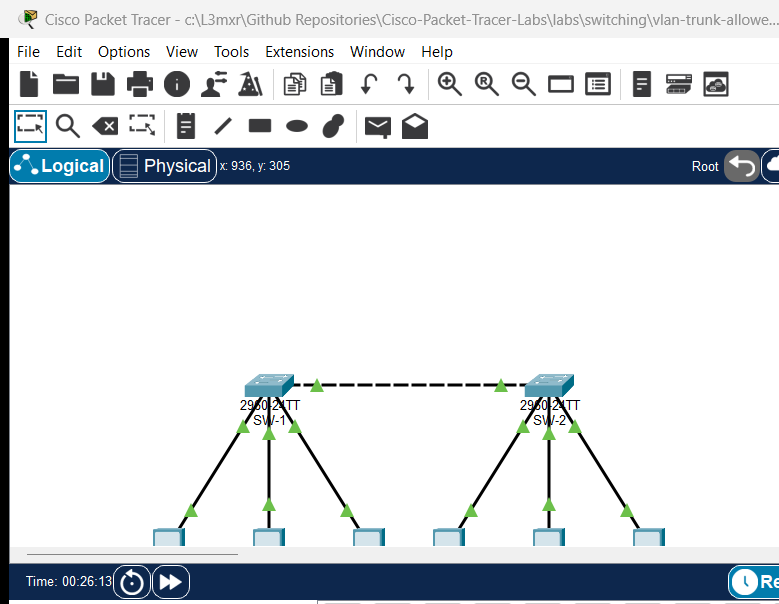

# PTL-0044: VLAN Trunk Allowed-List Troubleshooting

> **Category:** switching · **Difficulty:** intermediate · **Lab ID:** PTL-0044 · **Document:** reviewed · **Simulator:** tested pass

Virtual Local Area Networks (VLANs) and IEEE 802.1Q trunks form the structural foundation of modern switched campus architectures. In multi-switch topologies, inter-switch trunk links multiplex frames from dozens or hundreds of distinct VLANs across a single physical or bundled interface. By default on Cisco Catalyst switches, an 802.1Q trunk permits all VLAN IDs from 1 to 4094 across the link. However, enterprise security hardening and network efficiency policies routinely require switch administrators to configure a restricted **VLAN trunk allowed list** (`switchport trunk allowed vlan`), permitting only the specific VLANs required across that trunk.

While trunk pruning improves bandwidth utilization and confines broadcast traffic, manual allowed-list management introduces serious operational vulnerabilities when implemented incorrectly:
- **Accidental VLAN Pruning via Overwrite:** The standard Cisco IOS command syntax `switchport trunk allowed vlan <vlan-list>` completely overwrites any previously configured allowed list. Network administrators attempting to allow a single new VLAN often enter `switchport trunk allowed vlan 30`, unintentionally removing all production VLANs previously traversing the trunk and causing catastrophic service outages. The correct, non-destructive syntax requires the `add` modifier: `switchport trunk allowed vlan add 30`.
- **Allowed List Asymmetry Across Inter-Switch Peers:** Both switches terminating an 802.1Q trunk link must allow the exact same set of VLANs. If Switch A permits VLANs 10, 20, and 30, but Switch B's trunk allowed list is configured for only VLANs 10 and 20, frames belonging to VLAN 30 transmitted from Switch A will be discarded at Switch B's ingress interface, resulting in unidirectional or total intra-VLAN partition.
- **Native VLAN Mismatch and Frame Tagging Flaws:** IEEE 802.1Q trunks transmit frames belonging to the Native VLAN without an 802.1Q tag header. If trunk endpoints disagree on which VLAN ID is designated as native (e.g., Switch A uses Native VLAN 99 while Switch B defaults to Native VLAN 1), untagged frames transmitted from Switch A on VLAN 99 will be ingested by Switch B directly into VLAN 1. This creates severe cross-VLAN broadcast leakage, spanning-tree loop inconsistencies (PVST+ PVID-inconsistency), and security vulnerabilities such as double-tagging attacks.
- **Access Port vs. Trunk Port Misconfiguration:** When troubleshooting cross-switch reachability issues, engineers must distinguish between trunk transport failures and local access port assignment errors. Access ports require explicit VLAN membership (`switchport access vlan <id>`) and Spanning Tree PortFast (`spanning-tree portfast`), while trunk ports require encapsulation, unconditional trunking mode (`switchport mode trunk`), and non-negotiation (`switchport nonegotiate`).

In this troubleshooting laboratory, you assume the role of a senior network operations engineer responding to an urgent escalation: users in the **Operations Department (VLAN 30)** report total loss of communication between distribution buildings, while the **Engineering (VLAN 10)** and **Marketing (VLAN 20)** departments report completely normal network operation. Furthermore, Cisco Discovery Protocol (CDP) logs indicate intermittent Native VLAN mismatch warnings between distribution switches `SW-1` and `SW-2`.

You will audit operational trunk states, inspect allowed lists and native VLAN designations, diagnose multiple compounding trunking errors without altering existing access ports, remediate the configuration using non-destructive IOS commands, and verify full two-way intra-VLAN reachability across all corporate departments.

---

## Learning Objectives

- Apply structured Layer 2 troubleshooting methodologies to identify trunk allowed-list omissions and Native VLAN mismatches.
- Audit trunk operational status, encapsulation, and allowed VLAN parameters using `show interfaces trunk` and `show interfaces switchport`.
- Safely modify trunk allowed VLAN lists using the `add` keyword to restore pruned VLANs without disrupting operational VLANs.
- Identify and align Native VLAN designations across adjacent trunk peers to eliminate CDP mismatch warnings and prevent cross-VLAN frame leakage.
- Verify intra-VLAN end-to-end reachability across the inter-switch trunk for all production subnets.
- Validate strict Layer 2 broadcast domain isolation between distinct departmental VLANs.

---

## Prerequisites

- Solid understanding of Ethernet frame switching, MAC address tables, and Layer 2 broadcast domains.
- Completion of **PTL-0009: VLAN Segmentation and Access Port Configuration** and **PTL-0018: Inter-VLAN Routing with Router-on-a-Stick** or equivalent experience.
- Familiarity with IEEE 802.1Q encapsulation, tagged vs. untagged frames, and Native VLAN concepts.
- Cisco Packet Tracer 8.2 or newer (Packet Tracer 9.0+ verified).

---

## Topology



The topology models an enterprise campus distribution layer consisting of two Cisco Catalyst 2960 switches connected via an 802.1Q inter-switch trunk link (`GigabitEthernet0/1` <-> `GigabitEthernet0/1`), serving three distinct departmental VLANs and dedicated end-user workstations:

```text
  +---------------------------------------------------------------------------------+
  |                                  Campus Core                                    |
  +---------------------------------------------------------------------------------+
                                           |
                 Trunk Link: Gi0/1 <===============> Gi0/1 (Cross Cable)
                 - Encapsulation: 802.1Q             - Encapsulation: 802.1Q
                 - Allowed: 10,20,30,99 (Target)     - Allowed: 10,20,30,99 (Target)
                 - Native VLAN: 99 (Target)          - Native VLAN: 99 (Target)
                                           |
                +--------------------------+--------------------------+
                |                                                     |
         [Distribution SW-1]                                   [Distribution SW-2]
           |        |        |                                   |        |        |
        Fa0/10   Fa0/20   Fa0/15                              Fa0/10   Fa0/20   Fa0/15
       (VLAN 10)(VLAN 20)(VLAN 30)                           (VLAN 10)(VLAN 20)(VLAN 30)
           |        |        |                                   |        |        |
           v        v        v                                   v        v        v
      [PC-Eng1] [PC-Mkt1] [PC-Ops1]                         [PC-Eng2] [PC-Mkt2] [PC-Ops2]
      10.10     20.10     30.10                             10.20     20.20     30.20
```

---

## Addressing Table

| Device | Interface | IP Address | Subnet Mask | VLAN ID | VLAN Name | Purpose / Connected To |
|---|---|---|---|---|---|---|
| **SW-1** | Gi0/1 | N/A | N/A | 10,20,30,99 | Native_Trunk (99) | Inter-Switch Trunk to SW-2 |
| **SW-1** | Fa0/10 | N/A | N/A | 10 | Engineering | Access Port to PC-Eng1 |
| **SW-1** | Fa0/20 | N/A | N/A | 20 | Marketing | Access Port to PC-Mkt1 |
| **SW-1** | Fa0/15 | N/A | N/A | 30 | Operations | Access Port to PC-Ops1 |
| **SW-2** | Gi0/1 | N/A | N/A | 10,20,30,99 | Native_Trunk (99) | Inter-Switch Trunk to SW-1 |
| **SW-2** | Fa0/10 | N/A | N/A | 10 | Engineering | Access Port to PC-Eng2 |
| **SW-2** | Fa0/20 | N/A | N/A | 20 | Marketing | Access Port to PC-Mkt2 |
| **SW-2** | Fa0/15 | N/A | N/A | 30 | Operations | Access Port to PC-Ops2 |
| **PC-Eng1** | Fa0 | 192.168.10.10 | 255.255.255.0 | 10 | Engineering | Engineering Workstation 1 |
| **PC-Eng2** | Fa0 | 192.168.10.20 | 255.255.255.0 | 10 | Engineering | Engineering Workstation 2 |
| **PC-Mkt1** | Fa0 | 192.168.20.10 | 255.255.255.0 | 20 | Marketing | Marketing Workstation 1 |
| **PC-Mkt2** | Fa0 | 192.168.20.20 | 255.255.255.0 | 20 | Marketing | Marketing Workstation 2 |
| **PC-Ops1** | Fa0 | 192.168.30.10 | 255.255.255.0 | 30 | Operations | Operations Workstation 1 |
| **PC-Ops2** | Fa0 | 192.168.30.20 | 255.255.255.0 | 30 | Operations | Operations Workstation 2 |

---

## Lab Tasks

1. **Verify Baseline Network Connectivity and Isolate the Incident:**
   - Test connectivity between `PC-Eng1` and `PC-Eng2` (VLAN 10).
   - Test connectivity between `PC-Mkt1` and `PC-Mkt2` (VLAN 20).
   - Test connectivity between `PC-Ops1` and `PC-Ops2` (VLAN 30) and confirm the outage.
2. **Audit Switch Port Roles and Trunk Status:**
   - Execute `show interfaces trunk` on `SW-1` and `SW-2`.
   - Inspect the `Vlans allowed on trunk` and `Vlans allowed and active in management domain` output sections.
   - Execute `show interfaces GigabitEthernet0/1 switchport` to audit administrative and operational trunking modes.
3. **Diagnose and Remediate Trunk Allowed List Omissions on SW-1:**
   - Determine which VLANs are missing from SW-1's trunk allowed list on interface `GigabitEthernet0/1`.
   - Apply the correct non-destructive syntax (`switchport trunk allowed vlan add <vlan-id>`) to restore VLAN 30 to the trunk.
   - Do NOT overwrite existing allowed VLANs (VLAN 10, 20, 99).
4. **Diagnose and Resolve Native VLAN Mismatch on SW-2:**
   - Identify the Native VLAN mismatch between `SW-1` (Native VLAN 99) and `SW-2` (Native VLAN 1).
   - Reconfigure `SW-2` interface `GigabitEthernet0/1` with `switchport trunk native vlan 99`.
5. **Verify Comprehensive End-to-End Operation:**
   - Confirm that `PC-Ops1` can successfully ping `PC-Ops2` across the trunk with 0% loss.
   - Confirm that VLAN 10 and VLAN 20 retain full reachability across the trunk.
   - Confirm Layer 2 isolation: verify that attempts to ping between different VLANs (e.g., `PC-Eng1` to `PC-Mkt1`) time out as expected.
   - Save running configurations to NVRAM on both switches.

---

## Configuration Walkthrough

### Step 1: Baseline Audit and Fault Isolation

Begin by launching the starter topology (`assets/starter.pkt`). Open the command prompt on `PC-Eng1` and verify baseline connectivity across the inter-switch link to `PC-Eng2`:

```text
PC-Eng1> ping 192.168.10.20

Pinging 192.168.10.20 with 32 bytes of data:

Reply from 192.168.10.20: bytes=32 time=5ms TTL=128
Reply from 192.168.10.20: bytes=32 time<1ms TTL=128
Reply from 192.168.10.20: bytes=32 time<1ms TTL=128
Reply from 192.168.10.20: bytes=32 time<1ms TTL=128

Ping statistics for 192.168.10.20:
    Packets: Sent = 4, Received = 4, Lost = 0 (0% loss)
```

Now open the command prompt on `PC-Ops1` and ping its counterpart `PC-Ops2` in the Operations Department:

```text
PC-Ops1> ping 192.168.30.20

Pinging 192.168.30.20 with 32 bytes of data:

Request timed out.
Request timed out.
Request timed out.
Request timed out.

Ping statistics for 192.168.30.20:
    Packets: Sent = 4, Received = 0, Lost = 4 (100% loss)
```

The ping fails completely. Because Engineering (VLAN 10) functions properly across the physical cable between `SW-1` and `SW-2`, physical cabling and interface transceiver hardware are operational. The issue is a Layer 2 logical trunk filtering or configuration defect.

### Step 2: Inspecting Trunking Configuration on SW-1 and SW-2

Log in to `SW-1` via the CLI console and inspect the active trunk parameters:

```text
SW-1> enable
SW-1# show interfaces trunk
Port        Mode         Encapsulation  Status        Native vlan
Gig0/1      on           802.1q         trunking      99

Port        Vlans allowed on trunk
Gig0/1      10,20,99

Port        Vlans allowed and active in management domain
Gig0/1      10,20,99

Port        Vlans in spanning tree forwarding state and not pruned
Gig0/1      10,20
```

Notice the critical finding:
1. Under **`Vlans allowed on trunk`**, interface `Gig0/1` allows only `10,20,99`. **VLAN 30 is missing!**
2. Frames generated by `PC-Ops1` on VLAN 30 are dropped by `SW-1` when attempting to egress `Gig0/1`.

Next, log in to `SW-2` and execute `show interfaces trunk`:

```text
SW-2> enable
SW-2# show interfaces trunk
Port        Mode         Encapsulation  Status        Native vlan
Gig0/1      on           802.1q         trunking      1

Port        Vlans allowed on trunk
Gig0/1      10,20,30,99

Port        Vlans allowed and active in management domain
Gig0/1      10,20,30,99

Port        Vlans in spanning tree forwarding state and not pruned
Gig0/1      10,20,30,99
```

Analyzing SW-2 reveals two important details:
1. `SW-2` permits VLAN 30 on its trunk allowed list (`10,20,30,99`).
2. `SW-2` has its **`Native vlan` set to 1**, whereas `SW-1` has its **`Native vlan` set to 99**. This creates a Native VLAN mismatch condition.

### Step 3: Remediating SW-1 Trunk Allowed List

To restore VLAN 30 across the trunk without knocking out VLANs 10 and 20, enter configuration mode on `SW-1`.

> [!WARNING]
> Never issue `switchport trunk allowed vlan 30` by itself! This command replaces the entire allowed list with only VLAN 30, instantly terminating all traffic for Engineering (VLAN 10) and Marketing (VLAN 20). Always use the `add` modifier.

```text
SW-1# configure terminal
SW-1(config)# interface GigabitEthernet0/1
SW-1(config-if)# switchport trunk allowed vlan add 30
SW-1(config-if)# exit
SW-1(config)# exit
SW-1# write memory
```

### Step 4: Resolving Native VLAN Mismatch on SW-2

Enter configuration mode on `SW-2` and configure `GigabitEthernet0/1` to match the enterprise standard Native VLAN (VLAN 99):

```text
SW-2# configure terminal
SW-2(config)# interface GigabitEthernet0/1
SW-2(config-if)# switchport trunk native vlan 99
SW-2(config-if)# exit
SW-2(config)# exit
SW-2# write memory
```

---

## Verification

### 1. Verify Trunk Operational State on SW-1

Execute `show interfaces trunk` on `SW-1`:

```text
SW-1# show interfaces trunk
Port        Mode         Encapsulation  Status        Native vlan
Gig0/1      on           802.1q         trunking      99

Port        Vlans allowed on trunk
Gig0/1      10,20,30,99

Port        Vlans allowed and active in management domain
Gig0/1      10,20,30,99

Port        Vlans in spanning tree forwarding state and not pruned
Gig0/1      10,20,30,99
```

VLAN 30 is now allowed, active in the management domain, and in the Spanning Tree forwarding state on `SW-1`.

### 2. Verify Trunk Detailed Switchport Characteristics on Both Switches

Execute `show interfaces GigabitEthernet0/1 switchport` on both switches to confirm administrative and operational synchronization:

```text
SW-1# show interfaces GigabitEthernet0/1 switchport
Name: Gig0/1
Switchport: Enabled
Administrative Mode: trunk
Operational Mode: trunk
Administrative Trunking Encapsulation: dot1q
Operational Trunking Encapsulation: dot1q
Negotiation of Trunking: Off
Access Mode VLAN: 1 (default)
Trunking Native Mode VLAN: 99 (Native_Trunk)
Trunking VLANs Enabled: 10,20,30,99
Pruning VLANs Enabled: 2-1001
```

```text
SW-2# show interfaces GigabitEthernet0/1 switchport
Name: Gig0/1
Switchport: Enabled
Administrative Mode: trunk
Operational Mode: trunk
Administrative Trunking Encapsulation: dot1q
Operational Trunking Encapsulation: dot1q
Negotiation of Trunking: Off
Access Mode VLAN: 1 (default)
Trunking Native Mode VLAN: 99 (Native_Trunk)
Trunking VLANs Enabled: 10,20,30,99
Pruning VLANs Enabled: 2-1001
```

Both switches report `Operational Mode: trunk`, `Trunking Native Mode VLAN: 99`, and `Trunking VLANs Enabled: 10,20,30,99`.

### 3. Verify End-to-End Intra-VLAN Reachability

From `PC-Ops1`, re-test connectivity to `PC-Ops2`:

```text
PC-Ops1> ping 192.168.30.20

Pinging 192.168.30.20 with 32 bytes of data:

Reply from 192.168.30.20: bytes=32 time<1ms TTL=128
Reply from 192.168.30.20: bytes=32 time<1ms TTL=128
Reply from 192.168.30.20: bytes=32 time<1ms TTL=128
Reply from 192.168.30.20: bytes=32 time<1ms TTL=128

Ping statistics for 192.168.30.20:
    Packets: Sent = 4, Received = 4, Lost = 0 (0% loss)
```

Operations Department communication is 100% restored across the inter-switch trunk.

Verify that the other departments remain uninterrupted:
- From `PC-Eng1`, ping `PC-Eng2` (`192.168.10.20`): 4/4 replies received (0% loss).
- From `PC-Mkt1`, ping `PC-Mkt2` (`192.168.20.20`): 4/4 replies received (0% loss).

### 4. Verify Layer 2 VLAN Segmentation and Isolation

Test inter-VLAN communication by attempting to ping from `PC-Eng1` (VLAN 10) to `PC-Mkt1` (VLAN 20, `192.168.20.10`):

```text
PC-Eng1> ping 192.168.20.10

Pinging 192.168.20.10 with 32 bytes of data:

Request timed out.
Request timed out.
Request timed out.
Request timed out.

Ping statistics for 192.168.20.10:
    Packets: Sent = 4, Received = 0, Lost = 4 (100% loss)
```

The ping times out as expected. Without an active Layer 3 router or multilayer switch performing inter-VLAN routing, Layer 2 broadcast domains remain completely isolated.

---

## Troubleshooting

### Systematic Trunk Troubleshooting Flowchart

```text
[Start: Intra-VLAN Traffic Fails Across Trunk]
  |
  +---> 1. Check Physical Link & Port State:
  |        Execute 'show interfaces status'.
  |        Is the trunk interface 'connected' and up/up?
  |        --> If NO: Check physical cable, transceiver, and 'no shutdown'.
  |
  +---> 2. Verify Trunk Operational Mode:
  |        Execute 'show interfaces trunk'.
  |        Does the port appear under trunking ports?
  |        --> If NO: Execute 'switchport mode trunk' and 'switchport nonegotiate'.
  |
  +---> 3. Check Native VLAN Alignment:
  |        Compare 'Native vlan' field on both trunk endpoints.
  |        Do both switches show the exact same Native VLAN ID?
  |        --> If NO: Align with 'switchport trunk native vlan <id>' on mismatched switch.
  |
  +---> 4. Check Allowed VLAN List:
  |        Inspect 'Vlans allowed on trunk'.
  |        Is the affected VLAN explicitly present in the list?
  |        --> If NO: Execute 'switchport trunk allowed vlan add <vlan-id>'.
  |
  +---> 5. Check VLAN Existence & Active State:
  |        Execute 'show vlan brief'.
  |        Does the VLAN exist in the local VLAN database and state is 'active'?
  |        --> If NO: Create the VLAN with 'vlan <id>' and 'name <name>'.
  |
  +---> 6. Check Spanning Tree State:
           Inspect 'Vlans in spanning tree forwarding state and not pruned'.
           Is the VLAN listed in the STP forwarding section?
           --> If NO: Investigate STP topology, root bridges, or port blocking.
```

### Common Faults and Remediation Matrix

| Symptom | Probable Cause | Diagnostic Command | Remediation |
|---|---|---|---|
| Single VLAN fails across trunk; other VLANs work | VLAN pruned from trunk allowed list on one or both switches | `show interfaces trunk` | Enter interface configuration and issue `switchport trunk allowed vlan add <id>`. |
| All VLANs dropped when adding a new VLAN | Administrator typed `switchport trunk allowed vlan <id>` without `add` keyword | `show interfaces trunk` | Re-enter trunk allowed list with all required VLANs: `switchport trunk allowed vlan 10,20,30,99`. |
| `%CDP-4-NATIVE_VLAN_MISMATCH` console warning | Adjacent trunk interfaces have unequal Native VLAN configurations | `show interfaces trunk`, `show cdp neighbors detail` | Match Native VLANs across link using `switchport trunk native vlan <id>`. |
| Trunk link does not form; remains access port | Dynamic Trunking Protocol (DTP) negotiation mismatch or static mode omitted | `show interfaces <int> switchport` | Hardcode trunk mode with `switchport mode trunk` and disable negotiation with `switchport nonegotiate`. |
| Intra-switch ping fails within same VLAN | Access port assigned to wrong VLAN or interface shutdown | `show vlan brief`, `show interfaces status` | Verify port VLAN with `switchport access vlan <id>` and ensure interface is `no shutdown`. |

---

## Key Takeaways

- **Non-Destructive Syntax Enforcement:** Always use `switchport trunk allowed vlan add <vlan>` when appending VLANs to an existing trunk allowed list. Omitting the `add` keyword replaces the entire allowed list with only the specified VLAN.
- **Symmetric Configuration Requirement:** Trunk allowed lists and Native VLAN definitions must match on both ends of an inter-switch link. Mismatches create black holes, unidirectional frame drops, and spanning tree topology instability.
- **Native VLAN Best Practices:** Enterprise security benchmarks recommend setting the Native VLAN to an unused, dedicated non-default VLAN ID (such as VLAN 99) and pruning VLAN 1 to prevent VLAN hopping attacks.
- **Multi-Level Verification:** Diagnosing trunk issues requires examining both `show interfaces trunk` (high-level trunk status and STP forwarding) and `show interfaces switchport` (low-level administrative and operational details).

---

## References

- [IEEE Standard for Local and Metropolitan Area Networks: 802.1Q Bridges and Bridged Networks](https://standards.ieee.org/ieee/802.1Q/6844/)
- [Cisco Support Document 17056: Understanding and Configuring VLAN Trunk Protocol (VTP) and 802.1Q Trunking](https://www.cisco.com/c/en/us/support/docs/lan-switching/8021q/17056-741-4.html)
- [Cisco Catalyst 2960 Switch Software Configuration Guide: Configuring VLANs](https://www.cisco.com/c/en/us/td/docs/switches/lan/catalyst2960/software/release/12-2_55_se/configuration/guide/scg_2960/swvlan.html)
- [Cisco Catalyst 2960 Switch Software Configuration Guide: Configuring VLAN Trunks](https://www.cisco.com/c/en/us/td/docs/switches/lan/catalyst2960/software/release/12-2_55_se/configuration/guide/scg_2960/swtrunk.html)

---

## Files and Validation Status

This laboratory provides verified Cisco Packet Tracer files and configuration artifacts:

- **`assets/starter.pkt`:** Baseline faulted topology with pruned VLAN 30 on SW-1 and Native VLAN mismatch on SW-2 for student troubleshooting.
- **`assets/completed.pkt`:** Fully remediated reference topology with operational 802.1Q trunk, aligned Native VLAN 99, and verified multi-VLAN reachability.
- **`assets/topology.png`:** Visual network topology diagram.
- **`configs/SW-1.txt`:** Full sanitized Cisco IOS running configuration for distribution switch `SW-1`.
- **`configs/SW-2.txt`:** Full sanitized Cisco IOS running configuration for distribution switch `SW-2`.
- **`metadata.json`:** Machine-readable catalog metadata and learning objectives.
- **`verification.md`:** Complete positive and negative test acceptance matrix.
- **`AI_AGENT_GUIDE/state/PTL-0044-SIMULATOR-RESULTS.md`:** Live simulator verification evidence recorded in Packet Tracer 9.0.1.

