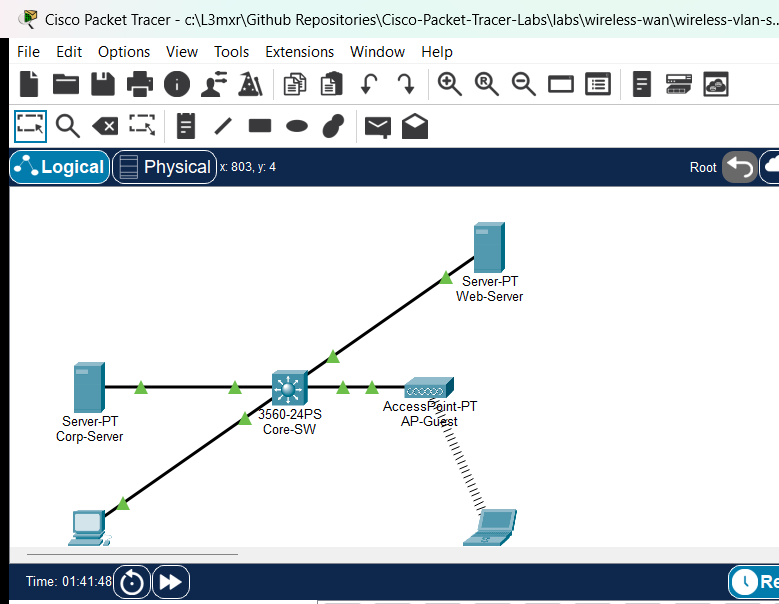

# Wireless VLAN Separation and Guest Access

## Learning Objectives
- Design and deploy isolated VLANs for corporate staff (VLAN 10) and guest wireless users (VLAN 20) on a Catalyst multilayer switch.
- Configure Switched Virtual Interfaces (SVIs) on the multilayer switch to serve as default gateways and enable inter-VLAN routing.
- Provision multi-pool Cisco IOS DHCP services on SVIs to dynamically allocate network parameters to corporate and guest clients.
- Integrate an autonomous 802.11 access point onto the designated guest access switchport to broadcast secure guest Wi-Fi.
- Construct and apply an Extended Access Control List (ACL) to restrict guest stations from accessing corporate staff hosts while preserving DMZ Internet access.
- Verify end-to-end positive connectivity for staff hosts and validate negative security controls blocking guest-to-corporate penetration.

## Prerequisites
- Completion of `PTL-0035` (WPA2 Wireless LAN Fundamentals).
- Solid foundation in VLAN concepts, 802.1Q trunking, and access port assignment (`PTL-0009` through `PTL-0011`).
- Understanding of Inter-VLAN Routing using Switched Virtual Interfaces (SVIs) and multilayer switching concepts (`PTL-0018`).
- Familiarity with Cisco IOS Extended Access Control List syntax and packet filtering logic (`PTL-0026`).

## Topology


The enterprise network topology demonstrates secure wireless guest segmentation:
- `Core-SW` (Cisco Catalyst 3560-24PS) acts as the Layer 3 core/distribution multilayer switch, routing traffic between VLANs and out to the DMZ via routed interface GigabitEthernet0/1 (`192.168.30.1/24`). It also provides centralized Cisco IOS DHCP services for both VLANs and enforces security filtering using an Extended ACL on the guest interface.
- `Corp-Server` (`Server-PT`) represents an internal corporate intranet repository (`192.168.10.100/24`) attached to Fa0/3 in Corporate VLAN 10.
- `Staff-PC` (`PC-PT`) is a corporate staff workstation attached to Fa0/2 in Corporate VLAN 10, receiving a dynamic IP via DHCP from pool `CORP-POOL`.
- `AP-Guest` (`AccessPoint-PT`) is an autonomous 802.11 access point connected to switchport Fa0/1 in Guest VLAN 20, broadcasting the guest wireless cell secured with WPA2-Personal (AES).
- `Guest-Laptop` (`Laptop-PT`) is a visitor station equipped with a wireless NIC (`PT-LAPTOP-NM-1W`), dynamically leasing an IP in Guest VLAN 20 from pool `GUEST-POOL`.
- `Web-Server` (`Server-PT`) represents a public DMZ web and DNS server (`192.168.30.100/24`) connected to routed port GigabitEthernet0/1.

## Addressing Table
| Device | Interface | IP Address | Subnet Mask | Default Gateway | Function / Description |
| :--- | :--- | :--- | :--- | :--- | :--- |
| `Core-SW` | Vlan10 (SVI) | `192.168.10.1` | `255.255.255.0` | N/A | Corporate VLAN Default Gateway |
| `Core-SW` | Vlan20 (SVI) | `192.168.20.1` | `255.255.255.0` | N/A | Guest VLAN Default Gateway & ACL Filter |
| `Core-SW` | Gi0/1 (Routed) | `192.168.30.1` | `255.255.255.0` | N/A | Uplink to DMZ Public Web Server |
| `Corp-Server` | FastEthernet0 | `192.168.10.100` | `255.255.255.0` | `192.168.10.1` | Corporate Intranet & File Server |
| `Web-Server` | FastEthernet0 | `192.168.30.100` | `255.255.255.0` | `192.168.30.1` | DMZ Public Web & DNS Server |
| `Staff-PC` | FastEthernet0 | DHCP (`192.168.10.11`+) | `255.255.255.0` | `192.168.10.1` | Corporate Staff Workstation (VLAN 10) |
| `AP-Guest` | Port 0 | N/A | N/A | N/A | FastEthernet Uplink to Core-SW Fa0/1 |
| `AP-Guest` | Port 1 | N/A | N/A | N/A | 802.11 2.4 GHz Radio (Guest Cell) |
| `Guest-Laptop` | Wireless0 | DHCP (`192.168.20.11`+) | `255.255.255.0` | `192.168.20.1` | Visitor Wireless Station (VLAN 20) |

## Lab Tasks
1. Verify starter configuration on `Core-SW`: SVIs `Vlan10` and `Vlan20`, routed interface `Gi0/1`, and switchport VLAN access assignments.
2. Enable Cisco IOS DHCP server services and configure distinct address pools for `CORP-POOL` and `GUEST-POOL` with appropriate gateway, DNS, and exclusion ranges.
3. Configure WPA2-Personal security with AES encryption on `AP-Guest` with passphrase `GuestWifiPass2026!`.
4. Equip `Guest-Laptop` with wireless module `PT-LAPTOP-NM-1W`, configure WPA2-PSK credentials, and verify dynamic IP acquisition.
5. Create and apply Extended Access Control List `GUEST-RESTRICTION` inbound on `interface Vlan20` to block guest traffic from reaching Corporate VLAN 10 while permitting DMZ access.
6. Verify staff full reachability to internal and DMZ assets, and verify guest access restrictions against corporate servers and workstations.

## Configuration Walkthrough

### 1. Multilayer Switch Baseline and SVI Routing
On `Core-SW`, enable IP routing, define the VLAN database, configure access ports, and provision SVIs:
```cisco
Core-SW# configure terminal
Core-SW(config)# hostname Core-SW
Core-SW(config)# ip routing
Core-SW(config)# vlan 10
Core-SW(config-vlan)# name Corporate-VLAN
Core-SW(config-vlan)# vlan 20
Core-SW(config-vlan)# name Guest-VLAN
Core-SW(config-vlan)# exit

Core-SW(config)# interface FastEthernet0/1
Core-SW(config-if)# description AP-Guest Access Port (VLAN 20)
Core-SW(config-if)# switchport mode access
Core-SW(config-if)# switchport access vlan 20
Core-SW(config-if)# spanning-tree portfast
Core-SW(config-if)# no shutdown

Core-SW(config)# interface FastEthernet0/2
Core-SW(config-if)# description Staff-PC Access Port (VLAN 10)
Core-SW(config-if)# switchport mode access
Core-SW(config-if)# switchport access vlan 10
Core-SW(config-if)# spanning-tree portfast
Core-SW(config-if)# no shutdown

Core-SW(config)# interface FastEthernet0/3
Core-SW(config-if)# description Corp-Server Access Port (VLAN 10)
Core-SW(config-if)# switchport mode access
Core-SW(config-if)# switchport access vlan 10
Core-SW(config-if)# spanning-tree portfast
Core-SW(config-if)# no shutdown

Core-SW(config)# interface Vlan10
Core-SW(config-if)# description Corporate Default Gateway
Core-SW(config-if)# ip address 192.168.10.1 255.255.255.0
Core-SW(config-if)# no shutdown

Core-SW(config)# interface Vlan20
Core-SW(config-if)# description Guest Default Gateway
Core-SW(config-if)# ip address 192.168.20.1 255.255.255.0
Core-SW(config-if)# no shutdown

Core-SW(config)# interface GigabitEthernet0/1
Core-SW(config-if)# description Routed Port to Web-Server (DMZ)
Core-SW(config-if)# no switchport
Core-SW(config-if)# ip address 192.168.30.1 255.255.255.0
Core-SW(config-if)# no shutdown
Core-SW(config-if)# exit
```

### 2. Multi-Pool Cisco IOS DHCP Provisioning
Configure address pools for corporate staff and guest wireless clients:
```cisco
Core-SW(config)# service dhcp
Core-SW(config)# ip dhcp excluded-address 192.168.10.1 192.168.10.10
Core-SW(config)# ip dhcp excluded-address 192.168.10.100
Core-SW(config)# ip dhcp excluded-address 192.168.20.1 192.168.20.10

Core-SW(config)# ip dhcp pool CORP-POOL
Core-SW(dhcp-config)# network 192.168.10.0 255.255.255.0
Core-SW(dhcp-config)# default-router 192.168.10.1
Core-SW(dhcp-config)# dns-server 192.168.30.100
Core-SW(dhcp-config)# domain-name corpwifi.local
Core-SW(dhcp-config)# exit

Core-SW(config)# ip dhcp pool GUEST-POOL
Core-SW(dhcp-config)# network 192.168.20.0 255.255.255.0
Core-SW(dhcp-config)# default-router 192.168.20.1
Core-SW(dhcp-config)# dns-server 192.168.30.100
Core-SW(dhcp-config)# domain-name guestwifi.local
Core-SW(dhcp-config)# exit
```

### 3. Extended Access Control List Policy
Implement security boundaries preventing guests from reaching corporate assets while permitting DHCP, DNS, Web, and diagnostic ICMP to the DMZ:
```cisco
Core-SW(config)# ip access-list extended GUEST-RESTRICTION
Core-SW(config-ext-nacl)# remark Permit DHCP requests from guests to local gateway
Core-SW(config-ext-nacl)# permit udp any any eq bootps
Core-SW(config-ext-nacl)# remark Permit DNS queries to DMZ server
Core-SW(config-ext-nacl)# permit udp any host 192.168.30.100 eq domain
Core-SW(config-ext-nacl)# remark Permit Web traffic to DMZ server
Core-SW(config-ext-nacl)# permit tcp any host 192.168.30.100 eq www
Core-SW(config-ext-nacl)# permit tcp any host 192.168.30.100 eq 443
Core-SW(config-ext-nacl)# remark Permit ICMP diagnostics to DMZ server
Core-SW(config-ext-nacl)# permit icmp any host 192.168.30.100
Core-SW(config-ext-nacl)# remark Explicitly deny guest access to Corporate Staff VLAN 10
Core-SW(config-ext-nacl)# deny ip 192.168.20.0 0.0.0.255 192.168.10.0 0.0.0.255
Core-SW(config-ext-nacl)# remark Permit guest access to any other external networks
Core-SW(config-ext-nacl)# permit ip 192.168.20.0 0.0.0.255 any
Core-SW(config-ext-nacl)# exit

Core-SW(config)# interface Vlan20
Core-SW(config-if)# ip access-group GUEST-RESTRICTION in
Core-SW(config-if)# end
Core-SW# write memory
```

### 4. Wireless Access Point and Client Security
Configure `AP-Guest` Port 1 radio with WPA2-PSK (AES) and associate `Guest-Laptop`:
1. On `AP-Guest`, select **Config** > **Port 1**:
   - Set **Authentication** to `WPA2-PSK`.
   - Set **Encryption Type** to `AES`.
   - Set **PSK Pass Phrase** to `GuestWifiPass2026!`.
2. On `Guest-Laptop`, install the `PT-LAPTOP-NM-1W` module, enable DHCP, and configure matching WPA2-PSK credentials.

## Verification
Confirm all positive and negative security criteria:

1. **Inspect Multilayer Switch Gateways and DHCP Status:**
   ```cisco
   Core-SW# show ip interface brief | exclude Fast
   Core-SW# show ip dhcp pool
   ```
2. **Verify Corporate Staff Connectivity:**
   On `Staff-PC`, execute `ipconfig` to verify lease `192.168.10.11`, then ping internal server `192.168.10.100` and external web server `192.168.30.100` (both succeed with 0% loss).
3. **Verify Guest Wireless Connectivity:**
   On `Guest-Laptop`, execute `ipconfig` to verify lease `192.168.20.11`, then ping DMZ web server `192.168.30.100` (succeeds with 0% loss).
4. **Validate Security Isolation:**
   From `Guest-Laptop`, attempt to ping internal `Corp-Server` (`192.168.10.100`) and `Staff-PC` (`192.168.10.11`). Both attempts must return `Destination host unreachable` (100% loss) from gateway `192.168.20.1`.

For complete test execution logs and POS/NEG test matrices, see [verification.md](verification.md).

## Troubleshooting
- **Guest Station Receives 169.254.x.x (APIPA):** Ensure switchport `FastEthernet0/1` is assigned to `Vlan 20`, spanning-tree PortFast is active, and the `GUEST-POOL` network range is configured correctly on `Core-SW`. Verify the ACL permits `bootps` (`permit udp any any eq bootps`) so DHCP discover frames reach the router process.
- **Guest Station Can Reach Corporate Intranet:** Verify that `ip access-group GUEST-RESTRICTION in` is applied to `interface Vlan20` (not Vlan10 or outbound). Extended ACLs applied inbound inspect source IP headers before routing logic forwards packets.
- **Wireless Authentication Fails:** Ensure both `AP-Guest` and `Guest-Laptop` use matching encryption algorithms (AES) and identical pre-shared keys (`GuestWifiPass2026!`).

## Key Takeaways
- Guest wireless isolation requires a defense-in-depth approach combining Layer 2 VLAN segmentation and Layer 3 Access Control List packet filtering.
- Autonomous access points can be directly mapped to dedicated guest access switchports, eliminating the need to expose internal 802.1Q trunking to unmanaged wireless cells.
- Applying Extended ACLs as close to the source as possible (inbound on the Guest SVI) minimizes unnecessary routing overhead and blocks malicious internal probing at the gateway boundary.

### Command Reference
| Command | Mode | Purpose |
| :--- | :--- | :--- |
| `ip routing` | Global Config | Enables Layer 3 IP routing on Catalyst multilayer switches |
| `interface Vlan <id>` | Global Config | Creates and enters Switched Virtual Interface configuration mode |
| `no switchport` | Interface Config | Converts a Layer 2 switchport into a routed Layer 3 port |
| `service dhcp` | Global Config | Activates the Cisco IOS DHCP server process |
| `ip dhcp pool <name>` | Global Config | Configures a dynamic DHCP addressing pool |
| `ip access-list extended <name>` | Global Config | Defines a named Extended Access Control List |
| `ip access-group <name> in` | Interface Config | Activates the ACL filter inbound on the interface |

## References
- [Cisco Catalyst 3560 Switch Software Configuration Guide - VLANs](https://www.cisco.com/c/en/us/td/docs/switches/lan/catalyst3560/software/release/12-2_55_se/configuration/guide/3560_scg/swvlan.html)
- [Cisco IOS Extended Access Lists Configuration Guide](https://www.cisco.com/c/en/us/support/docs/security/ios-firewall/23602-confaccesslists.html)
- [Cisco CCNA 200-301 Official Cert Guide - Wireless Architectures and Security](https://learningnetwork.cisco.com/s/ccna-exam-topics)

## Files and Validation Status
| File | Description | Status |
| :--- | :--- | :--- |
| `assets/starter.pkt` | Baseline topology with SVIs and VLAN assignments; ready for DHCP and ACL configuration | Validated |
| `assets/completed.pkt` | Fully configured topology with DHCP pools, WPA2-PSK security, and ACL filtering | Validated |
| `assets/topology.png` | Visual network diagram captured from Packet Tracer canvas | Validated |
| `configs/Core-SW.txt` | Complete running configuration for Catalyst 3560 Core Switch | Validated |
| `metadata.json` | Structured metadata adhering to repository standards | Validated |
| `verification.md` | Detailed positive and negative verification evidence | Validated |
