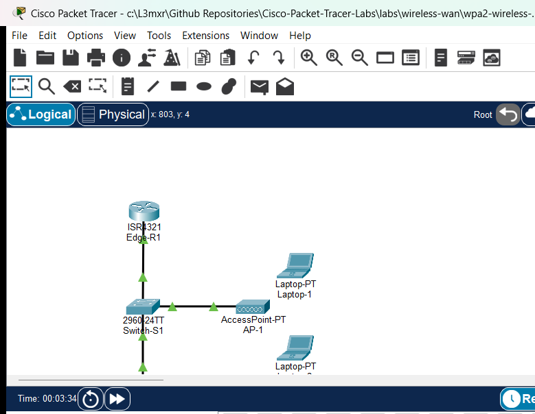

# WPA2 Wireless LAN Fundamentals

## Learning Objectives
- Deploy and configure an autonomous 802.11 wireless access point (`AccessPoint-PT`) integrated with switched Ethernet infrastructure.
- Secure the wireless local area network using WPA2-Personal (Pre-Shared Key) and Advanced Encryption Standard (AES) cipher suites.
- Implement Cisco IOS DHCP address pool services on an upstream default gateway router to lease IPv4 parameters to wireless stations.
- Equip and configure portable client hosts with 802.11 wireless network interface modules (`PT-LAPTOP-NM-1W`).
- Verify successful 802.11 association, dynamic IP acquisition, and end-to-end IP reachability from wireless stations to wired intranet servers.
- Test and document negative authentication scenarios demonstrating that incorrect Pre-Shared Keys are blocked from network association.

## Prerequisites
- Familiarity with basic IPv4 addressing, subnet masking, and default gateway concepts from `PTL-0014` and `PTL-0015`.
- Understanding of Layer 2 Ethernet switching and PortFast concepts from `PTL-0009` and `PTL-0017`.
- Basic understanding of Cisco IOS DHCP server configuration from `PTL-0012`.

## Topology


The topology models a small enterprise wireless local area network integrated with a switched corporate campus:
- `Edge-R1` (Cisco ISR 4321) serves as the default gateway router for the LAN (`192.168.10.1/24`) and provides centralized Cisco IOS DHCP services via address pool `WLAN-POOL`.
- `Switch-S1` (Cisco Catalyst 2960-24TT) provides access layer Ethernet switching, with ports configured with `spanning-tree portfast` to accelerate wireless host association and eliminate STP forward delays.
- `AP-1` (`AccessPoint-PT`) is a standalone autonomous access point bridging 802.11 wireless frames onto the wired Ethernet infrastructure.
- `Wired-Server` (`Server-PT`) represents a corporate intranet file and web server (`192.168.10.100/24`).
- `Laptop-1` is an authorized mobile workstation equipped with a wireless NIC and configured with the valid WPA2-PSK key.
- `Laptop-2` is an unauthorized host configured with an invalid pre-shared key to test security boundary enforcement.

## Addressing Table
| Device | Interface | IP Address | Subnet Mask | Default Gateway | Function / Description |
| :--- | :--- | :--- | :--- | :--- | :--- |
| `Edge-R1` | Gi0/0/0 | `192.168.10.1` | `255.255.255.0` | N/A | LAN Default Gateway & DHCP Server |
| `Switch-S1` | VLAN 1 (SVI) | `192.168.10.2` | `255.255.255.0` | `192.168.10.1` | Management Switch Virtual Interface |
| `Wired-Server` | FastEthernet0 | `192.168.10.100` | `255.255.255.0` | `192.168.10.1` | Corporate Web and File Server |
| `AP-1` | Port 0 | N/A | N/A | N/A | 10/100 Ethernet Uplink to Switch Fa0/2 |
| `AP-1` | Port 1 | N/A | N/A | N/A | 802.11b/g 2.4 GHz Radio Interface (Ch 6) |
| `Laptop-1` | Wireless0 | DHCP (`192.168.10.11`+) | `255.255.255.0` | `192.168.10.1` | Authorized Corporate Wireless Station |
| `Laptop-2` | Wireless0 | DHCP (Lease Blocked) | `255.255.255.0` | `192.168.10.1` | Unauthorized Client (Authentication Failure) |

## Lab Tasks
1. Verify starter topology infrastructure: `Edge-R1` and `Switch-S1` addressed and active, and `Wired-Server` reachable via ping.
2. Install 2.4 GHz 802.11 wireless modules (`PT-LAPTOP-NM-1W`) into `Laptop-1` and `Laptop-2`.
3. Configure WPA2-Personal security with AES encryption on `AP-1` using pre-shared key `CiscoLabKey2026!`.
4. Configure `Laptop-1` with valid WPA2-PSK credentials and dynamic DHCP addressing.
5. Configure `Laptop-2` with invalid WPA2 credentials (`InvalidPass999!`) to verify authentication rejection.
6. Verify 802.11 association, DHCP address leasing, and end-to-end ping reachability to gateway and wired server.

## Configuration Walkthrough

### 1. Configure Edge-R1 DHCP Services
On `Edge-R1`, configure the interface uplink and create the dynamic address pool:
```cisco
Edge-R1# configure terminal
Edge-R1(config)# interface GigabitEthernet0/0/0
Edge-R1(config-if)# description Uplink to Switch-S1 Fa0/1
Edge-R1(config-if)# ip address 192.168.10.1 255.255.255.0
Edge-R1(config-if)# no shutdown
Edge-R1(config-if)# exit
Edge-R1(config)# ip dhcp excluded-address 192.168.10.1 192.168.10.10
Edge-R1(config)# ip dhcp excluded-address 192.168.10.100
Edge-R1(config)# ip dhcp pool WLAN-POOL
Edge-R1(dhcp-config)# network 192.168.10.0 255.255.255.0
Edge-R1(dhcp-config)# default-router 192.168.10.1
Edge-R1(dhcp-config)# dns-server 192.168.10.1
Edge-R1(dhcp-config)# domain-name ciscolab.local
Edge-R1(dhcp-config)# end
Edge-R1# copy running-config startup-config
```

### 2. Configure Switch-S1 with PortFast
On `Switch-S1`, configure access ports with `spanning-tree portfast` to eliminate 30-second STP forward delays when wireless stations associate:
```cisco
Switch-S1# configure terminal
Switch-S1(config)# interface FastEthernet0/1
Switch-S1(config-if)# description Uplink to Edge-R1 Gi0/0/0
Switch-S1(config-if)# switchport mode access
Switch-S1(config-if)# spanning-tree portfast
Switch-S1(config-if)# no shutdown
Switch-S1(config-if)# exit
Switch-S1(config)# interface FastEthernet0/2
Switch-S1(config-if)# description Access Point AP-1 Port 0
Switch-S1(config-if)# switchport mode access
Switch-S1(config-if)# spanning-tree portfast
Switch-S1(config-if)# no shutdown
Switch-S1(config-if)# exit
Switch-S1(config)# interface FastEthernet0/3
Switch-S1(config-if)# description Wired Server FastEthernet0
Switch-S1(config-if)# switchport mode access
Switch-S1(config-if)# spanning-tree portfast
Switch-S1(config-if)# no shutdown
Switch-S1(config-if)# exit
Switch-S1(config)# interface vlan 1
Switch-S1(config-if)# ip address 192.168.10.2 255.255.255.0
Switch-S1(config-if)# no shutdown
Switch-S1(config-if)# exit
Switch-S1(config)# ip default-gateway 192.168.10.1
Switch-S1(config)# end
Switch-S1# copy running-config startup-config
```

### 3. Configure AP-1 Wireless Security
On `AP-1`, navigate to **Port 1** (2.4 GHz radio) and apply WPA2-Personal settings:
- **Port Status:** On
- **Channel:** 6 (2.437 GHz)
- **Authentication:** WPA2-PSK
- **Encryption:** AES
- **PSK Pass Phrase:** `CiscoLabKey2026!`

### 4. Configure Client Laptops
1. On `Laptop-1`, power off the device, insert `PT-LAPTOP-NM-1W`, and power it on. Configure **Wireless0** for WPA2-PSK AES with key `CiscoLabKey2026!`, and enable DHCP.
2. On `Laptop-2`, power off the device, insert `PT-LAPTOP-NM-1W`, and power it on. Configure **Wireless0** for WPA2-PSK AES with invalid key `InvalidPass999!`, and enable DHCP.

## Verification

### 1. Verify Edge-R1 DHCP Address Leases
Inspect active client address bindings on `Edge-R1` to confirm dynamic address issuance:
```cisco
Edge-R1# show ip dhcp binding
IP address       Client-ID/              Lease expiration        Type
                 Hardware address
192.168.10.11    0060.2f18.364c          --                      Automatic
```

### 2. Verify Laptop-1 IP Configuration and Gateway Reachability
On `Laptop-1`, open the **Command Prompt** and verify the dynamically acquired IP parameters:
```cmd
C:\> ipconfig

Wireless0 Connection:
   Connection-specific DNS Suffix..: ciscolab.local
   Link-local IPv6 Address.........: FE80::2E0:F9FF:FE49:5BCE
   IPv4 Address....................: 192.168.10.11
   Subnet Mask.....................: 255.255.255.0
   Default Gateway.................: 192.168.10.1
```

Verify reachability to the default router:
```cmd
C:\> ping 192.168.10.1

Pinging 192.168.10.1 with 32 bytes of data:

Reply from 192.168.10.1: bytes=32 time=10ms TTL=255
Reply from 192.168.10.1: bytes=32 time=13ms TTL=255
Reply from 192.168.10.1: bytes=32 time=10ms TTL=255
Reply from 192.168.10.1: bytes=32 time=7ms TTL=255

Ping statistics for 192.168.10.1:
    Packets: Sent = 4, Received = 4, Lost = 0 (0% loss)
```

### 3. Verify End-to-End Wireless-to-Wired Access
Ping `Wired-Server` (`192.168.10.100`) from `Laptop-1` across the access point and switched boundary:
```cmd
C:\> ping 192.168.10.100

Pinging 192.168.10.100 with 32 bytes of data:

Reply from 192.168.10.100: bytes=32 time=11ms TTL=128
Reply from 192.168.10.100: bytes=32 time=10ms TTL=128
Reply from 192.168.10.100: bytes=32 time=7ms TTL=128
Reply from 192.168.10.100: bytes=32 time=12ms TTL=128

Ping statistics for 192.168.10.100:
    Packets: Sent = 4, Received = 4, Lost = 0 (0% loss)
```

### 4. Verify Unauthorized Client Rejection (Negative Testing)
On `Laptop-2`, verify that the station fails 802.11 4-way handshake authentication and cannot acquire an address or transmit traffic:
```cmd
C:\> ipconfig

Wireless0 Connection:
   Autoconfiguration IPv4 Address..: 169.254.4.160
   Subnet Mask.....................: 255.255.0.0
   Default Gateway.................: 0.0.0.0

C:\> ping 192.168.10.100

Pinging 192.168.10.100 with 32 bytes of data:

Request timed out.
Request timed out.
Request timed out.
Request timed out.

Ping statistics for 192.168.10.100:
    Packets: Sent = 4, Received = 0, Lost = 4 (100% loss)
```

For complete automated test evidence, see [verification.md](verification.md).

## Troubleshooting
- **Wireless station receives 169.254.x.x (APIPA):** WPA2 passphrase mismatch or switch port STP delay. Verify WPA2-PSK key spelling on client matches AP exactly. Check `Switch-S1` port Fa0/2: ensure `spanning-tree portfast` is enabled so DHCP requests are not dropped during STP Listening/Learning.
- **No RF waves appear between AP and Laptop:** Physical module unpowered or coverage distance exceeded. Verify laptop power switch is ON. `AccessPoint-PT` coverage radius is 140 pixels in Packet Tracer; ensure station is placed within RF range of the AP.
- **Client associates but cannot ping Wired-Server:** Server gateway misconfiguration or switch VLAN isolation. Check `Wired-Server` default gateway is set to `192.168.10.1`. Ensure switchports Fa0/2 and Fa0/3 are in the same access VLAN (VLAN 1).
- **Client pings gateway but fails DNS resolution:** DHCP pool missing DNS option. Inspect `show run | section dhcp` on `Edge-R1`; verify `dns-server 192.168.10.1` is configured in pool `WLAN-POOL`.

## Key Takeaways
- **Autonomous vs Lightweight Architecture:** Standalone access points (`AccessPoint-PT`) manage RF configuration, SSID broadcasting, and encryption locally on the device without requiring a Wireless LAN Controller (WLC).
- **WPA2-Personal (PSK):** Uses a shared secret passphrase combined with the SSID to derive Pairwise Master Keys (PMK) and Pairwise Transient Keys (PTK) via the 802.11 4-way handshake.
- **AES vs TKIP:** AES (Counter Mode CBC-MAC Protocol / CCMP) provides robust cryptographic integrity and confidentiality, replacing deprecated WEP and WPA-TKIP cipher suites.
- **Switch PortFast Necessity:** Connecting access points to switch ports configured with `spanning-tree portfast` prevents 30-second STP forward delays when stations associate or when AP links flap, ensuring rapid DHCP address negotiation.

### Command Reference
| Command | Execution Context | Purpose |
| :--- | :--- | :--- |
| `ip dhcp pool <name>` | Global Configuration | Creates or enters a DHCP pool definition |
| `network <network-id> <subnet-mask>` | DHCP Configuration | Specifies the subnet address range for dynamic leases |
| `default-router <ip-address>` | DHCP Configuration | Configures the default gateway option handed to DHCP clients |
| `ip dhcp excluded-address <low> [high]` | Global Configuration | Reserves static IP addresses from being leased dynamically |
| `show ip dhcp binding` | Privileged EXEC | Displays active IP-to-MAC/DUID DHCP lease bindings |
| `show ip dhcp pool` | Privileged EXEC | Displays DHCP pool statistics and utilization |
| `spanning-tree portfast` | Interface Configuration | Bypasses STP Listening and Learning states for edge host/AP ports |
| `ipconfig` / `ipconfig /renew` | Windows/PC Command Line | Inspects or requests renewal of dynamic IP interface parameters |

## References
- [Cisco Aironet Access Point WPA2 Configuration Guide](https://www.cisco.com/c/en/us/support/docs/wireless/aironet-1200-series/29494-wpa2-psk-config.html)
- [Cisco Catalyst 2960 Switch PortFast Configuration Guide](https://www.cisco.com/c/en/us/td/docs/switches/lan/catalyst2960/software/release/12-2_55_se/configuration/guide/scg_2960/swstp.html)
- [Cisco CCNA Exam Topics (Topic 2.6: Configure and verify wireless LAN using WPA2 PSK GUI)](https://learningnetwork.cisco.com/s/ccna-exam-topics)

## Files and Validation Status
- **Starter Topology:** [assets/starter.pkt](assets/starter.pkt)
- **Completed Topology:** [assets/completed.pkt](assets/completed.pkt)
- **Topology Diagram:** [assets/topology.png](assets/topology.png)
- **Edge-R1 Running Config:** [configs/Edge-R1.txt](configs/Edge-R1.txt)
- **Switch-S1 Running Config:** [configs/Switch-S1.txt](configs/Switch-S1.txt)
- **Simulator Results Evidence:** [PTL-0035-SIMULATOR-RESULTS.md](../../../AI_AGENT_GUIDE/state/PTL-0035-SIMULATOR-RESULTS.md)
- **Validation Status:** Simulator tested and verified in Packet Tracer 9.0.1. All positive and negative test cases passing.
